# Episode 01 — complete illustrated storyboard gallery

**20 sheets / 80 labeled shot illustrations.** Each sheet contains four panels in reading order: top-left, top-right, bottom-left, bottom-right. See the [creator approval record](../Shared_Resources/Archive/CURRENT_PRODUCTION_STATUS.md) for reviewed panels. Individual motion first frames require separate approval.

[Open HTML gallery](storyboards/index.html) · [Shot-by-shot index](../Shared_Resources/Archive/Episode_01/STORYBOARD_INDEX.md) · [Generation and review notes](storyboards/GENERATION_NOTES.md)

## BOARD_01 — SHOT_001–SHOT_004

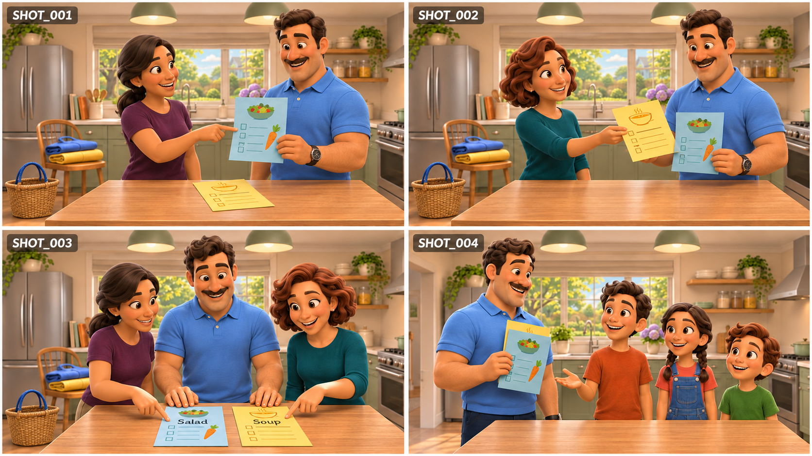

SHOT_001: The blue salad note · SHOT_002: A second dish, a second color · SHOT_003: The headings are clear · SHOT_004: Three helpers arrive

## BOARD_02 — SHOT_005–SHOT_008

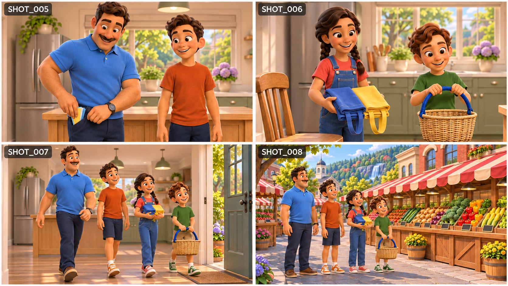

SHOT_005: A filing error in Dad's head · SHOT_006: The empty containers · SHOT_007: Ready, including the basket · SHOT_008: One sunny market

## BOARD_03 — SHOT_009–SHOT_012

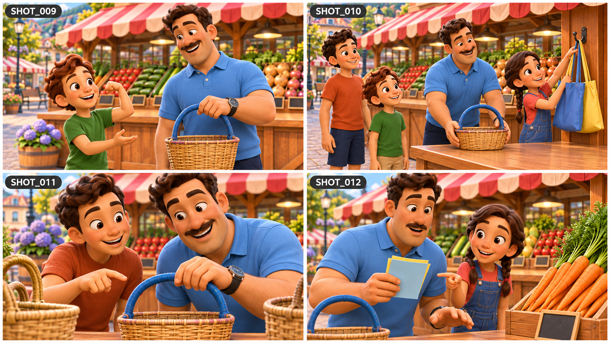

SHOT_009: Saving the small muscles · SHOT_010: Make room to choose · SHOT_011: Our own blue handle · SHOT_012: Four, not forty

## BOARD_04 — SHOT_013–SHOT_016

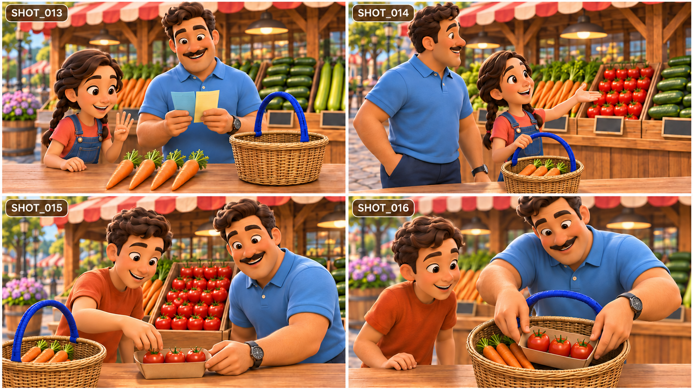

SHOT_013: Four distinct carrots · SHOT_014: Leave the extras in the crate · SHOT_015: Three tomatoes need a tray · SHOT_016: A careful place for tomatoes

## BOARD_05 — SHOT_017–SHOT_020

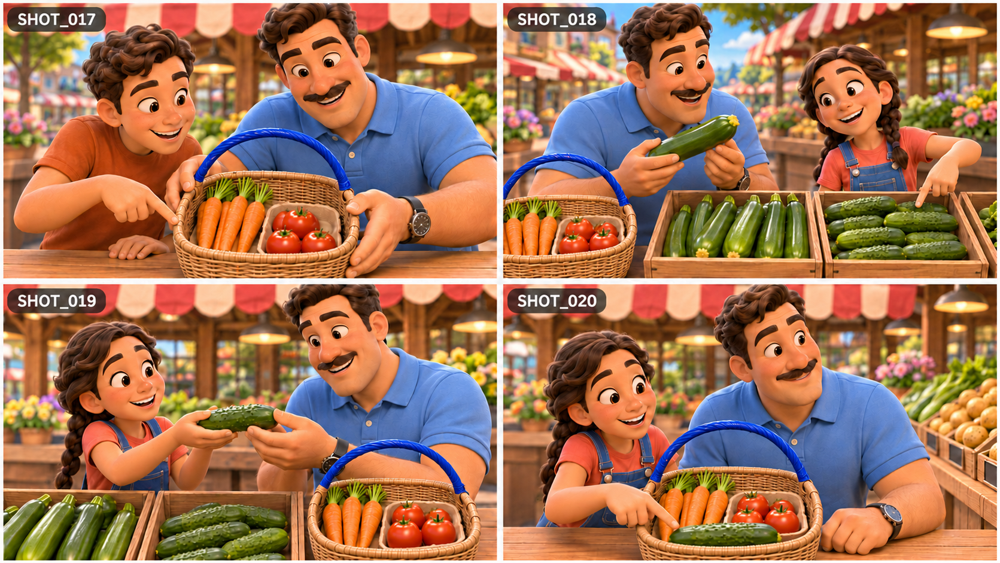

SHOT_017: Packing is part of the plan · SHOT_018: The wrong green cousin · SHOT_019: One cucumber, correctly introduced · SHOT_020: Use more than a guess

## BOARD_06 — SHOT_021–SHOT_024

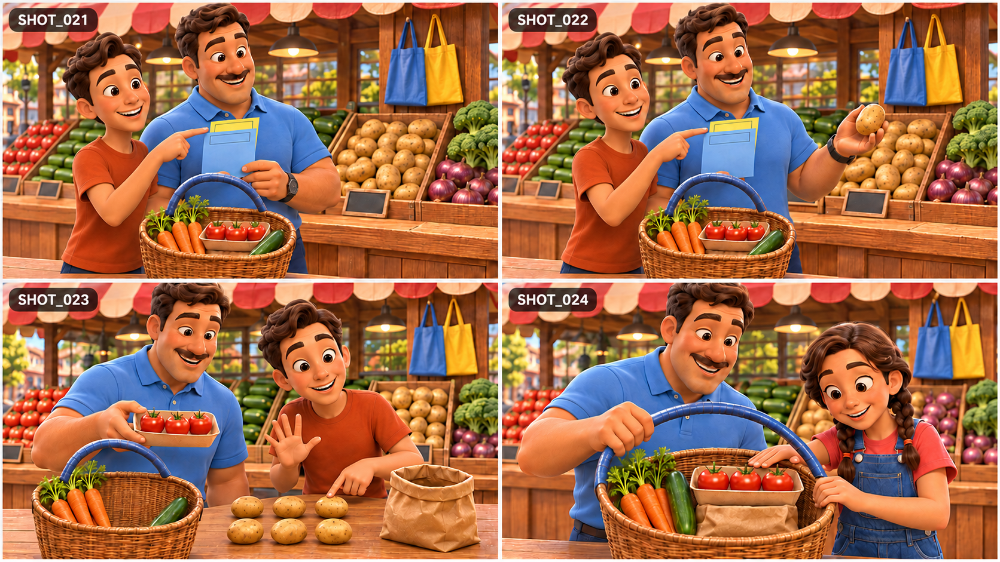

SHOT_021: The yellow note waits its turn · SHOT_022: Potatoes raise a question · SHOT_023: Six potatoes underneath · SHOT_024: A place for each thing

## BOARD_07 — SHOT_025–SHOT_028

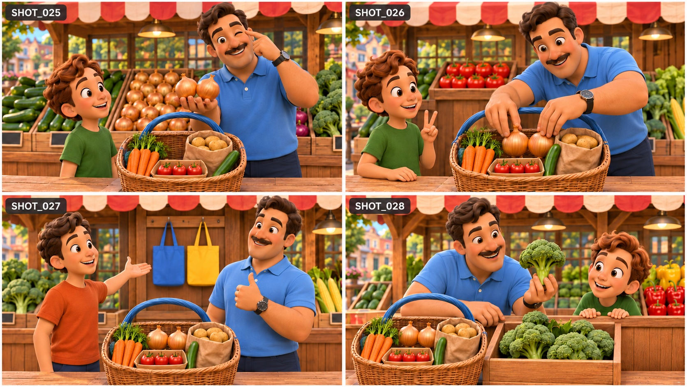

SHOT_025: The uncut onion joke · SHOT_026: Two onions join the sack · SHOT_027: Leave the question open · SHOT_028: A small green forest

## BOARD_08 — SHOT_029–SHOT_032

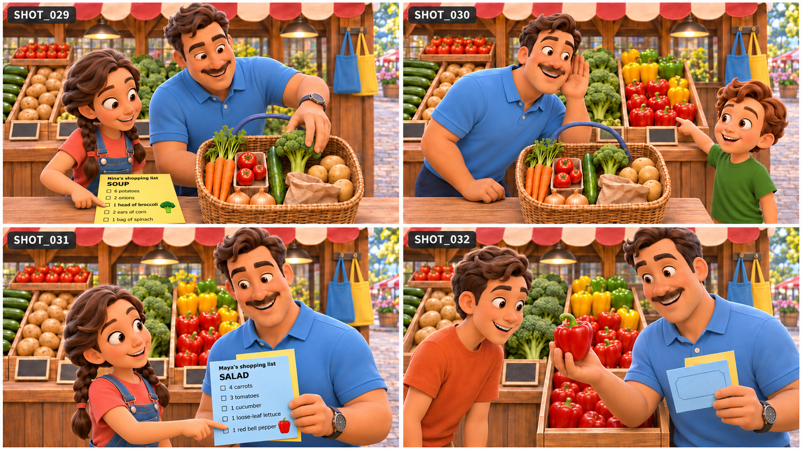

SHOT_029: One broccoli head · SHOT_030: A bell that stays quiet · SHOT_031: Color is part of the request · SHOT_032: Look gently before choosing

## BOARD_09 — SHOT_033–SHOT_036

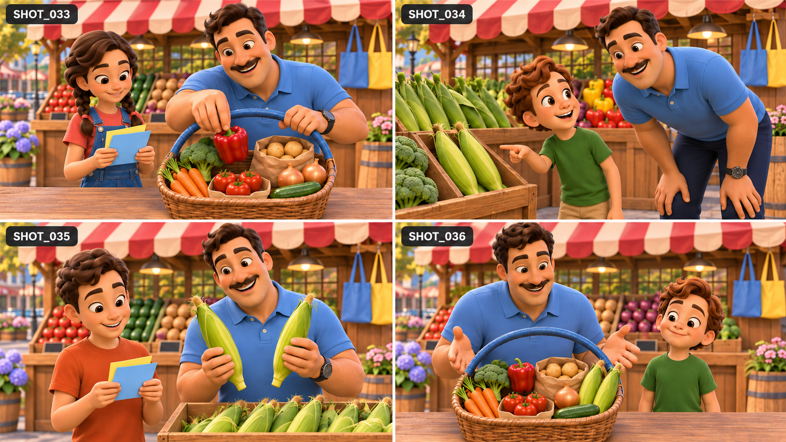

SHOT_033: The red pepper has a place · SHOT_034: Corn with ears · SHOT_035: Two ears, one careful choice · SHOT_036: A polite pair in the basket

## BOARD_10 — SHOT_037–SHOT_040

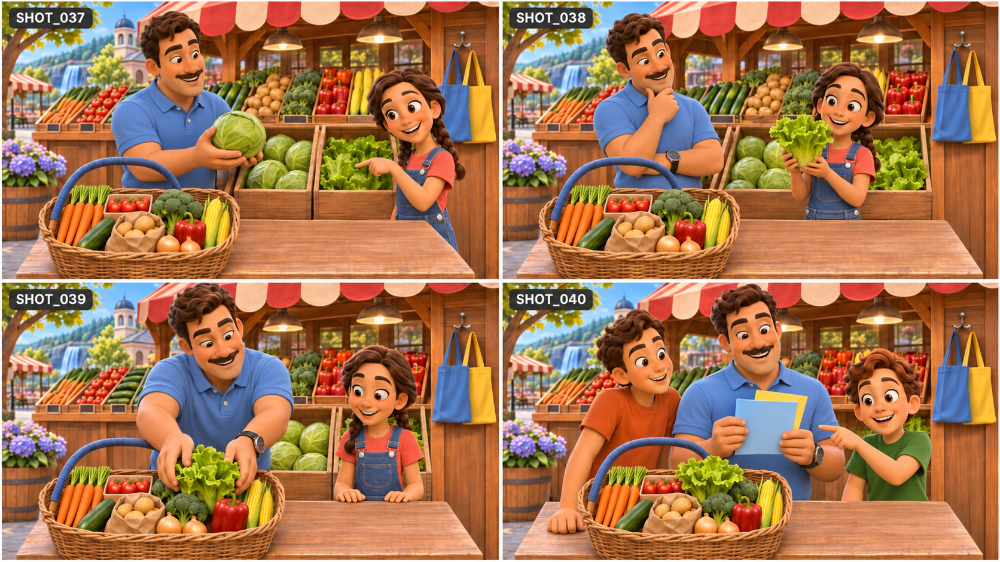

SHOT_037: The round green guess · SHOT_038: Leaves with a different shape · SHOT_039: Protect the leaves on top · SHOT_040: Almost the whole list

## BOARD_11 — SHOT_041–SHOT_044

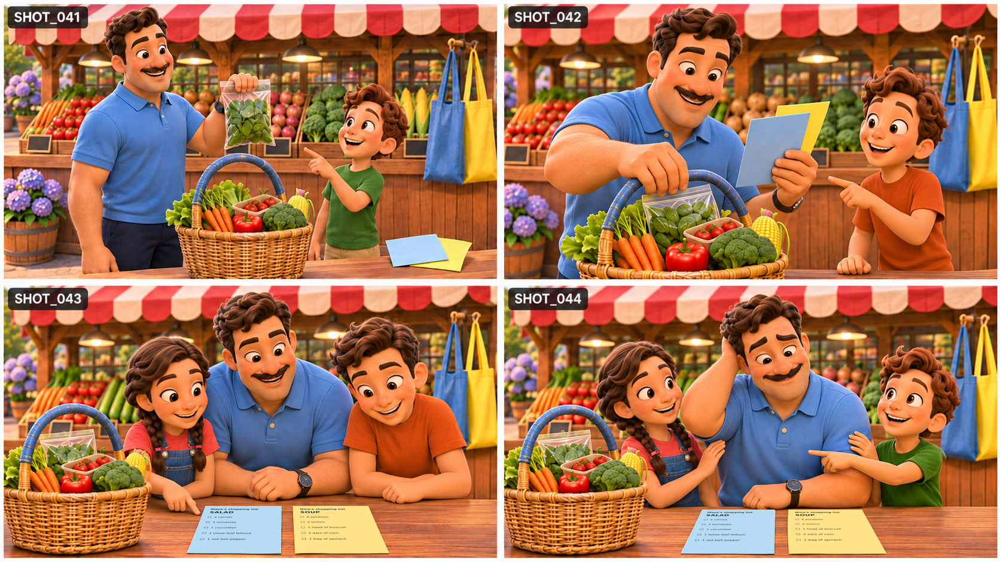

SHOT_041: The last bag of leaves · SHOT_042: All ten ingredients · SHOT_043: Give both headings some room · SHOT_044: The mistake was in the memory

## BOARD_12 — SHOT_045–SHOT_048

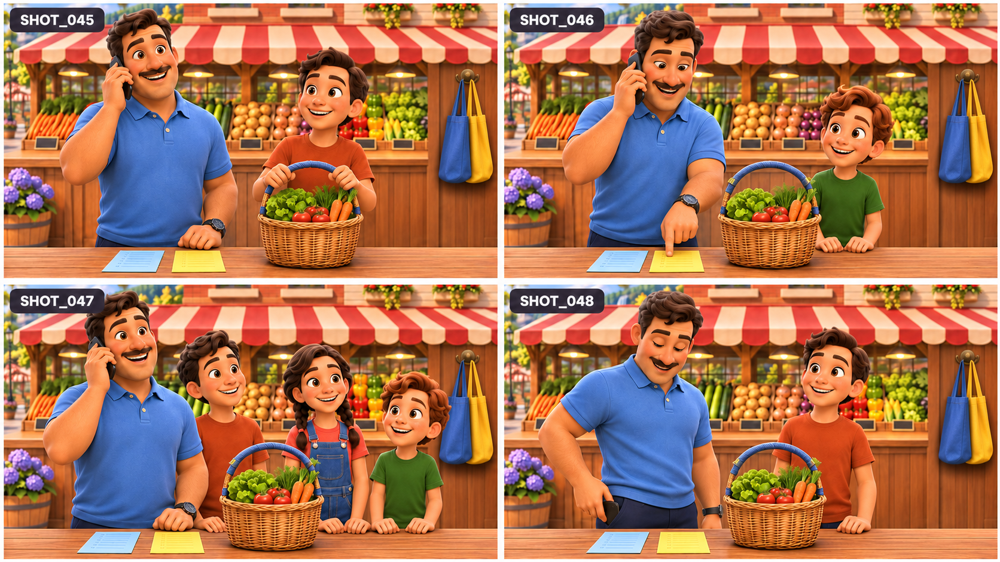

SHOT_045: Check with Maya · SHOT_046: Nina confirms her soup · SHOT_047: Help is part of the plan · SHOT_048: The call has done its job

## BOARD_13 — SHOT_049–SHOT_052

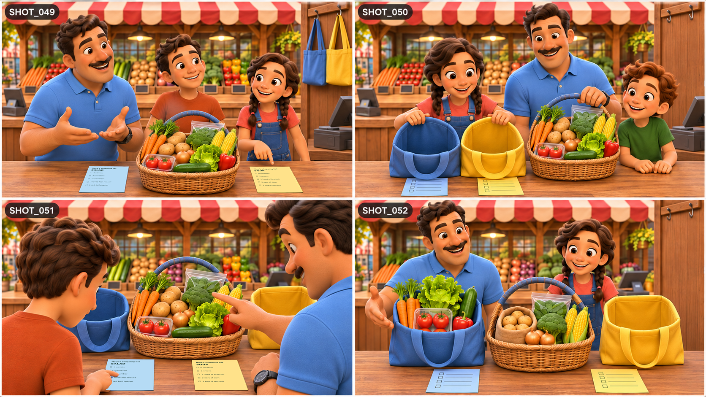

SHOT_049: Say it honestly · SHOT_050: Two empty totes, ready · SHOT_051: Read, group, then pack · SHOT_052: Maya's salad goes in BLUE

## BOARD_14 — SHOT_053–SHOT_056

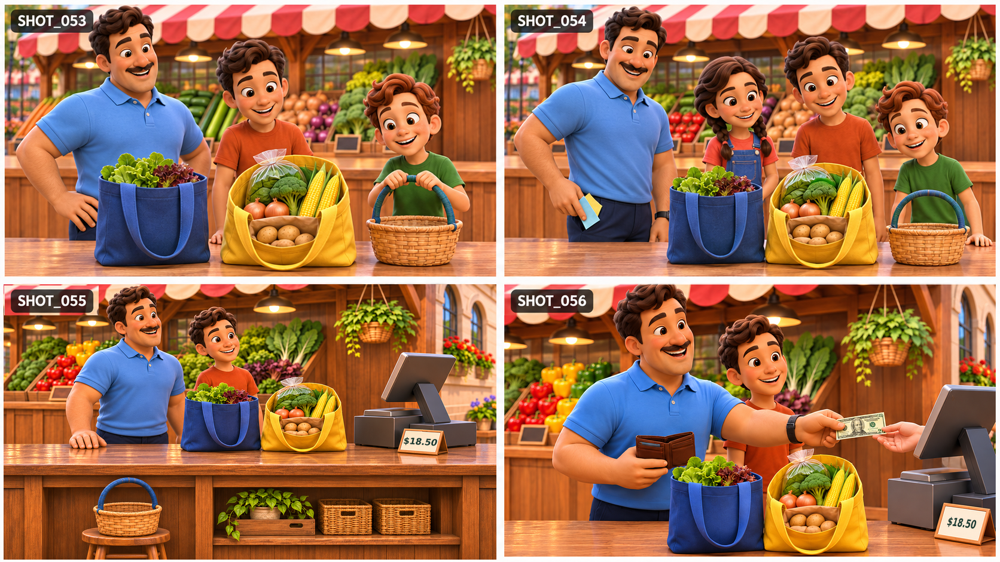

SHOT_053: Nina's soup goes in YELLOW · SHOT_054: Colors and contents agree · SHOT_055: The total is eighteen fifty · SHOT_056: One twenty-dollar payment

## BOARD_15 — SHOT_057–SHOT_060

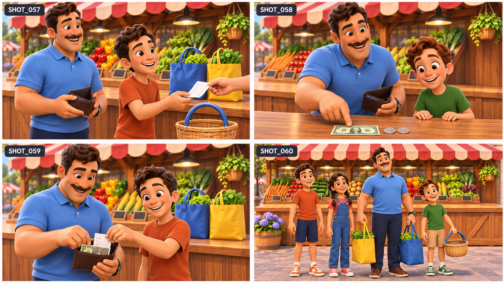

SHOT_057: A receipt worth reading · SHOT_058: One dollar and two quarters · SHOT_059: Receipt, change, wallet · SHOT_060: Ready to carry home

## BOARD_16 — SHOT_061–SHOT_064

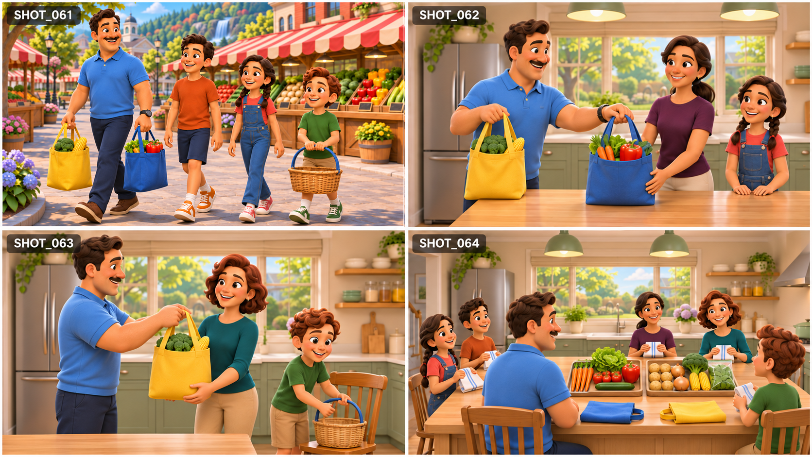

SHOT_061: Four shoppers, safely homeward · SHOT_062: Maya gets the BLUE tote · SHOT_063: Nina gets the YELLOW tote · SHOT_064: One kitchen, two preparation areas

## BOARD_17 — SHOT_065–SHOT_068

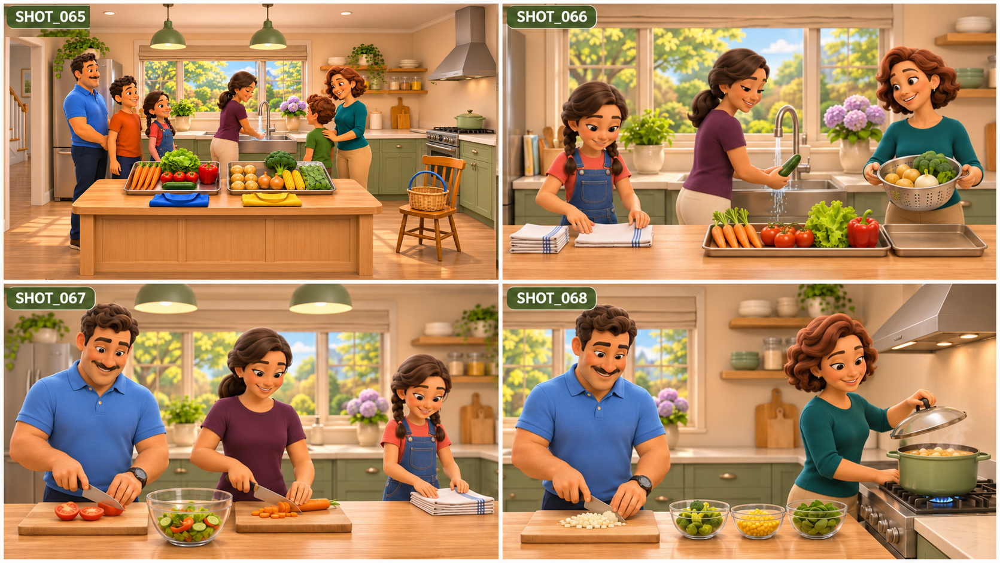

SHOT_065: Clean hands for the next job · SHOT_066: Wash before preparing · SHOT_067: The salad takes shape · SHOT_068: Ingredients are not soup yet

## BOARD_18 — SHOT_069–SHOT_072

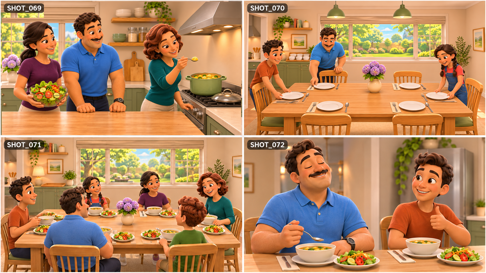

SHOT_069: Allow the cooking its time · SHOT_070: Six places waiting · SHOT_071: Serve what the family made · SHOT_072: An honest spoonful

## BOARD_19 — SHOT_073–SHOT_076

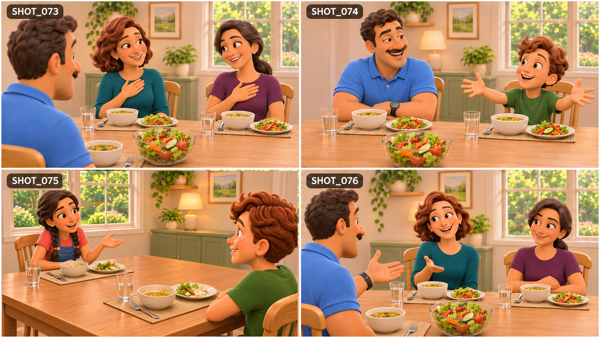

SHOT_073: Both partners share the credit · SHOT_074: Forty carrots stay imaginary · SHOT_075: An ear for a good question · SHOT_076: Ask before guessing

## BOARD_20 — SHOT_077–SHOT_080

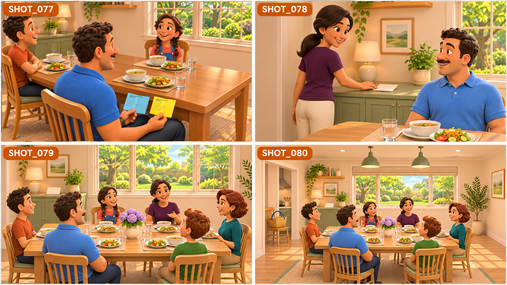

SHOT_077: The two original notes · SHOT_078: Tomorrow's fruit promise · SHOT_079: Choose together next time · SHOT_080: Two dishes, one family

## Five location previews

The five existing home/market previews are preserved unchanged; regenerated cast-populated storyboard panels are separate images.

### HOME_KITCHEN.jpg

### MARKET_WIDE.jpg

### MARKET_STALL.jpg

### MARKET_CHECKOUT.jpg

### HOME_TABLE.jpg

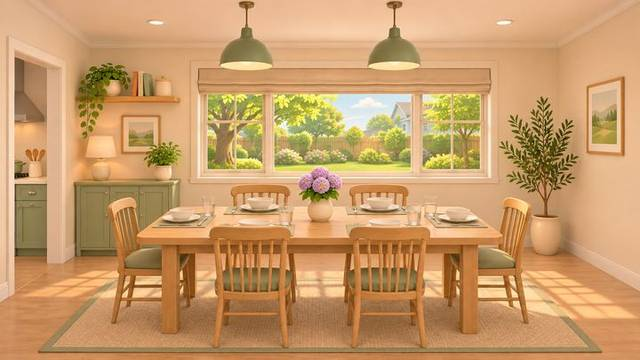

## Permanent cast gallery

[All 14 unchanged character previews](../Shared_Resources/Assets/Episode_01/characters/) · [Adult lineup](../Shared_Resources/Assets/Episode_01/characters/ADULTS_lineup.jpg) · [Children’s lineup](../Shared_Resources/Assets/Episode_01/characters/CHILDREN_lineup.jpg)
