# Episode 02 — complete illustrated storyboard gallery

**20 sheets / 80 labeled shot illustrations.** Each sheet contains four panels in reading order: top-left, top-right, bottom-left, bottom-right. See the [creator approval record (historical reference)](https://github.com/pujahalder34675-creator/ai-story-building/blob/8362bf7a5ec009104a53857e9bee314a843c1a14/CURRENT_PRODUCTION_STATUS.md) for reviewed panels. Individual motion first frames require separate approval.

[Open HTML gallery](storyboards/index.html) · [Shot-by-shot index (historical reference)](https://github.com/pujahalder34675-creator/ai-story-building/blob/8362bf7a5ec009104a53857e9bee314a843c1a14/Episode_02/STORYBOARD_INDEX.md) · [Generation and review notes](storyboards/GENERATION_NOTES.md)

## BOARD_01 — SHOT_001–SHOT_004

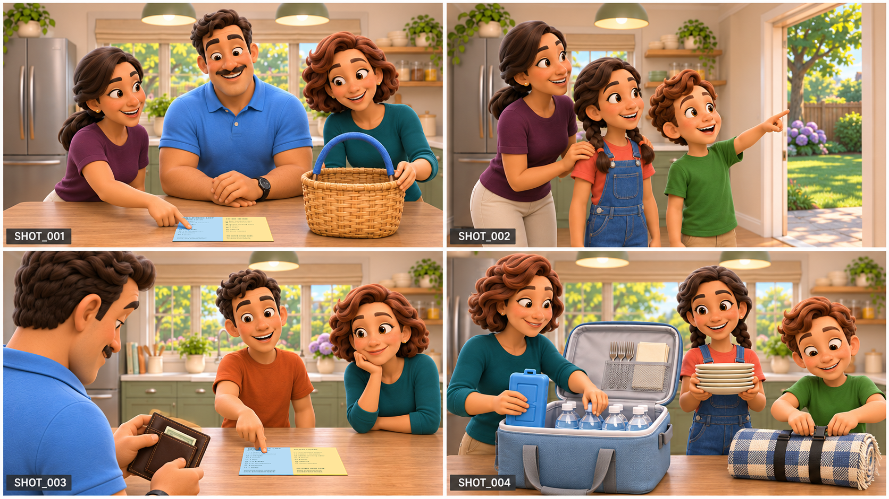

SHOT_001: One card, two colors · SHOT_002: A picnic close to home · SHOT_003: A real limit · SHOT_004: What we already own

## BOARD_02 — SHOT_005–SHOT_008

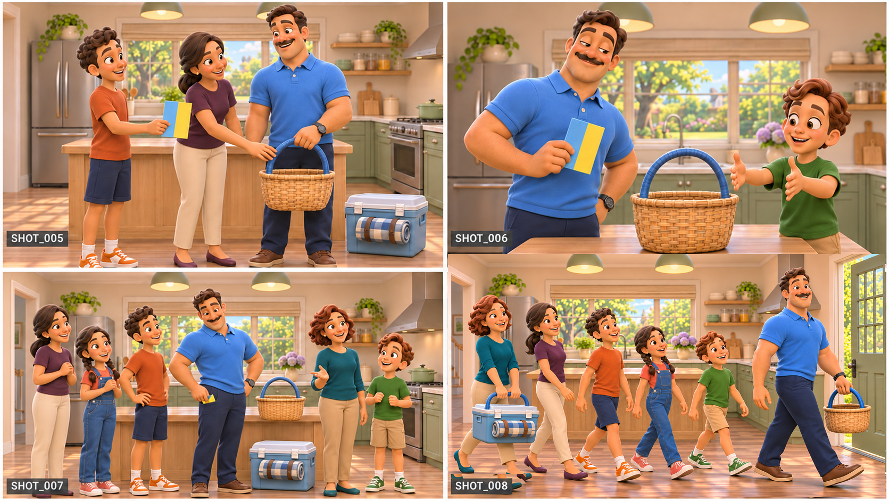

SHOT_005: The size champion · SHOT_006: The basket has an opinion · SHOT_007: Everyone has a job · SHOT_008: Out together

## BOARD_03 — SHOT_009–SHOT_012

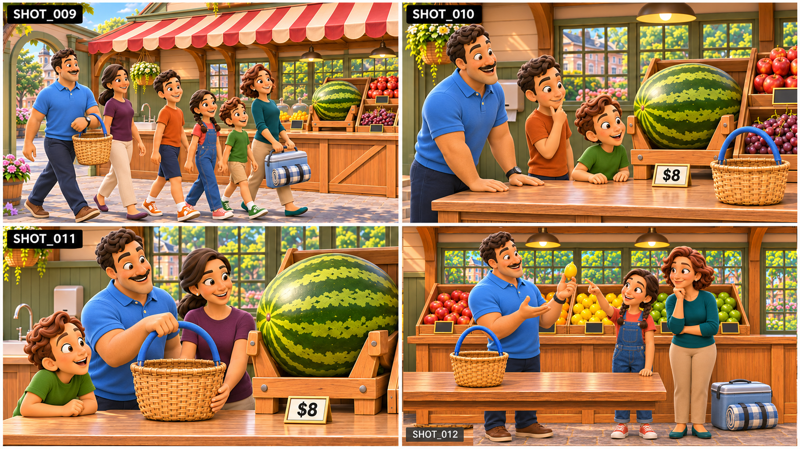

SHOT_009: The fruit shop · SHOT_010: A champion in a cradle · SHOT_011: No room at the rim · SHOT_012: The little yellow orange

## BOARD_04 — SHOT_013–SHOT_016

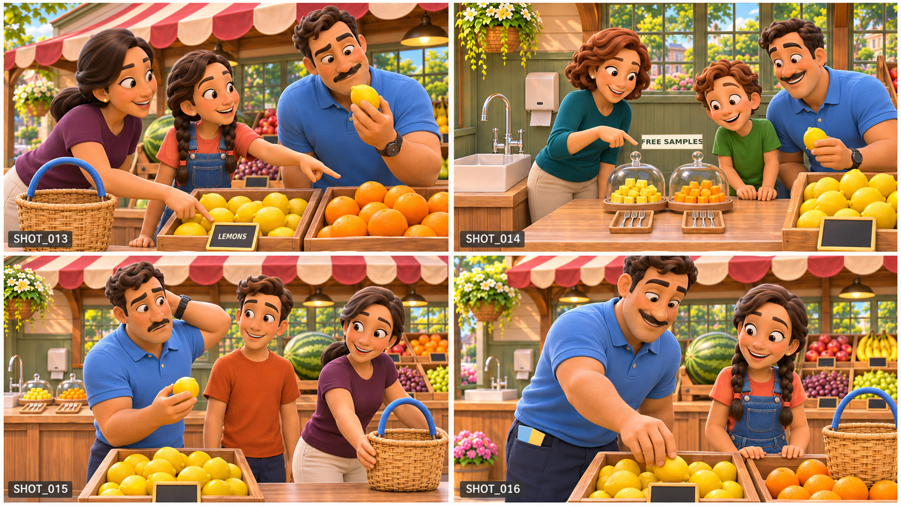

SHOT_013: More than one clue · SHOT_014: An invitation to compare · SHOT_015: A little hesitation · SHOT_016: Putting a guess down

## BOARD_05 — SHOT_017–SHOT_020

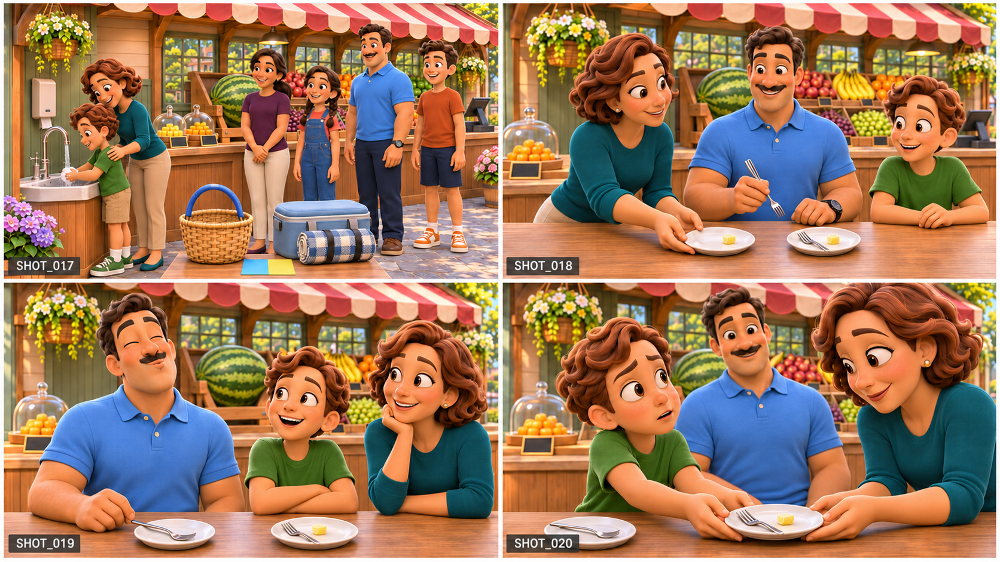

SHOT_017: A proper washing pause · SHOT_018: Two separate sample plates · SHOT_019: The sour surprise · SHOT_020: Is sour the same as bad?

## BOARD_06 — SHOT_021–SHOT_024

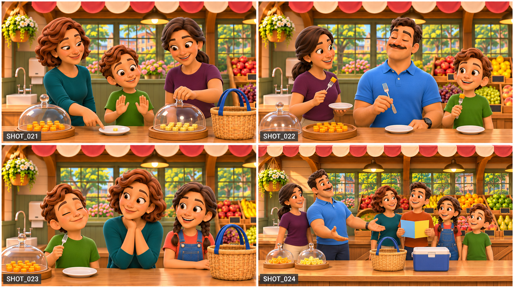

SHOT_021: A reassuring difference · SHOT_022: An orange on its own terms · SHOT_023: A choice without a dare · SHOT_024: The expert changes the rule

## BOARD_07 — SHOT_025–SHOT_028

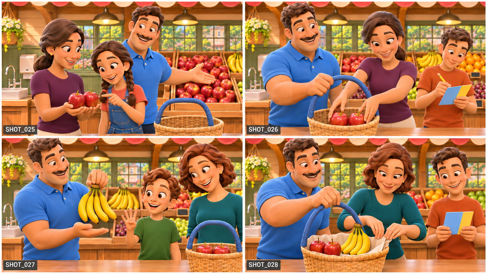

SHOT_025: An apple is not a trophy · SHOT_026: Two apples, two dollars · SHOT_027: A bunch is one purchase · SHOT_028: No banana passengers

## BOARD_08 — SHOT_029–SHOT_032

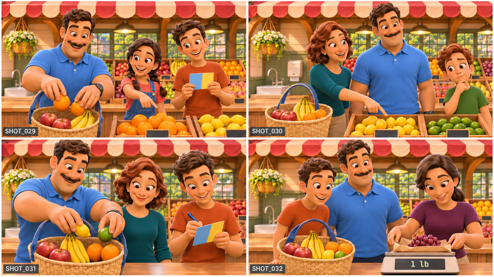

SHOT_029: Oranges with their own name · SHOT_030: A reason for a lemon · SHOT_031: Two different citrus fruits · SHOT_032: A pound is a weight

## BOARD_09 — SHOT_033–SHOT_036

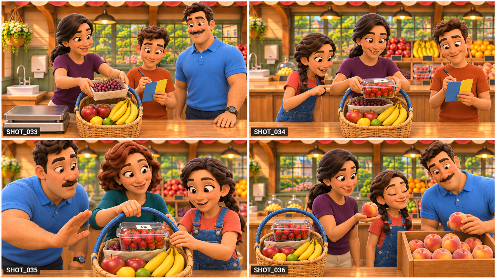

SHOT_033: Weight, then price · SHOT_034: Strawberries under a lid · SHOT_035: A safe place for soft fruit · SHOT_036: Ready today

## BOARD_10 — SHOT_037–SHOT_040

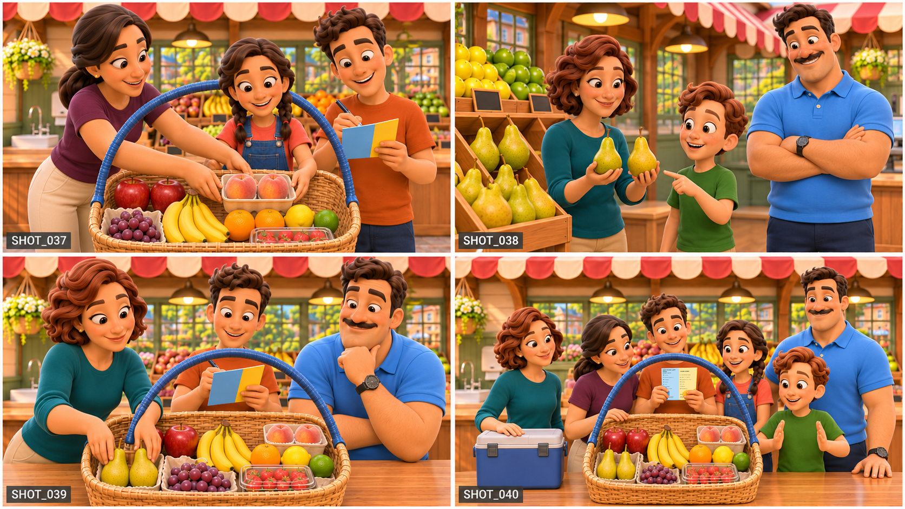

SHOT_037: Peaches need protection · SHOT_038: The pear comparison · SHOT_039: The last fruit line · SHOT_040: Enough is a useful amount

## BOARD_11 — SHOT_041–SHOT_044

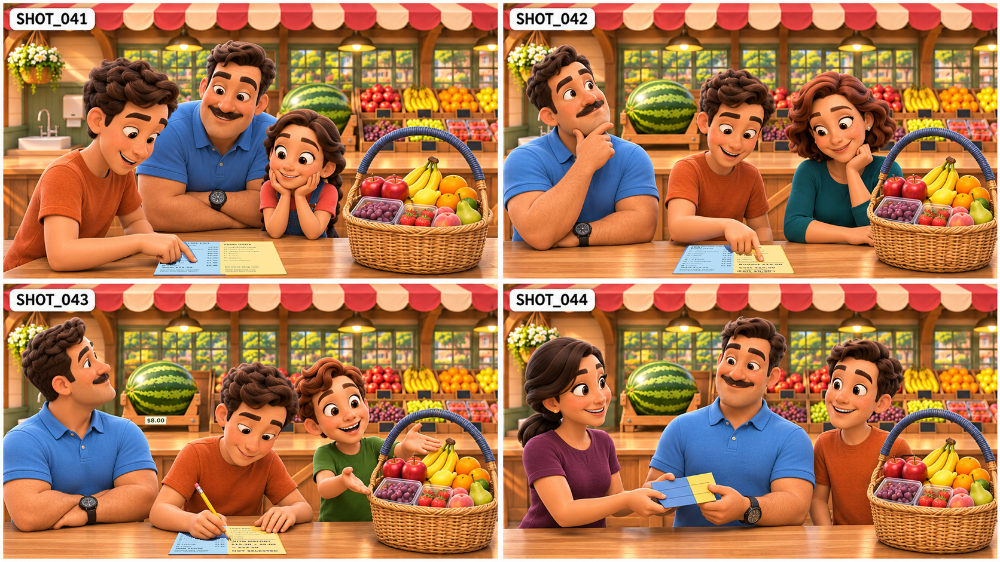

SHOT_041: Reading the total · SHOT_042: A little breathing room · SHOT_043: The champion asks too much · SHOT_044: Leaving it for another picnic

## BOARD_12 — SHOT_045–SHOT_048

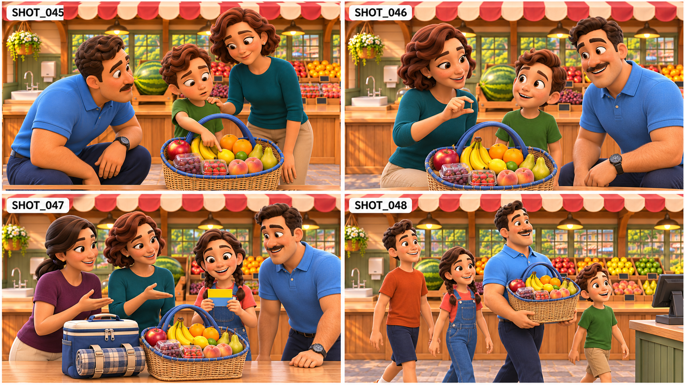

SHOT_045: One remaining worry · SHOT_046: A small job for a strong flavor · SHOT_047: Sharing the important jobs · SHOT_048: A plan worth carrying

## BOARD_13 — SHOT_049–SHOT_052

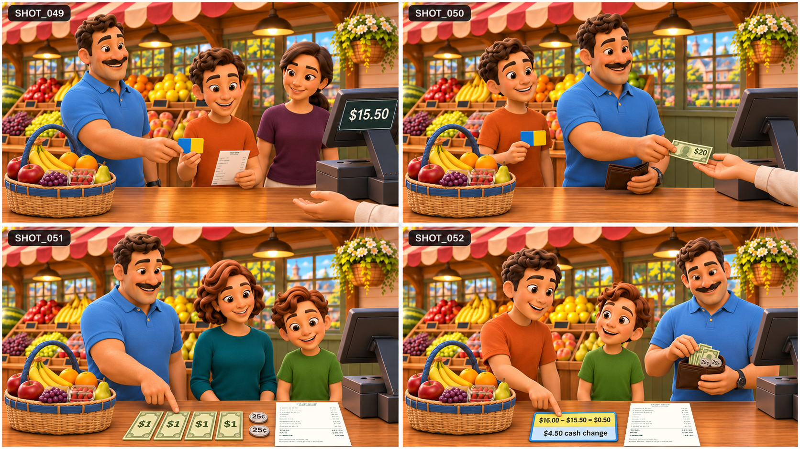

SHOT_049: The real checkout · SHOT_050: One twenty-dollar bill · SHOT_051: Four dollars and two quarters · SHOT_052: Two different remainders

## BOARD_14 — SHOT_053–SHOT_056

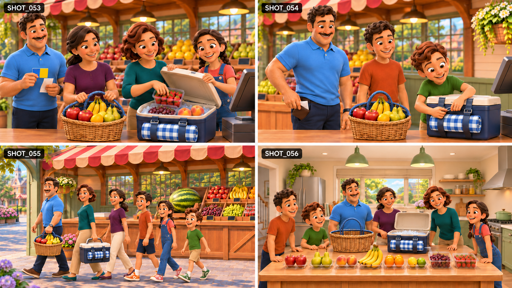

SHOT_053: Gentle seats for the journey · SHOT_054: Everything accounted for · SHOT_055: A smaller victory · SHOT_056: Home, with the right fruit

## BOARD_15 — SHOT_057–SHOT_060

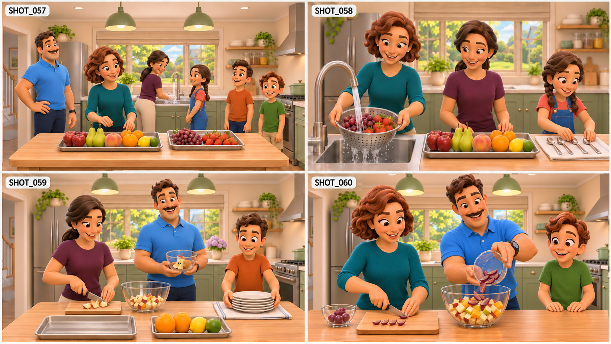

SHOT_057: Clean hands again · SHOT_058: Rinse before preparing · SHOT_059: Adults take the cutting jobs · SHOT_060: Grapes take the long cut

## BOARD_16 — SHOT_061–SHOT_064

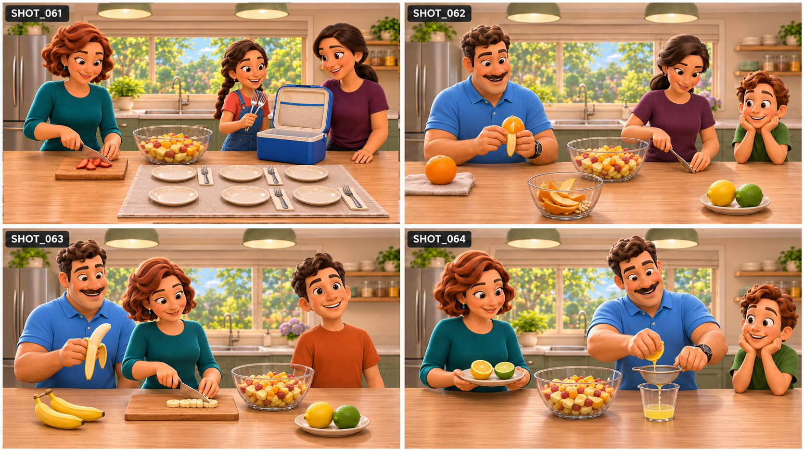

SHOT_061: Strawberries join the colors · SHOT_062: Two oranges, no surprises · SHOT_063: The bunch becomes four · SHOT_064: Half of each

## BOARD_17 — SHOT_065–SHOT_068

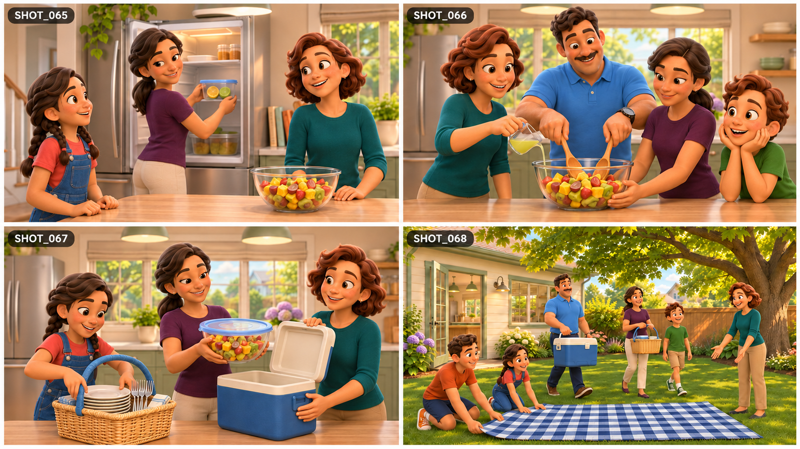

SHOT_065: Saving the other halves · SHOT_066: A small amount, a shared bowl · SHOT_067: Cool until lunch · SHOT_068: Only a few steps away

## BOARD_18 — SHOT_069–SHOT_072

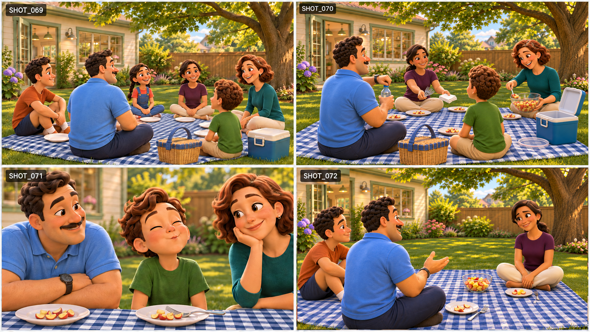

SHOT_069: Six places in the shade · SHOT_070: The bowl finally opens · SHOT_071: Max makes his own choice · SHOT_072: What Dad wanted

## BOARD_19 — SHOT_073–SHOT_076

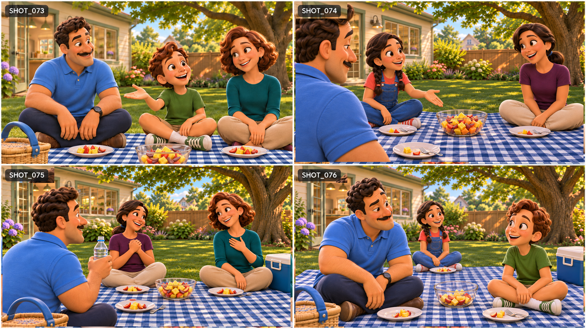

SHOT_073: Already special · SHOT_074: A better kind of champion · SHOT_075: Both mothers, one good plan · SHOT_076: The face stays unfolded

## BOARD_20 — SHOT_077–SHOT_080

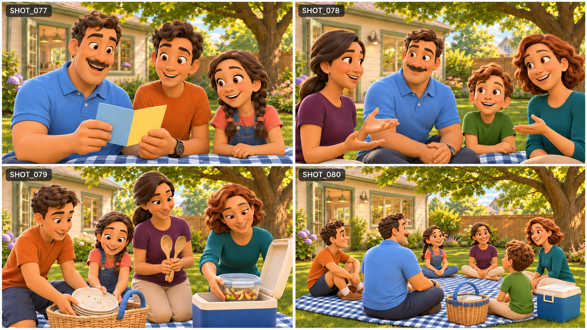

SHOT_077: A card worth keeping · SHOT_078: Tomorrow can wait · SHOT_079: Keeping what we made · SHOT_080: Enough for a happy ending

## Five location previews

The kitchen preview is shared unchanged with Episode 01; the four new location images are generated drafts.

### HOME_KITCHEN.jpg

### FRUIT_SHOP_WIDE.png

[FRUIT_SHOP_WIDE.png (historical reference)](https://github.com/pujahalder34675-creator/ai-story-building/blob/8362bf7a5ec009104a53857e9bee314a843c1a14/Episode_02/assets/environments/FRUIT_SHOP_WIDE.png)

### FRUIT_COUNTER.png

[FRUIT_COUNTER.png (historical reference)](https://github.com/pujahalder34675-creator/ai-story-building/blob/8362bf7a5ec009104a53857e9bee314a843c1a14/Episode_02/assets/environments/FRUIT_COUNTER.png)

### FRUIT_CHECKOUT.png

[FRUIT_CHECKOUT.png (historical reference)](https://github.com/pujahalder34675-creator/ai-story-building/blob/8362bf7a5ec009104a53857e9bee314a843c1a14/Episode_02/assets/environments/FRUIT_CHECKOUT.png)

### HOME_GARDEN.png

[HOME_GARDEN.png (historical reference)](https://github.com/pujahalder34675-creator/ai-story-building/blob/8362bf7a5ec009104a53857e9bee314a843c1a14/Episode_02/assets/environments/HOME_GARDEN.png)

## Permanent cast gallery

[All 14 unchanged character previews](../ref/characters/) · [Adult lineup](../ref/characters/ADULTS_lineup.jpg) · [Children’s lineup](../ref/characters/CHILDREN_lineup.jpg)
