# Episode 04 — Dad Tried On the Wrong Shoes! | Shopping Mall English: storyboard gallery

The [creator approval record](../CURRENT_PRODUCTION_STATUS.md) identifies reviewed panels. Individual motion first frames require separate approval.

[Shot index](STORYBOARD_INDEX.md) · [HTML gallery](assets/storyboards/index.html) · [Generation notes](assets/storyboards/GENERATION_NOTES.md)

## BOARD_01 — SHOT_001–SHOT_004

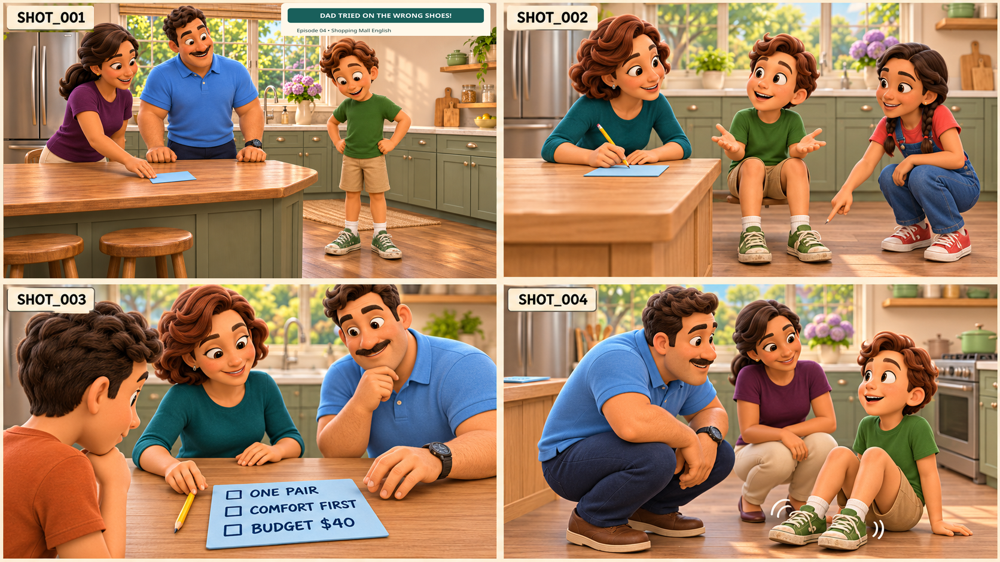

SHOT_001: A pair for school · SHOT_002: The person inside them · SHOT_003: One clear plan · SHOT_004: Check without guessing

## BOARD_02 — SHOT_005–SHOT_008

SHOT_005: Six people leaving · SHOT_006: The right pocket · SHOT_007: Comfort is not a race · SHOT_008: The mall trip begins

## BOARD_03 — SHOT_009–SHOT_012

SHOT_009: Doors and directions · SHOT_010: A moving staircase · SHOT_011: Another way upstairs · SHOT_012: Take a small map

## BOARD_04 — SHOT_013–SHOT_016

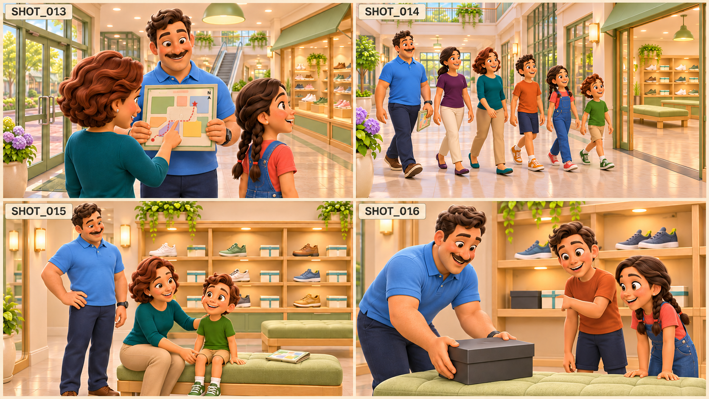

SHOT_013: Landmarks agree · SHOT_014: The store window · SHOT_015: Ask for a seat · SHOT_016: Two boxes nearby

## BOARD_05 — SHOT_017–SHOT_020

SHOT_017: An overconfident comparison · SHOT_018: The wrong shoe joke · SHOT_019: Nothing gets forced · SHOT_020: Return and measure first

## BOARD_06 — SHOT_021–SHOT_024

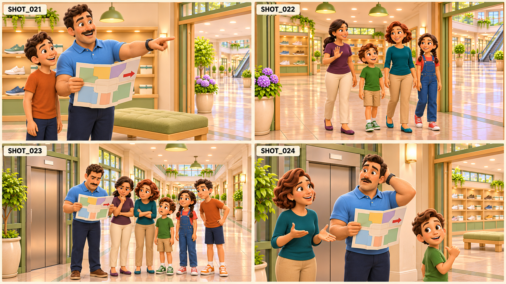

SHOT_021: The little arrow · SHOT_022: Together, not wandering · SHOT_023: The wrong direction stops · SHOT_024: Not every room fits

## BOARD_07 — SHOT_025–SHOT_028

SHOT_025: A familiar hello · SHOT_026: One useful question · SHOT_027: Turn the map, not the family · SHOT_028: The bench was the clue

## BOARD_08 — SHOT_029–SHOT_032

SHOT_029: A short family update · SHOT_030: Rose goes her own way · SHOT_031: Read the real sign · SHOT_032: Back without shortcuts

## BOARD_09 — SHOT_033–SHOT_036

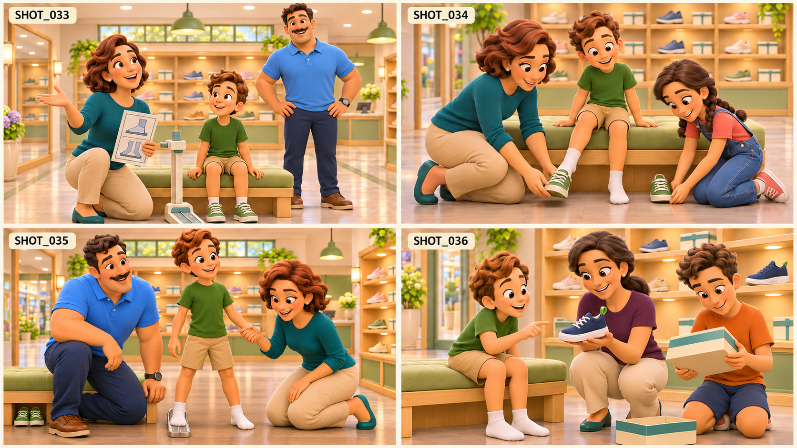

SHOT_033: Ask before using · SHOT_034: One old pair stays together · SHOT_035: Both feet, one answer · SHOT_036: A style he likes

## BOARD_10 — SHOT_037–SHOT_040

SHOT_037: The nearby size · SHOT_038: A brief tight fit · SHOT_039: Listen and remove · SHOT_040: The other extreme

## BOARD_11 — SHOT_041–SHOT_044

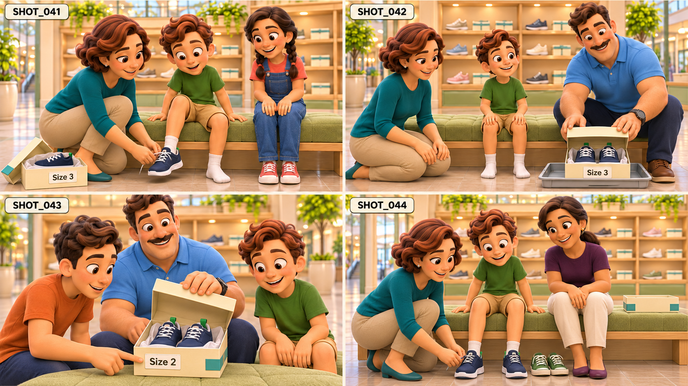

SHOT_041: Loose is information · SHOT_042: Return the loose pair · SHOT_043: The measured size arrives · SHOT_044: Make space gently

## BOARD_12 — SHOT_045–SHOT_048

SHOT_045: Secure, not squeezed · SHOT_046: His answer matters · SHOT_047: Stand before deciding · SHOT_048: A short walking test

## BOARD_13 — SHOT_049–SHOT_052

SHOT_049: The mirror is not the judge · SHOT_050: One more careful check · SHOT_051: Ask the price plainly · SHOT_052: No extra pair required

## BOARD_14 — SHOT_053–SHOT_056

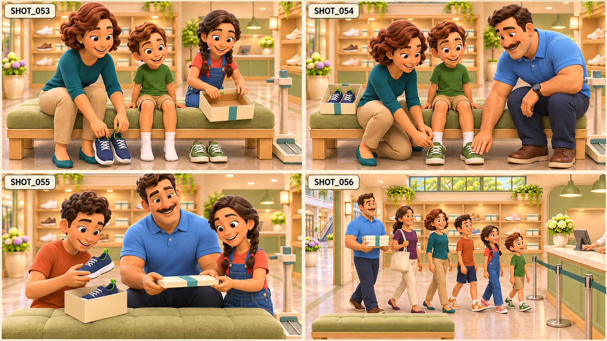

SHOT_053: Take off the trial pair · SHOT_054: Old shoes return to work · SHOT_055: Only the right box · SHOT_056: Ready for the cashier

## BOARD_15 — SHOT_057–SHOT_060

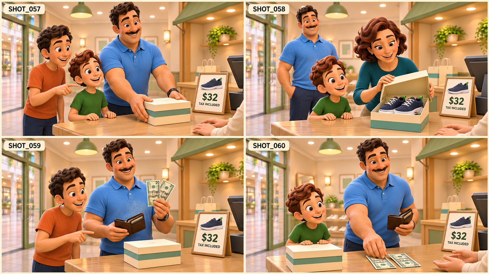

SHOT_057: The pair on the counter · SHOT_058: One final look · SHOT_059: Forty is enough · SHOT_060: Payment stays visible

## BOARD_16 — SHOT_061–SHOT_064

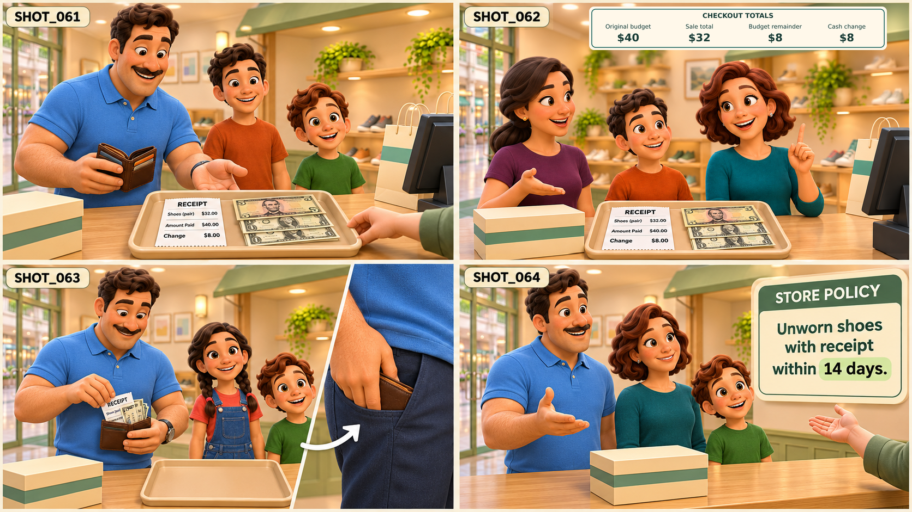

SHOT_061: Eight dollars back · SHOT_062: Budget and cash agree · SHOT_063: Keep the receipt · SHOT_064: Ask about returning

## BOARD_17 — SHOT_065–SHOT_068

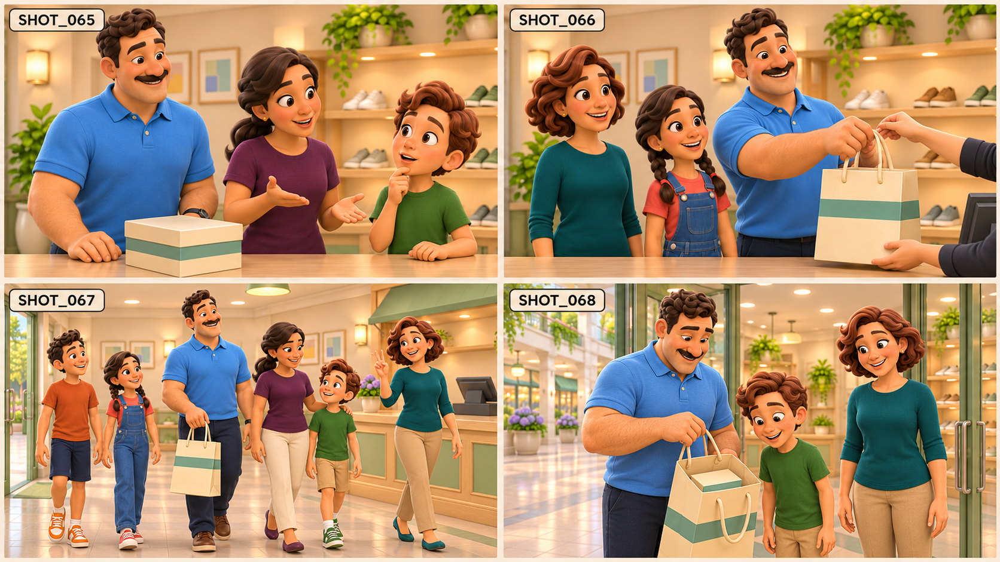

SHOT_065: A policy is not a refund · SHOT_066: One bag, one purchase · SHOT_067: Check the group again · SHOT_068: A careful carry

## BOARD_18 — SHOT_069–SHOT_072

SHOT_069: The correct exit · SHOT_070: The escalator can wait · SHOT_071: Check, then fold · SHOT_072: Out through the same doors

## BOARD_19 — SHOT_073–SHOT_076

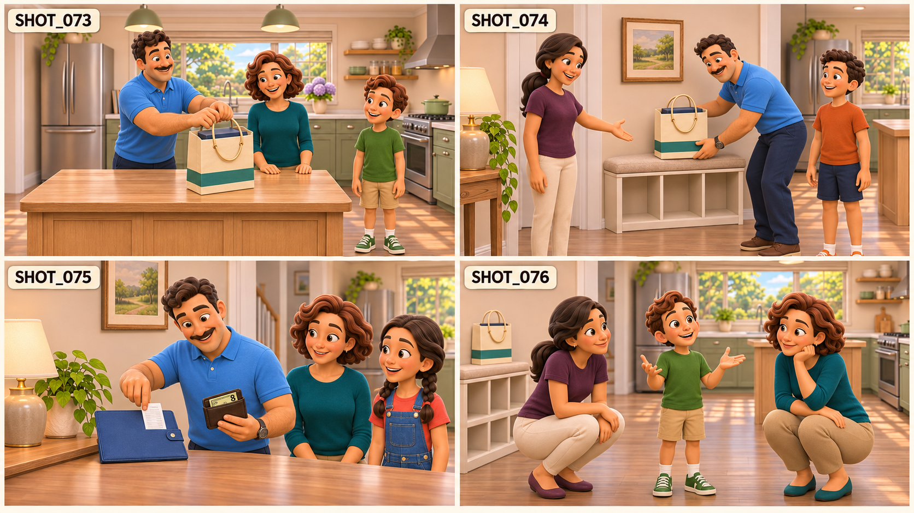

SHOT_073: Home, same kitchen · SHOT_074: A clean place for shoes · SHOT_075: Proof of the pair · SHOT_076: The customer reports

## BOARD_20 — SHOT_077–SHOT_080

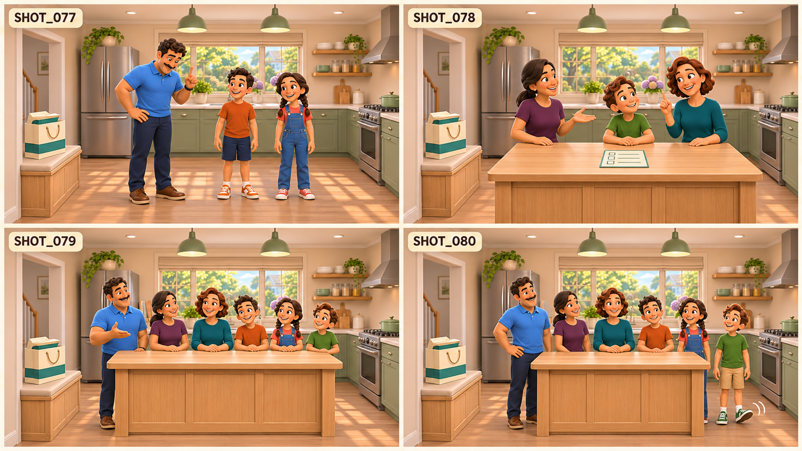

SHOT_077: The joke finds its limit · SHOT_078: A different picnic plan · SHOT_079: Everyone helped · SHOT_080: One family, the right fit

## Five clean environment references

### HOME_KITCHEN

### MALL_ENTRANCE

### MALL_CORRIDOR

### SHOE_FITTING

### SHOE_CHECKOUT

## Original six family identities

[14 unchanged cast previews](assets/characters/)
