# Episode 05 — The Picnic Is on the WRONG Bench! | Park English | Family Adventure: storyboard gallery

The [creator approval record (historical reference)](https://github.com/pujahalder34675-creator/ai-story-building/blob/8362bf7a5ec009104a53857e9bee314a843c1a14/CURRENT_PRODUCTION_STATUS.md) identifies reviewed panels. Individual motion first frames require separate approval.

[Screenplay](STORY.md) · [Video prompts](VIDEO_PROMPTS.md)

## BOARD_01 — SHOT_001–SHOT_004

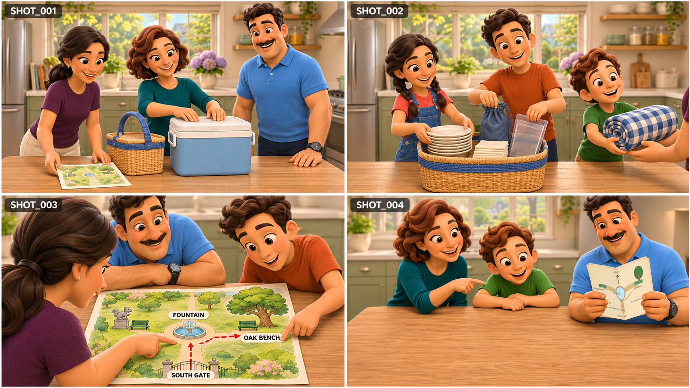

SHOT_001: A picnic beyond our gate · SHOT_002: What travels with us · SHOT_003: One place to meet · SHOT_004: A bench needs a neighbor

## BOARD_02 — SHOT_005–SHOT_008

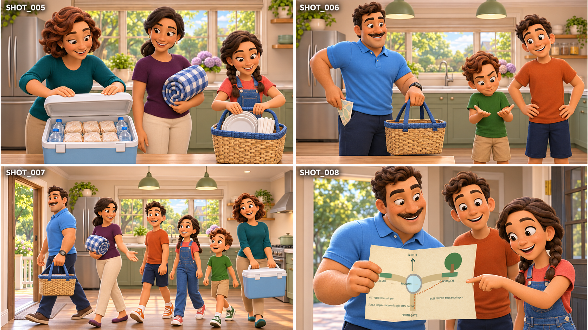

SHOT_005: Cold passengers · SHOT_006: Our direction expert · SHOT_007: Six leave together · SHOT_008: The small drawing

## BOARD_03 — SHOT_009–SHOT_012

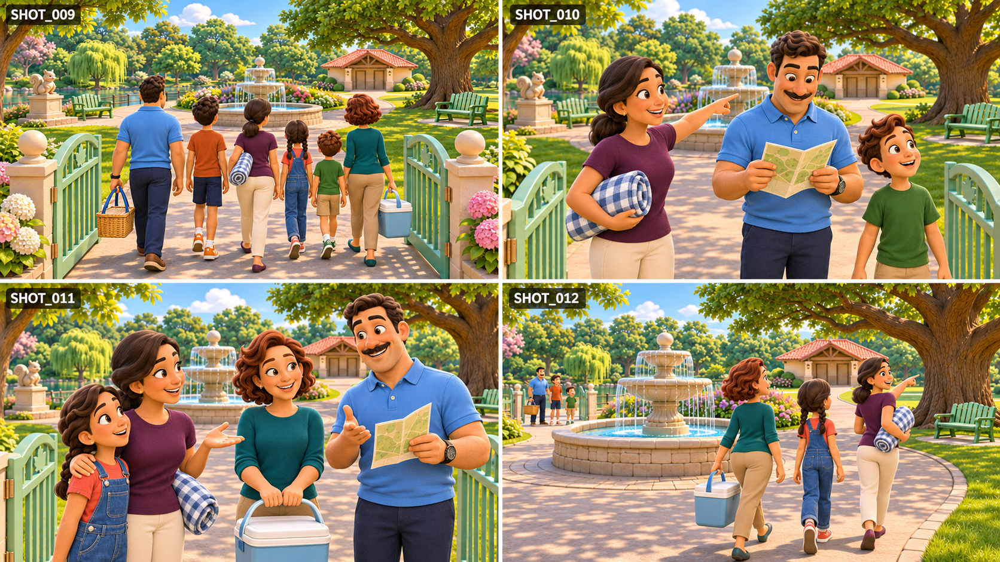

SHOT_009: A gate to somewhere new · SHOT_010: Look before the turn · SHOT_011: A short head start · SHOT_012: The sensible route

## BOARD_04 — SHOT_013–SHOT_016

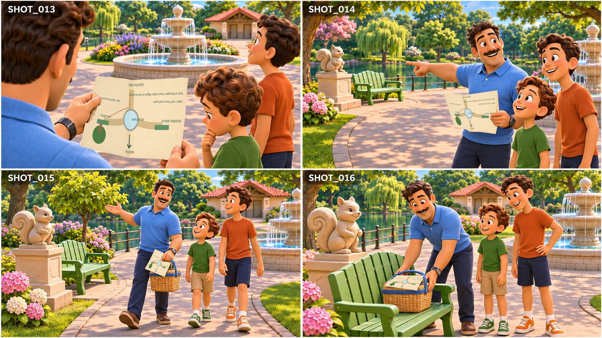

SHOT_013: The map takes a turn · SHOT_014: A very convincing green bench · SHOT_015: A tree is nearly everywhere · SHOT_016: The first bench wins too soon

## BOARD_05 — SHOT_017–SHOT_020

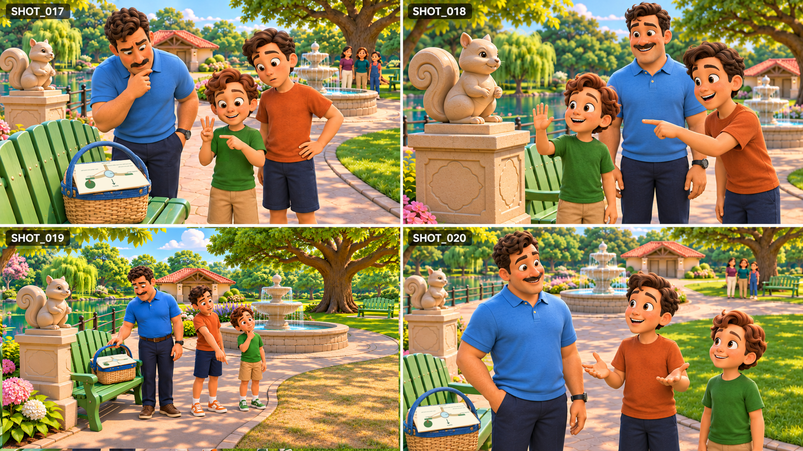

SHOT_017: Three places too few · SHOT_018: The silent local expert · SHOT_019: A bench without a blanket · SHOT_020: A call would be allowed

## BOARD_06 — SHOT_021–SHOT_024

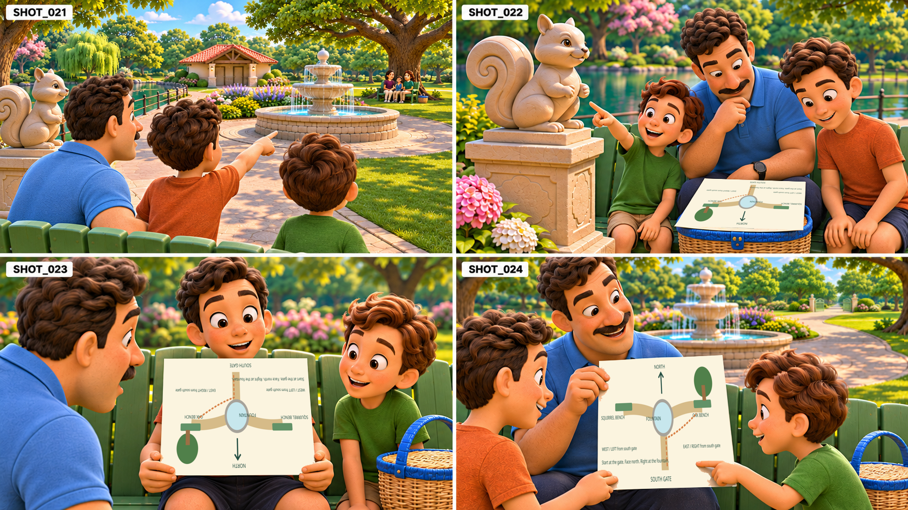

SHOT_021: One color, two places · SHOT_022: A landmark is more than a seat · SHOT_023: The upside-down oak · SHOT_024: Turn the page, keep the park

## BOARD_07 — SHOT_025–SHOT_028

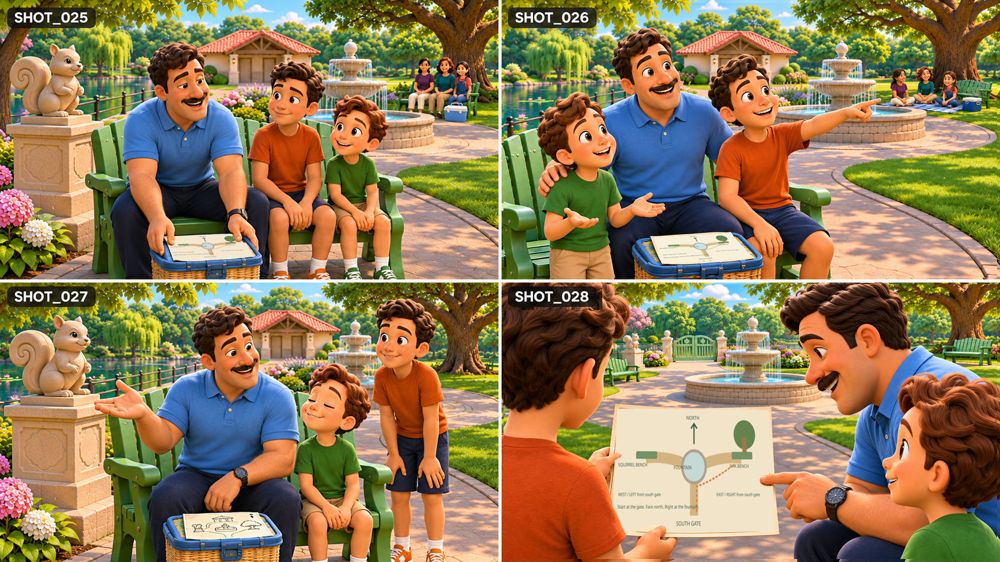

SHOT_025: A small admission · SHOT_026: The better question · SHOT_027: Our quiet friend has a job · SHOT_028: Two landmarks agree

## BOARD_08 — SHOT_029–SHOT_032

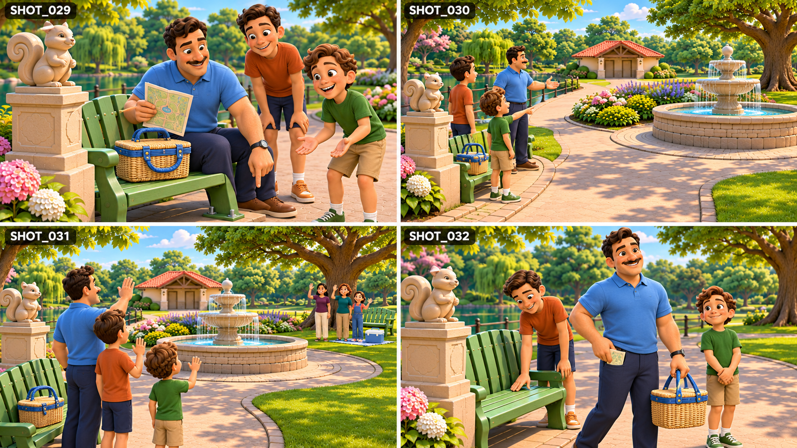

SHOT_029: Do not move the picnic · SHOT_030: No shortcuts through flowers · SHOT_031: A wave across the square · SHOT_032: Carry the useful things

## BOARD_09 — SHOT_033–SHOT_036

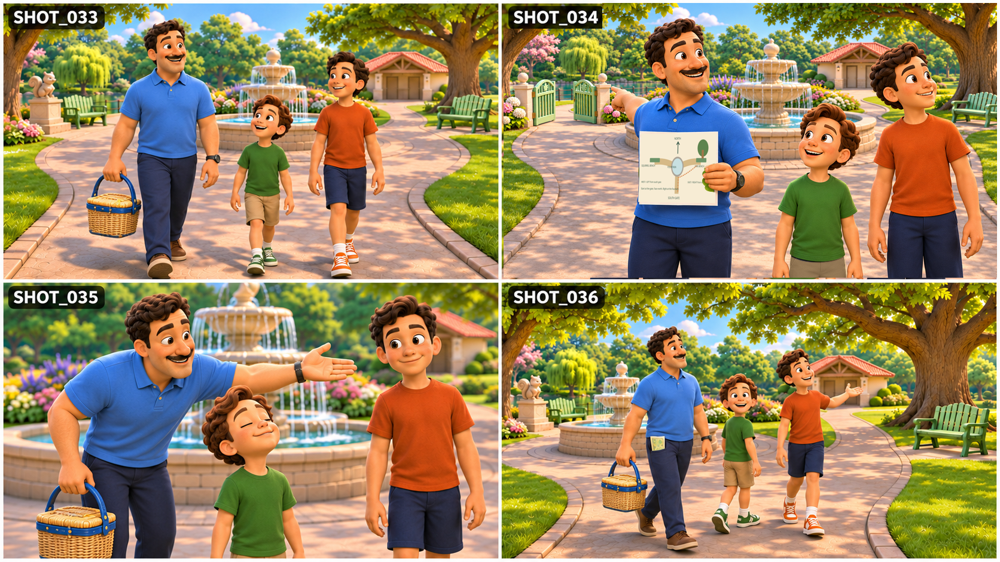

SHOT_033: Back to a known point · SHOT_034: Face the way we came in · SHOT_035: Listen to the landmark · SHOT_036: Right means this turn

## BOARD_10 — SHOT_037–SHOT_040

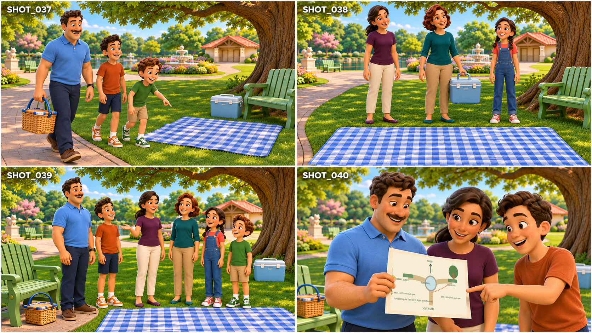

SHOT_037: The bench with the people · SHOT_038: Already saving places · SHOT_039: The destination is complete · SHOT_040: A helpful explanation

## BOARD_11 — SHOT_041–SHOT_044

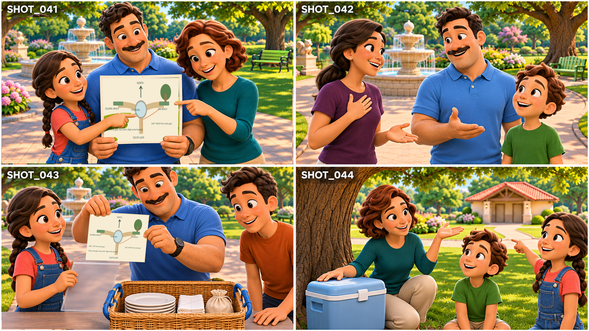

SHOT_041: Good information, better directions · SHOT_042: Both sides of the misunderstanding · SHOT_043: Map gets a clear home · SHOT_044: Food can wait a moment

## BOARD_12 — SHOT_045–SHOT_048

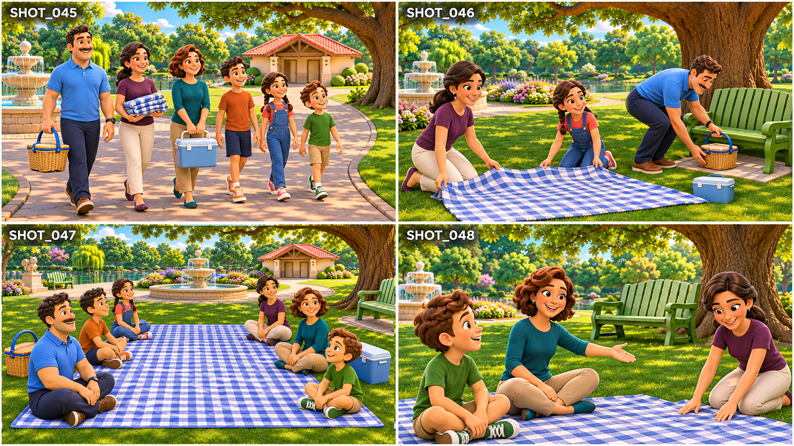

SHOT_045: A short wash trip together · SHOT_046: Our picnic returns once · SHOT_047: Six places, fixed and comfortable · SHOT_048: Room for everyone

## BOARD_13 — SHOT_049–SHOT_052

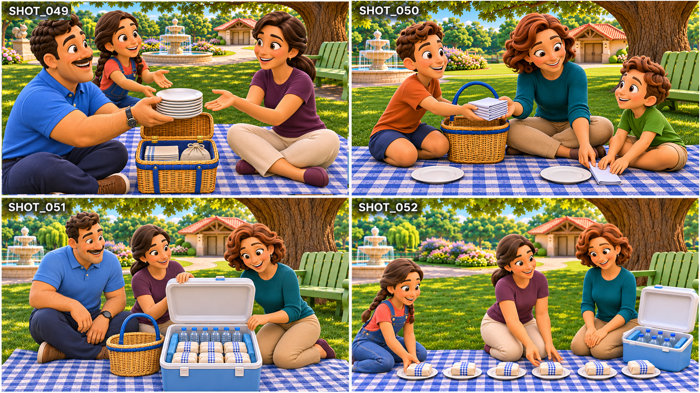

SHOT_049: The clean plates arrive · SHOT_050: Napkins know where to go · SHOT_051: The cold lid opens · SHOT_052: One parcel for each person

## BOARD_14 — SHOT_053–SHOT_056

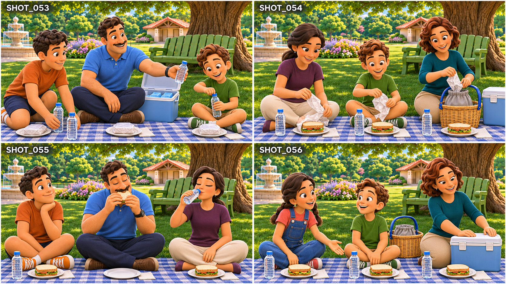

SHOT_053: Water follows the same plan · SHOT_054: Wrappers stay with us · SHOT_055: The first quiet bite · SHOT_056: No race to the best shade

## BOARD_15 — SHOT_057–SHOT_060

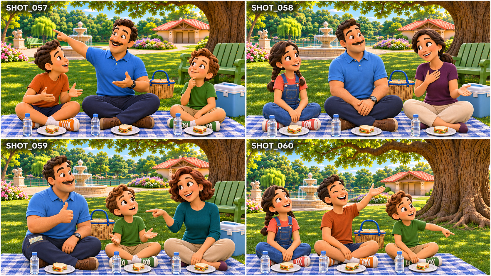

SHOT_057: What the other bench taught us · SHOT_058: A kind correction travels farther · SHOT_059: A map needs a listener · SHOT_060: The oak gets no medal

## BOARD_16 — SHOT_061–SHOT_064

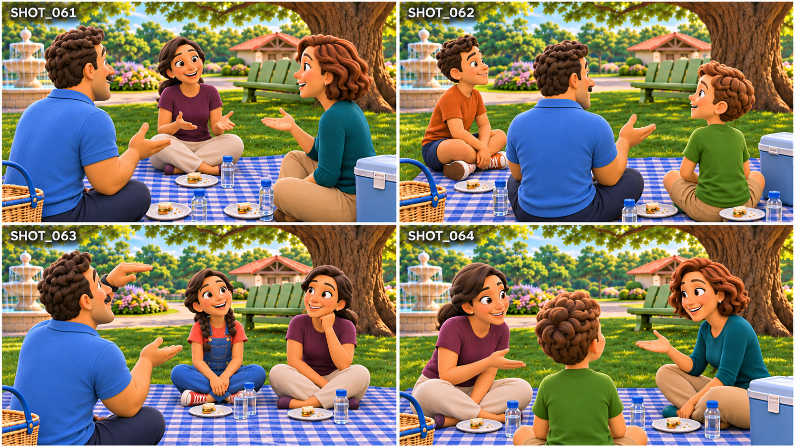

SHOT_061: A picnic is not a test · SHOT_062: Another sort of good guide · SHOT_063: The tiny tree grows up · SHOT_064: A place everyone can describe

## BOARD_17 — SHOT_065–SHOT_068

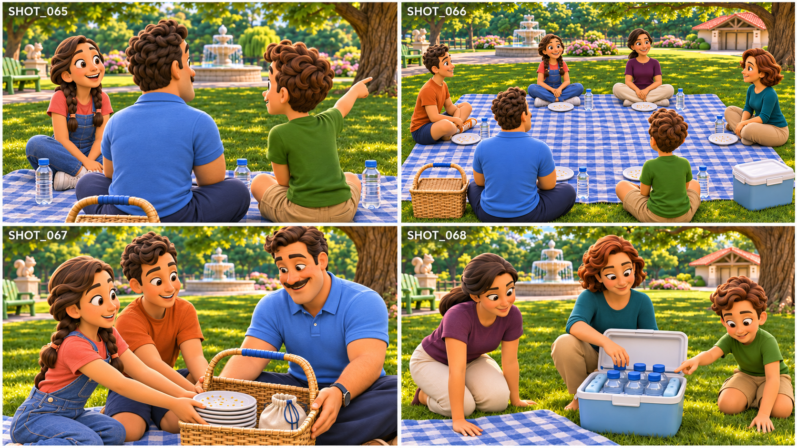

SHOT_065: The fountain keeps its voice · SHOT_066: The last bites take time · SHOT_067: The basket changes jobs · SHOT_068: Leave the shade as we found it

## BOARD_18 — SHOT_069–SHOT_072

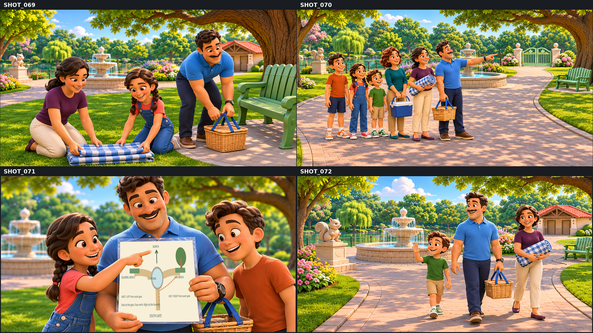

SHOT_069: Fold the meeting place · SHOT_070: One last landmark check · SHOT_071: A picture with the top marked · SHOT_072: The quiet guide receives thanks

## BOARD_19 — SHOT_073–SHOT_076

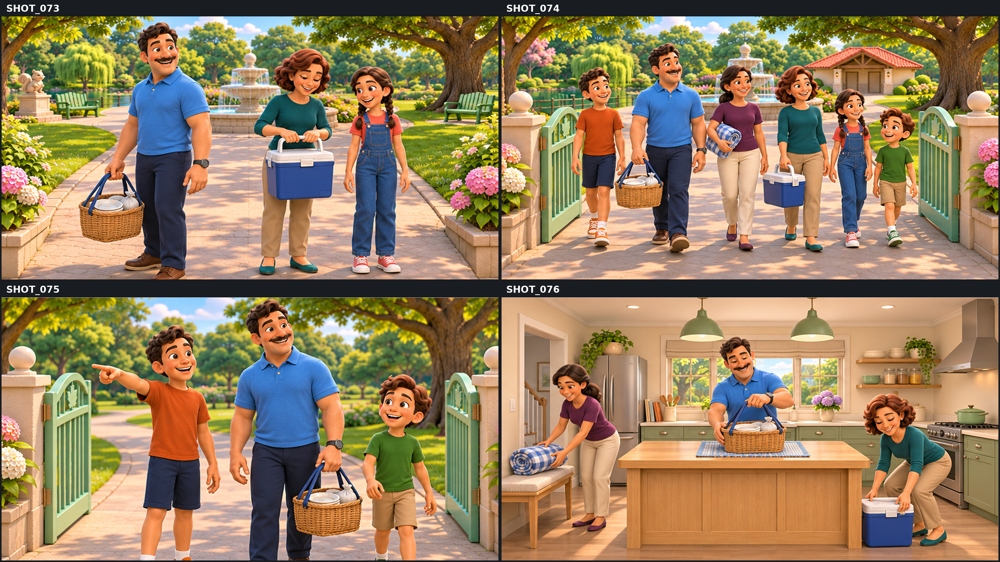

SHOT_073: Two benches, one good memory · SHOT_074: Through the gate together · SHOT_075: The correct kind of shortcut · SHOT_076: Home with a small story

## BOARD_20 — SHOT_077–SHOT_080

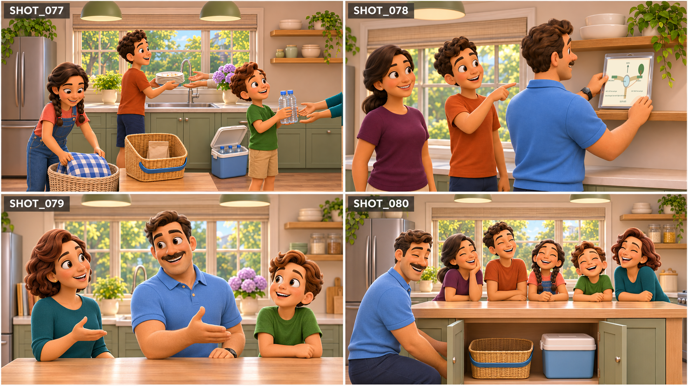

SHOT_077: The second useful job · SHOT_078: One map, the right way up · SHOT_079: Tomorrow can use a simple question · SHOT_080: The bench with everyone

## Five clean environment references

### HOME_KITCHEN

### PARK_GATE

[PARK_GATE (historical reference)](https://github.com/pujahalder34675-creator/ai-story-building/blob/8362bf7a5ec009104a53857e9bee314a843c1a14/Episode_05/assets/environments/PARK_GATE.png)

### PARK_FOUNTAIN

[PARK_FOUNTAIN (historical reference)](https://github.com/pujahalder34675-creator/ai-story-building/blob/8362bf7a5ec009104a53857e9bee314a843c1a14/Episode_05/assets/environments/PARK_FOUNTAIN.png)

### PARK_BENCH_FORK

[PARK_BENCH_FORK (historical reference)](https://github.com/pujahalder34675-creator/ai-story-building/blob/8362bf7a5ec009104a53857e9bee314a843c1a14/Episode_05/assets/environments/PARK_BENCH_FORK.png)

### PARK_OAK_PICNIC

[PARK_OAK_PICNIC (historical reference)](https://github.com/pujahalder34675-creator/ai-story-building/blob/8362bf7a5ec009104a53857e9bee314a843c1a14/Episode_05/assets/environments/PARK_OAK_PICNIC.png)

## Original six family identities

[14 unchanged cast previews](../ref/characters/)
