# Episode 06 — Dad Said HOT… But Meant WARM! | Restaurant English | Funny Family Dinner: storyboard gallery

The [creator approval record (historical reference)](https://github.com/pujahalder34675-creator/ai-story-building/blob/8362bf7a5ec009104a53857e9bee314a843c1a14/CURRENT_PRODUCTION_STATUS.md) identifies reviewed panels. Individual motion first frames require separate approval.

[Shot index (historical reference)](https://github.com/pujahalder34675-creator/ai-story-building/blob/8362bf7a5ec009104a53857e9bee314a843c1a14/Episode_06/STORYBOARD_INDEX.md) · [HTML gallery](storyboards/index.html) · [Generation notes](storyboards/GENERATION_NOTES.md)

## BOARD_01 — SHOT_001–SHOT_004

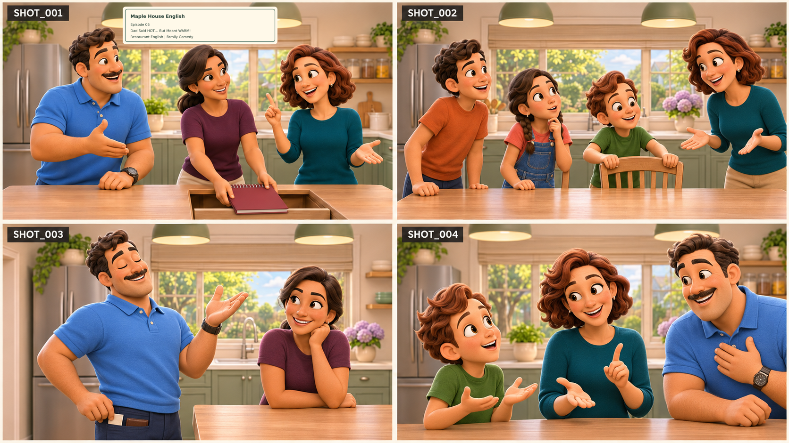

SHOT_001: A dinner invitation · SHOT_002: A place for six · SHOT_003: The speech in his pocket · SHOT_004: What Max wants to know

## BOARD_02 — SHOT_005–SHOT_008

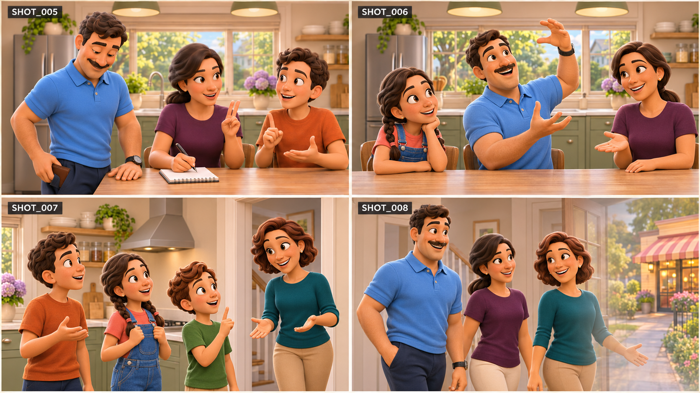

SHOT_005: Room in the dinner budget · SHOT_006: No menu in the imagination · SHOT_007: Everyone brings a question · SHOT_008: The short version

## BOARD_03 — SHOT_009–SHOT_012

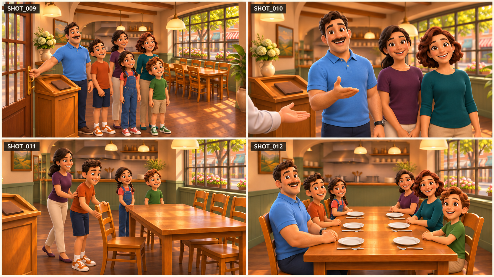

SHOT_009: A welcoming doorway · SHOT_010: A table please · SHOT_011: The aisle is a working path · SHOT_012: Six places in order

## BOARD_04 — SHOT_013–SHOT_016

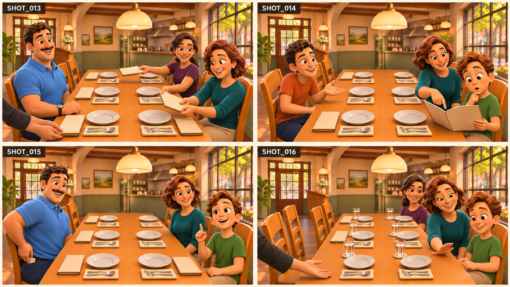

SHOT_013: Menus arrive before meals · SHOT_014: Not a book to finish · SHOT_015: Water without a speech · SHOT_016: The water landing

## BOARD_05 — SHOT_017–SHOT_020

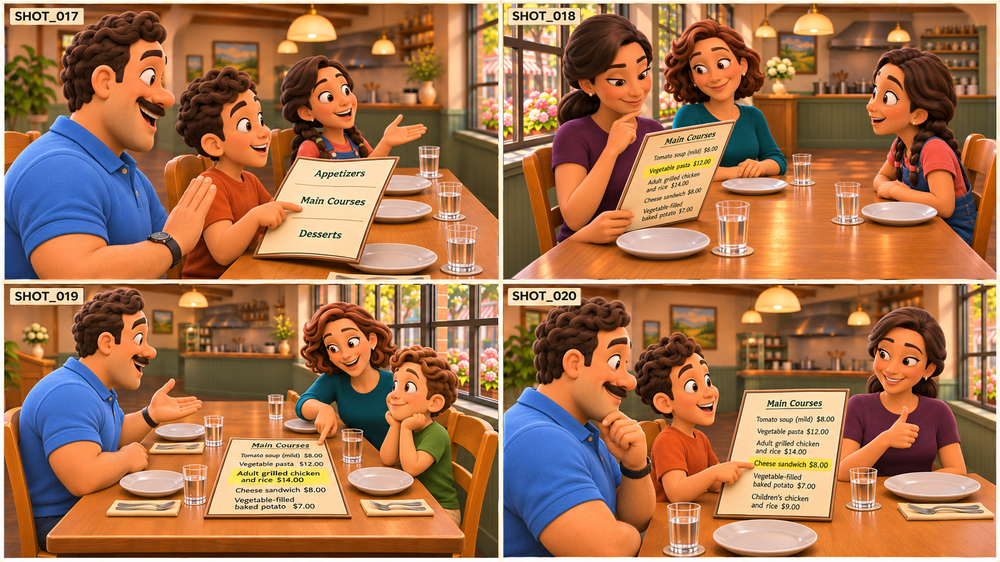

SHOT_017: A menu has neighborhoods · SHOT_018: Maya chooses vegetables · SHOT_019: Nina knows her dinner · SHOT_020: Leo's comfortable choice

## BOARD_06 — SHOT_021–SHOT_024

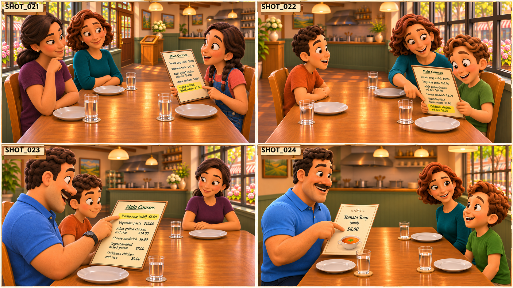

SHOT_021: Ella asks what comes with it · SHOT_022: Max chooses his size · SHOT_023: Dan finds his soup · SHOT_024: One word makes two paths

## BOARD_07 — SHOT_025–SHOT_028

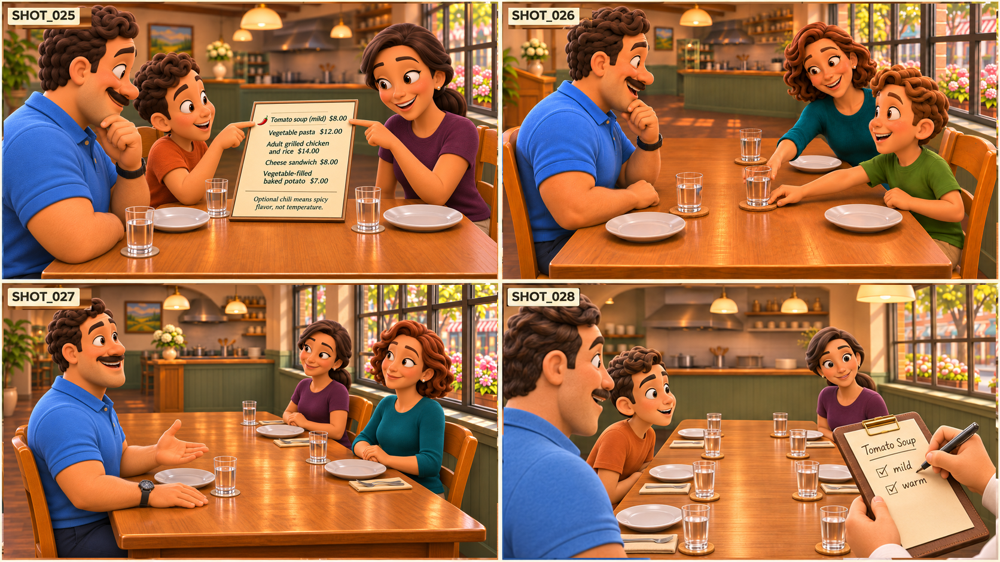

SHOT_025: The little pepper picture · SHOT_026: The water is not a rescue · SHOT_027: A smaller and clearer request · SHOT_028: A change before the kitchen

## BOARD_08 — SHOT_029–SHOT_032

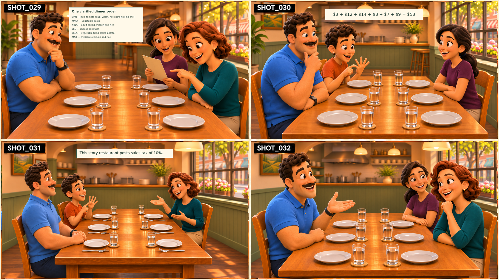

SHOT_029: All six dishes in one place · SHOT_030: Prices before promises · SHOT_031: The posted tax · SHOT_032: Leave room for thanks

## BOARD_09 — SHOT_033–SHOT_036

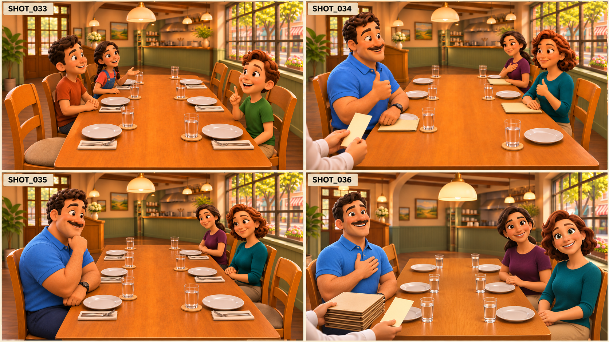

SHOT_033: Everyone says their own order · SHOT_034: Both partners finish the order · SHOT_035: Ask about needs before cooking · SHOT_036: One ticket leaves the table

## BOARD_10 — SHOT_037–SHOT_040

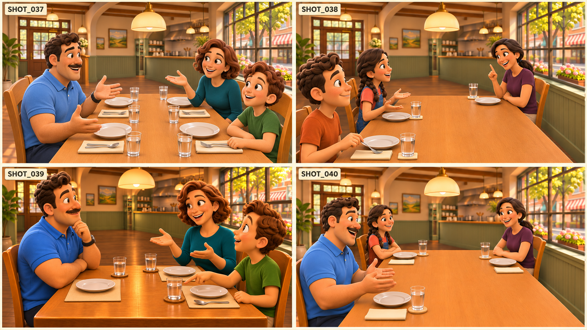

SHOT_037: A wait with an ending · SHOT_038: The fork is not a microphone · SHOT_039: Two meanings can share a word · SHOT_040: A useful memory of flour

## BOARD_11 — SHOT_041–SHOT_044

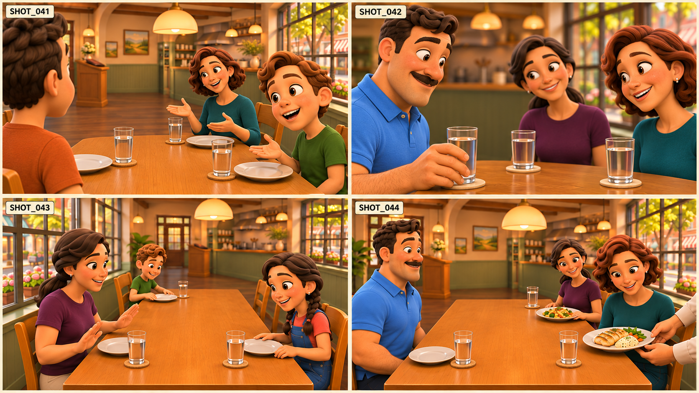

SHOT_041: An appetizer stays on the menu · SHOT_042: A very ordinary request · SHOT_043: Clear space for the plates · SHOT_044: The first two meals arrive

## BOARD_12 — SHOT_045–SHOT_048

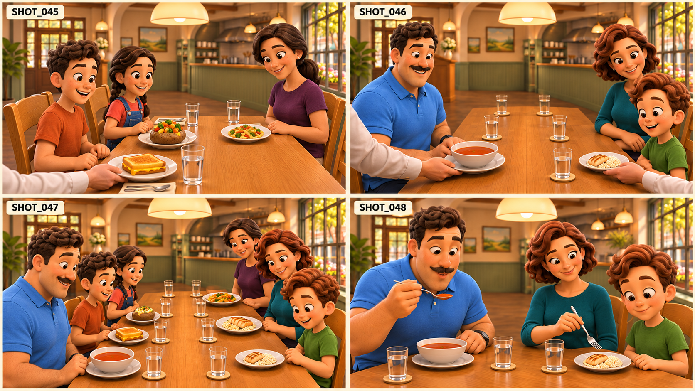

SHOT_045: Two children recognize dinner · SHOT_046: A small plate and a warm bowl · SHOT_047: Six choices meet the table · SHOT_048: Warm is checked, not guessed

## BOARD_13 — SHOT_049–SHOT_052

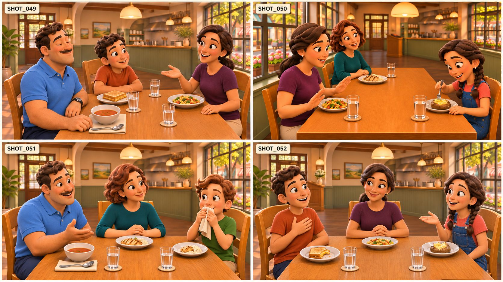

SHOT_049: The soup gets its sentence · SHOT_050: Not a hot-food competition · SHOT_051: The napkin earns its place · SHOT_052: A fork and a choice

## BOARD_14 — SHOT_053–SHOT_056

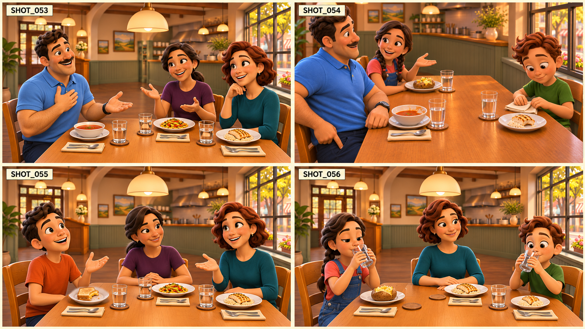

SHOT_053: Two meanings, no lecture · SHOT_054: The quiet speech finally rests · SHOT_055: The window has other plans · SHOT_056: Water belongs to its place

## BOARD_15 — SHOT_057–SHOT_060

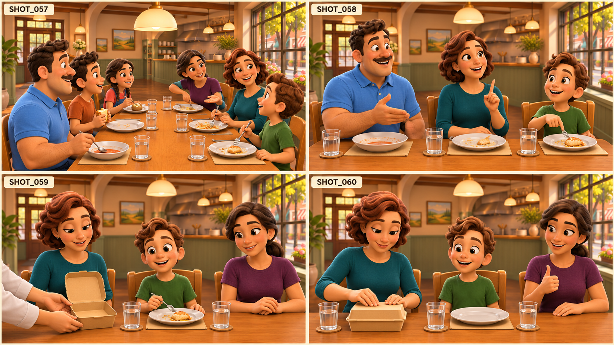

SHOT_057: A pause in the middle · SHOT_058: A box for what already exists · SHOT_059: The box arrives empty · SHOT_060: One portion changes containers

## BOARD_16 — SHOT_061–SHOT_064

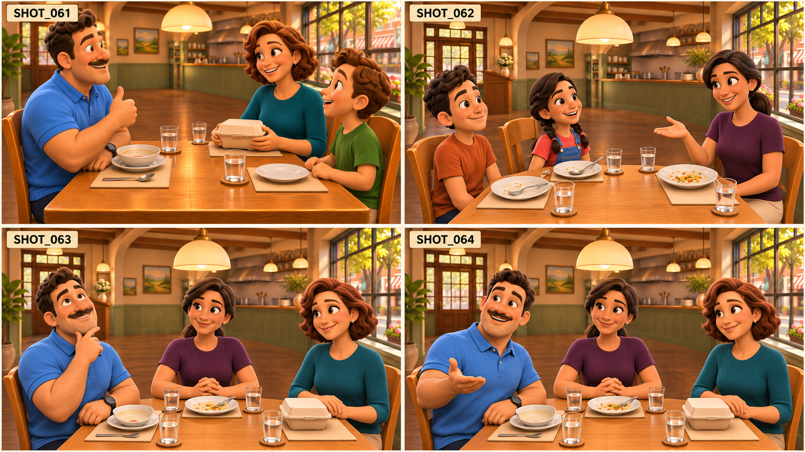

SHOT_061: The box has a destination · SHOT_062: Finish without a disappearing dish · SHOT_063: Dessert can remain a possibility · SHOT_064: Could we have the check

## BOARD_17 — SHOT_065–SHOT_068

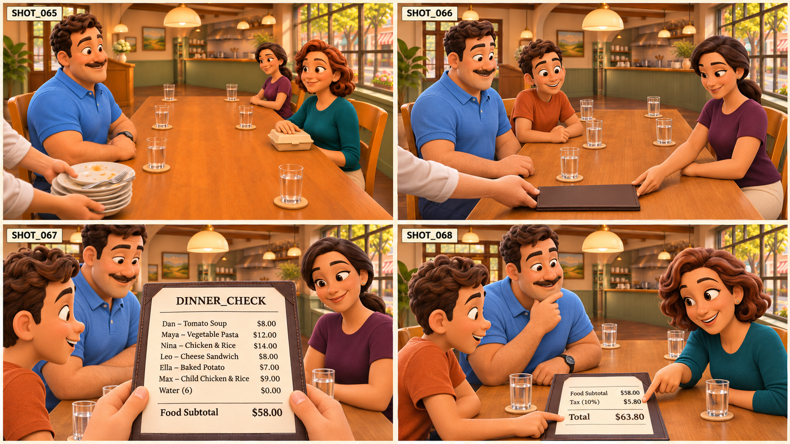

SHOT_065: A clear table keeps one box · SHOT_066: The bill is smaller than the speech · SHOT_067: Six lines mean six meals · SHOT_068: Tax stays separate

## BOARD_18 — SHOT_069–SHOT_072

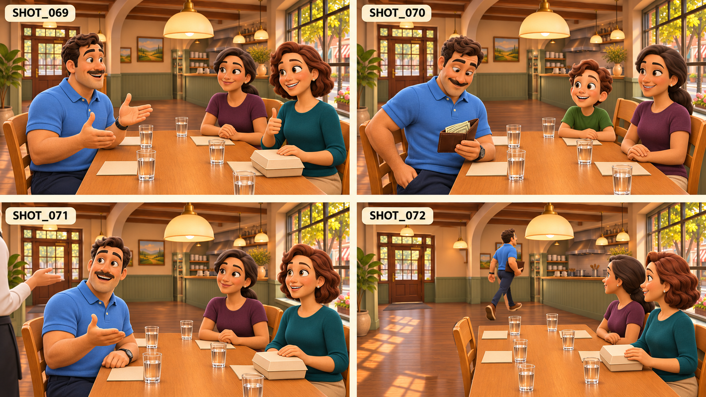

SHOT_069: A choice for the end · SHOT_070: Wallet on the right · SHOT_071: Ask where to pay · SHOT_072: One person uses the clear aisle

## BOARD_19 — SHOT_073–SHOT_076

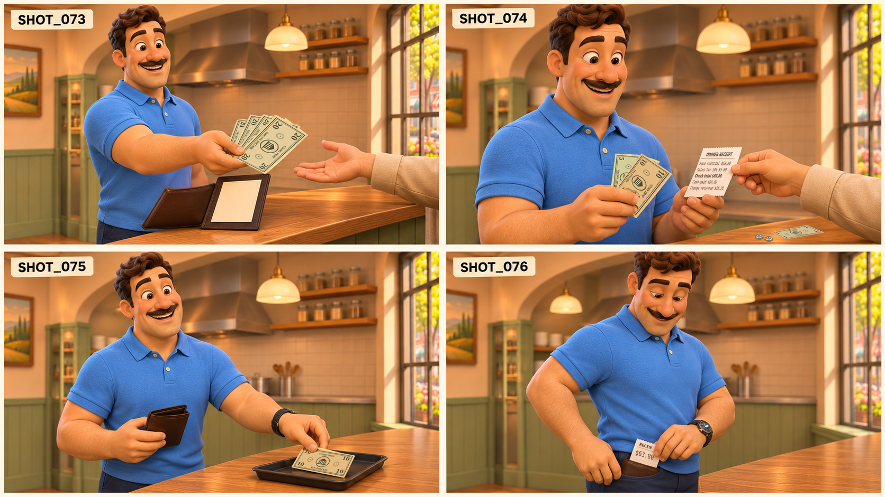

SHOT_073: Eighty to settle the meal · SHOT_074: The first change is not the remainder · SHOT_075: Ten dollars for the service · SHOT_076: Receipt in its own place

## BOARD_20 — SHOT_077–SHOT_080

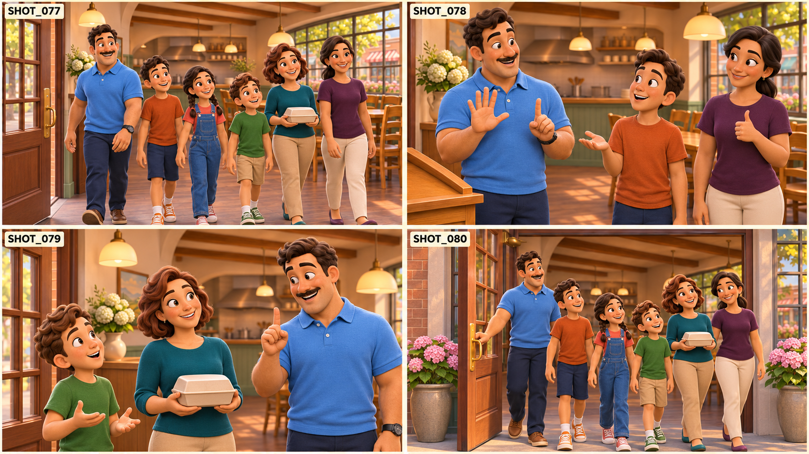

SHOT_077: The whole family leaves together · SHOT_078: The budget has an honest ending · SHOT_079: A sentence worth keeping · SHOT_080: A warm evening, clearly said

## Five clean environment references

### HOME_KITCHEN

### RESTAURANT_ENTRANCE

[RESTAURANT_ENTRANCE (historical reference)](https://github.com/pujahalder34675-creator/ai-story-building/blob/8362bf7a5ec009104a53857e9bee314a843c1a14/Episode_06/assets/environments/RESTAURANT_ENTRANCE.png)

### RESTAURANT_WIDE

[RESTAURANT_WIDE (historical reference)](https://github.com/pujahalder34675-creator/ai-story-building/blob/8362bf7a5ec009104a53857e9bee314a843c1a14/Episode_06/assets/environments/RESTAURANT_WIDE.png)

### RESTAURANT_TABLE

[RESTAURANT_TABLE (historical reference)](https://github.com/pujahalder34675-creator/ai-story-building/blob/8362bf7a5ec009104a53857e9bee314a843c1a14/Episode_06/assets/environments/RESTAURANT_TABLE.png)

### SERVICE_COUNTER

[SERVICE_COUNTER (historical reference)](https://github.com/pujahalder34675-creator/ai-story-building/blob/8362bf7a5ec009104a53857e9bee314a843c1a14/Episode_06/assets/environments/SERVICE_COUNTER.png)

## Original six family identities

[14 unchanged cast previews](../ref/characters/)
