# Episode 07 — Right Bus, Wrong Stop! | Travel English | Slow Family Comedy: storyboard gallery

The [creator approval record](../CURRENT_PRODUCTION_STATUS.md) identifies reviewed panels. Individual motion first frames require separate approval.

[Shot index](STORYBOARD_INDEX.md) · [HTML gallery](assets/storyboards/index.html) · [Generation notes](assets/storyboards/GENERATION_NOTES.md)

## BOARD_01 — SHOT_001–SHOT_004

SHOT_001: A library morning · SHOT_002: Three books going back · SHOT_003: The fare is already paid · SHOT_004: A time with a destination

## BOARD_02 — SHOT_005–SHOT_008

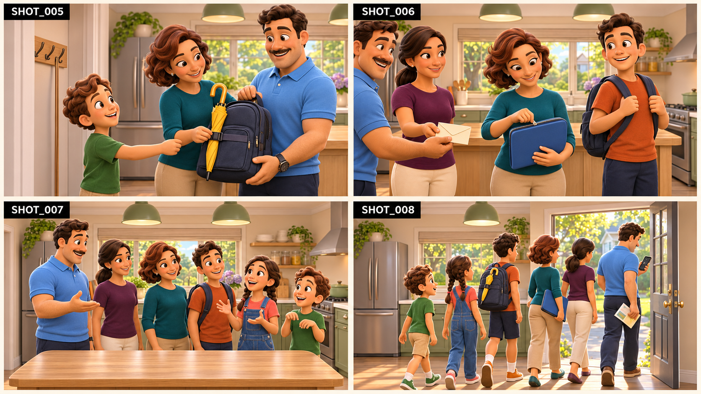

SHOT_005: Umbrella without a storm · SHOT_006: Cards in their own place · SHOT_007: Everyone gets a voice · SHOT_008: Ready before the clock

## BOARD_03 — SHOT_009–SHOT_012

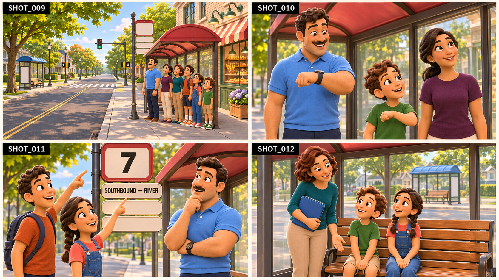

SHOT_009: A stop that looks familiar · SHOT_010: The pleased-with-himself pose · SHOT_011: A pole with two kinds of information · SHOT_012: A comfortable place to wonder

## BOARD_04 — SHOT_013–SHOT_016

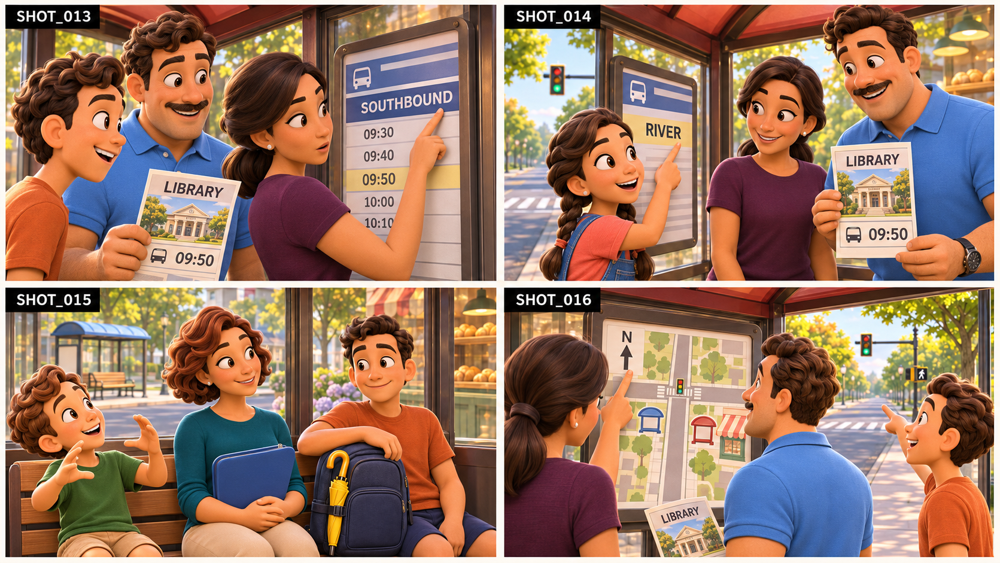

SHOT_013: The timetable seems to agree · SHOT_014: A river in the wrong plan · SHOT_015: The building is not the book · SHOT_016: First look at the street map

## BOARD_05 — SHOT_017–SHOT_020

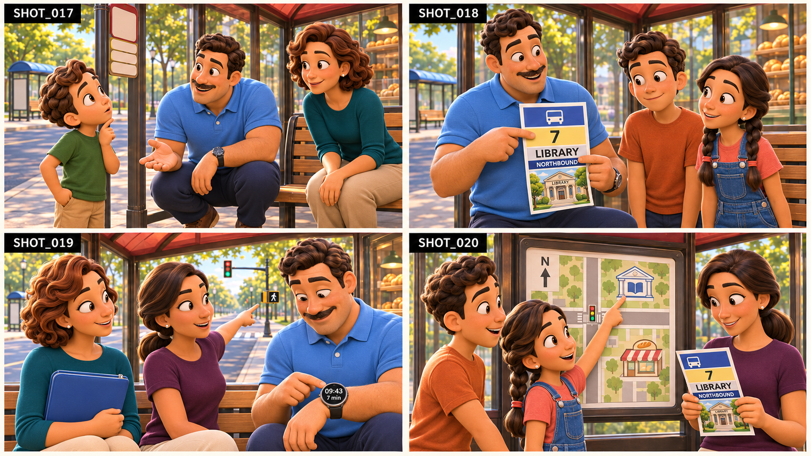

SHOT_017: A stop with no legs · SHOT_018: Right number, wrong direction · SHOT_019: No need to race · SHOT_020: What we know for certain

## BOARD_06 — SHOT_021–SHOT_024

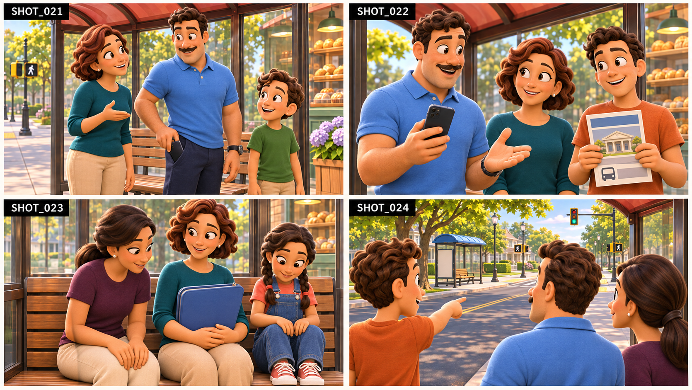

SHOT_021: A useful call, not a rescue · SHOT_022: Say the place before the problem · SHOT_023: One folder stays zipped · SHOT_024: The opposite roof

## BOARD_07 — SHOT_025–SHOT_028

SHOT_025: A map is not the whole street · SHOT_026: A mistake that stays small · SHOT_027: The call begins · SHOT_028: The small embarrassment

## BOARD_08 — SHOT_029–SHOT_032

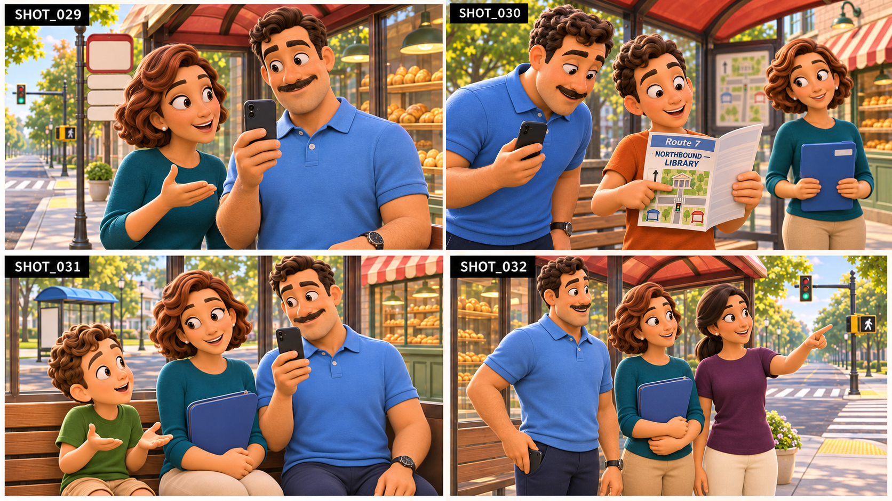

SHOT_029: Tell Ed where we are · SHOT_030: Give the destination a direction · SHOT_031: A reassuring grandfather · SHOT_032: A call that leaves room to act

## BOARD_09 — SHOT_033–SHOT_036

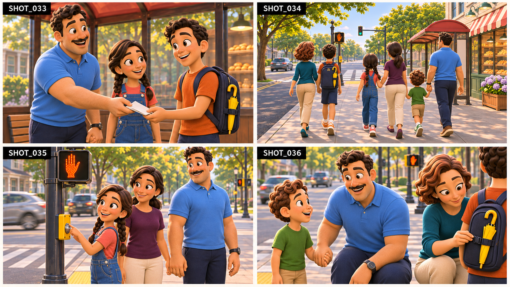

SHOT_033: The better question · SHOT_034: Walking to the signal · SHOT_035: A button is not a green light · SHOT_036: Waiting has a purpose

## BOARD_10 — SHOT_037–SHOT_040

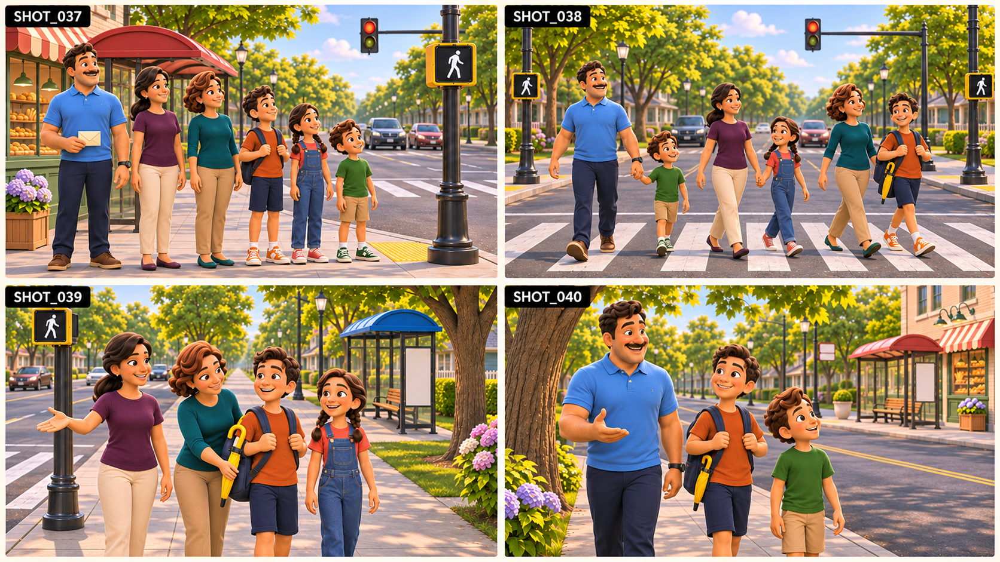

SHOT_037: Look before the first step · SHOT_038: Across in one group · SHOT_039: Back on the sidewalk · SHOT_040: The same street from a new side

## BOARD_11 — SHOT_041–SHOT_044

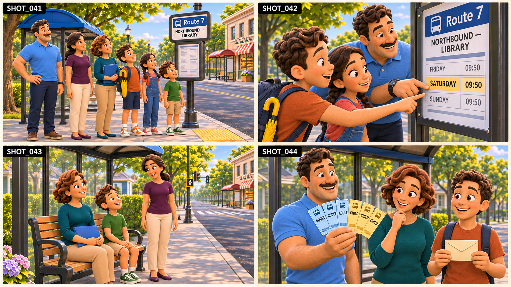

SHOT_041: Northbound at last · SHOT_042: Check a whole line · SHOT_043: Sit before it arrives · SHOT_044: Tickets without confetti

## BOARD_12 — SHOT_045–SHOT_048

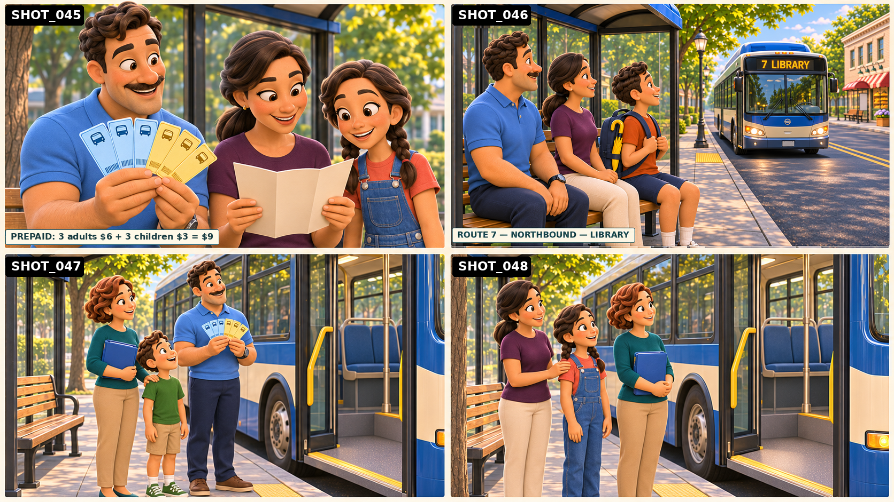

SHOT_045: The fare has no surprise · SHOT_046: The destination on the moving bus · SHOT_047: Doors after wheels · SHOT_048: Space for people getting off

## BOARD_13 — SHOT_049–SHOT_052

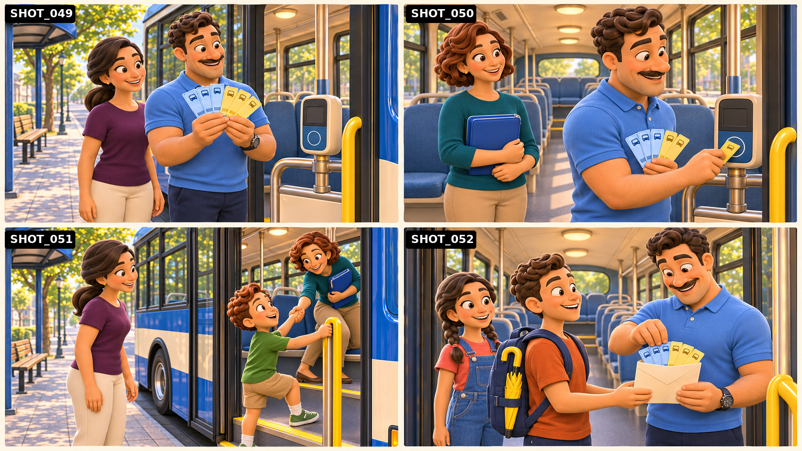

SHOT_049: A quiet hello to the driver · SHOT_050: Six tickets, one careful pass · SHOT_051: A steady step for Max · SHOT_052: Keep the evidence together

## BOARD_14 — SHOT_053–SHOT_056

SHOT_053: Three pairs of seats · SHOT_054: A bag below the window · SHOT_055: At last, a departure · SHOT_056: A window, not a steering wheel

## BOARD_15 — SHOT_057–SHOT_060

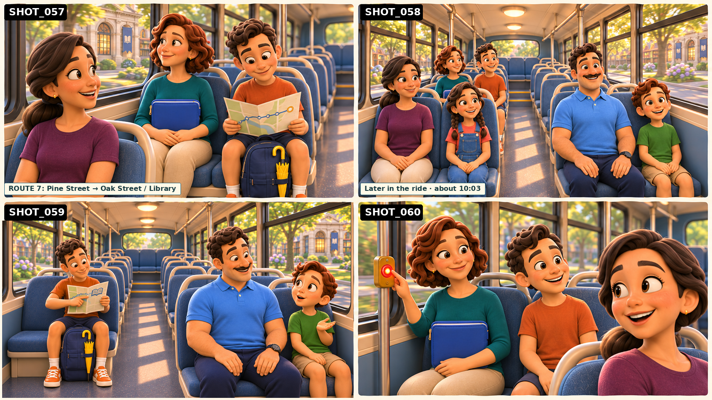

SHOT_057: The route on the leaflet · SHOT_058: A little travel time · SHOT_059: A smaller voice is enough · SHOT_060: One request, once

## BOARD_16 — SHOT_061–SHOT_064

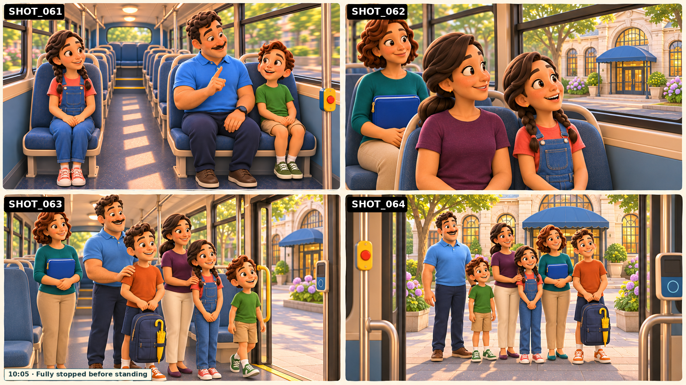

SHOT_061: Ready does not mean standing · SHOT_062: The library through the glass · SHOT_063: Arrival before the aisle · SHOT_064: Six people off safely

## BOARD_17 — SHOT_065–SHOT_068

SHOT_065: Through the right door · SHOT_066: Three old friends come out · SHOT_067: Return the red and blue · SHOT_068: The last return makes room

## BOARD_18 — SHOT_069–SHOT_072

SHOT_069: A display with possibilities · SHOT_070: Leo chooses a wider world · SHOT_071: Ella finds the next small thing · SHOT_072: A dinosaur that fits

## BOARD_19 — SHOT_073–SHOT_076

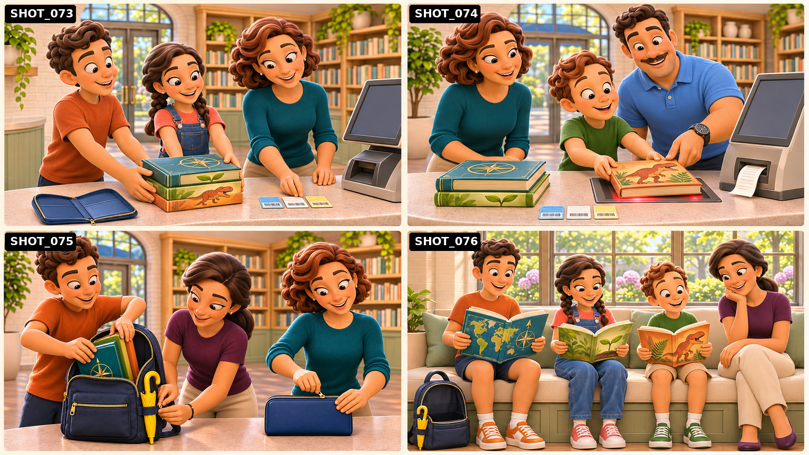

SHOT_073: Borrowing has a record · SHOT_074: Three books checked, no new fare · SHOT_075: Back into the right places · SHOT_076: Open one new page

## BOARD_20 — SHOT_077–SHOT_080

SHOT_077: A quiet place to be honest · SHOT_078: Both parts of the team · SHOT_079: A story for Grandpa later · SHOT_080: The right arrival

## Five clean environment references

### HOME_KITCHEN

### WRONG_STOP

### CORRECT_STOP

### BUS_INTERIOR

### LIBRARY_FOYER

## Original six family identities

[14 unchanged cast previews](assets/characters/)
