# Episode 09 — Can Dad Grow Money? | Garden English | Funny Learning Story: storyboard gallery

The [creator approval record](../CURRENT_PRODUCTION_STATUS.md) identifies reviewed panels. Individual motion first frames require separate approval.

[Shot index](STORYBOARD_INDEX.md) · [HTML gallery](assets/storyboards/index.html) · [Generation notes](assets/storyboards/GENERATION_NOTES.md)

## BOARD_01 — SHOT_001–SHOT_004

SHOT_001: A small garden plan · SHOT_002: A word with two jobs · SHOT_003: Leaves instead of change · SHOT_004: Three homes for plants

## BOARD_02 — SHOT_005–SHOT_008

SHOT_005: A delivery we can count · SHOT_006: Tools have places too · SHOT_007: A drink with a different job · SHOT_008: Outside together

## BOARD_03 — SHOT_009–SHOT_012

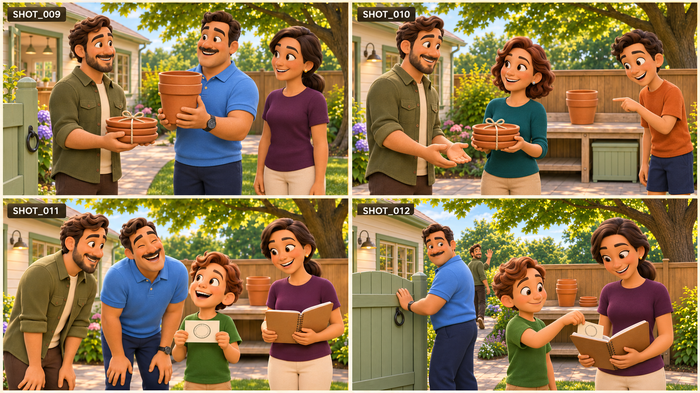

SHOT_009: Uncle Ben brings empty homes · SHOT_010: No hidden forest · SHOT_011: The family resemblance · SHOT_012: A short visit, a real thank-you

## BOARD_04 — SHOT_013–SHOT_016

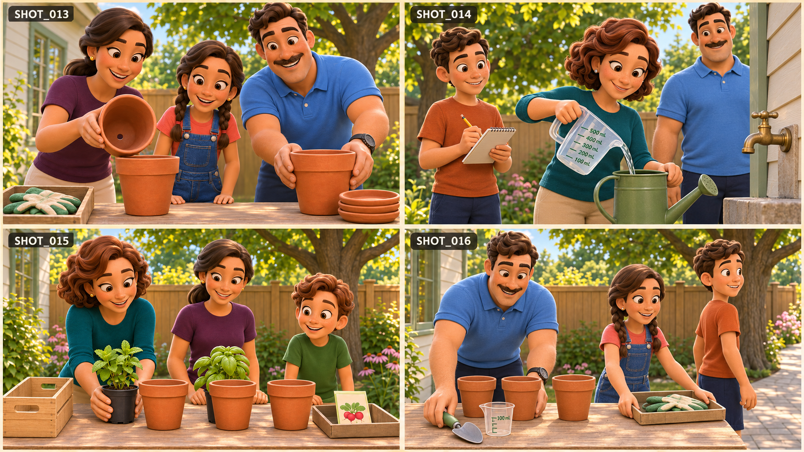

SHOT_013: Look under the pot · SHOT_014: The water has a starting line · SHOT_015: Seedlings are already plants · SHOT_016: A workbench, not a playground

## BOARD_05 — SHOT_017–SHOT_020

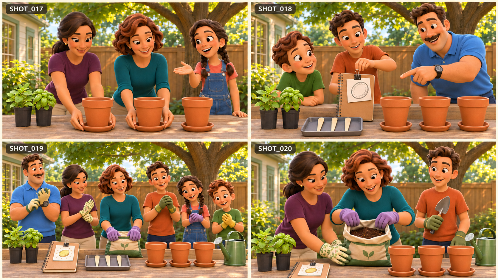

SHOT_017: Saucers under empty pots · SHOT_018: The pretend coin gets a job · SHOT_019: Six gardeners, one safe plan · SHOT_020: Open gently

## BOARD_06 — SHOT_021–SHOT_024

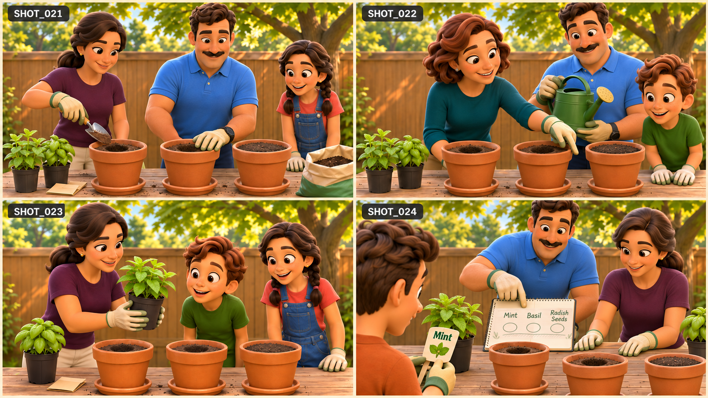

SHOT_021: Room for roots · SHOT_022: Check before the pour · SHOT_023: Look, do not taste · SHOT_024: Find the mint label

## BOARD_07 — SHOT_025–SHOT_028

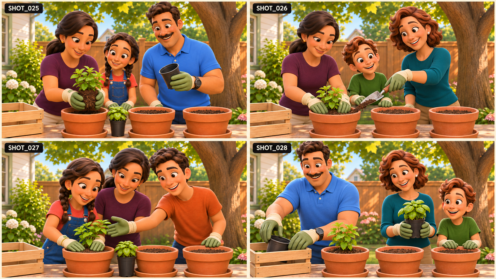

SHOT_025: A small root ball · SHOT_026: Mint finds its home · SHOT_027: Firm, not squashed · SHOT_028: An empty nursery container

## BOARD_08 — SHOT_029–SHOT_032

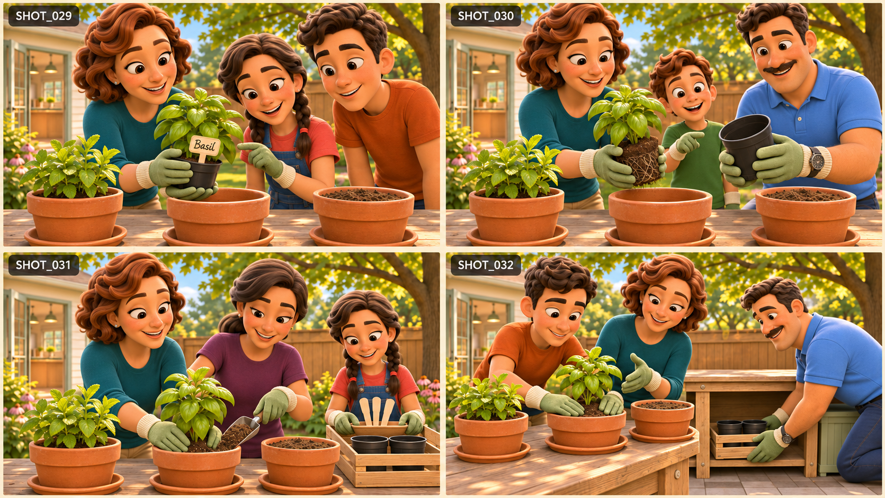

SHOT_029: A different leaf · SHOT_030: Support the basil · SHOT_031: Basil in the middle · SHOT_032: Leave the leaves room

## BOARD_09 — SHOT_033–SHOT_036

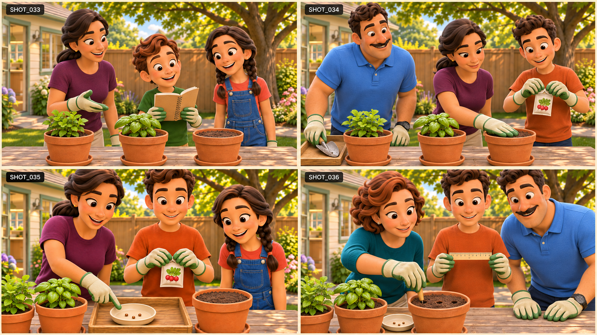

SHOT_033: Two plants, two names · SHOT_034: A quiet seed bed · SHOT_035: Only three for this pot · SHOT_036: Room below and beside

## BOARD_10 — SHOT_037–SHOT_040

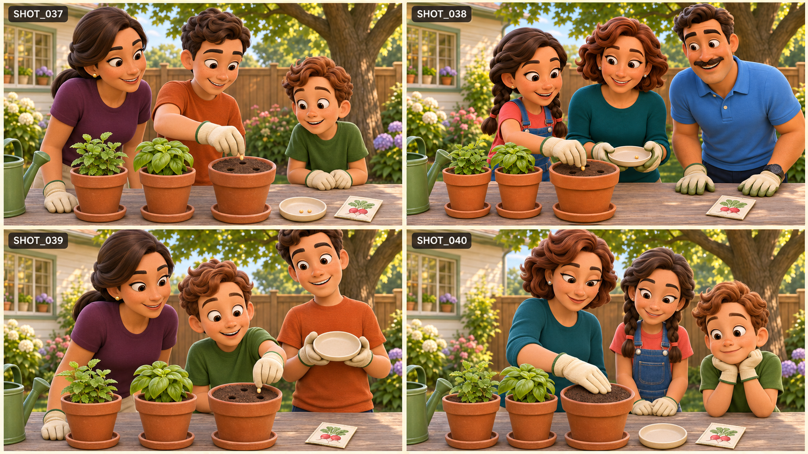

SHOT_037: The first seed · SHOT_038: The second seed · SHOT_039: The third seed · SHOT_040: Covered, not instantly grown

## BOARD_11 — SHOT_041–SHOT_044

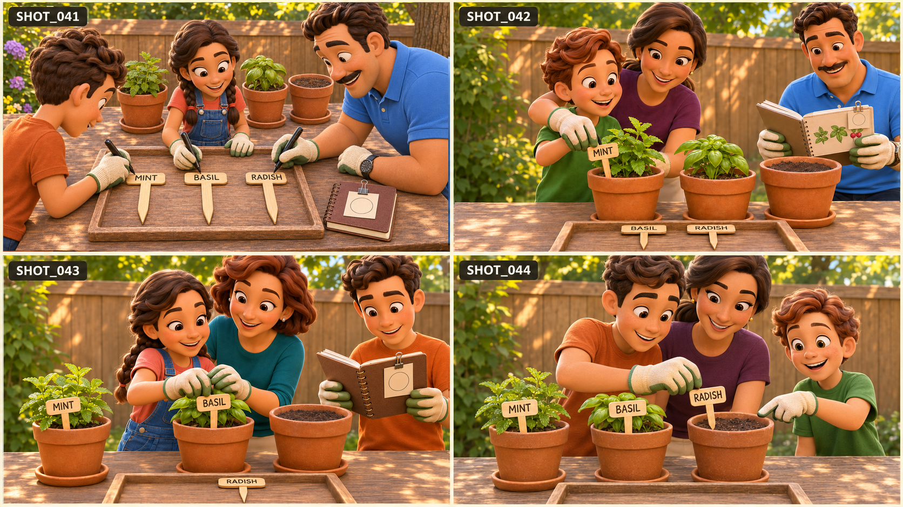

SHOT_041: Write before you stick · SHOT_042: Mint has a nameplate · SHOT_043: Basil belongs here · SHOT_044: A name for an invisible beginning

## BOARD_12 — SHOT_045–SHOT_048

SHOT_045: Day one means day one · SHOT_046: The generous gardener pauses · SHOT_047: A smaller way to check · SHOT_048: A measured drink for mint

## BOARD_13 — SHOT_049–SHOT_052

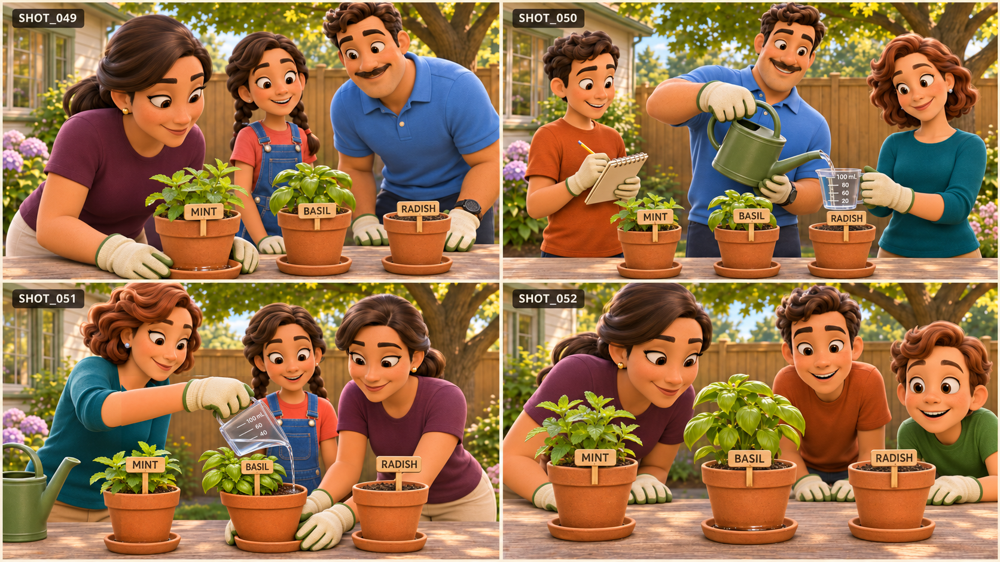

SHOT_049: Wait for the water · SHOT_050: Measure the next drink · SHOT_051: Basil’s turn · SHOT_052: The second saucer tells a story

## BOARD_14 — SHOT_053–SHOT_056

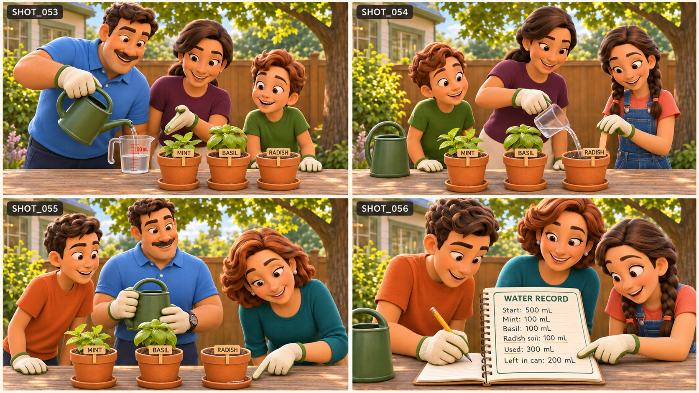

SHOT_053: Water for the hidden seeds · SHOT_054: A gentle final pour · SHOT_055: Enough for this morning · SHOT_056: The numbers stay with the work

## BOARD_15 — SHOT_057–SHOT_060

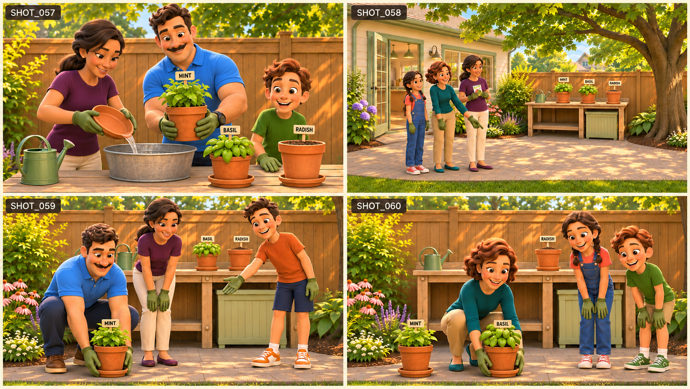

SHOT_057: Drainage is not a bath · SHOT_058: Sunlight has a place · SHOT_059: One pot at a time · SHOT_060: The middle neighbor

## BOARD_16 — SHOT_061–SHOT_064

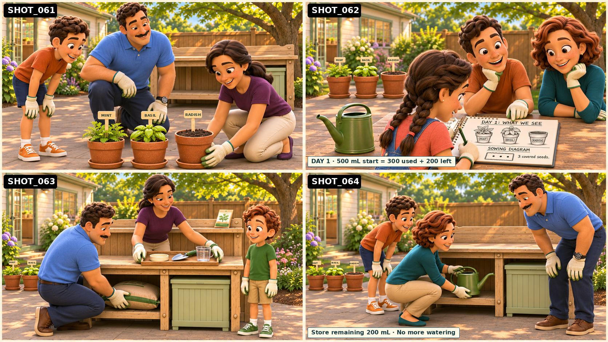

SHOT_061: A place for quiet beginnings · SHOT_062: A picture that tells the truth · SHOT_063: The bench has finished its part · SHOT_064: The unused water is still water

## BOARD_17 — SHOT_065–SHOT_068

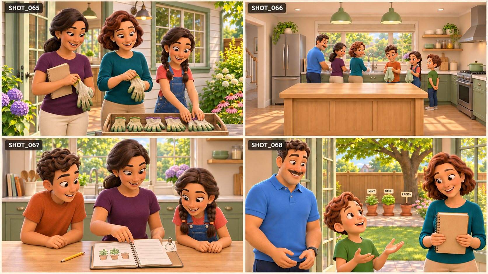

SHOT_065: Gloves off the right way · SHOT_066: Clean hands before anything else · SHOT_067: A dry record comes indoors · SHOT_068: The part that takes longer

## BOARD_18 — SHOT_069–SHOT_072

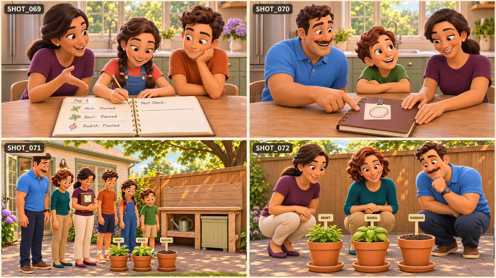

SHOT_069: A promise without a timer · SHOT_070: What the coin can grow · SHOT_071: Back to look, not to interfere · SHOT_072: Room to care

## BOARD_19 — SHOT_073–SHOT_076

SHOT_073: The quiet pot has company · SHOT_074: One question helped more · SHOT_075: Everyone left a useful mark · SHOT_076: What grows next is a surprise

## BOARD_20 — SHOT_077–SHOT_080

SHOT_077: A very small ambition · SHOT_078: One last honest entry · SHOT_079: A garden does not need applause · SHOT_080: The next visit can wait

## Five clean environment references

### HOME_KITCHEN

### HOME_GARDEN

### POTTING_BENCH

### GARDEN_POTS

### GARDEN_PATH

## Original six family identities

[14 unchanged cast previews](assets/characters/)
