# Episode 10 — The Party Cake Went to the Wrong House!: storyboard gallery

The [creator approval record (historical reference)](https://github.com/pujahalder34675-creator/ai-story-building/blob/8362bf7a5ec009104a53857e9bee314a843c1a14/CURRENT_PRODUCTION_STATUS.md) identifies reviewed panels. Individual motion first frames require separate approval.

[Screenplay](STORY.md) · [Video prompts](VIDEO_PROMPTS.md)

## BOARD_01 — SHOT_001–SHOT_004

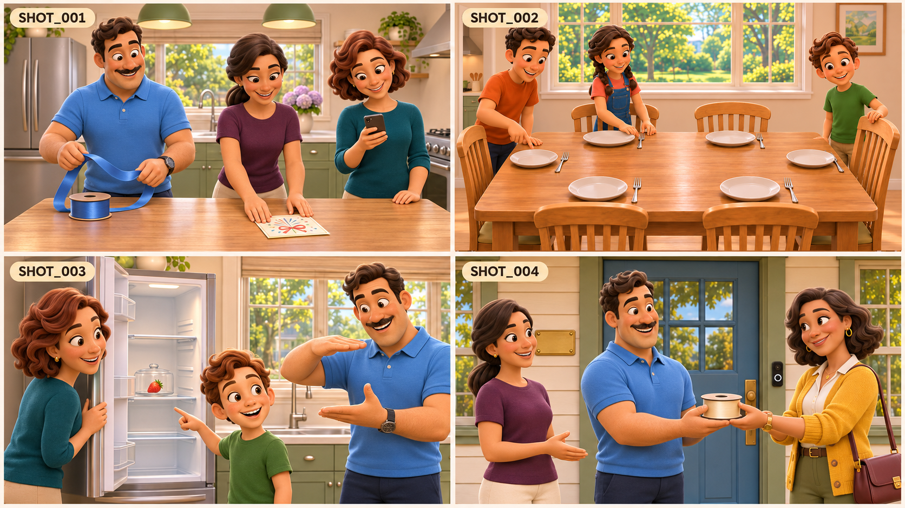

SHOT_001: A party for our team · SHOT_002: Six places, no extra guests · SHOT_003: The smallest backup dessert · SHOT_004: Aunt Rose brings ribbon

## BOARD_02 — SHOT_005–SHOT_008

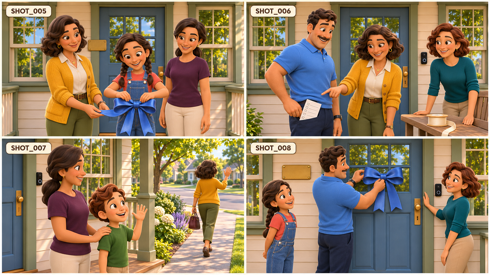

SHOT_005: A bow needs a little room · SHOT_006: Not every mistake is a disaster · SHOT_007: A short visit, a warm goodbye · SHOT_008: The blue door gets its bow

## BOARD_03 — SHOT_009–SHOT_012

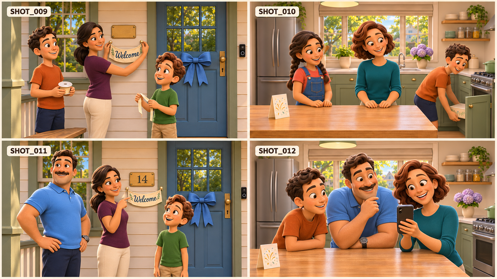

SHOT_009: One banner, a clear doorway · SHOT_010: The decoration box closes · SHOT_011: A door and a number · SHOT_012: The confirmation is correct

## BOARD_04 — SHOT_013–SHOT_016

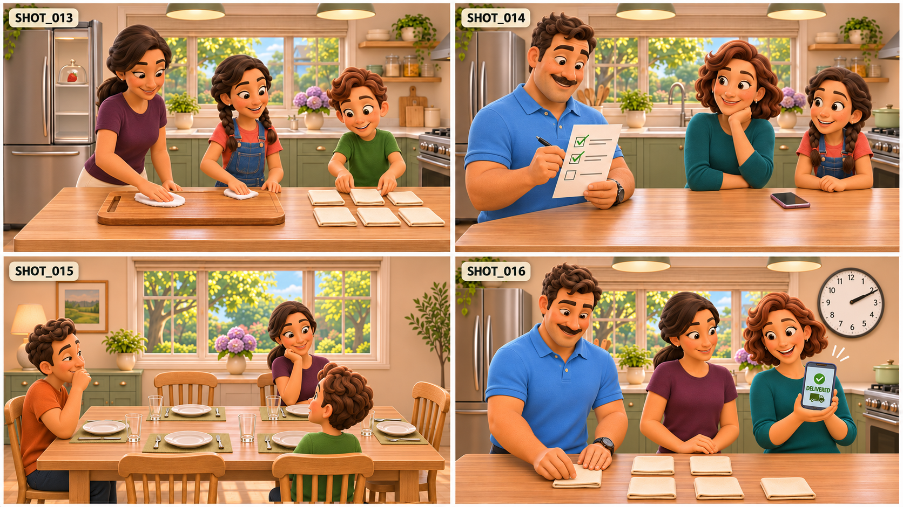

SHOT_013: A clean cake shelf · SHOT_014: The list has a space · SHOT_015: Waiting with company · SHOT_016: A little time passes

## BOARD_05 — SHOT_017–SHOT_020

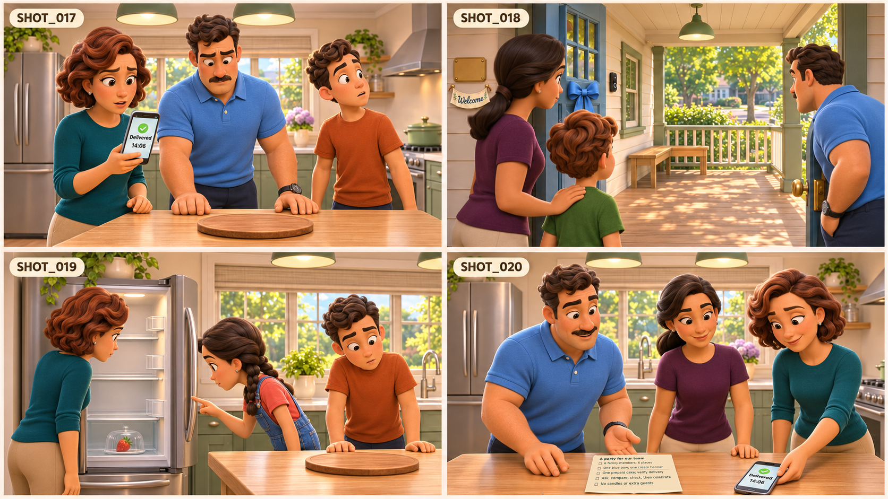

SHOT_017: Delivered, but not here · SHOT_018: Check the doorstep first · SHOT_019: The fridge is not a hiding place · SHOT_020: A perfect plan feels smaller

## BOARD_06 — SHOT_021–SHOT_024

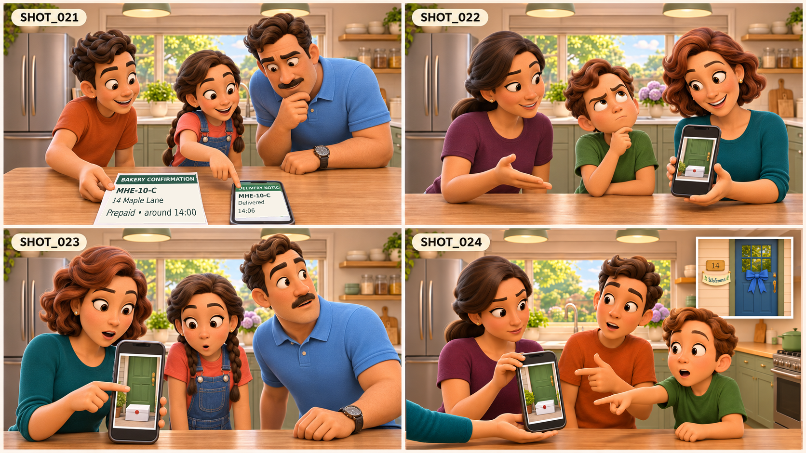

SHOT_021: What do we actually know? · SHOT_022: Nobody has to accuse anyone · SHOT_023: The wrong color in the picture · SHOT_024: A bow that never went there

## BOARD_07 — SHOT_025–SHOT_028

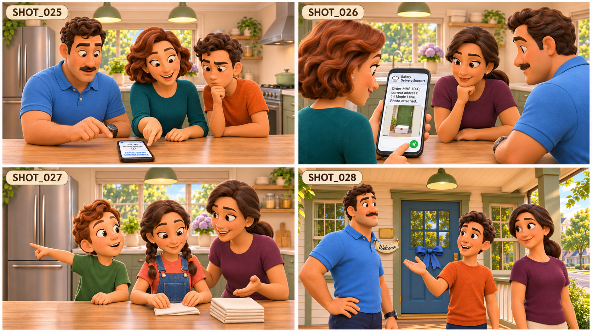

SHOT_025: Read the message completely · SHOT_026: Ask for help with facts · SHOT_027: The small dessert can wait · SHOT_028: Do not follow every green door

## BOARD_08 — SHOT_029–SHOT_032

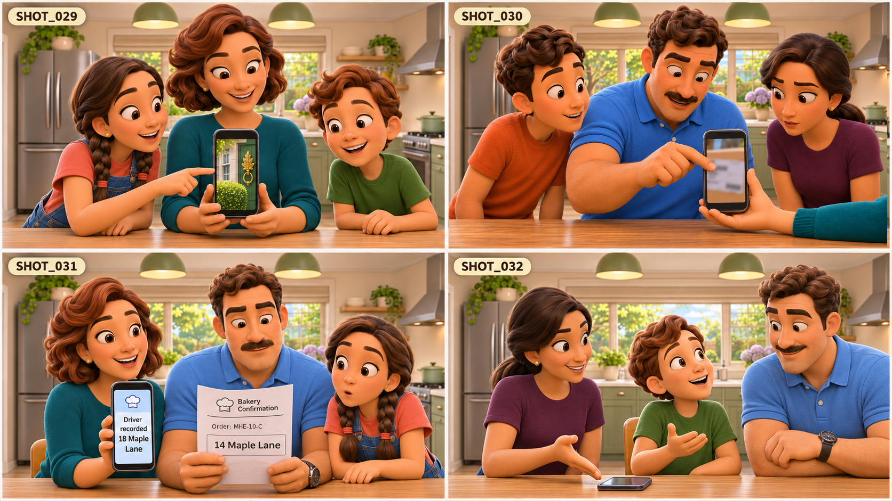

SHOT_029: A detail beside the bell · SHOT_030: The full label is blurry · SHOT_031: A reply gives a useful clue · SHOT_032: Keep one question at a time

## BOARD_09 — SHOT_033–SHOT_036

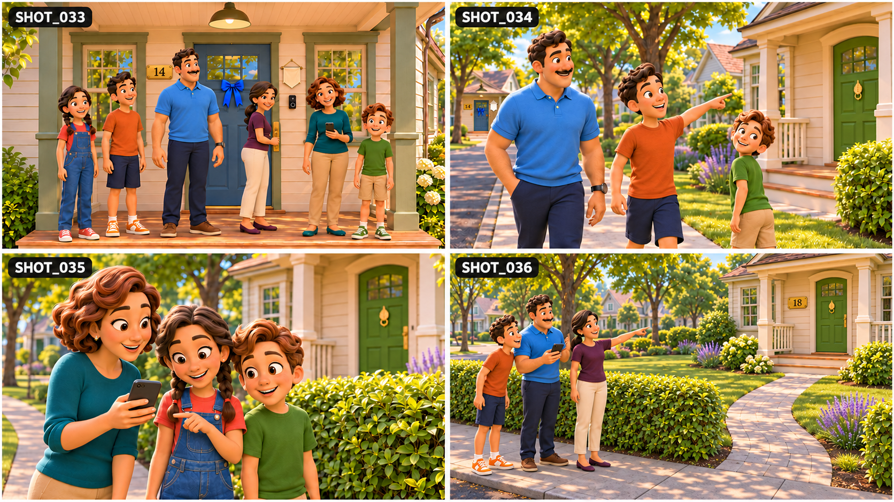

SHOT_033: Who goes and who stays? · SHOT_034: The right direction this time · SHOT_035: A familiar low hedge · SHOT_036: The number is eighteen

## BOARD_10 — SHOT_037–SHOT_040

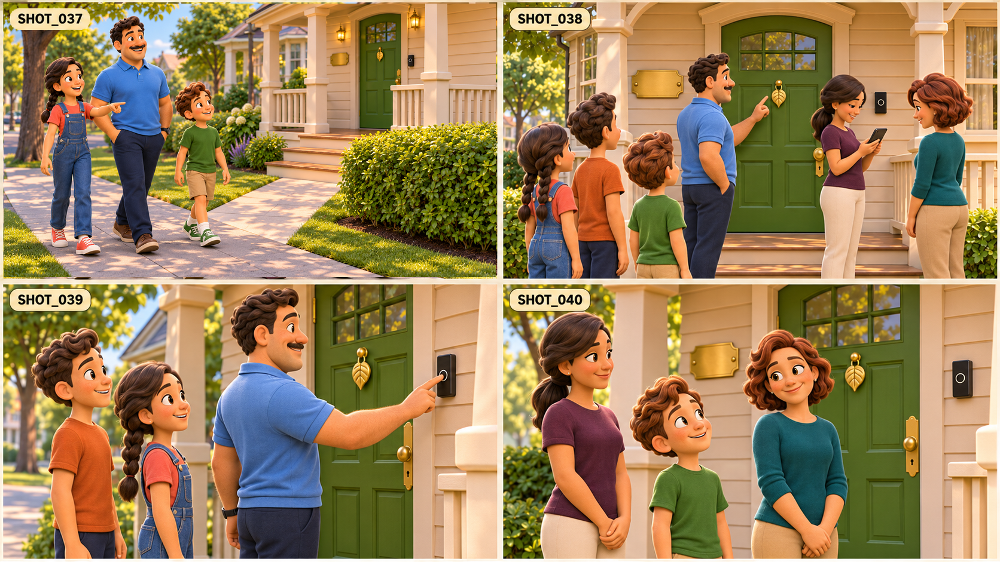

SHOT_037: A private path is not a shortcut · SHOT_038: At the green door · SHOT_039: One ring is enough · SHOT_040: The quiet waiting beat

## BOARD_11 — SHOT_041–SHOT_044

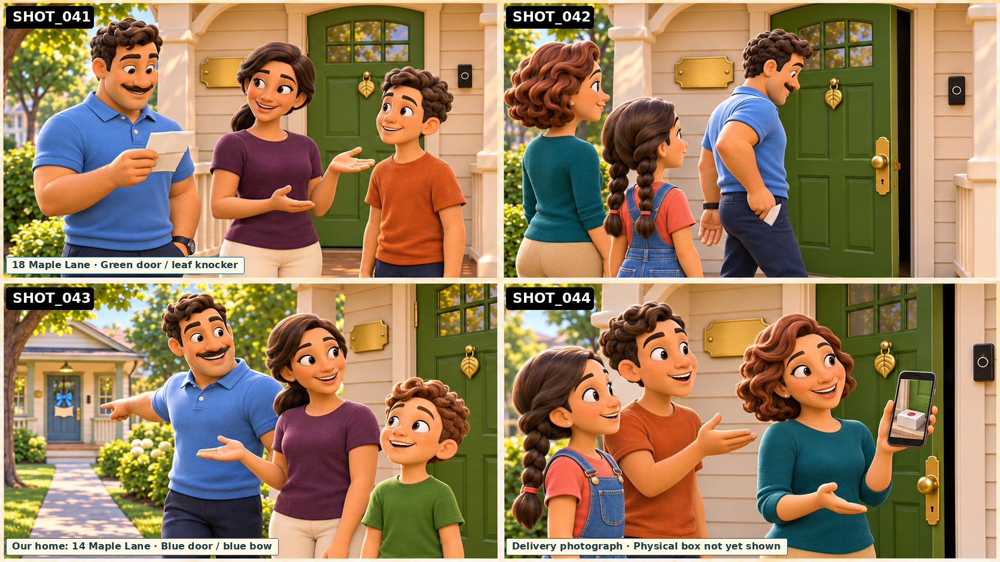

SHOT_041: It is all right to leave a note · SHOT_042: The latch moves · SHOT_043: An introduction, not an accusation · SHOT_044: Describe the box carefully

## BOARD_12 — SHOT_045–SHOT_048

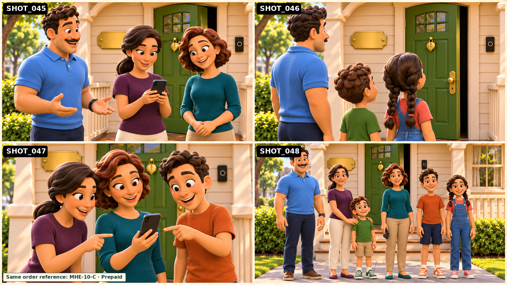

SHOT_045: The question gives room to answer · SHOT_046: A sound from the kitchen · SHOT_047: We brought the right information · SHOT_048: The whole group stays visible

## BOARD_13 — SHOT_049–SHOT_052

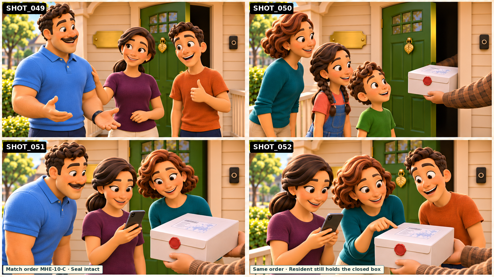

SHOT_049: A small admission while waiting · SHOT_050: The box is coming · SHOT_051: A note from the bakery · SHOT_052: Match the order, not just the color

## BOARD_14 — SHOT_053–SHOT_056

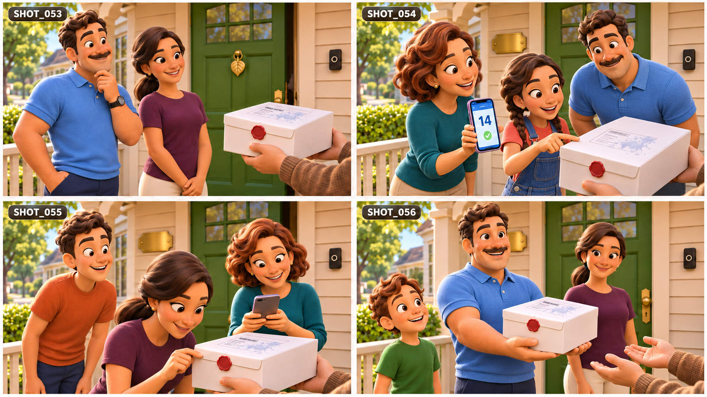

SHOT_053: The neighbor explains · SHOT_054: Four became an uncertain mark · SHOT_055: A seal worth checking · SHOT_056: One careful transfer

## BOARD_15 — SHOT_057–SHOT_060

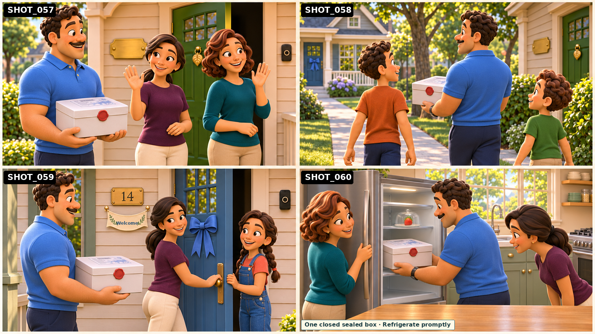

SHOT_057: Thanks before leaving · SHOT_058: Homeward with the right box · SHOT_059: The blue bow welcomes it · SHOT_060: Cold storage comes first

## BOARD_16 — SHOT_061–SHOT_064

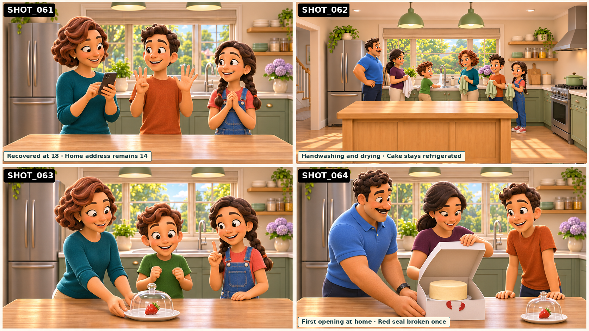

SHOT_061: Close the delivery question · SHOT_062: Hands before dessert · SHOT_063: The emergency strawberry earns a job · SHOT_064: Open the right box once

## BOARD_17 — SHOT_065–SHOT_068

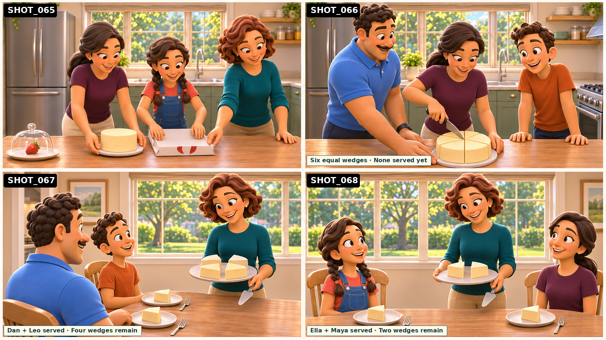

SHOT_065: A place for the empty packaging · SHOT_066: Six slices from one cake · SHOT_067: The first two plates · SHOT_068: Two more, not a refill

## BOARD_18 — SHOT_069–SHOT_072

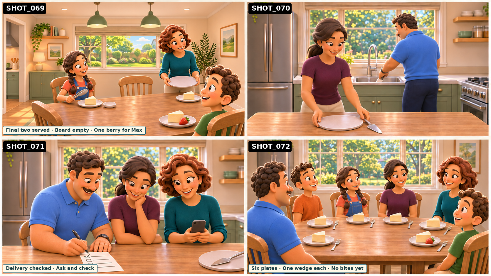

SHOT_069: The last pair completes the table · SHOT_070: Sharp tools stay in the kitchen · SHOT_071: One honest box on the list · SHOT_072: Six seats, one celebration

## BOARD_19 — SHOT_073–SHOT_076

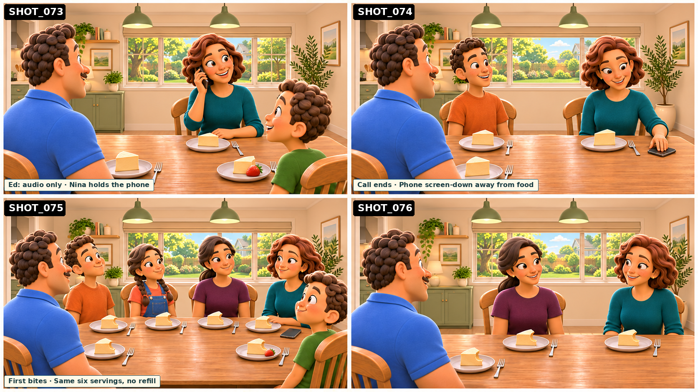

SHOT_073: A short hello from Grandpa Ed · SHOT_074: An address beats a lucky guess · SHOT_075: The first bite is finally simple · SHOT_076: More than the decoration

## BOARD_20 — SHOT_077–SHOT_080

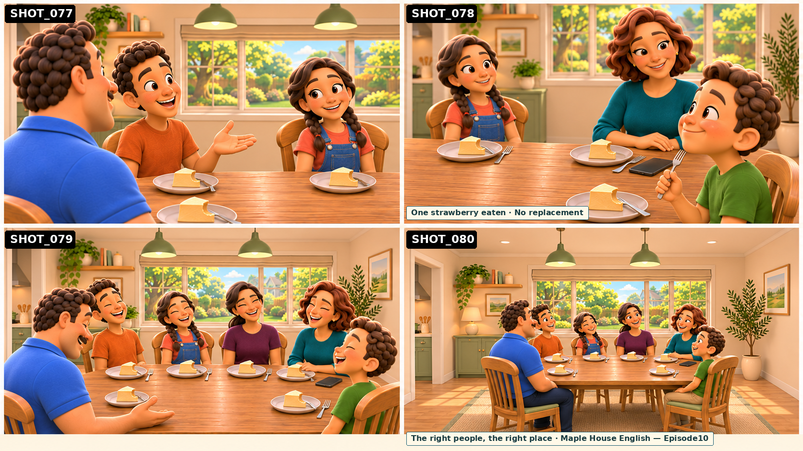

SHOT_077: A different kind of perfect · SHOT_078: The little assistant retires · SHOT_079: One last useful question · SHOT_080: The right place all along

## Five clean environment references

### HOME_KITCHEN

### HOME_TABLE

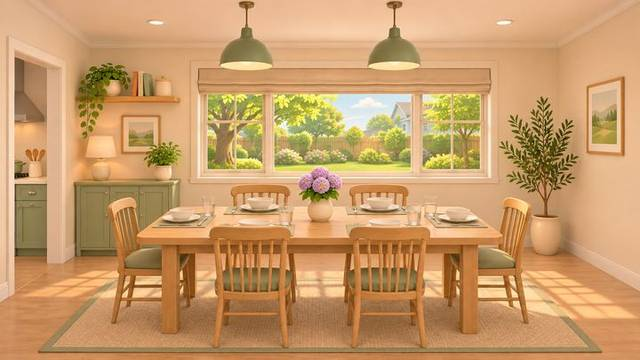

### HOME_PORCH

[HOME_PORCH (historical reference)](https://github.com/pujahalder34675-creator/ai-story-building/blob/8362bf7a5ec009104a53857e9bee314a843c1a14/Episode_10/assets/environments/HOME_PORCH.png)

### NEIGHBOR_PORCH

[NEIGHBOR_PORCH (historical reference)](https://github.com/pujahalder34675-creator/ai-story-building/blob/8362bf7a5ec009104a53857e9bee314a843c1a14/Episode_10/assets/environments/NEIGHBOR_PORCH.png)

### LANE_WALKWAY

[LANE_WALKWAY (historical reference)](https://github.com/pujahalder34675-creator/ai-story-building/blob/8362bf7a5ec009104a53857e9bee314a843c1a14/Episode_10/assets/environments/LANE_WALKWAY.png)

## Original six family identities

[14 unchanged cast previews](../ref/characters/)
