# Storyboard gallery — The Mouse That Ate the Moon!

Read each sheet across the top row and then across the bottom row. Each panel is one 15-second clip. The links beneath each image open the matching dialogue and video direction.

| Sheet | Shots | Time | Beat |
|---|---|---|---|
| [Board 01](#board-01) | 001–004 | 00:00–01:00 | The coffee inspector |
| [Board 02](#board-02) | 005–008 | 01:00–02:00 | One ticket, one family |
| [Board 03](#board-03) | 009–012 | 02:00–03:00 | The sun misses its cue |
| [Board 04](#board-04) | 013–016 | 03:00–04:00 | An indoor sun |
| [Board 05](#board-05) | 017–020 | 04:00–05:00 | Who's doing the squeaking? |
| [Board 06](#board-06) | 021–024 | 05:00–06:00 | The moon disappears |
| [Board 07](#board-07) | 025–028 | 06:00–07:00 | Nobody left to invite |
| [Board 08](#board-08) | 029–032 | 07:00–08:00 | Two kinds of closer |
| [Board 09](#board-09) | 033–036 | 08:00–09:00 | A path for little feet |
| [Board 10](#board-10) | 037–040 | 09:00–10:00 | A voice of his own |
| [Board 11](#board-11) | 041–044 | 10:00–11:00 | A mouse off the edge |
| [Board 12](#board-12) | 045–048 | 11:00–12:00 | Whose left? |
| [Board 13](#board-13) | 049–052 | 12:00–13:00 | A knock on the night's door |
| [Board 14](#board-14) | 053–056 | 13:00–14:00 | The elbow policy |
| [Board 15](#board-15) | 057–060 | 14:00–15:00 | A visitor comes calling |
| [Board 16](#board-16) | 061–064 | 15:00–16:00 | Meet me halfway |
| [Board 17](#board-17) | 065–068 | 16:00–17:00 | The quiet seat |
| [Board 18](#board-18) | 069–072 | 17:00–18:00 | A very big bow |
| [Board 19](#board-19) | 073–076 | 18:00–19:00 | House lights |
| [Board 20](#board-20) | 077–080 | 19:00–20:00 | Company for coffee |

## Board 01 — The coffee inspector

[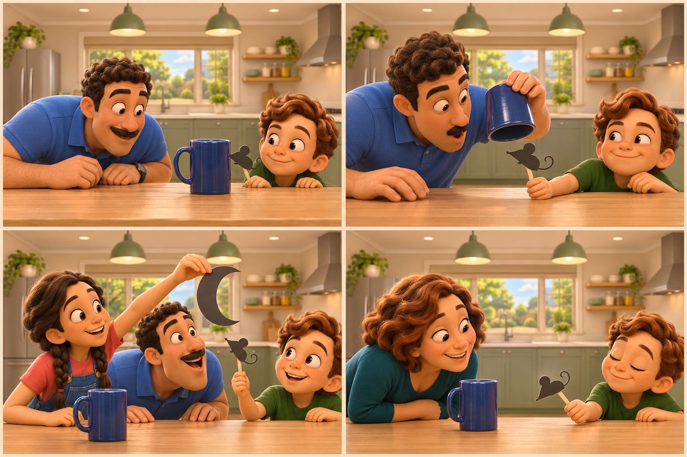](assets/storyboards/BOARD_01.png)

| Panel | Shot and video prompt | Episode time |
|---|---|---|
| Top left | [SHOT_001 · A nose by the mug](VIDEO_PROMPTS.md#shot-001) | 00:00–00:15 |
| Top right | [SHOT_002 · The search party](VIDEO_PROMPTS.md#shot-002) | 00:15–00:30 |
| Bottom left | [SHOT_003 · A banana in the sky](VIDEO_PROMPTS.md#shot-003) | 00:30–00:45 |
| Bottom right | [SHOT_004 · A story of his own](VIDEO_PROMPTS.md#shot-004) | 00:45–01:00 |

## Board 02 — One ticket, one family

[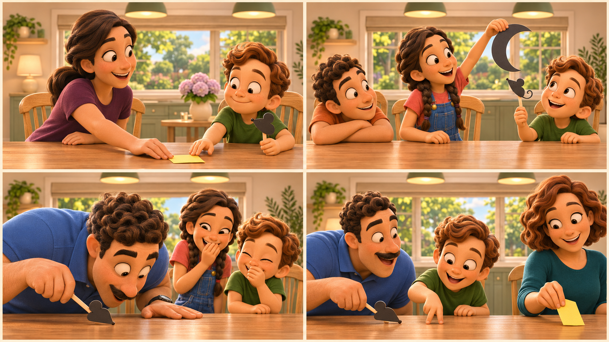](assets/storyboards/BOARD_02.png)

| Panel | Shot and video prompt | Episode time |
|---|---|---|
| Top left | [SHOT_005 · One piece of paper](VIDEO_PROMPTS.md#shot-005) | 01:00–01:15 |
| Top right | [SHOT_006 · Where the moon lives](VIDEO_PROMPTS.md#shot-006) | 01:15–01:30 |
| Bottom left | [SHOT_007 · The fancy bow](VIDEO_PROMPTS.md#shot-007) | 01:30–01:45 |
| Bottom right | [SHOT_008 · Little steps](VIDEO_PROMPTS.md#shot-008) | 01:45–02:00 |

## Board 03 — The sun misses its cue

[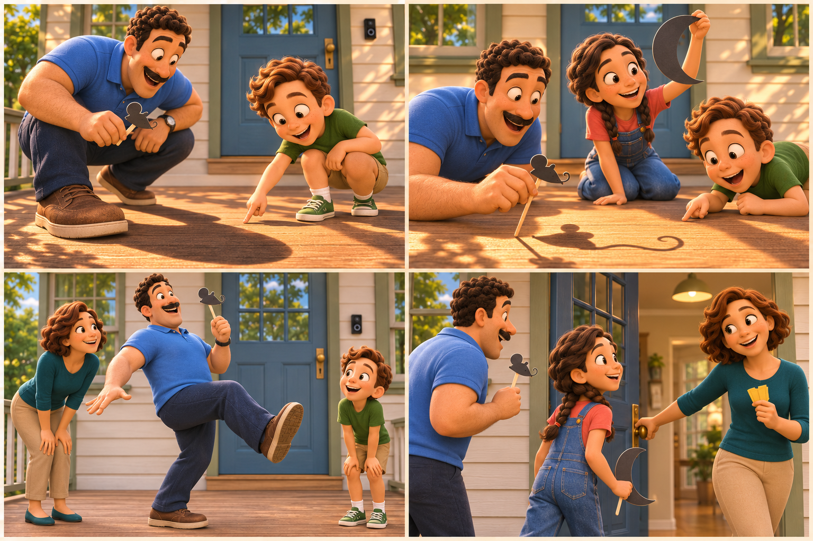](assets/storyboards/BOARD_03.png)

| Panel | Shot and video prompt | Episode time |
|---|---|---|
| Top left | [SHOT_009 · The unpaid understudy](VIDEO_PROMPTS.md#shot-009) | 02:00–02:15 |
| Top right | [SHOT_010 · Pip's very long walk](VIDEO_PROMPTS.md#shot-010) | 02:15–02:30 |
| Bottom left | [SHOT_011 · The sun misses its cue](VIDEO_PROMPTS.md#shot-011) | 02:30–02:45 |
| Bottom right | [SHOT_012 · An indoor sun](VIDEO_PROMPTS.md#shot-012) | 02:45–03:00 |

## Board 04 — An indoor sun

[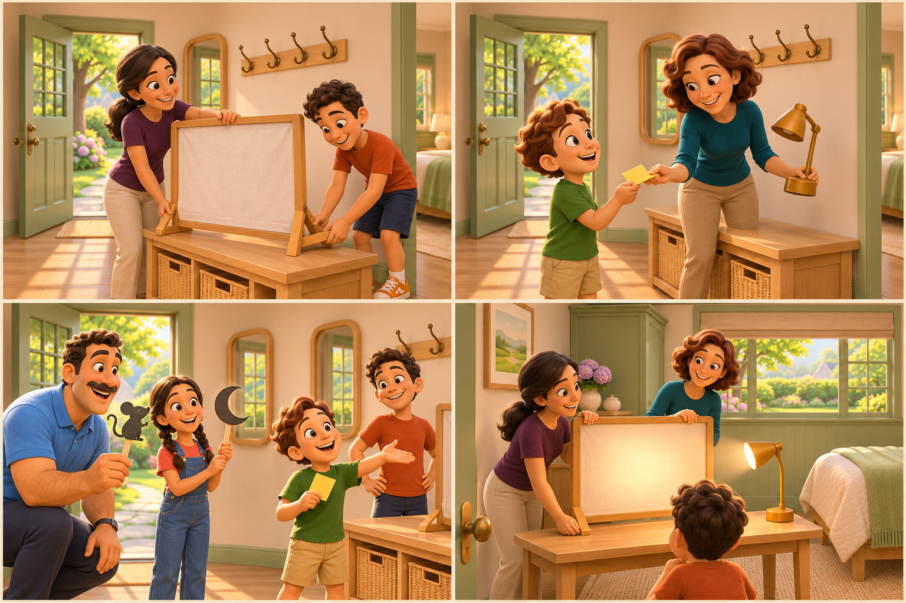](assets/storyboards/BOARD_04.png)

| Panel | Shot and video prompt | Episode time |
|---|---|---|
| Top left | [SHOT_013 · The screen on the bench](VIDEO_PROMPTS.md#shot-013) | 03:00–03:15 |
| Top right | [SHOT_014 · The light department](VIDEO_PROMPTS.md#shot-014) | 03:15–03:30 |
| Bottom left | [SHOT_015 · The job nobody wants](VIDEO_PROMPTS.md#shot-015) | 03:30–03:45 |
| Bottom right | [SHOT_016 · Two sides of one stage](VIDEO_PROMPTS.md#shot-016) | 03:45–04:00 |

## Board 05 — Who's doing the squeaking?

[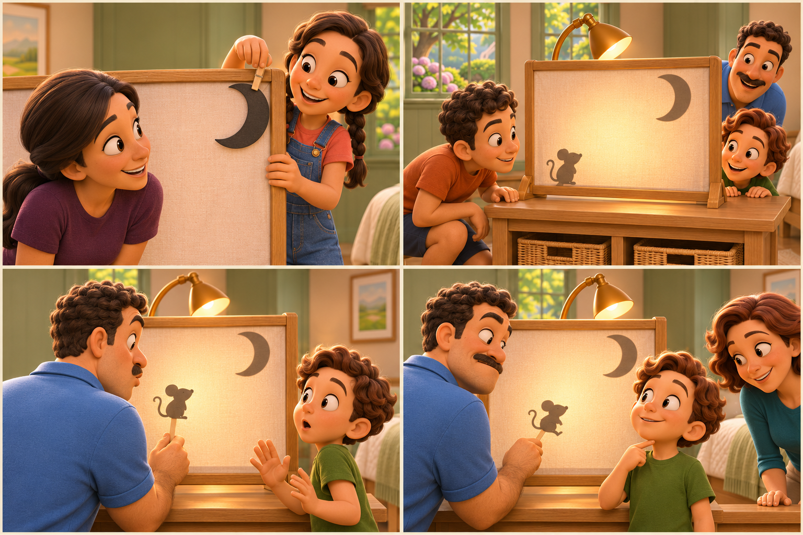](assets/storyboards/BOARD_05.png)

| Panel | Shot and video prompt | Episode time |
|---|---|---|
| Top left | [SHOT_017 · Hanging the moon](VIDEO_PROMPTS.md#shot-017) | 04:00–04:15 |
| Top right | [SHOT_018 · One small traveler](VIDEO_PROMPTS.md#shot-018) | 04:15–04:30 |
| Bottom left | [SHOT_019 · Two voices for one mouse](VIDEO_PROMPTS.md#shot-019) | 04:30–04:45 |
| Bottom right | [SHOT_020 · One voice is plenty](VIDEO_PROMPTS.md#shot-020) | 04:45–05:00 |

## Board 06 — The moon disappears

[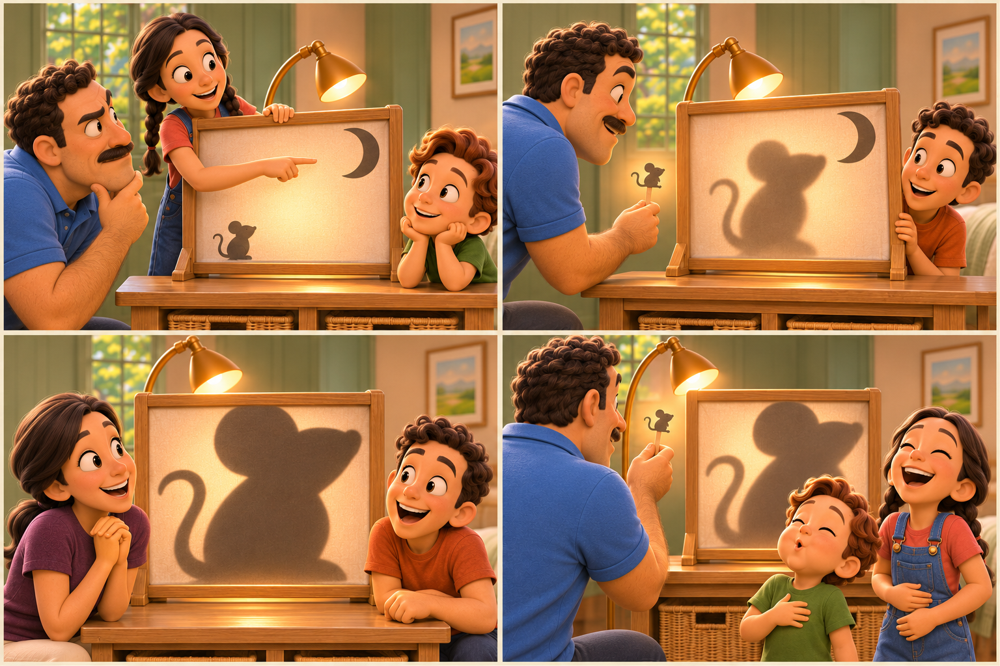](assets/storyboards/BOARD_06.png)

| Panel | Shot and video prompt | Episode time |
|---|---|---|
| Top left | [SHOT_021 · Closer to what?](VIDEO_PROMPTS.md#shot-021) | 05:00–05:15 |
| Top right | [SHOT_022 · The ear that kept going](VIDEO_PROMPTS.md#shot-022) | 05:15–05:30 |
| Bottom left | [SHOT_023 · Where did the sky go?](VIDEO_PROMPTS.md#shot-023) | 05:30–05:45 |
| Bottom right | [SHOT_024 · A very small burp](VIDEO_PROMPTS.md#shot-024) | 05:45–06:00 |

## Board 07 — Nobody left to invite

[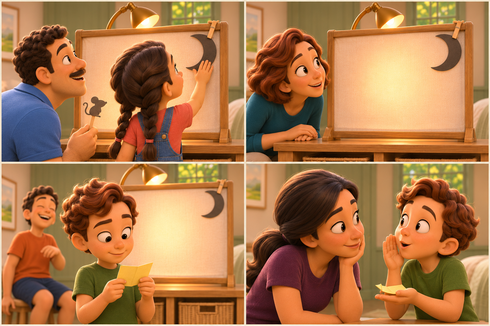](assets/storyboards/BOARD_07.png)

| Panel | Shot and video prompt | Episode time |
|---|---|---|
| Top left | [SHOT_025 · Still on its peg](VIDEO_PROMPTS.md#shot-025) | 06:00–06:15 |
| Top right | [SHOT_026 · A moon on its own](VIDEO_PROMPTS.md#shot-026) | 06:15–06:30 |
| Bottom left | [SHOT_027 · Folded small](VIDEO_PROMPTS.md#shot-027) | 06:30–06:45 |
| Bottom right | [SHOT_028 · Nobody left to invite](VIDEO_PROMPTS.md#shot-028) | 06:45–07:00 |

## Board 08 — Two kinds of closer

[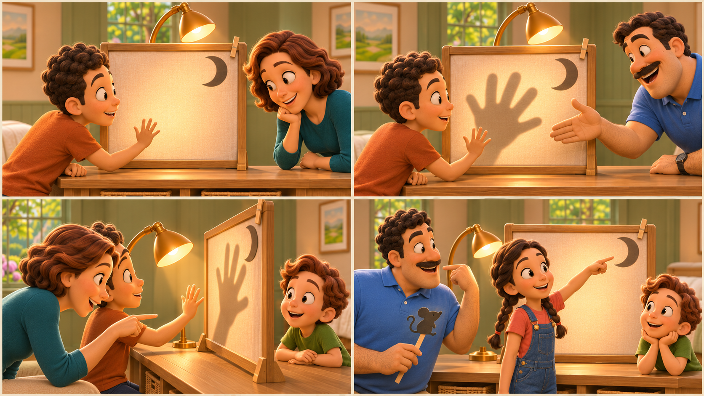](assets/storyboards/BOARD_08.png)

| Panel | Shot and video prompt | Episode time |
|---|---|---|
| Top left | [SHOT_029 · A hand at the screen](VIDEO_PROMPTS.md#shot-029) | 07:00–07:15 |
| Top right | [SHOT_030 · Five enormous reasons](VIDEO_PROMPTS.md#shot-030) | 07:15–07:30 |
| Bottom left | [SHOT_031 · A better look](VIDEO_PROMPTS.md#shot-031) | 07:30–07:45 |
| Bottom right | [SHOT_032 · The rest of the sentence](VIDEO_PROMPTS.md#shot-032) | 07:45–08:00 |

## Board 09 — A path for little feet

[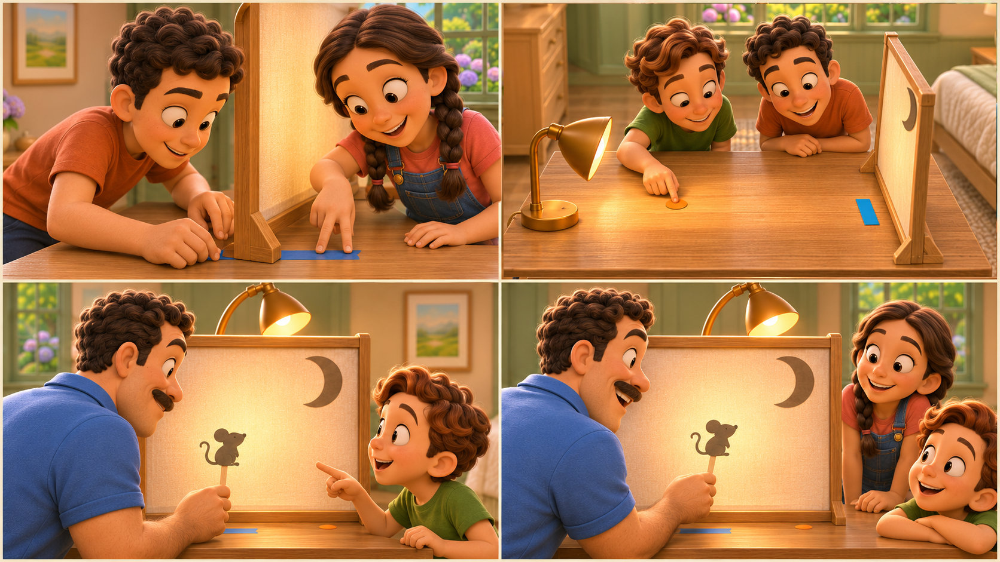](assets/storyboards/BOARD_09.png)

| Panel | Shot and video prompt | Episode time |
|---|---|---|
| Top left | [SHOT_033 · The blue path](VIDEO_PROMPTS.md#shot-033) | 08:00–08:15 |
| Top right | [SHOT_034 · Save the big spot](VIDEO_PROMPTS.md#shot-034) | 08:15–08:30 |
| Bottom left | [SHOT_035 · Small again](VIDEO_PROMPTS.md#shot-035) | 08:30–08:45 |
| Bottom right | [SHOT_036 · Across, not back](VIDEO_PROMPTS.md#shot-036) | 08:45–09:00 |

## Board 10 — A voice of his own

[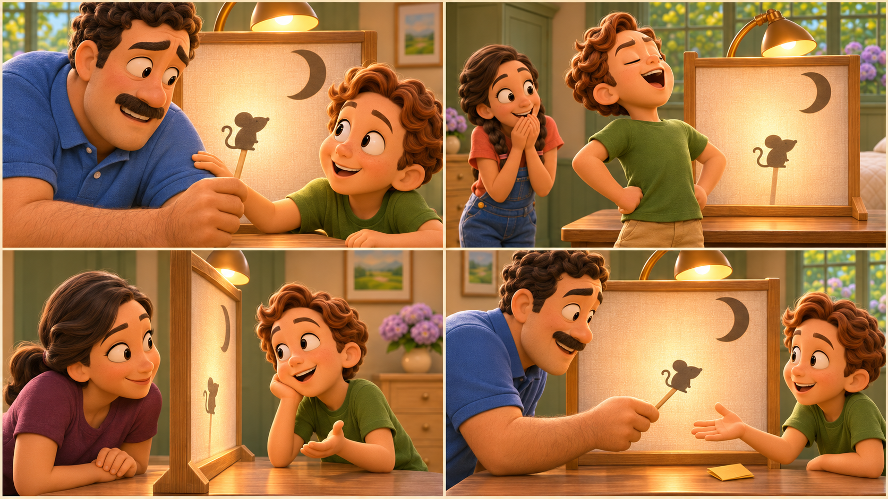](assets/storyboards/BOARD_10.png)

| Panel | Shot and video prompt | Episode time |
|---|---|---|
| Top left | [SHOT_037 · A mouse with stage fright](VIDEO_PROMPTS.md#shot-037) | 09:00–09:15 |
| Top right | [SHOT_038 · The big voice](VIDEO_PROMPTS.md#shot-038) | 09:15–09:30 |
| Bottom left | [SHOT_039 · Through the cloth](VIDEO_PROMPTS.md#shot-039) | 09:30–09:45 |
| Bottom right | [SHOT_040 · Taking the stick](VIDEO_PROMPTS.md#shot-040) | 09:45–10:00 |

## Board 11 — A mouse off the edge

[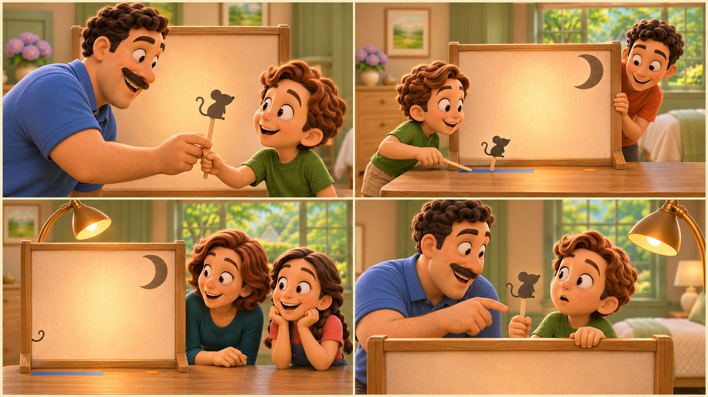](assets/storyboards/BOARD_11.png)

| Panel | Shot and video prompt | Episode time |
|---|---|---|
| Top left | [SHOT_041 · Changing hands](VIDEO_PROMPTS.md#shot-041) | 10:00–10:15 |
| Top right | [SHOT_042 · A lookout for Pip](VIDEO_PROMPTS.md#shot-042) | 10:15–10:30 |
| Bottom left | [SHOT_043 · Just the tail](VIDEO_PROMPTS.md#shot-043) | 10:30–10:45 |
| Bottom right | [SHOT_044 · Who can see the stage?](VIDEO_PROMPTS.md#shot-044) | 10:45–11:00 |

## Board 12 — Whose left?

[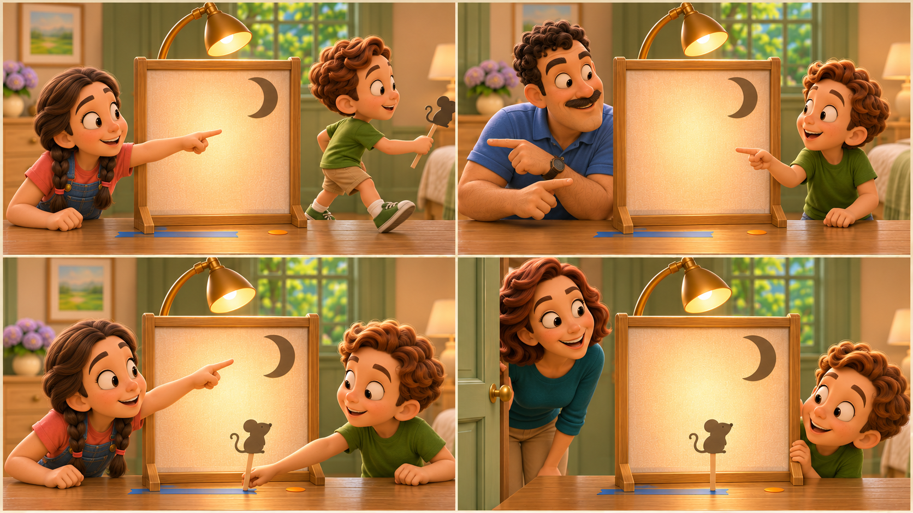](assets/storyboards/BOARD_12.png)

| Panel | Shot and video prompt | Episode time |
|---|---|---|
| Top left | [SHOT_045 · Two different lefts](VIDEO_PROMPTS.md#shot-045) | 11:00–11:15 |
| Top right | [SHOT_046 · Which pair of shoes?](VIDEO_PROMPTS.md#shot-046) | 11:15–11:30 |
| Bottom left | [SHOT_047 · A direction that works](VIDEO_PROMPTS.md#shot-047) | 11:30–11:45 |
| Bottom right | [SHOT_048 · A place for the giant](VIDEO_PROMPTS.md#shot-048) | 11:45–12:00 |

## Board 13 — A knock on the night's door

[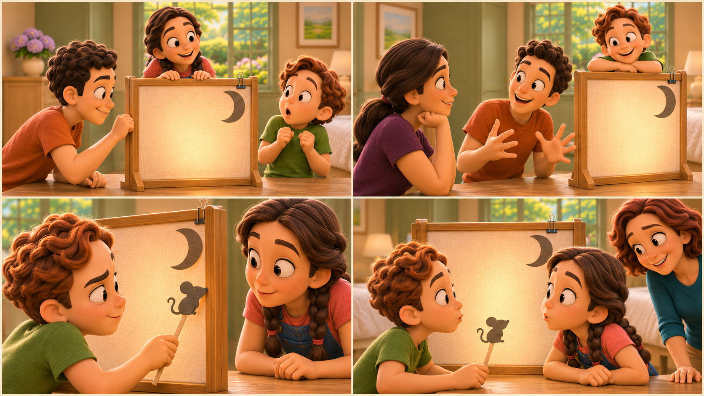](assets/storyboards/BOARD_13.png)

| Panel | Shot and video prompt | Episode time |
|---|---|---|
| Top left | [SHOT_049 · One knock too soon](VIDEO_PROMPTS.md#shot-049) | 12:00–12:15 |
| Top right | [SHOT_050 · An unexpected door](VIDEO_PROMPTS.md#shot-050) | 12:15–12:30 |
| Bottom left | [SHOT_051 · Who's at the moon?](VIDEO_PROMPTS.md#shot-051) | 12:30–12:45 |
| Bottom right | [SHOT_052 · Leave a little room](VIDEO_PROMPTS.md#shot-052) | 12:45–13:00 |

## Board 14 — The elbow policy

[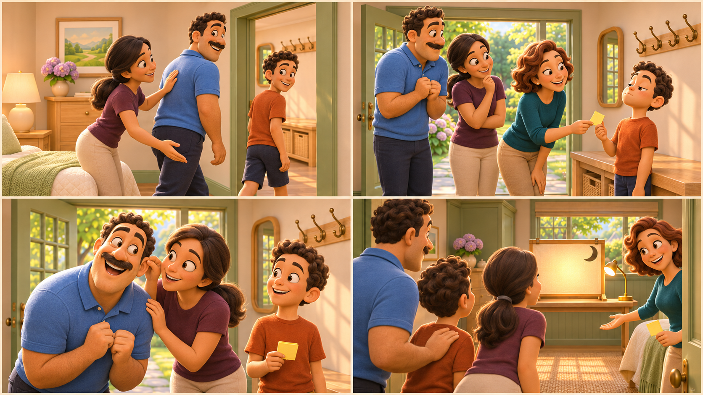](assets/storyboards/BOARD_14.png)

| Panel | Shot and video prompt | Episode time |
|---|---|---|
| Top left | [SHOT_053 · House opens in a minute](VIDEO_PROMPTS.md#shot-053) | 13:00–13:15 |
| Top right | [SHOT_054 · The elbow policy](VIDEO_PROMPTS.md#shot-054) | 13:15–13:30 |
| Bottom left | [SHOT_055 · A crumb behind the ear](VIDEO_PROMPTS.md#shot-055) | 13:30–13:45 |
| Bottom right | [SHOT_056 · A full house](VIDEO_PROMPTS.md#shot-056) | 13:45–14:00 |

## Board 15 — A visitor comes calling

[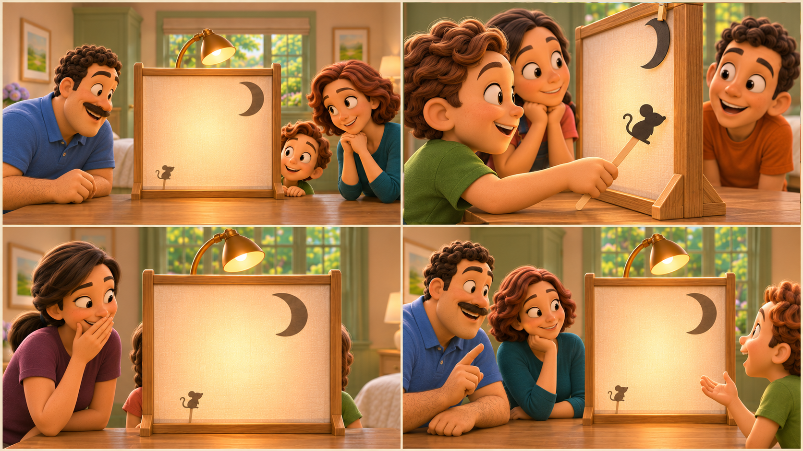](assets/storyboards/BOARD_15.png)

| Panel | Shot and video prompt | Episode time |
|---|---|---|
| Top left | [SHOT_057 · Once, down here](VIDEO_PROMPTS.md#shot-057) | 14:00–14:15 |
| Top right | [SHOT_058 · Knock twice](VIDEO_PROMPTS.md#shot-058) | 14:15–14:30 |
| Bottom left | [SHOT_059 · The cheese rumor](VIDEO_PROMPTS.md#shot-059) | 14:30–14:45 |
| Bottom right | [SHOT_060 · The part Dad leaves in](VIDEO_PROMPTS.md#shot-060) | 14:45–15:00 |

## Board 16 — Meet me halfway

[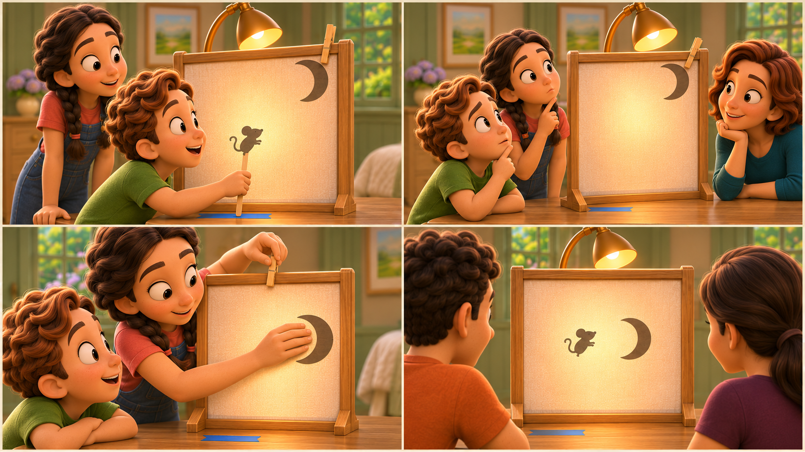](assets/storyboards/BOARD_16.png)

| Panel | Shot and video prompt | Episode time |
|---|---|---|
| Top left | [SHOT_061 · One very short jump](VIDEO_PROMPTS.md#shot-061) | 15:00–15:15 |
| Top right | [SHOT_062 · Halfway](VIDEO_PROMPTS.md#shot-062) | 15:15–15:30 |
| Bottom left | [SHOT_063 · The moon comes down](VIDEO_PROMPTS.md#shot-063) | 15:30–15:45 |
| Bottom right | [SHOT_064 · A whisker of space](VIDEO_PROMPTS.md#shot-064) | 15:45–16:00 |

## Board 17 — The quiet seat

[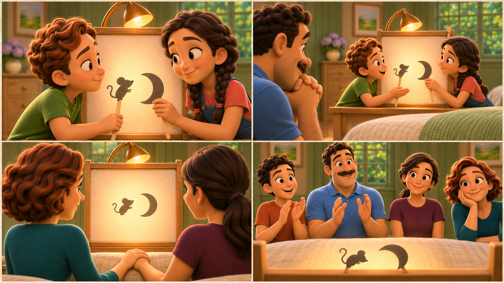](assets/storyboards/BOARD_17.png)

| Panel | Shot and video prompt | Episode time |
|---|---|---|
| Top left | [SHOT_065 · The question](VIDEO_PROMPTS.md#shot-065) | 16:00–16:15 |
| Top right | [SHOT_066 · Dinner for two](VIDEO_PROMPTS.md#shot-066) | 16:15–16:30 |
| Bottom left | [SHOT_067 · The quiet seat](VIDEO_PROMPTS.md#shot-067) | 16:30–16:45 |
| Bottom right | [SHOT_068 · A finish you can hear](VIDEO_PROMPTS.md#shot-068) | 16:45–17:00 |

## Board 18 — A very big bow

[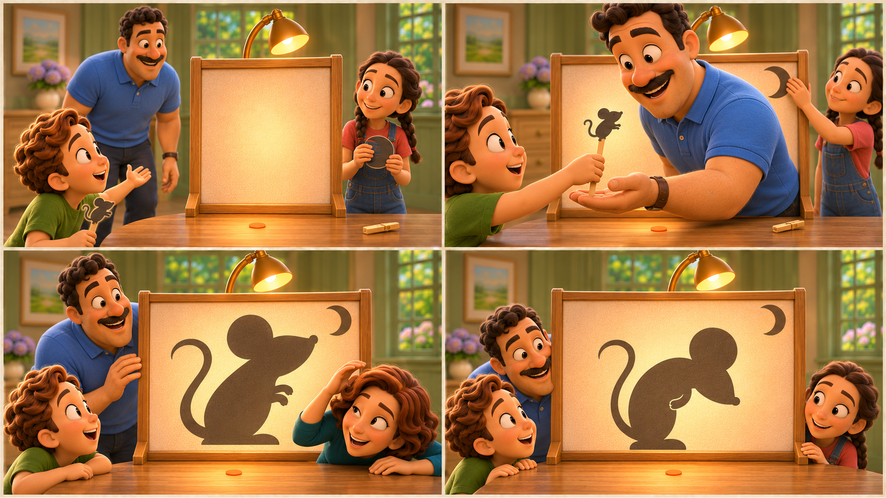](assets/storyboards/BOARD_18.png)

| Panel | Shot and video prompt | Episode time |
|---|---|---|
| Top left | [SHOT_069 · An invitation for Dad](VIDEO_PROMPTS.md#shot-069) | 17:00–17:15 |
| Top right | [SHOT_070 · Back by invitation](VIDEO_PROMPTS.md#shot-070) | 17:15–17:30 |
| Bottom left | [SHOT_071 · The return of the ears](VIDEO_PROMPTS.md#shot-071) | 17:30–17:45 |
| Bottom right | [SHOT_072 · The bow that lands](VIDEO_PROMPTS.md#shot-072) | 17:45–18:00 |

## Board 19 — House lights

[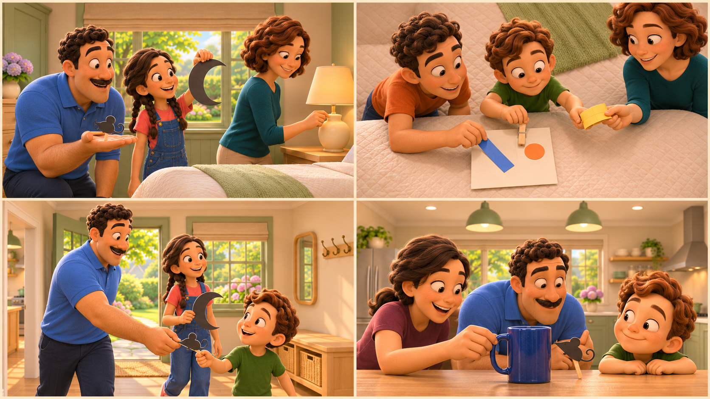](assets/storyboards/BOARD_19.png)

| Panel | Shot and video prompt | Episode time |
|---|---|---|
| Top left | [SHOT_073 · The room comes back](VIDEO_PROMPTS.md#shot-073) | 18:00–18:15 |
| Top right | [SHOT_074 · The smallest stagehand](VIDEO_PROMPTS.md#shot-074) | 18:15–18:30 |
| Bottom left | [SHOT_075 · What to tell Rose](VIDEO_PROMPTS.md#shot-075) | 18:30–18:45 |
| Bottom right | [SHOT_076 · The mug gets a visitor](VIDEO_PROMPTS.md#shot-076) | 18:45–19:00 |

## Board 20 — Company for coffee

[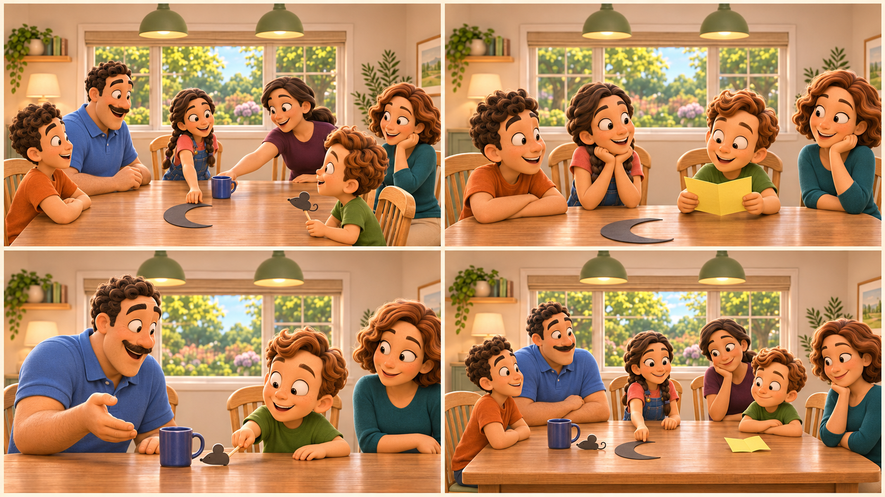](assets/storyboards/BOARD_20.png)

| Panel | Shot and video prompt | Episode time |
|---|---|---|
| Top left | [SHOT_077 · Six seats and a moon](VIDEO_PROMPTS.md#shot-077) | 19:00–19:15 |
| Top right | [SHOT_078 · A rather important review](VIDEO_PROMPTS.md#shot-078) | 19:15–19:30 |
| Bottom left | [SHOT_079 · Closer to whom?](VIDEO_PROMPTS.md#shot-079) | 19:30–19:45 |
| Bottom right | [SHOT_080 · Company for coffee](VIDEO_PROMPTS.md#shot-080) | 19:45–20:00 |
