# Episode 12 storyboard — Dad’s Shoe Is Going to School!

20 of 20 sheets illustrated. Read each sheet across the top row, then across the bottom row. Each panel covers one 10-second shot.

[Screenplay](STORY.md) · [Video prompts](VIDEO_PROMPTS.md)

| Sheet | Episode time | Shot range | Opening beat |
|---|---|---|---|
| [01](#board-01) | 00:00–00:40 | 001–004 | Somebody framed a shoe |
| [02](#board-02) | 00:40–01:20 | 005–008 | A very quiet sock |
| [03](#board-03) | 01:20–02:00 | 009–012 | Both jobs |
| [04](#board-04) | 02:00–02:40 | 013–016 | Which side of the glass? |
| [05](#board-05) | 02:40–03:20 | 017–020 | A gap with a name |
| [06](#board-06) | 03:20–04:00 | 021–024 | Meet Cousin Cushion |
| [07](#board-07) | 04:00–04:40 | 025–028 | A clock the size of a pea |
| [08](#board-08) | 04:40–05:20 | 029–032 | Picture two |
| [09](#board-09) | 05:20–06:00 | 033–036 | A different kind of help |
| [10](#board-10) | 06:00–06:40 | 037–040 | A smile Max can keep |
| [11](#board-11) | 06:40–07:20 | 041–044 | The space stays open |
| [12](#board-12) | 07:20–08:00 | 045–048 | The look from the dentist |
| [13](#board-13) | 08:00–08:40 | 049–052 | The part under the bow |
| [14](#board-14) | 08:40–09:20 | 053–056 | Whose fingers? |
| [15](#board-15) | 09:20–10:00 | 057–060 | One more, by myself |
| [16](#board-16) | 10:00–10:40 | 061–064 | Make room for a shoe |
| [17](#board-17) | 10:40–11:20 | 065–068 | After the click |
| [18](#board-18) | 11:20–12:00 | 069–072 | The one where we're all looking |
| [19](#board-19) | 12:00–12:40 | 073–076 | Toe first |
| [20](#board-20) | 12:40–13:20 | 077–080 | The rest of that old story |

## Board 01 — Somebody framed a shoe

[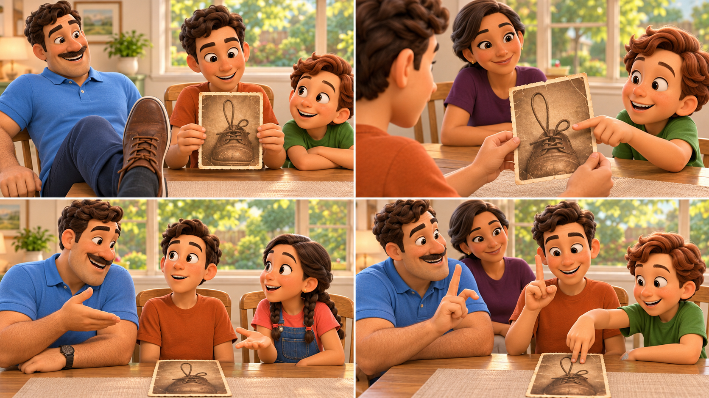](storyboards/BOARD_01.png)

| Panel | Screenplay shot | Episode time |
|---|---|---|
| Top left | [SHOT_001 · Somebody framed a shoe](STORY.md#shot-001) | 00:00–00:10 |
| Top right | [SHOT_002 · The part that made the cut](STORY.md#shot-002) | 00:10–00:20 |
| Bottom left | [SHOT_003 · Of Dad and by Leo](STORY.md#shot-003) | 00:20–00:30 |
| Bottom right | [SHOT_004 · A rabbit with one good ear](STORY.md#shot-004) | 00:30–00:40 |

## Board 02 — A very quiet sock

[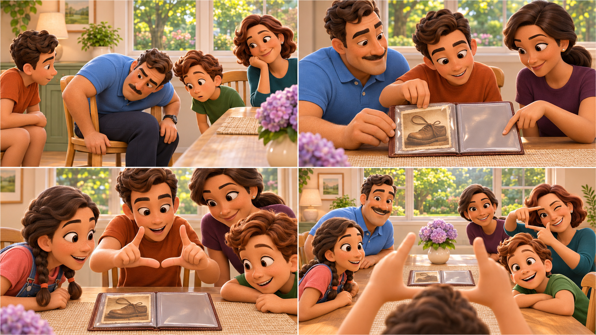](storyboards/BOARD_02.png)

| Panel | Screenplay shot | Episode time |
|---|---|---|
| Top left | [SHOT_005 · A very quiet sock](STORY.md#shot-005) | 00:40–00:50 |
| Top right | [SHOT_006 · The first pocket](STORY.md#shot-006) | 00:50–01:00 |
| Bottom left | [SHOT_007 · Tomorrow's page](STORY.md#shot-007) | 01:00–01:10 |
| Bottom right | [SHOT_008 · The photographer's trick](STORY.md#shot-008) | 01:10–01:20 |

## Board 03 — Both jobs

[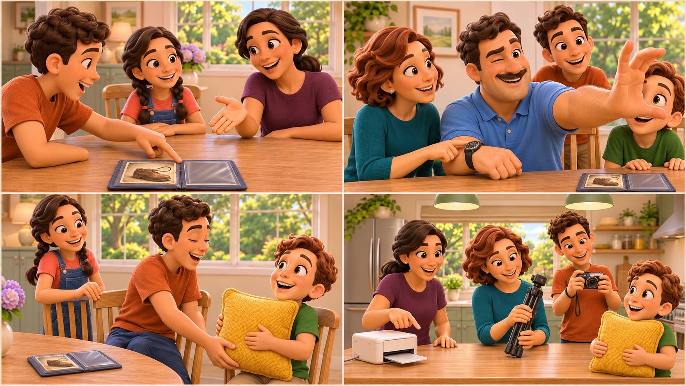](storyboards/BOARD_03.png)

| Panel | Screenplay shot | Episode time |
|---|---|---|
| Top left | [SHOT_009 · Both jobs](STORY.md#shot-009) | 01:20–01:30 |
| Top right | [SHOT_010 · The long-arm solution](STORY.md#shot-010) | 01:30–01:40 |
| Bottom left | [SHOT_011 · A place to come back to](STORY.md#shot-011) | 01:40–01:50 |
| Bottom right | [SHOT_012 · Something that stands on three legs](STORY.md#shot-012) | 01:50–02:00 |

## Board 04 — Which side of the glass?

[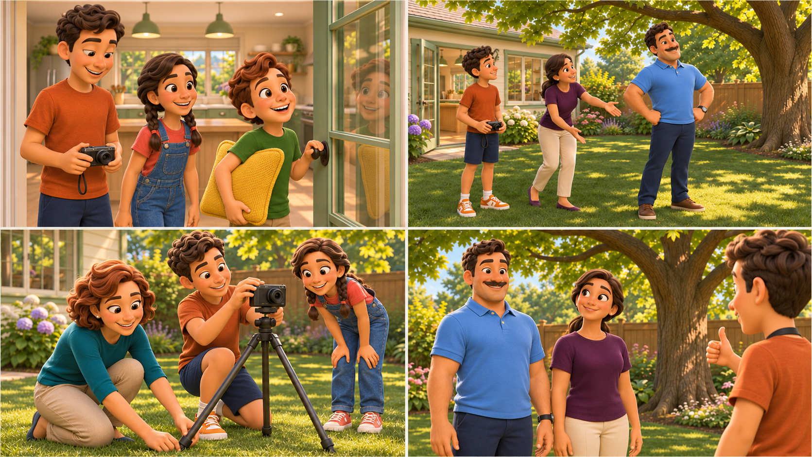](storyboards/BOARD_04.png)

| Panel | Screenplay shot | Episode time |
|---|---|---|
| Top left | [SHOT_013 · Which side of the glass?](STORY.md#shot-013) | 02:00–02:10 |
| Top right | [SHOT_014 · A spot where eyes can open](STORY.md#shot-014) | 02:10–02:20 |
| Bottom left | [SHOT_015 · Three feet on the lawn](STORY.md#shot-015) | 02:20–02:30 |
| Bottom right | [SHOT_016 · A branch through Dad's head](STORY.md#shot-016) | 02:30–02:40 |

## Board 05 — A gap with a name

[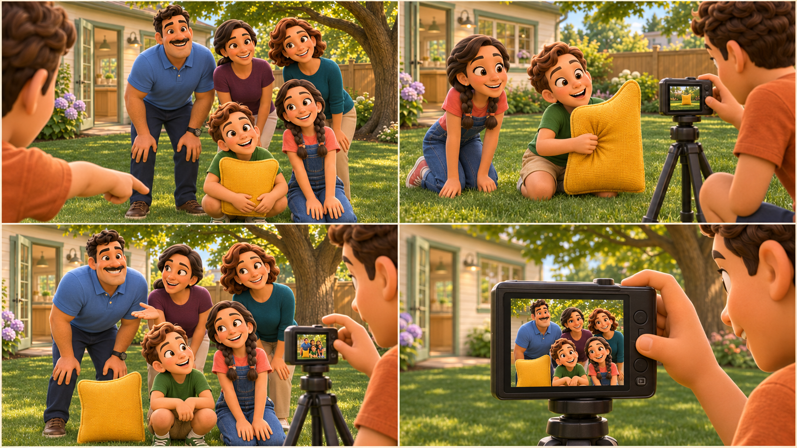](storyboards/BOARD_05.png)

| Panel | Screenplay shot | Episode time |
|---|---|---|
| Top left | [SHOT_017 · A gap with a name](STORY.md#shot-017) | 02:40–02:50 |
| Top right | [SHOT_018 · A stand-in with a dent](STORY.md#shot-018) | 02:50–03:00 |
| Bottom left | [SHOT_019 · The first request](STORY.md#shot-019) | 03:00–03:10 |
| Bottom right | [SHOT_020 · Picture one](STORY.md#shot-020) | 03:10–03:20 |

## Board 06 — Meet Cousin Cushion

[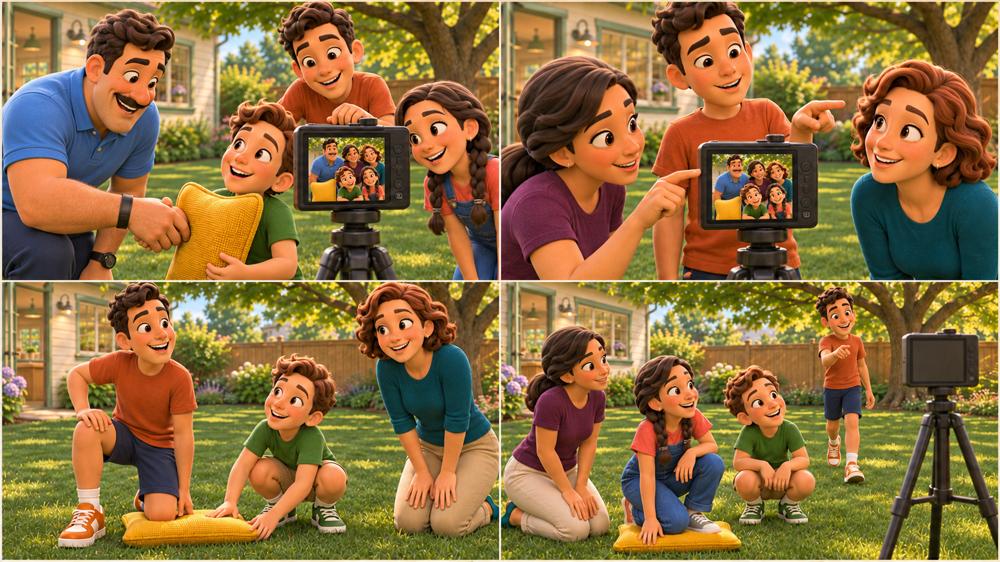](storyboards/BOARD_06.png)

| Panel | Screenplay shot | Episode time |
|---|---|---|
| Top left | [SHOT_021 · Meet Cousin Cushion](STORY.md#shot-021) | 03:20–03:30 |
| Top right | [SHOT_022 · What a camera shows](STORY.md#shot-022) | 03:30–03:40 |
| Bottom left | [SHOT_023 · What the cushion can do](STORY.md#shot-023) | 03:40–03:50 |
| Bottom right | [SHOT_024 · Directions from his own spot](STORY.md#shot-024) | 03:50–04:00 |

## Board 07 — A clock the size of a pea

[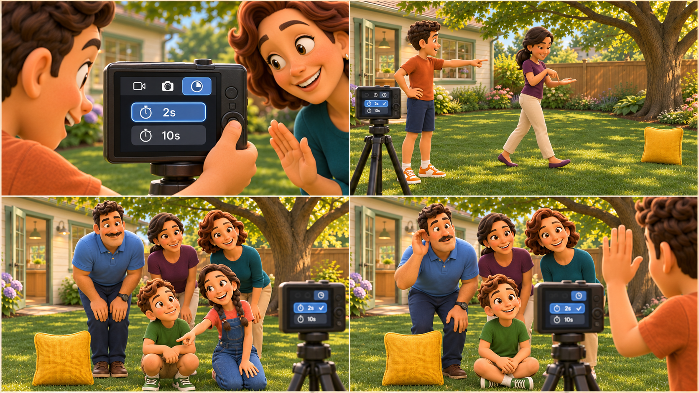](storyboards/BOARD_07.png)

| Panel | Screenplay shot | Episode time |
|---|---|---|
| Top left | [SHOT_025 · A clock the size of a pea](STORY.md#shot-025) | 04:00–04:10 |
| Top right | [SHOT_026 · Two steps and a bit](STORY.md#shot-026) | 04:10–04:20 |
| Bottom left | [SHOT_027 · Leave a lane](STORY.md#shot-027) | 04:20–04:30 |
| Bottom right | [SHOT_028 · Who listens for the click?](STORY.md#shot-028) | 04:30–04:40 |

## Board 08 — Picture two

[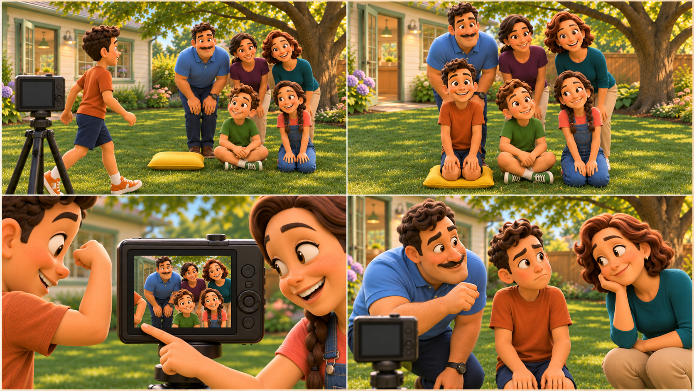](storyboards/BOARD_08.png)

| Panel | Screenplay shot | Episode time |
|---|---|---|
| Top left | [SHOT_029 · Picture two](STORY.md#shot-029) | 04:40–04:50 |
| Top right | [SHOT_030 · A perfect pose for nobody](STORY.md#shot-030) | 04:50–05:00 |
| Bottom left | [SHOT_031 · A very small portrait of Leo](STORY.md#shot-031) | 05:00–05:10 |
| Bottom right | [SHOT_032 · No votes from the elbow](STORY.md#shot-032) | 05:10–05:20 |

## Board 09 — A different kind of help

[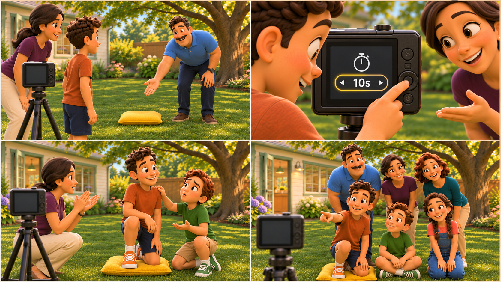](storyboards/BOARD_09.png)

| Panel | Screenplay shot | Episode time |
|---|---|---|
| Top left | [SHOT_033 · A different kind of help](STORY.md#shot-033) | 05:20–05:30 |
| Top right | [SHOT_034 · Ten instead of two](STORY.md#shot-034) | 05:30–05:40 |
| Bottom left | [SHOT_035 · The walk, including the turn](STORY.md#shot-035) | 05:40–05:50 |
| Bottom right | [SHOT_036 · What to look at](STORY.md#shot-036) | 05:50–06:00 |

## Board 10 — A smile Max can keep

[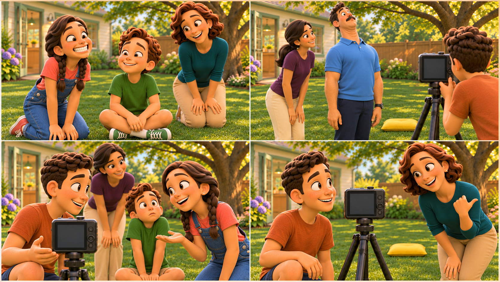](storyboards/BOARD_10.png)

| Panel | Screenplay shot | Episode time |
|---|---|---|
| Top left | [SHOT_037 · A smile Max can keep](STORY.md#shot-037) | 06:00–06:10 |
| Top right | [SHOT_038 · The family chin](STORY.md#shot-038) | 06:10–06:20 |
| Bottom left | [SHOT_039 · Who calls it?](STORY.md#shot-039) | 06:20–06:30 |
| Bottom right | [SHOT_040 · One less job to carry](STORY.md#shot-040) | 06:30–06:40 |

## Board 11 — The space stays open

[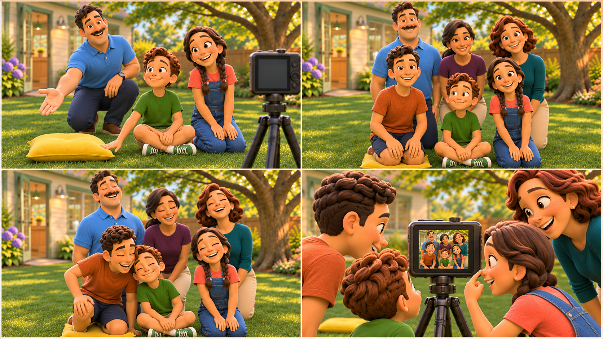](storyboards/BOARD_11.png)

| Panel | Screenplay shot | Episode time |
|---|---|---|
| Top left | [SHOT_041 · The space stays open](STORY.md#shot-041) | 06:40–06:50 |
| Top right | [SHOT_042 · Picture three](STORY.md#shot-042) | 06:50–07:00 |
| Bottom left | [SHOT_043 · All the air comes out](STORY.md#shot-043) | 07:00–07:10 |
| Bottom right | [SHOT_044 · Six actual noses](STORY.md#shot-044) | 07:10–07:20 |

## Board 12 — The look from the dentist

[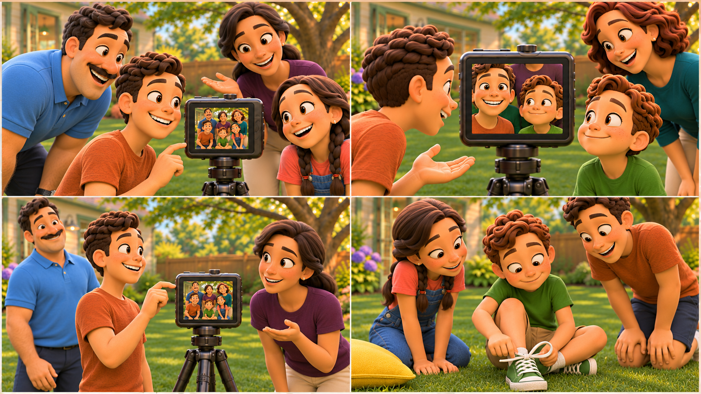](storyboards/BOARD_12.png)

| Panel | Screenplay shot | Episode time |
|---|---|---|
| Top left | [SHOT_045 · The look from the dentist](STORY.md#shot-045) | 07:20–07:30 |
| Top right | [SHOT_046 · Who Max was watching](STORY.md#shot-046) | 07:30–07:40 |
| Bottom left | [SHOT_047 · One they could use](STORY.md#shot-047) | 07:40–07:50 |
| Bottom right | [SHOT_048 · A little ear in the grass](STORY.md#shot-048) | 07:50–08:00 |

## Board 13 — The part under the bow

[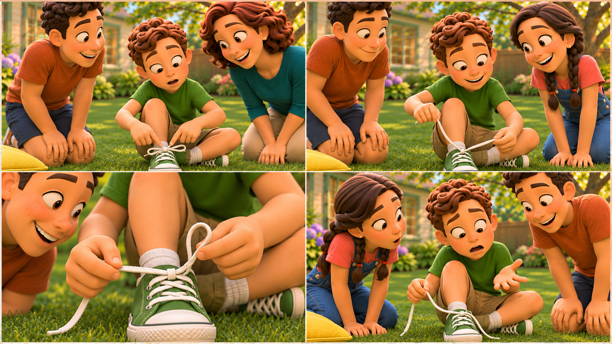](storyboards/BOARD_13.png)

| Panel | Screenplay shot | Episode time |
|---|---|---|
| Top left | [SHOT_049 · The part under the bow](STORY.md#shot-049) | 08:00–08:10 |
| Top right | [SHOT_050 · Permission to get it wrong](STORY.md#shot-050) | 08:10–08:20 |
| Bottom left | [SHOT_051 · Two ends, one loop](STORY.md#shot-051) | 08:20–08:30 |
| Bottom right | [SHOT_052 · The escaping ear](STORY.md#shot-052) | 08:30–08:40 |

## Board 14 — Whose fingers?

[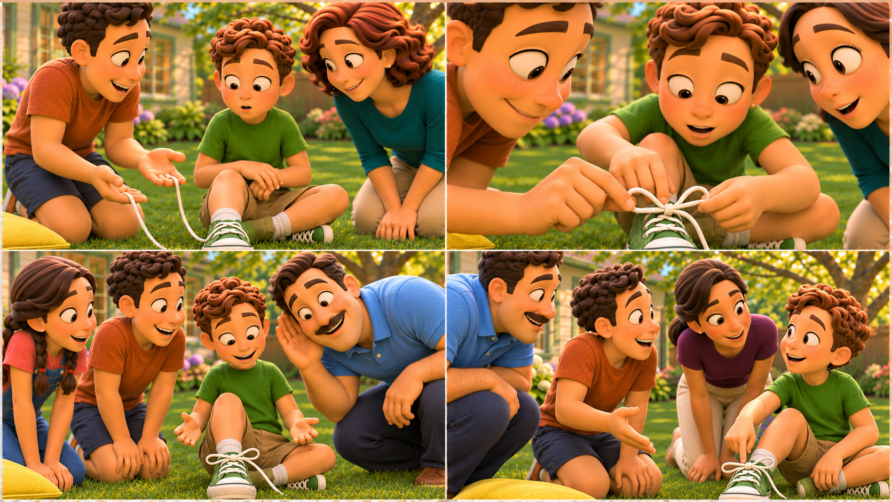](storyboards/BOARD_14.png)

| Panel | Screenplay shot | Episode time |
|---|---|---|
| Top left | [SHOT_053 · Whose fingers?](STORY.md#shot-053) | 08:40–08:50 |
| Top right | [SHOT_054 · Just this bit](STORY.md#shot-054) | 08:50–09:00 |
| Bottom left | [SHOT_055 · A bow that can hear](STORY.md#shot-055) | 09:00–09:10 |
| Bottom right | [SHOT_056 · An honest credit](STORY.md#shot-056) | 09:10–09:20 |

## Board 15 — One more, by myself

[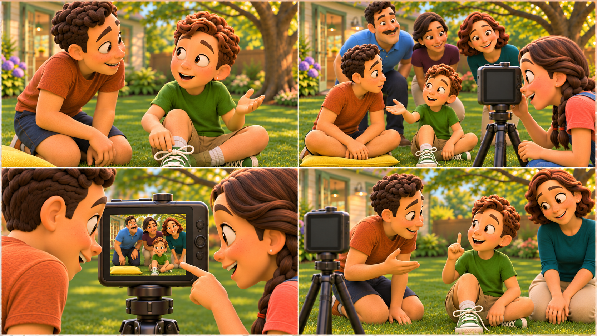](storyboards/BOARD_15.png)

| Panel | Screenplay shot | Episode time |
|---|---|---|
| Top left | [SHOT_057 · One more, by myself](STORY.md#shot-057) | 09:20–09:30 |
| Top right | [SHOT_058 · What Ella sees](STORY.md#shot-058) | 09:30–09:40 |
| Bottom left | [SHOT_059 · There's the picture](STORY.md#shot-059) | 09:40–09:50 |
| Bottom right | [SHOT_060 · Ask the person in the picture](STORY.md#shot-060) | 09:50–10:00 |

## Board 16 — Make room for a shoe

[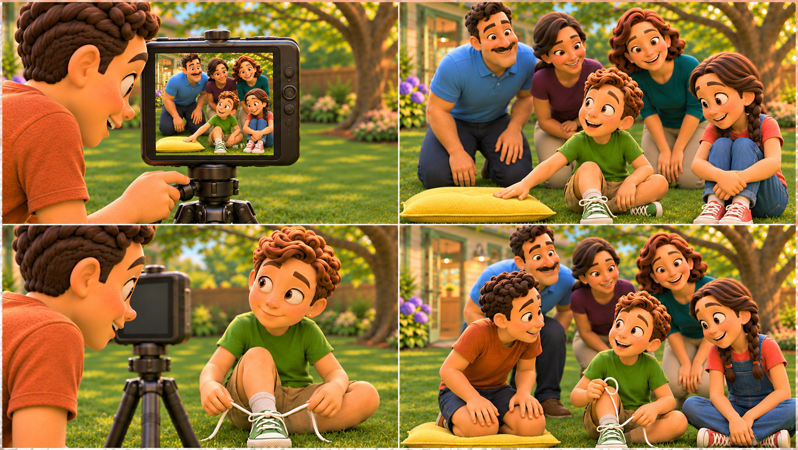](storyboards/BOARD_16.png)

| Panel | Screenplay shot | Episode time |
|---|---|---|
| Top left | [SHOT_061 · Make room for a shoe](STORY.md#shot-061) | 10:00–10:10 |
| Top right | [SHOT_062 · A particular kind of seat](STORY.md#shot-062) | 10:10–10:20 |
| Bottom left | [SHOT_063 · On Max's time](STORY.md#shot-063) | 10:20–10:30 |
| Bottom right | [SHOT_064 · Picture four](STORY.md#shot-064) | 10:30–10:40 |

## Board 17 — After the click

[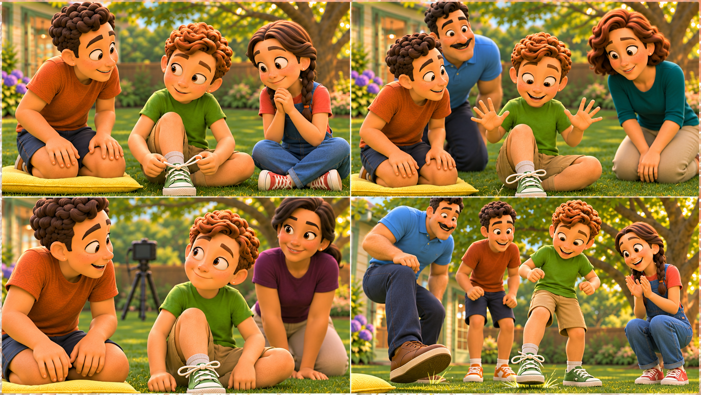](storyboards/BOARD_17.png)

| Panel | Screenplay shot | Episode time |
|---|---|---|
| Top left | [SHOT_065 · After the click](STORY.md#shot-065) | 10:40–10:50 |
| Top right | [SHOT_066 · Two ears that stay](STORY.md#shot-066) | 10:50–11:00 |
| Bottom left | [SHOT_067 · What the photographer saw](STORY.md#shot-067) | 11:00–11:10 |
| Bottom right | [SHOT_068 · A noise the knot can make](STORY.md#shot-068) | 11:10–11:20 |

## Board 18 — The one where we're all looking

[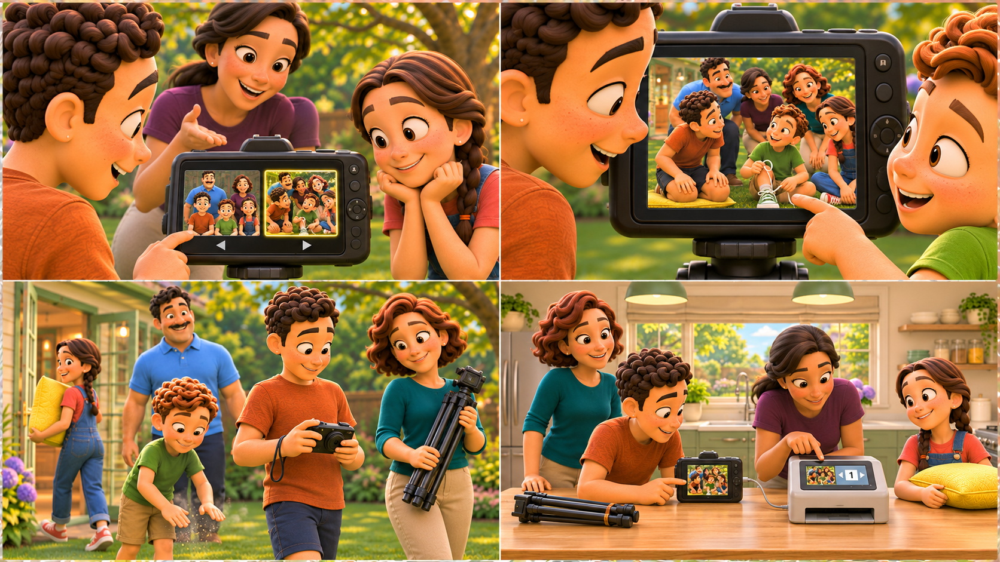](storyboards/BOARD_18.png)

| Panel | Screenplay shot | Episode time |
|---|---|---|
| Top left | [SHOT_069 · The one where we're all looking](STORY.md#shot-069) | 11:20–11:30 |
| Top right | [SHOT_070 · Leo's empty hands](STORY.md#shot-070) | 11:30–11:40 |
| Bottom left | [SHOT_071 · Folding up the crew](STORY.md#shot-071) | 11:40–11:50 |
| Bottom right | [SHOT_072 · One copy](STORY.md#shot-072) | 11:50–12:00 |

## Board 19 — Toe first

[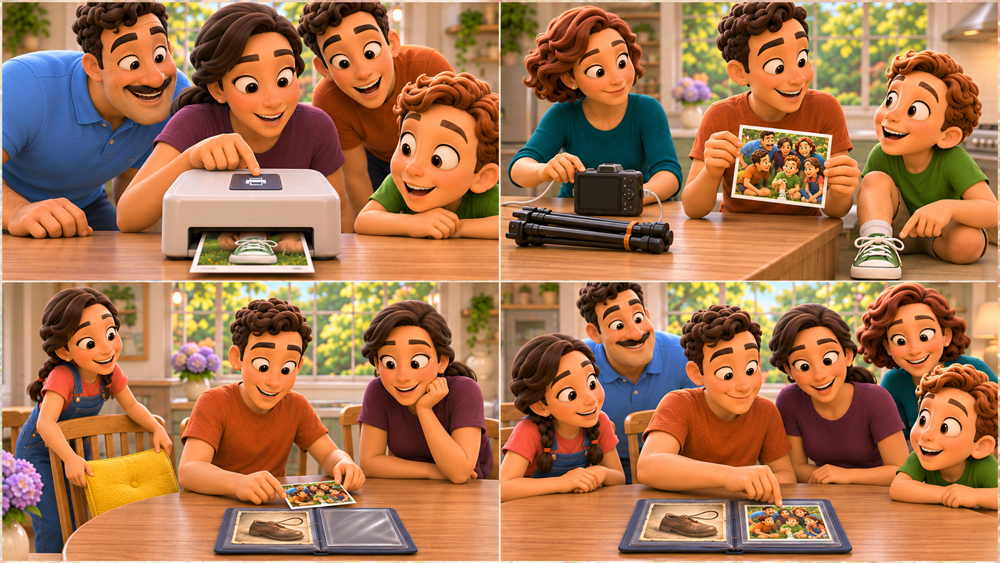](storyboards/BOARD_19.png)

| Panel | Screenplay shot | Episode time |
|---|---|---|
| Top left | [SHOT_073 · Toe first](STORY.md#shot-073) | 12:00–12:10 |
| Top right | [SHOT_074 · Now the faces](STORY.md#shot-074) | 12:10–12:20 |
| Bottom left | [SHOT_075 · A yellow cushion comes home](STORY.md#shot-075) | 12:20–12:30 |
| Bottom right | [SHOT_076 · What belongs on the right](STORY.md#shot-076) | 12:30–12:40 |

## Board 20 — The rest of that old story

[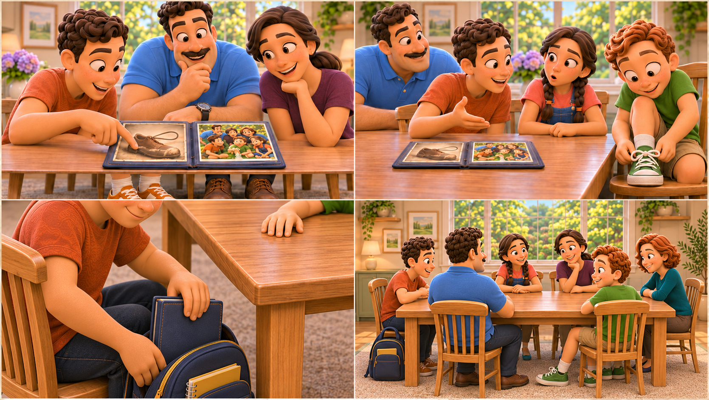](storyboards/BOARD_20.png)

| Panel | Screenplay shot | Episode time |
|---|---|---|
| Top left | [SHOT_077 · The rest of that old story](STORY.md#shot-077) | 12:40–12:50 |
| Top right | [SHOT_078 · Max tries the question](STORY.md#shot-078) | 12:50–13:00 |
| Bottom left | [SHOT_079 · A place in the bag](STORY.md#shot-079) | 13:00–13:10 |
| Bottom right | [SHOT_080 · A job for the other foot](STORY.md#shot-080) | 13:10–13:20 |
