# Episode 12 storyboard — Dad’s Shoe Is Going to School!

19 of 20 sheets illustrated. Read each sheet across the top row, then across the bottom row. Each panel covers one 15-second shot.

[Screenplay](STORY.md) · [Image references and checksums](assets/storyboards/GENERATION_NOTES.md)

| Sheet | Episode time | Shot range | Opening beat |
|---|---|---|---|
| [01](#board-01) | 00:00–01:00 | 001–004 | Somebody framed a shoe |
| [02](#board-02) | 01:00–02:00 | 005–008 | A very quiet sock |
| [03](#board-03) | 02:00–03:00 | 009–012 | Both jobs |
| [04](#board-04) | 03:00–04:00 | 013–016 | Which side of the glass? |
| [05](#board-05) | 04:00–05:00 | 017–020 | A gap with a name |
| [06](#board-06) | 05:00–06:00 | 021–024 | Meet Cousin Cushion |
| [07](#board-07) | 06:00–07:00 | 025–028 | A clock the size of a pea |
| [08](#board-08) | 07:00–08:00 | 029–032 | Picture two |
| [09](#board-09) | 08:00–09:00 | 033–036 | A different kind of help |
| [10](#board-10) | 09:00–10:00 | 037–040 | A smile Max can keep |
| [11](#board-11) | 10:00–11:00 | 041–044 | The space stays open |
| [12](#board-12) | 11:00–12:00 | 045–048 | The look from the dentist |
| [13](#board-13) | 12:00–13:00 | 049–052 | The part under the bow |
| [14](#board-14) | 13:00–14:00 | 053–056 | Whose fingers? |
| [15](#board-15) | 14:00–15:00 | 057–060 | One more, by myself |
| [16](#board-16) | 15:00–16:00 | 061–064 | Make room for a shoe |
| [17](#board-17) | 16:00–17:00 | 065–068 | After the click |
| [18](#board-18) | 17:00–18:00 | 069–072 | The one where we're all looking |
| [19](#board-19) | 18:00–19:00 | 073–076 | Toe first |
| 20 · pending | 19:00–20:00 | 077–080 | The rest of that old story |

## Board 01 — Somebody framed a shoe

[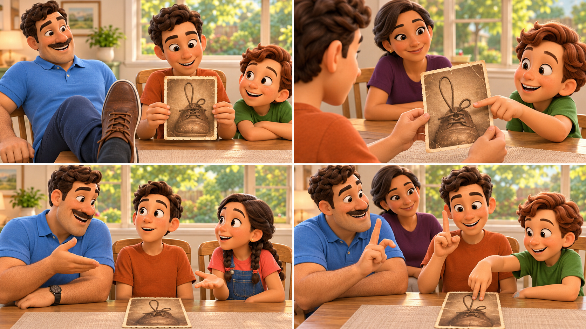](assets/storyboards/BOARD_01.png)

| Panel | Screenplay shot | Episode time |
|---|---|---|
| Top left | [SHOT_001 · Somebody framed a shoe](STORY.md#shot-001) | 00:00–00:15 |
| Top right | [SHOT_002 · The part that made the cut](STORY.md#shot-002) | 00:15–00:30 |
| Bottom left | [SHOT_003 · Of Dad and by Leo](STORY.md#shot-003) | 00:30–00:45 |
| Bottom right | [SHOT_004 · A rabbit with one good ear](STORY.md#shot-004) | 00:45–01:00 |

## Board 02 — A very quiet sock

| Panel | Screenplay shot | Episode time |
|---|---|---|
| Top left | [SHOT_005 · A very quiet sock](STORY.md#shot-005) | 01:00–01:15 |
| Top right | [SHOT_006 · The first pocket](STORY.md#shot-006) | 01:15–01:30 |
| Bottom left | [SHOT_007 · Tomorrow's page](STORY.md#shot-007) | 01:30–01:45 |
| Bottom right | [SHOT_008 · The photographer's trick](STORY.md#shot-008) | 01:45–02:00 |

## Board 03 — Both jobs

[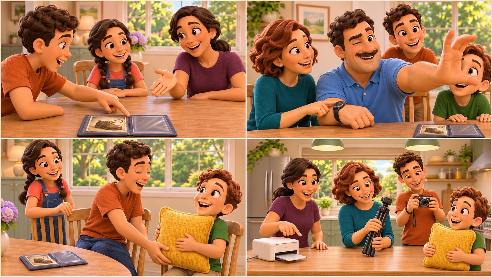](assets/storyboards/BOARD_03.png)

| Panel | Screenplay shot | Episode time |
|---|---|---|
| Top left | [SHOT_009 · Both jobs](STORY.md#shot-009) | 02:00–02:15 |
| Top right | [SHOT_010 · The long-arm solution](STORY.md#shot-010) | 02:15–02:30 |
| Bottom left | [SHOT_011 · A place to come back to](STORY.md#shot-011) | 02:30–02:45 |
| Bottom right | [SHOT_012 · Something that stands on three legs](STORY.md#shot-012) | 02:45–03:00 |

## Board 04 — Which side of the glass?

| Panel | Screenplay shot | Episode time |
|---|---|---|
| Top left | [SHOT_013 · Which side of the glass?](STORY.md#shot-013) | 03:00–03:15 |
| Top right | [SHOT_014 · A spot where eyes can open](STORY.md#shot-014) | 03:15–03:30 |
| Bottom left | [SHOT_015 · Three feet on the lawn](STORY.md#shot-015) | 03:30–03:45 |
| Bottom right | [SHOT_016 · A branch through Dad's head](STORY.md#shot-016) | 03:45–04:00 |

## Board 05 — A gap with a name

[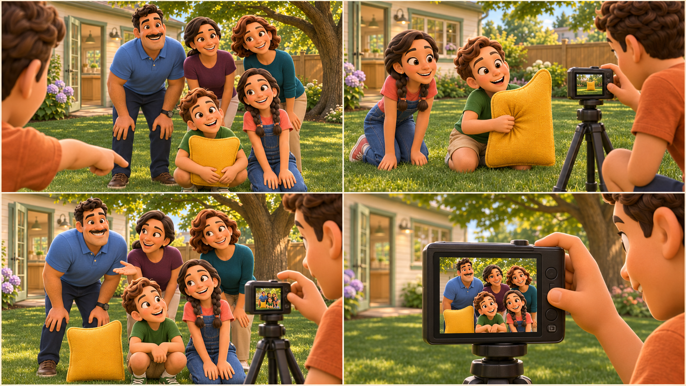](assets/storyboards/BOARD_05.png)

| Panel | Screenplay shot | Episode time |
|---|---|---|
| Top left | [SHOT_017 · A gap with a name](STORY.md#shot-017) | 04:00–04:15 |
| Top right | [SHOT_018 · A stand-in with a dent](STORY.md#shot-018) | 04:15–04:30 |
| Bottom left | [SHOT_019 · The first request](STORY.md#shot-019) | 04:30–04:45 |
| Bottom right | [SHOT_020 · Picture one](STORY.md#shot-020) | 04:45–05:00 |

## Board 06 — Meet Cousin Cushion

[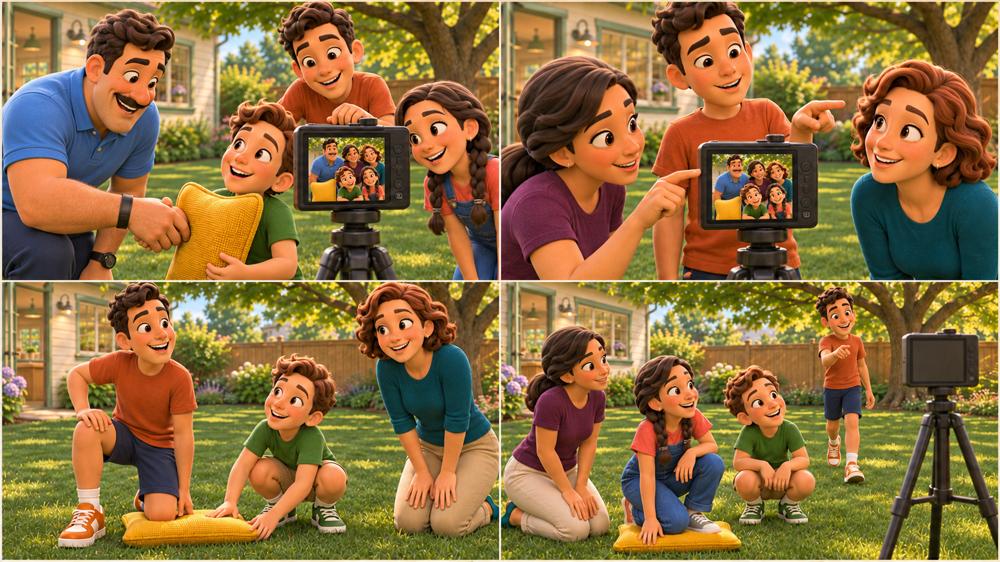](assets/storyboards/BOARD_06.png)

| Panel | Screenplay shot | Episode time |
|---|---|---|
| Top left | [SHOT_021 · Meet Cousin Cushion](STORY.md#shot-021) | 05:00–05:15 |
| Top right | [SHOT_022 · What a camera shows](STORY.md#shot-022) | 05:15–05:30 |
| Bottom left | [SHOT_023 · What the cushion can do](STORY.md#shot-023) | 05:30–05:45 |
| Bottom right | [SHOT_024 · Directions from his own spot](STORY.md#shot-024) | 05:45–06:00 |

## Board 07 — A clock the size of a pea

[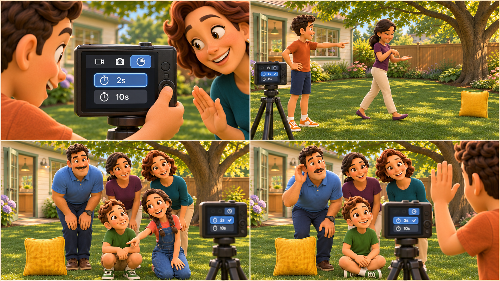](assets/storyboards/BOARD_07.png)

| Panel | Screenplay shot | Episode time |
|---|---|---|
| Top left | [SHOT_025 · A clock the size of a pea](STORY.md#shot-025) | 06:00–06:15 |
| Top right | [SHOT_026 · Two steps and a bit](STORY.md#shot-026) | 06:15–06:30 |
| Bottom left | [SHOT_027 · Leave a lane](STORY.md#shot-027) | 06:30–06:45 |
| Bottom right | [SHOT_028 · Who listens for the click?](STORY.md#shot-028) | 06:45–07:00 |

## Board 08 — Picture two

[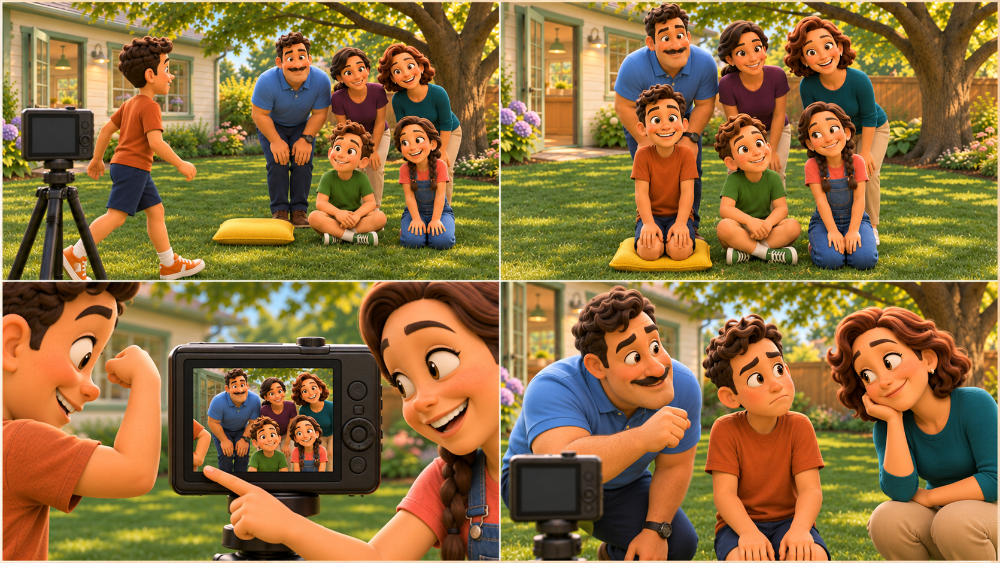](assets/storyboards/BOARD_08.png)

| Panel | Screenplay shot | Episode time |
|---|---|---|
| Top left | [SHOT_029 · Picture two](STORY.md#shot-029) | 07:00–07:15 |
| Top right | [SHOT_030 · A perfect pose for nobody](STORY.md#shot-030) | 07:15–07:30 |
| Bottom left | [SHOT_031 · A very small portrait of Leo](STORY.md#shot-031) | 07:30–07:45 |
| Bottom right | [SHOT_032 · No votes from the elbow](STORY.md#shot-032) | 07:45–08:00 |

## Board 09 — A different kind of help

[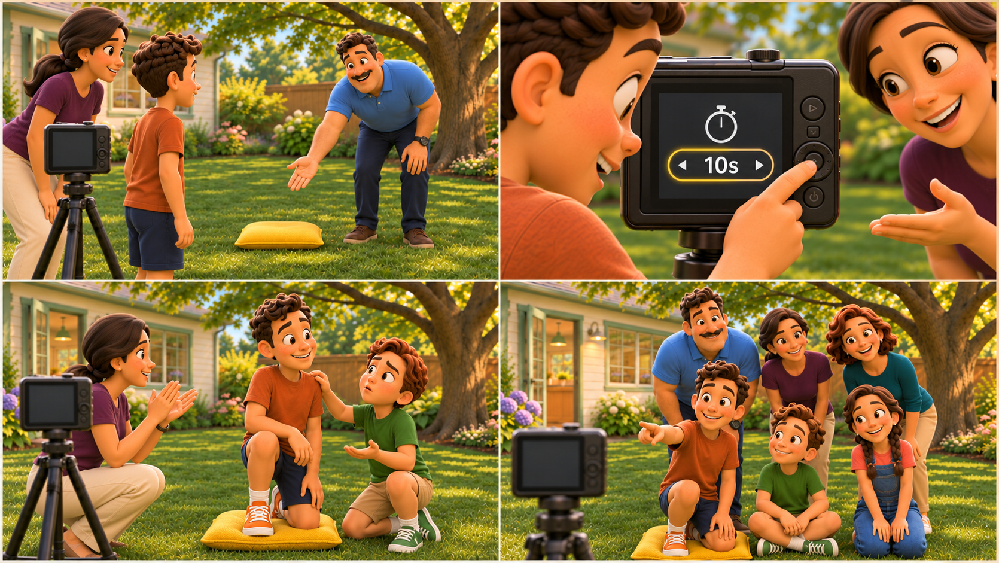](assets/storyboards/BOARD_09.png)

| Panel | Screenplay shot | Episode time |
|---|---|---|
| Top left | [SHOT_033 · A different kind of help](STORY.md#shot-033) | 08:00–08:15 |
| Top right | [SHOT_034 · Ten instead of two](STORY.md#shot-034) | 08:15–08:30 |
| Bottom left | [SHOT_035 · The walk, including the turn](STORY.md#shot-035) | 08:30–08:45 |
| Bottom right | [SHOT_036 · What to look at](STORY.md#shot-036) | 08:45–09:00 |

## Board 10 — A smile Max can keep

[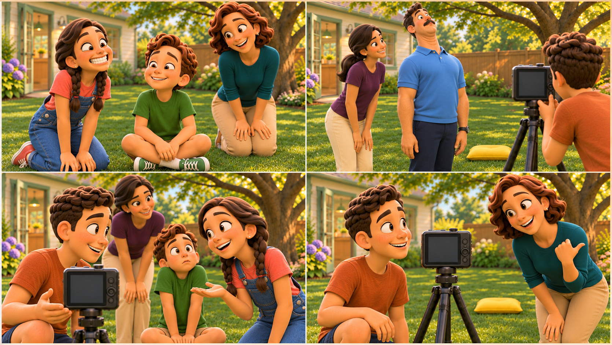](assets/storyboards/BOARD_10.png)

| Panel | Screenplay shot | Episode time |
|---|---|---|
| Top left | [SHOT_037 · A smile Max can keep](STORY.md#shot-037) | 09:00–09:15 |
| Top right | [SHOT_038 · The family chin](STORY.md#shot-038) | 09:15–09:30 |
| Bottom left | [SHOT_039 · Who calls it?](STORY.md#shot-039) | 09:30–09:45 |
| Bottom right | [SHOT_040 · One less job to carry](STORY.md#shot-040) | 09:45–10:00 |

## Board 11 — The space stays open

[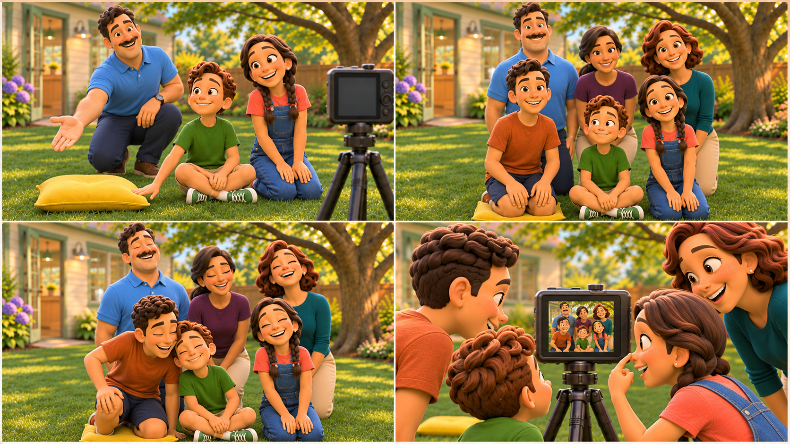](assets/storyboards/BOARD_11.png)

| Panel | Screenplay shot | Episode time |
|---|---|---|
| Top left | [SHOT_041 · The space stays open](STORY.md#shot-041) | 10:00–10:15 |
| Top right | [SHOT_042 · Picture three](STORY.md#shot-042) | 10:15–10:30 |
| Bottom left | [SHOT_043 · All the air comes out](STORY.md#shot-043) | 10:30–10:45 |
| Bottom right | [SHOT_044 · Six actual noses](STORY.md#shot-044) | 10:45–11:00 |

## Board 12 — The look from the dentist

[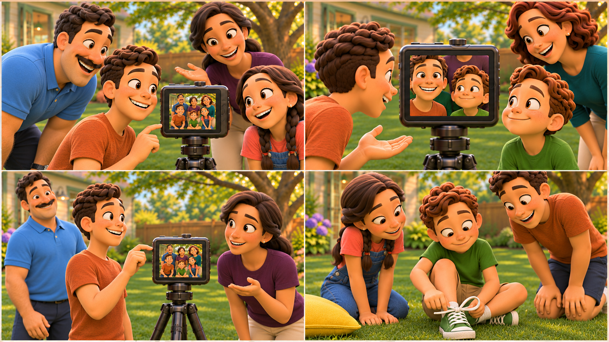](assets/storyboards/BOARD_12.png)

| Panel | Screenplay shot | Episode time |
|---|---|---|
| Top left | [SHOT_045 · The look from the dentist](STORY.md#shot-045) | 11:00–11:15 |
| Top right | [SHOT_046 · Who Max was watching](STORY.md#shot-046) | 11:15–11:30 |
| Bottom left | [SHOT_047 · One they could use](STORY.md#shot-047) | 11:30–11:45 |
| Bottom right | [SHOT_048 · A little ear in the grass](STORY.md#shot-048) | 11:45–12:00 |

## Board 13 — The part under the bow

[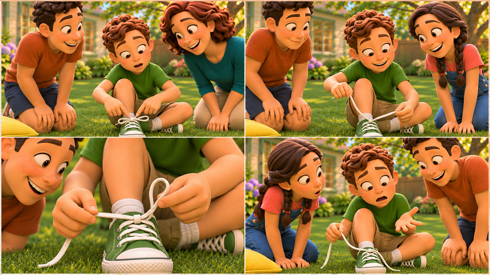](assets/storyboards/BOARD_13.png)

| Panel | Screenplay shot | Episode time |
|---|---|---|
| Top left | [SHOT_049 · The part under the bow](STORY.md#shot-049) | 12:00–12:15 |
| Top right | [SHOT_050 · Permission to get it wrong](STORY.md#shot-050) | 12:15–12:30 |
| Bottom left | [SHOT_051 · Two ends, one loop](STORY.md#shot-051) | 12:30–12:45 |
| Bottom right | [SHOT_052 · The escaping ear](STORY.md#shot-052) | 12:45–13:00 |

## Board 14 — Whose fingers?

[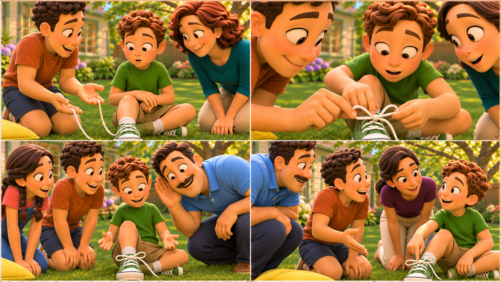](assets/storyboards/BOARD_14.png)

| Panel | Screenplay shot | Episode time |
|---|---|---|
| Top left | [SHOT_053 · Whose fingers?](STORY.md#shot-053) | 13:00–13:15 |
| Top right | [SHOT_054 · Just this bit](STORY.md#shot-054) | 13:15–13:30 |
| Bottom left | [SHOT_055 · A bow that can hear](STORY.md#shot-055) | 13:30–13:45 |
| Bottom right | [SHOT_056 · An honest credit](STORY.md#shot-056) | 13:45–14:00 |

## Board 15 — One more, by myself

[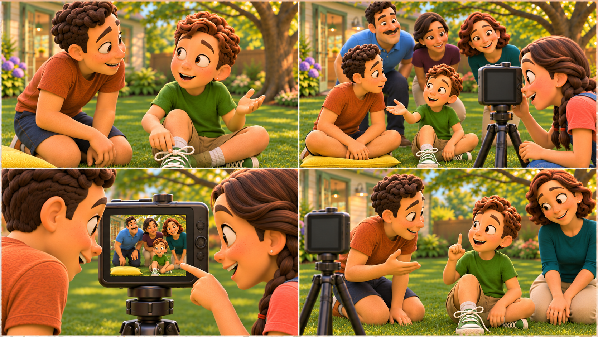](assets/storyboards/BOARD_15.png)

| Panel | Screenplay shot | Episode time |
|---|---|---|
| Top left | [SHOT_057 · One more, by myself](STORY.md#shot-057) | 14:00–14:15 |
| Top right | [SHOT_058 · What Ella sees](STORY.md#shot-058) | 14:15–14:30 |
| Bottom left | [SHOT_059 · There's the picture](STORY.md#shot-059) | 14:30–14:45 |
| Bottom right | [SHOT_060 · Ask the person in the picture](STORY.md#shot-060) | 14:45–15:00 |

## Board 16 — Make room for a shoe

[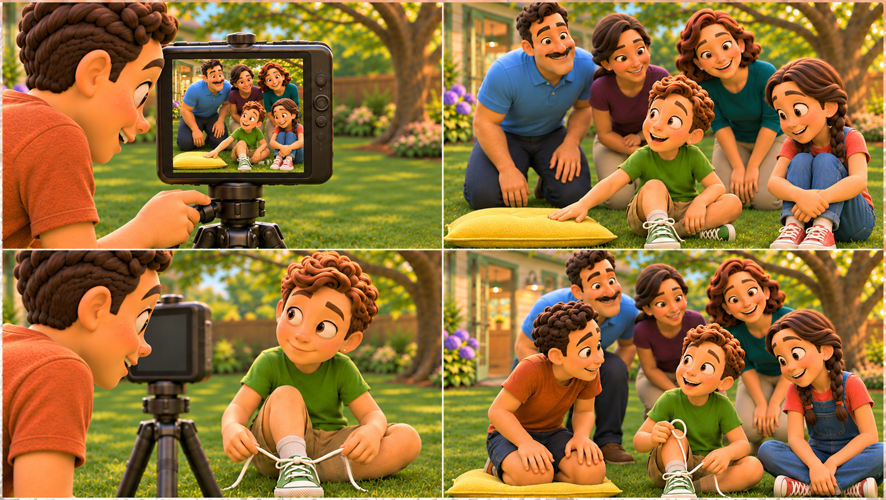](assets/storyboards/BOARD_16.png)

| Panel | Screenplay shot | Episode time |
|---|---|---|
| Top left | [SHOT_061 · Make room for a shoe](STORY.md#shot-061) | 15:00–15:15 |
| Top right | [SHOT_062 · A particular kind of seat](STORY.md#shot-062) | 15:15–15:30 |
| Bottom left | [SHOT_063 · On Max's time](STORY.md#shot-063) | 15:30–15:45 |
| Bottom right | [SHOT_064 · Picture four](STORY.md#shot-064) | 15:45–16:00 |

## Board 17 — After the click

[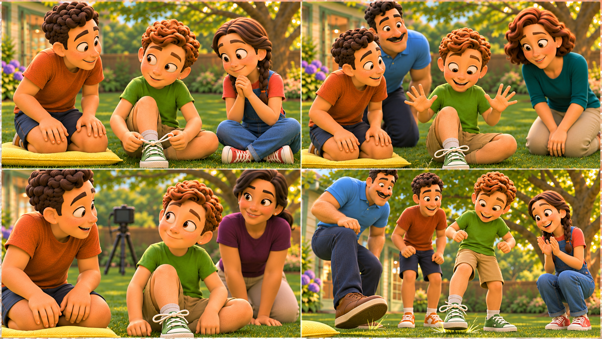](assets/storyboards/BOARD_17.png)

| Panel | Screenplay shot | Episode time |
|---|---|---|
| Top left | [SHOT_065 · After the click](STORY.md#shot-065) | 16:00–16:15 |
| Top right | [SHOT_066 · Two ears that stay](STORY.md#shot-066) | 16:15–16:30 |
| Bottom left | [SHOT_067 · What the photographer saw](STORY.md#shot-067) | 16:30–16:45 |
| Bottom right | [SHOT_068 · A noise the knot can make](STORY.md#shot-068) | 16:45–17:00 |

## Board 18 — The one where we're all looking

[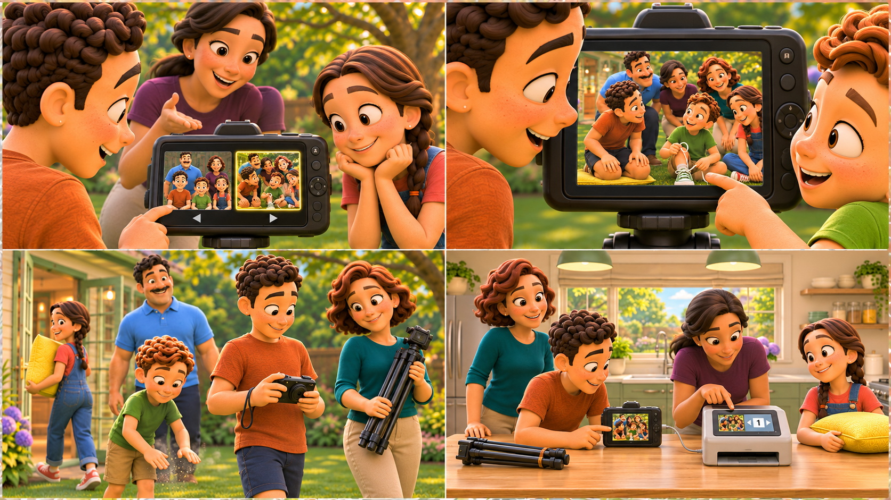](assets/storyboards/BOARD_18.png)

| Panel | Screenplay shot | Episode time |
|---|---|---|
| Top left | [SHOT_069 · The one where we're all looking](STORY.md#shot-069) | 17:00–17:15 |
| Top right | [SHOT_070 · Leo's empty hands](STORY.md#shot-070) | 17:15–17:30 |
| Bottom left | [SHOT_071 · Folding up the crew](STORY.md#shot-071) | 17:30–17:45 |
| Bottom right | [SHOT_072 · One copy](STORY.md#shot-072) | 17:45–18:00 |

## Board 19 — Toe first

[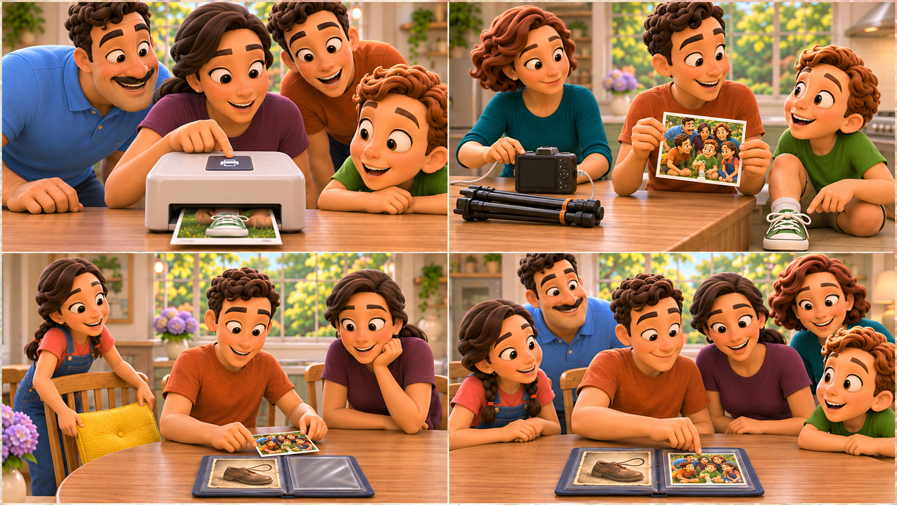](assets/storyboards/BOARD_19.png)

| Panel | Screenplay shot | Episode time |
|---|---|---|
| Top left | [SHOT_073 · Toe first](STORY.md#shot-073) | 18:00–18:15 |
| Top right | [SHOT_074 · Now the faces](STORY.md#shot-074) | 18:15–18:30 |
| Bottom left | [SHOT_075 · A yellow cushion comes home](STORY.md#shot-075) | 18:30–18:45 |
| Bottom right | [SHOT_076 · What belongs on the right](STORY.md#shot-076) | 18:45–19:00 |
