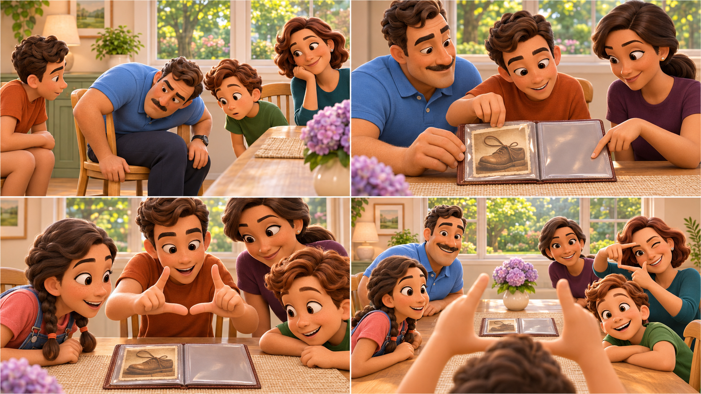
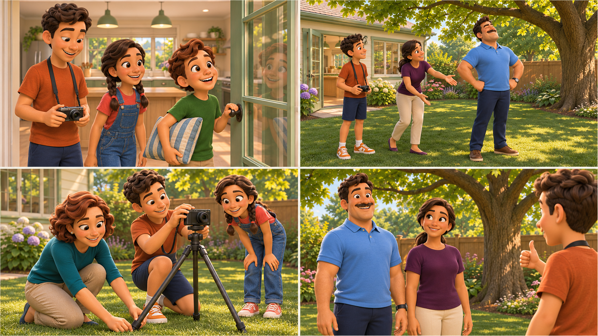

# Episode 12 storyboard — Dad’s Shoe Is Going to School!

4 of 20 sheets illustrated. Read each sheet across the top row, then across the bottom row. Each panel covers one 15-second shot.

[Screenplay](STORY.md) · [Image references and checksums](assets/storyboards/GENERATION_NOTES.md)

| Sheet | Episode time | Shot range | Opening beat |
|---|---|---|---|
| [01](#board-01) | 00:00–01:00 | 001–004 | Somebody framed a shoe |
| [02](#board-02) | 01:00–02:00 | 005–008 | A very quiet sock |
| [03](#board-03) | 02:00–03:00 | 009–012 | Both jobs |
| [04](#board-04) | 03:00–04:00 | 013–016 | Which side of the glass? |
| 05 · pending | 04:00–05:00 | 017–020 | A gap with a name |
| 06 · pending | 05:00–06:00 | 021–024 | Meet Cousin Cushion |
| 07 · pending | 06:00–07:00 | 025–028 | A clock the size of a pea |
| 08 · pending | 07:00–08:00 | 029–032 | Picture two |
| 09 · pending | 08:00–09:00 | 033–036 | A different kind of help |
| 10 · pending | 09:00–10:00 | 037–040 | A smile Max can keep |
| 11 · pending | 10:00–11:00 | 041–044 | The space stays open |
| 12 · pending | 11:00–12:00 | 045–048 | The look from the dentist |
| 13 · pending | 12:00–13:00 | 049–052 | The part under the bow |
| 14 · pending | 13:00–14:00 | 053–056 | Whose fingers? |
| 15 · pending | 14:00–15:00 | 057–060 | One more, by myself |
| 16 · pending | 15:00–16:00 | 061–064 | Make room for a shoe |
| 17 · pending | 16:00–17:00 | 065–068 | After the click |
| 18 · pending | 17:00–18:00 | 069–072 | The one where we're all looking |
| 19 · pending | 18:00–19:00 | 073–076 | Toe first |
| 20 · pending | 19:00–20:00 | 077–080 | The rest of that old story |

## Board 01 — Somebody framed a shoe

| Panel | Screenplay shot | Episode time |
|---|---|---|
| Top left | [SHOT_001 · Somebody framed a shoe](STORY.md#shot-001) | 00:00–00:15 |
| Top right | [SHOT_002 · The part that made the cut](STORY.md#shot-002) | 00:15–00:30 |
| Bottom left | [SHOT_003 · Of Dad and by Leo](STORY.md#shot-003) | 00:30–00:45 |
| Bottom right | [SHOT_004 · A rabbit with one good ear](STORY.md#shot-004) | 00:45–01:00 |

## Board 02 — A very quiet sock

| Panel | Screenplay shot | Episode time |
|---|---|---|
| Top left | [SHOT_005 · A very quiet sock](STORY.md#shot-005) | 01:00–01:15 |
| Top right | [SHOT_006 · The first pocket](STORY.md#shot-006) | 01:15–01:30 |
| Bottom left | [SHOT_007 · Tomorrow's page](STORY.md#shot-007) | 01:30–01:45 |
| Bottom right | [SHOT_008 · The photographer's trick](STORY.md#shot-008) | 01:45–02:00 |

## Board 03 — Both jobs

| Panel | Screenplay shot | Episode time |
|---|---|---|
| Top left | [SHOT_009 · Both jobs](STORY.md#shot-009) | 02:00–02:15 |
| Top right | [SHOT_010 · The long-arm solution](STORY.md#shot-010) | 02:15–02:30 |
| Bottom left | [SHOT_011 · A place to come back to](STORY.md#shot-011) | 02:30–02:45 |
| Bottom right | [SHOT_012 · Something that stands on three legs](STORY.md#shot-012) | 02:45–03:00 |

## Board 04 — Which side of the glass?

| Panel | Screenplay shot | Episode time |
|---|---|---|
| Top left | [SHOT_013 · Which side of the glass?](STORY.md#shot-013) | 03:00–03:15 |
| Top right | [SHOT_014 · A spot where eyes can open](STORY.md#shot-014) | 03:15–03:30 |
| Bottom left | [SHOT_015 · Three feet on the lawn](STORY.md#shot-015) | 03:30–03:45 |
| Bottom right | [SHOT_016 · A branch through Dad's head](STORY.md#shot-016) | 03:45–04:00 |
