# Episode 13 storyboard — Do I Get My Duck Back?

20 of 20 sheets illustrated. Read each sheet across the top row, then across the bottom row. Each panel covers one 10-second shot.

[Screenplay](STORY.md) · [Video prompts](VIDEO_PROMPTS.md)

| Sheet | Episode time | Shot range | Opening beat |
|---|---|---|---|
| [01](#board-01) | 00:00–00:40 | 001–004 | Someone very short is knocking |
| [02](#board-02) | 00:40–01:20 | 005–008 | The item on offer |
| [03](#board-03) | 01:20–02:00 | 009–012 | Through the blue door |
| [04](#board-04) | 02:00–02:40 | 013–016 | Someone at the other end |
| [05](#board-05) | 02:40–03:20 | 017–020 | A duck with a name |
| [06](#board-06) | 03:20–04:00 | 021–024 | A stripe with a secret |
| [07](#board-07) | 04:00–04:40 | 025–028 | The rest of the sentence |
| [08](#board-08) | 04:40–05:20 | 029–032 | The word on the door |
| [09](#board-09) | 05:20–06:00 | 033–036 | Back where they belong |
| [10](#board-10) | 06:00–06:40 | 037–040 | A hop you can see |
| [11](#board-11) | 06:40–07:20 | 041–044 | Which back wheel? |
| [12](#board-12) | 07:20–08:00 | 045–048 | A noise she gets to keep |
| [13](#board-13) | 08:00–08:40 | 049–052 | A noise that looks pink |
| [14](#board-14) | 08:40–09:20 | 053–056 | A bee in a lunchbox |
| [15](#board-15) | 09:20–10:00 | 057–060 | June's blue roof |
| [16](#board-16) | 10:00–10:40 | 061–064 | The answer Ella means |
| [17](#board-17) | 10:40–11:20 | 065–068 | Until three |
| [18](#board-18) | 11:20–12:00 | 069–072 | A tin full of something else |
| [19](#board-19) | 12:00–12:40 | 073–076 | An ordinary knock |
| [20](#board-20) | 12:40–13:20 | 077–080 | A sound to bring next time |

## Board 01 — Someone very short is knocking

[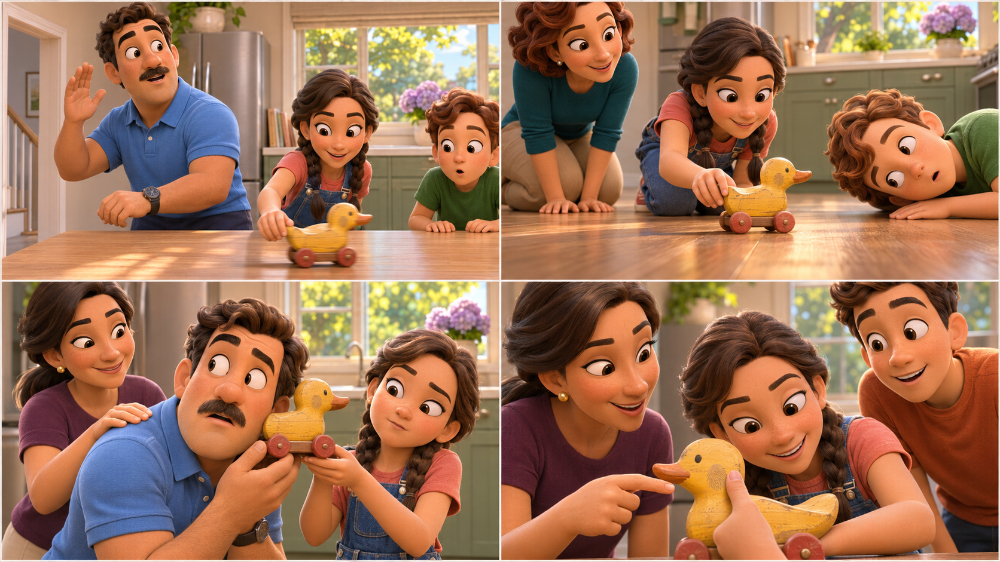](storyboards/BOARD_01.png)

| Panel | Screenplay shot | Episode time |
|---|---|---|
| Top left | [SHOT_001 · Someone very short is knocking](STORY.md#shot-001) | 00:00–00:10 |
| Top right | [SHOT_002 · It follows her](STORY.md#shot-002) | 00:10–00:20 |
| Bottom left | [SHOT_003 · Nothing in the duck](STORY.md#shot-003) | 00:20–00:30 |
| Bottom right | [SHOT_004 · A beak with a fingerprint](STORY.md#shot-004) | 00:30–00:40 |

## Board 02 — The item on offer

[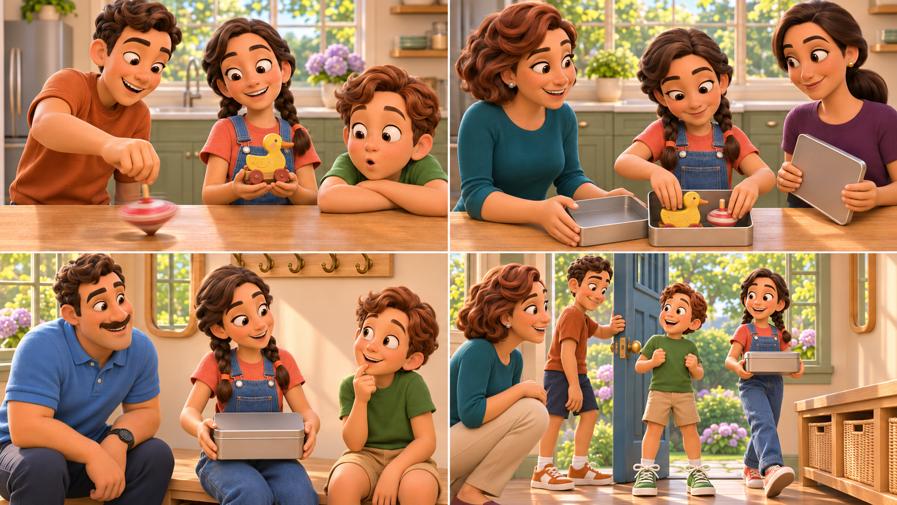](storyboards/BOARD_02.png)

| Panel | Screenplay shot | Episode time |
|---|---|---|
| Top left | [SHOT_005 · The item on offer](STORY.md#shot-005) | 00:40–00:50 |
| Top right | [SHOT_006 · May I borrow your tin?](STORY.md#shot-006) | 00:50–01:00 |
| Bottom left | [SHOT_007 · One goes, one comes along](STORY.md#shot-007) | 01:00–01:10 |
| Bottom right | [SHOT_008 · Two bows at the door](STORY.md#shot-008) | 01:10–01:20 |

## Board 03 — Through the blue door

[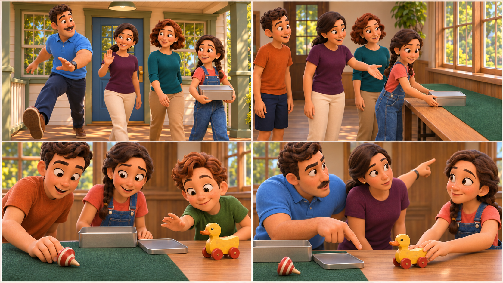](storyboards/BOARD_03.png)

| Panel | Screenplay shot | Episode time |
|---|---|---|
| Top left | [SHOT_009 · Through the blue door](STORY.md#shot-009) | 01:20–01:30 |
| Top right | [SHOT_010 · A table by the window](STORY.md#shot-010) | 01:30–01:40 |
| Bottom left | [SHOT_011 · A top with stage fright](STORY.md#shot-011) | 01:40–01:50 |
| Bottom right | [SHOT_012 · The traveling knock](STORY.md#shot-012) | 01:50–02:00 |

## Board 04 — Someone at the other end

[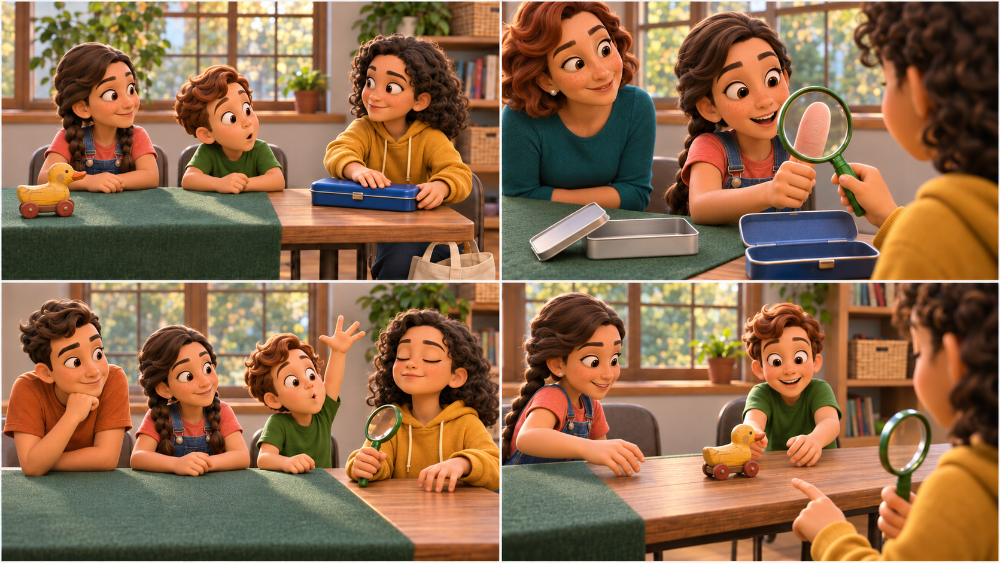](storyboards/BOARD_04.png)

| Panel | Screenplay shot | Episode time |
|---|---|---|
| Top left | [SHOT_013 · Someone at the other end](STORY.md#shot-013) | 02:00–02:10 |
| Top right | [SHOT_014 · What fits in a pencil case](STORY.md#shot-014) | 02:10–02:20 |
| Bottom left | [SHOT_015 · June's impossible sound](STORY.md#shot-015) | 02:20–02:30 |
| Bottom right | [SHOT_016 · One audition](STORY.md#shot-016) | 02:30–02:40 |

## Board 05 — A duck with a name

[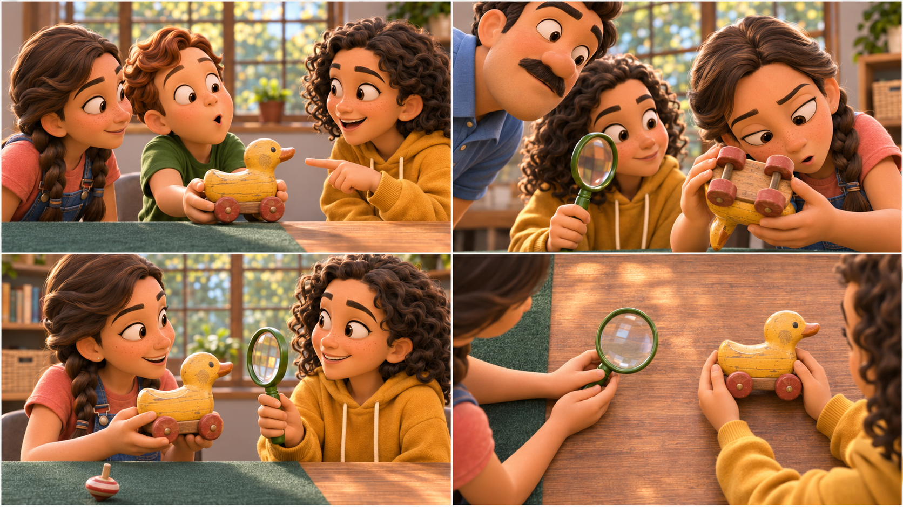](storyboards/BOARD_05.png)

| Panel | Screenplay shot | Episode time |
|---|---|---|
| Top left | [SHOT_017 · A duck with a name](STORY.md#shot-017) | 02:40–02:50 |
| Top right | [SHOT_018 · The wrong end for looking](STORY.md#shot-018) | 02:50–03:00 |
| Bottom left | [SHOT_019 · The word they both hear](STORY.md#shot-019) | 03:00–03:10 |
| Bottom right | [SHOT_020 · The switch](STORY.md#shot-020) | 03:10–03:20 |

## Board 06 — A stripe with a secret

[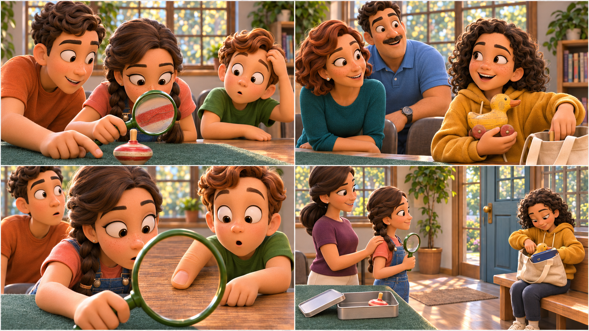](storyboards/BOARD_06.png)

| Panel | Screenplay shot | Episode time |
|---|---|---|
| Top left | [SHOT_021 · A stripe with a secret](STORY.md#shot-021) | 03:20–03:30 |
| Top right | [SHOT_022 · A sound worth taking home](STORY.md#shot-022) | 03:30–03:40 |
| Bottom left | [SHOT_023 · A very clear view of nothing](STORY.md#shot-023) | 03:40–03:50 |
| Bottom right | [SHOT_024 · Mabel's head goes in](STORY.md#shot-024) | 03:50–04:00 |

## Board 07 — The rest of the sentence

[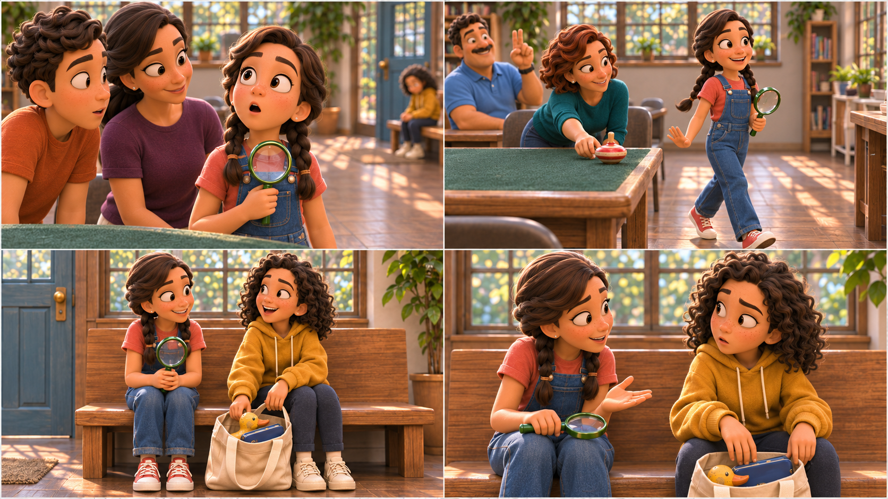](storyboards/BOARD_07.png)

| Panel | Screenplay shot | Episode time |
|---|---|---|
| Top left | [SHOT_025 · The rest of the sentence](STORY.md#shot-025) | 04:00–04:10 |
| Top right | [SHOT_026 · A hand at her side](STORY.md#shot-026) | 04:10–04:20 |
| Bottom left | [SHOT_027 · A place on the bench](STORY.md#shot-027) | 04:20–04:30 |
| Bottom right | [SHOT_028 · How long is a switch?](STORY.md#shot-028) | 04:30–04:40 |

## Board 08 — The word on the door

[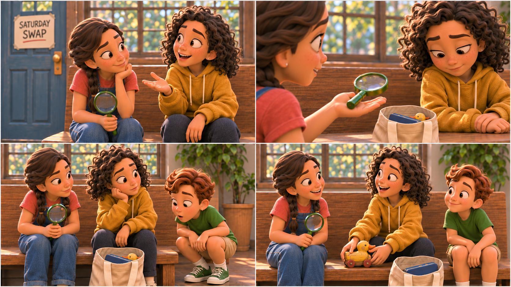](storyboards/BOARD_08.png)

| Panel | Screenplay shot | Episode time |
|---|---|---|
| Top left | [SHOT_029 · The word on the door](STORY.md#shot-029) | 04:40–04:50 |
| Top right | [SHOT_030 · A question with room after it](STORY.md#shot-030) | 04:50–05:00 |
| Bottom left | [SHOT_031 · A quiet second](STORY.md#shot-031) | 05:00–05:10 |
| Bottom right | [SHOT_032 · Two yeses](STORY.md#shot-032) | 05:10–05:20 |

## Board 09 — Back where they belong

[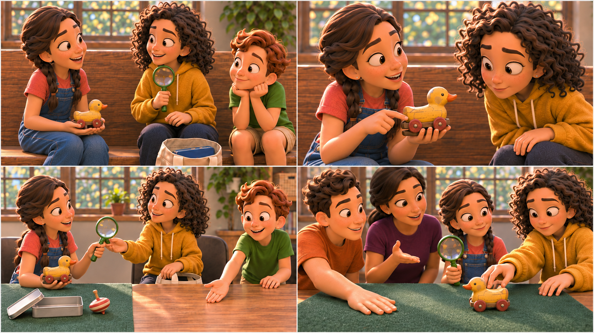](storyboards/BOARD_09.png)

| Panel | Screenplay shot | Episode time |
|---|---|---|
| Top left | [SHOT_033 · Back where they belong](STORY.md#shot-033) | 05:20–05:30 |
| Top right | [SHOT_034 · A smaller question](STORY.md#shot-034) | 05:30–05:40 |
| Bottom left | [SHOT_035 · Back to the window](STORY.md#shot-035) | 05:40–05:50 |
| Bottom right | [SHOT_036 · Take away the tabletop](STORY.md#shot-036) | 05:50–06:00 |

## Board 10 — A hop you can see

[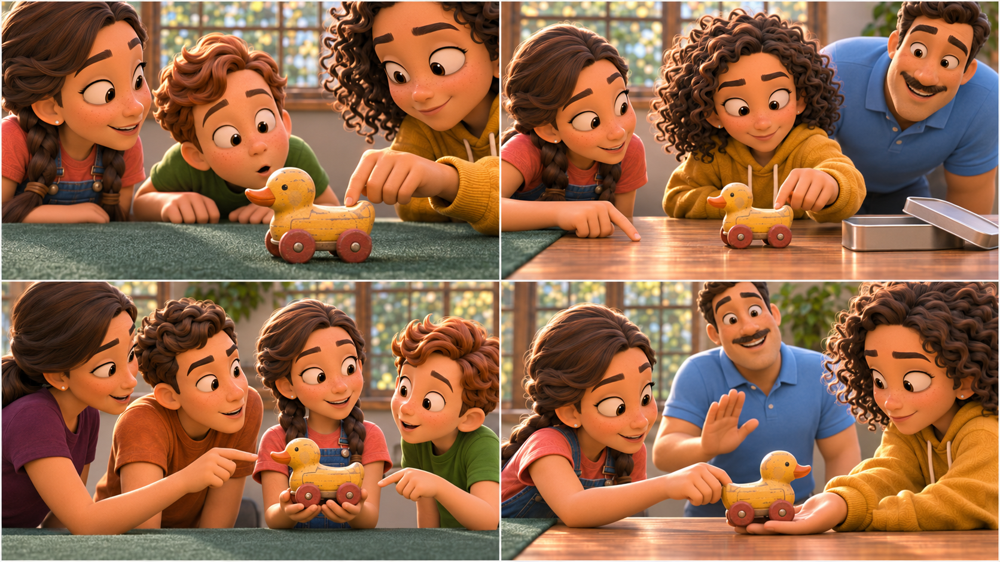](storyboards/BOARD_10.png)

| Panel | Screenplay shot | Episode time |
|---|---|---|
| Top left | [SHOT_037 · A hop you can see](STORY.md#shot-037) | 06:00–06:10 |
| Top right | [SHOT_038 · The sound meets the hop](STORY.md#shot-038) | 06:10–06:20 |
| Bottom left | [SHOT_039 · The front stays level](STORY.md#shot-039) | 06:20–06:30 |
| Bottom right | [SHOT_040 · Backward duck](STORY.md#shot-040) | 06:30–06:40 |

## Board 11 — Which back wheel?

[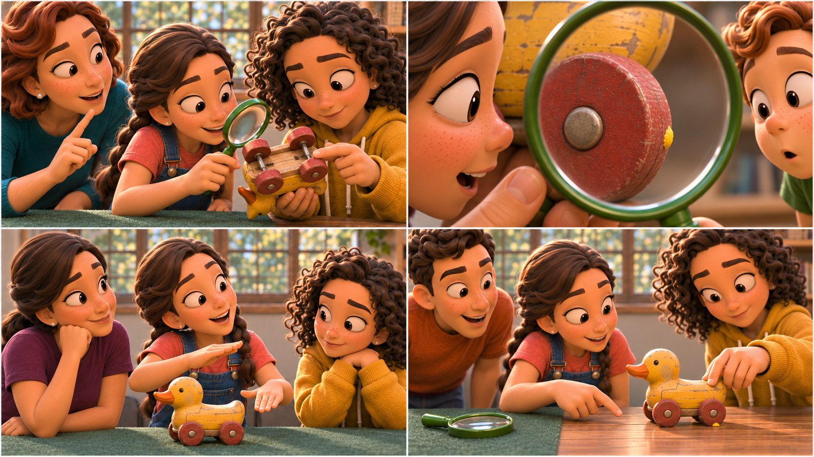](storyboards/BOARD_11.png)

| Panel | Screenplay shot | Episode time |
|---|---|---|
| Top left | [SHOT_041 · Which back wheel?](STORY.md#shot-041) | 06:40–06:50 |
| Top right | [SHOT_042 · A yellow hill](STORY.md#shot-042) | 06:50–07:00 |
| Bottom left | [SHOT_043 · The painter remembers](STORY.md#shot-043) | 07:00–07:10 |
| Bottom right | [SHOT_044 · Once around](STORY.md#shot-044) | 07:10–07:20 |

## Board 12 — A noise she gets to keep

[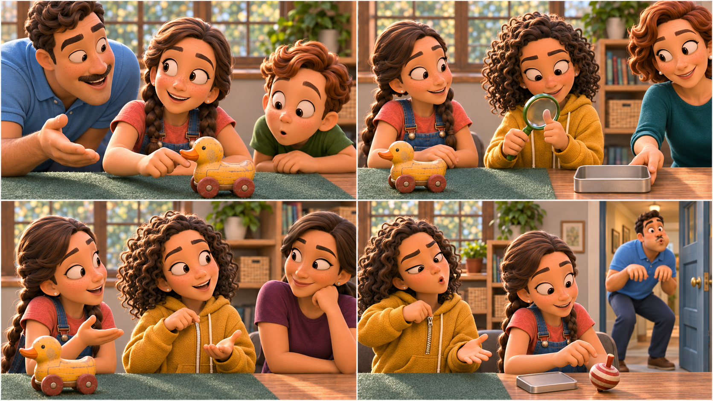](storyboards/BOARD_12.png)

| Panel | Screenplay shot | Episode time |
|---|---|---|
| Top left | [SHOT_045 · A noise she gets to keep](STORY.md#shot-045) | 07:20–07:30 |
| Top right | [SHOT_046 · Glass back, as promised](STORY.md#shot-046) | 07:30–07:40 |
| Bottom left | [SHOT_047 · The unsolved part](STORY.md#shot-047) | 07:40–07:50 |
| Bottom right | [SHOT_048 · The day the zipper won](STORY.md#shot-048) | 07:50–08:00 |

## Board 13 — A noise that looks pink

[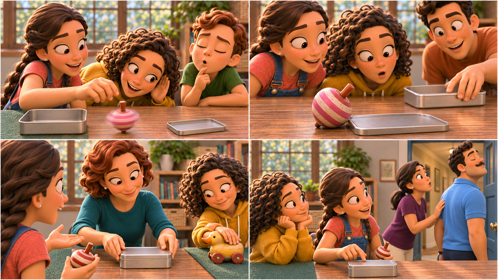](storyboards/BOARD_13.png)

| Panel | Screenplay shot | Episode time |
|---|---|---|
| Top left | [SHOT_049 · A noise that looks pink](STORY.md#shot-049) | 08:00–08:10 |
| Top right | [SHOT_050 · A tiny accidental ting](STORY.md#shot-050) | 08:10–08:20 |
| Bottom left | [SHOT_051 · A roof for the music](STORY.md#shot-051) | 08:20–08:30 |
| Bottom right | [SHOT_052 · Somebody lend me an ear](STORY.md#shot-052) | 08:30–08:40 |

## Board 14 — A bee in a lunchbox

[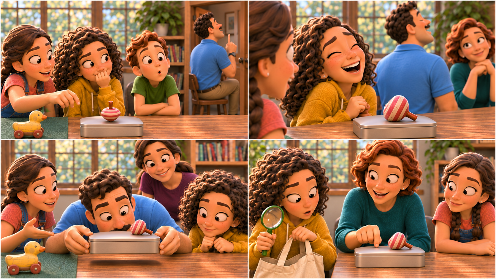](storyboards/BOARD_14.png)

| Panel | Screenplay shot | Episode time |
|---|---|---|
| Top left | [SHOT_053 · A bee in a lunchbox](STORY.md#shot-053) | 08:40–08:50 |
| Top right | [SHOT_054 · The bee gets boots](STORY.md#shot-054) | 08:50–09:00 |
| Bottom left | [SHOT_055 · May I see the bee?](STORY.md#shot-055) | 09:00–09:10 |
| Bottom right | [SHOT_056 · What comes with the top?](STORY.md#shot-056) | 09:10–09:20 |

## Board 15 — June's blue roof

[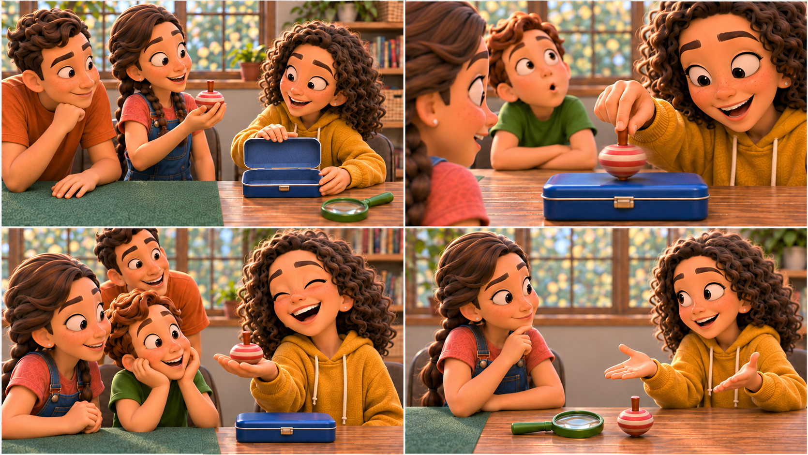](storyboards/BOARD_15.png)

| Panel | Screenplay shot | Episode time |
|---|---|---|
| Top left | [SHOT_057 · June's blue roof](STORY.md#shot-057) | 09:20–09:30 |
| Top right | [SHOT_058 · June takes a turn](STORY.md#shot-058) | 09:30–09:40 |
| Bottom left | [SHOT_059 · A good wrong answer](STORY.md#shot-059) | 09:40–09:50 |
| Bottom right | [SHOT_060 · An offer with names in it](STORY.md#shot-060) | 09:50–10:00 |

## Board 16 — The answer Ella means

[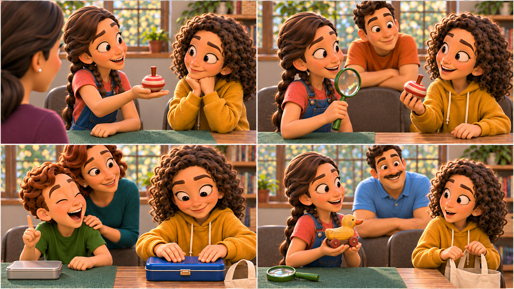](storyboards/BOARD_16.png)

| Panel | Screenplay shot | Episode time |
|---|---|---|
| Top left | [SHOT_061 · The answer Ella means](STORY.md#shot-061) | 10:00–10:10 |
| Top right | [SHOT_062 · A swap that sticks](STORY.md#shot-062) | 10:10–10:20 |
| Bottom left | [SHOT_063 · What fits this afternoon](STORY.md#shot-063) | 10:20–10:30 |
| Bottom right | [SHOT_064 · What about a second sound?](STORY.md#shot-064) | 10:30–10:40 |

## Board 17 — Until three

[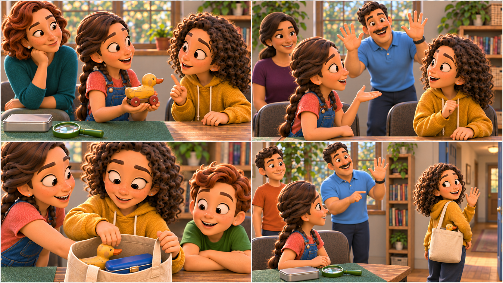](storyboards/BOARD_17.png)

| Panel | Screenplay shot | Episode time |
|---|---|---|
| Top left | [SHOT_065 · Until three](STORY.md#shot-065) | 10:40–10:50 |
| Top right | [SHOT_066 · Which blue door?](STORY.md#shot-066) | 10:50–11:00 |
| Bottom left | [SHOT_067 · Mabel goes visiting](STORY.md#shot-067) | 11:00–11:10 |
| Bottom right | [SHOT_068 · A wave from the hallway](STORY.md#shot-068) | 11:10–11:20 |

## Board 18 — A tin full of something else

[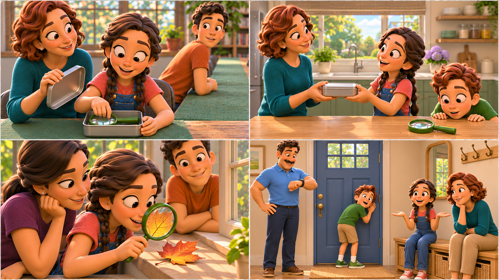](storyboards/BOARD_18.png)

| Panel | Screenplay shot | Episode time |
|---|---|---|
| Top left | [SHOT_069 · A tin full of something else](STORY.md#shot-069) | 11:20–11:30 |
| Top right | [SHOT_070 · Lid and all](STORY.md#shot-070) | 11:30–11:40 |
| Bottom left | [SHOT_071 · A leaf on the windowsill](STORY.md#shot-071) | 11:40–11:50 |
| Bottom right | [SHOT_072 · The minute hand](STORY.md#shot-072) | 11:50–12:00 |

## Board 19 — An ordinary knock

[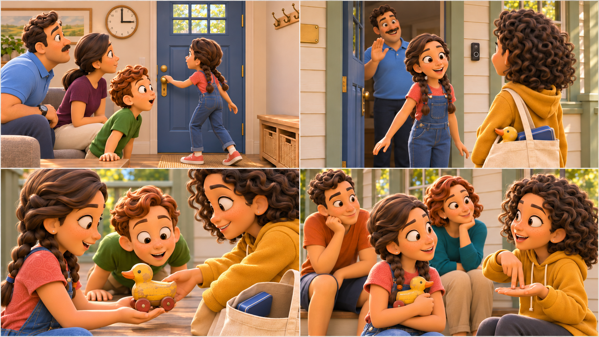](storyboards/BOARD_19.png)

| Panel | Screenplay shot | Episode time |
|---|---|---|
| Top left | [SHOT_073 · An ordinary knock](STORY.md#shot-073) | 12:00–12:10 |
| Top right | [SHOT_074 · Both of them](STORY.md#shot-074) | 12:10–12:20 |
| Bottom left | [SHOT_075 · Four familiar wheels](STORY.md#shot-075) | 12:20–12:30 |
| Bottom right | [SHOT_076 · What June's dad heard](STORY.md#shot-076) | 12:30–12:40 |

## Board 20 — A sound to bring next time

[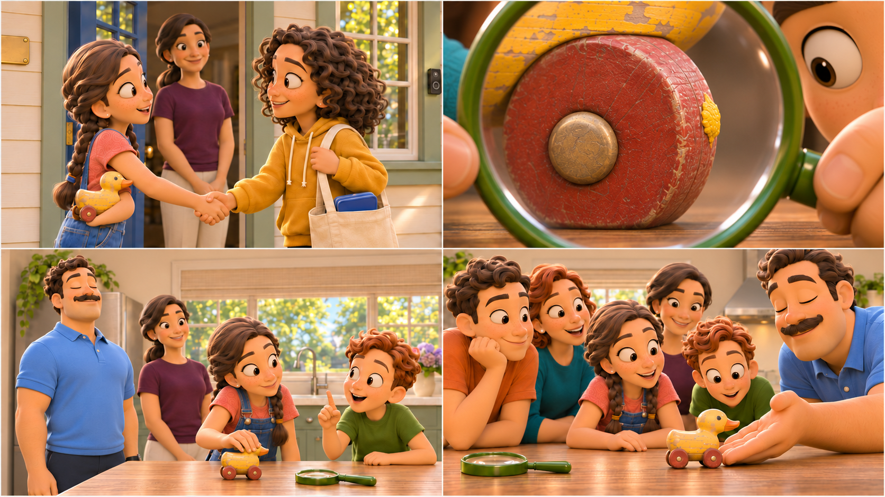](storyboards/BOARD_20.png)

| Panel | Screenplay shot | Episode time |
|---|---|---|
| Top left | [SHOT_077 · A sound to bring next time](STORY.md#shot-077) | 12:40–12:50 |
| Top right | [SHOT_078 · Same table, different view](STORY.md#shot-078) | 12:50–13:00 |
| Bottom left | [SHOT_079 · A caller with good manners](STORY.md#shot-079) | 13:00–13:10 |
| Bottom right | [SHOT_080 · Come in, Mabel](STORY.md#shot-080) | 13:10–13:20 |
