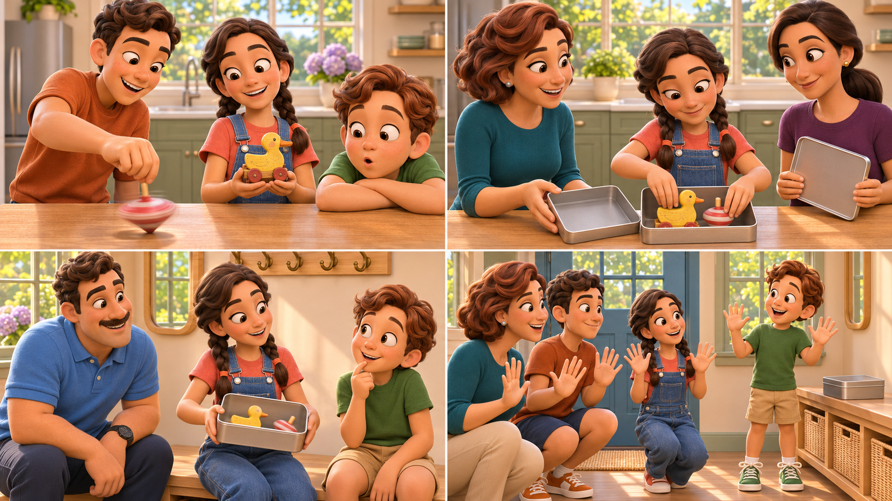

# Episode 13 storyboard — Do I Get My Duck Back?

5 of 20 sheets illustrated. Read each sheet across the top row, then across the bottom row. Each panel covers one 15-second shot.

[Screenplay](STORY.md) · [Image references and checksums](assets/storyboards/GENERATION_NOTES.md)

| Sheet | Episode time | Shot range | Opening beat |
|---|---|---|---|
| [01](#board-01) | 00:00–01:00 | 001–004 | Someone very short is knocking |
| [02](#board-02) | 01:00–02:00 | 005–008 | The item on offer |
| [03](#board-03) | 02:00–03:00 | 009–012 | Through the blue door |
| [04](#board-04) | 03:00–04:00 | 013–016 | Someone at the other end |
| [05](#board-05) | 04:00–05:00 | 017–020 | A duck with a name |
| 06 · pending | 05:00–06:00 | 021–024 | A stripe with a secret |
| 07 · pending | 06:00–07:00 | 025–028 | The rest of the sentence |
| 08 · pending | 07:00–08:00 | 029–032 | The word on the door |
| 09 · pending | 08:00–09:00 | 033–036 | Back where they belong |
| 10 · pending | 09:00–10:00 | 037–040 | A hop you can see |
| 11 · pending | 10:00–11:00 | 041–044 | Which back wheel? |
| 12 · pending | 11:00–12:00 | 045–048 | A noise she gets to keep |
| 13 · pending | 12:00–13:00 | 049–052 | A noise that looks pink |
| 14 · pending | 13:00–14:00 | 053–056 | A bee in a lunchbox |
| 15 · pending | 14:00–15:00 | 057–060 | June's blue roof |
| 16 · pending | 15:00–16:00 | 061–064 | The answer Ella means |
| 17 · pending | 16:00–17:00 | 065–068 | Until three |
| 18 · pending | 17:00–18:00 | 069–072 | A tin full of something else |
| 19 · pending | 18:00–19:00 | 073–076 | An ordinary knock |
| 20 · pending | 19:00–20:00 | 077–080 | A sound to bring next time |

## Board 01 — Someone very short is knocking

| Panel | Screenplay shot | Episode time |
|---|---|---|
| Top left | [SHOT_001 · Someone very short is knocking](STORY.md#shot-001) | 00:00–00:15 |
| Top right | [SHOT_002 · It follows her](STORY.md#shot-002) | 00:15–00:30 |
| Bottom left | [SHOT_003 · Nothing in the duck](STORY.md#shot-003) | 00:30–00:45 |
| Bottom right | [SHOT_004 · A beak with a fingerprint](STORY.md#shot-004) | 00:45–01:00 |

## Board 02 — The item on offer

| Panel | Screenplay shot | Episode time |
|---|---|---|
| Top left | [SHOT_005 · The item on offer](STORY.md#shot-005) | 01:00–01:15 |
| Top right | [SHOT_006 · May I borrow your tin?](STORY.md#shot-006) | 01:15–01:30 |
| Bottom left | [SHOT_007 · One goes, one comes along](STORY.md#shot-007) | 01:30–01:45 |
| Bottom right | [SHOT_008 · Two bows at the door](STORY.md#shot-008) | 01:45–02:00 |

## Board 03 — Through the blue door

| Panel | Screenplay shot | Episode time |
|---|---|---|
| Top left | [SHOT_009 · Through the blue door](STORY.md#shot-009) | 02:00–02:15 |
| Top right | [SHOT_010 · A table by the window](STORY.md#shot-010) | 02:15–02:30 |
| Bottom left | [SHOT_011 · A top with stage fright](STORY.md#shot-011) | 02:30–02:45 |
| Bottom right | [SHOT_012 · The traveling knock](STORY.md#shot-012) | 02:45–03:00 |

## Board 04 — Someone at the other end

| Panel | Screenplay shot | Episode time |
|---|---|---|
| Top left | [SHOT_013 · Someone at the other end](STORY.md#shot-013) | 03:00–03:15 |
| Top right | [SHOT_014 · What fits in a pencil case](STORY.md#shot-014) | 03:15–03:30 |
| Bottom left | [SHOT_015 · June's impossible sound](STORY.md#shot-015) | 03:30–03:45 |
| Bottom right | [SHOT_016 · One audition](STORY.md#shot-016) | 03:45–04:00 |

## Board 05 — A duck with a name

| Panel | Screenplay shot | Episode time |
|---|---|---|
| Top left | [SHOT_017 · A duck with a name](STORY.md#shot-017) | 04:00–04:15 |
| Top right | [SHOT_018 · The wrong end for looking](STORY.md#shot-018) | 04:15–04:30 |
| Bottom left | [SHOT_019 · The word they both hear](STORY.md#shot-019) | 04:30–04:45 |
| Bottom right | [SHOT_020 · The switch](STORY.md#shot-020) | 04:45–05:00 |
