# Episode 13 storyboard — Do I Get My Duck Back?

17 of 20 sheets illustrated. Read each sheet across the top row, then across the bottom row. Each panel covers one 15-second shot.

[Screenplay](STORY.md) · [Image references and checksums](assets/storyboards/GENERATION_NOTES.md)

| Sheet | Episode time | Shot range | Opening beat |
|---|---|---|---|
| [01](#board-01) | 00:00–01:00 | 001–004 | Someone very short is knocking |
| [02](#board-02) | 01:00–02:00 | 005–008 | The item on offer |
| [03](#board-03) | 02:00–03:00 | 009–012 | Through the blue door |
| [04](#board-04) | 03:00–04:00 | 013–016 | Someone at the other end |
| [05](#board-05) | 04:00–05:00 | 017–020 | A duck with a name |
| [06](#board-06) | 05:00–06:00 | 021–024 | A stripe with a secret |
| [07](#board-07) | 06:00–07:00 | 025–028 | The rest of the sentence |
| [08](#board-08) | 07:00–08:00 | 029–032 | The word on the door |
| [09](#board-09) | 08:00–09:00 | 033–036 | Back where they belong |
| [10](#board-10) | 09:00–10:00 | 037–040 | A hop you can see |
| [11](#board-11) | 10:00–11:00 | 041–044 | Which back wheel? |
| [12](#board-12) | 11:00–12:00 | 045–048 | A noise she gets to keep |
| [13](#board-13) | 12:00–13:00 | 049–052 | A noise that looks pink |
| [14](#board-14) | 13:00–14:00 | 053–056 | A bee in a lunchbox |
| [15](#board-15) | 14:00–15:00 | 057–060 | June's blue roof |
| [16](#board-16) | 15:00–16:00 | 061–064 | The answer Ella means |
| [17](#board-17) | 16:00–17:00 | 065–068 | Until three |
| 18 · pending | 17:00–18:00 | 069–072 | A tin full of something else |
| 19 · pending | 18:00–19:00 | 073–076 | An ordinary knock |
| 20 · pending | 19:00–20:00 | 077–080 | A sound to bring next time |

## Board 01 — Someone very short is knocking

[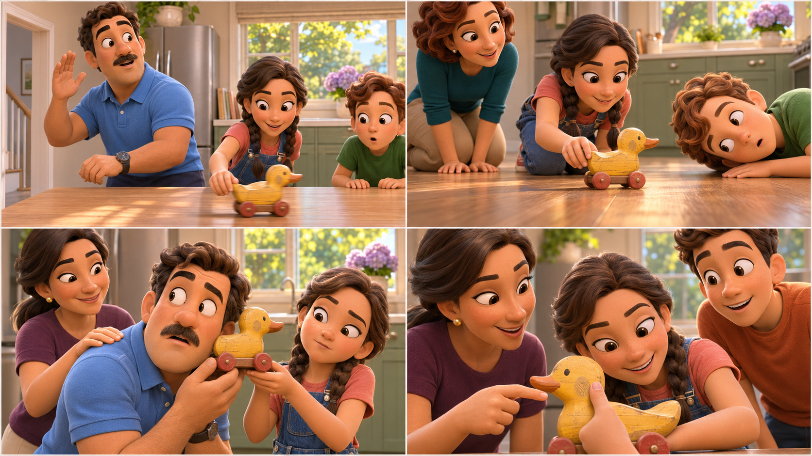](assets/storyboards/BOARD_01.png)

| Panel | Screenplay shot | Episode time |
|---|---|---|
| Top left | [SHOT_001 · Someone very short is knocking](STORY.md#shot-001) | 00:00–00:15 |
| Top right | [SHOT_002 · It follows her](STORY.md#shot-002) | 00:15–00:30 |
| Bottom left | [SHOT_003 · Nothing in the duck](STORY.md#shot-003) | 00:30–00:45 |
| Bottom right | [SHOT_004 · A beak with a fingerprint](STORY.md#shot-004) | 00:45–01:00 |

## Board 02 — The item on offer

| Panel | Screenplay shot | Episode time |
|---|---|---|
| Top left | [SHOT_005 · The item on offer](STORY.md#shot-005) | 01:00–01:15 |
| Top right | [SHOT_006 · May I borrow your tin?](STORY.md#shot-006) | 01:15–01:30 |
| Bottom left | [SHOT_007 · One goes, one comes along](STORY.md#shot-007) | 01:30–01:45 |
| Bottom right | [SHOT_008 · Two bows at the door](STORY.md#shot-008) | 01:45–02:00 |

## Board 03 — Through the blue door

[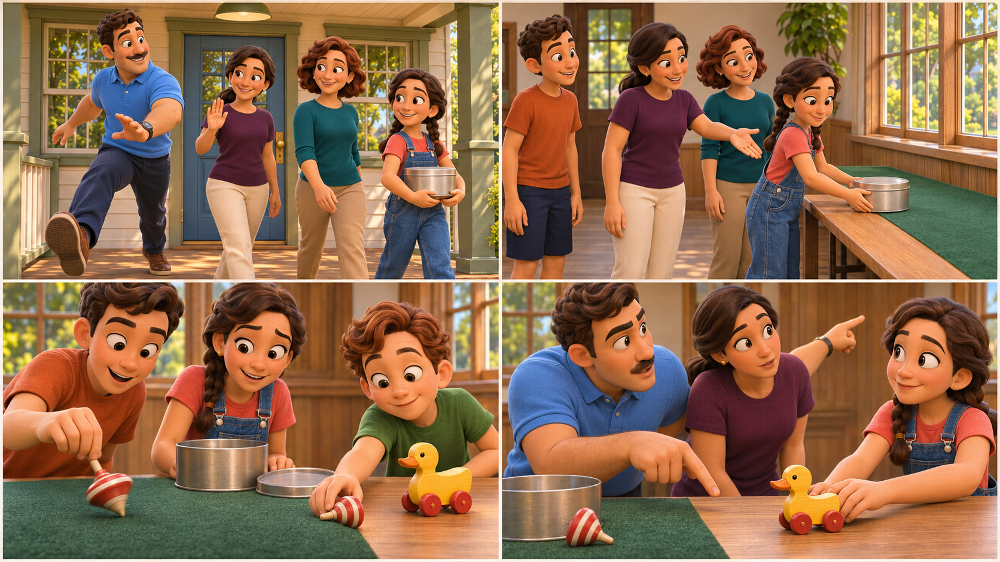](assets/storyboards/BOARD_03.png)

| Panel | Screenplay shot | Episode time |
|---|---|---|
| Top left | [SHOT_009 · Through the blue door](STORY.md#shot-009) | 02:00–02:15 |
| Top right | [SHOT_010 · A table by the window](STORY.md#shot-010) | 02:15–02:30 |
| Bottom left | [SHOT_011 · A top with stage fright](STORY.md#shot-011) | 02:30–02:45 |
| Bottom right | [SHOT_012 · The traveling knock](STORY.md#shot-012) | 02:45–03:00 |

## Board 04 — Someone at the other end

[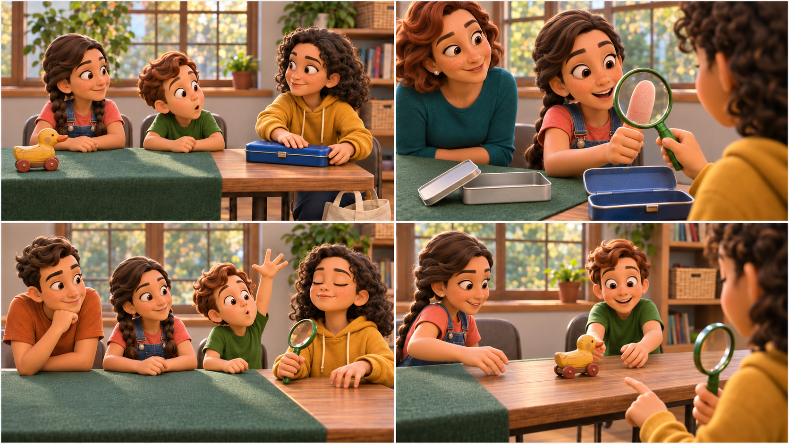](assets/storyboards/BOARD_04.png)

| Panel | Screenplay shot | Episode time |
|---|---|---|
| Top left | [SHOT_013 · Someone at the other end](STORY.md#shot-013) | 03:00–03:15 |
| Top right | [SHOT_014 · What fits in a pencil case](STORY.md#shot-014) | 03:15–03:30 |
| Bottom left | [SHOT_015 · June's impossible sound](STORY.md#shot-015) | 03:30–03:45 |
| Bottom right | [SHOT_016 · One audition](STORY.md#shot-016) | 03:45–04:00 |

## Board 05 — A duck with a name

[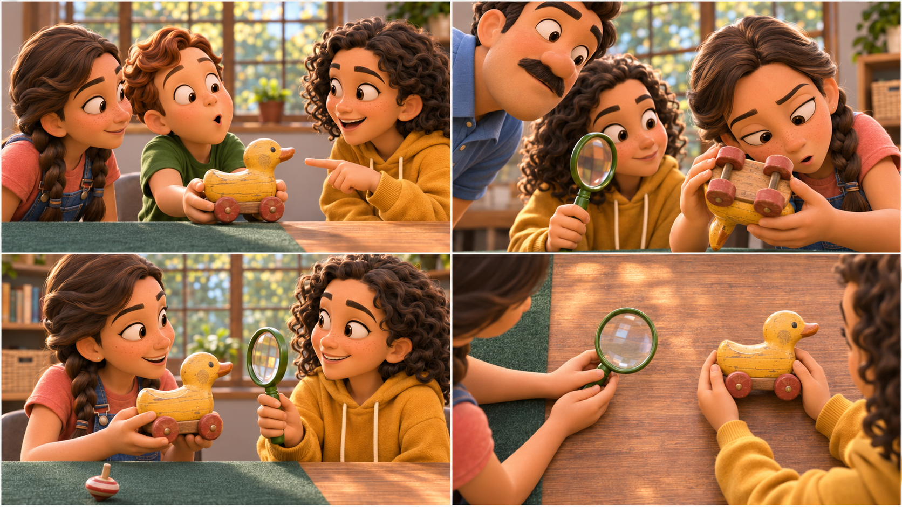](assets/storyboards/BOARD_05.png)

| Panel | Screenplay shot | Episode time |
|---|---|---|
| Top left | [SHOT_017 · A duck with a name](STORY.md#shot-017) | 04:00–04:15 |
| Top right | [SHOT_018 · The wrong end for looking](STORY.md#shot-018) | 04:15–04:30 |
| Bottom left | [SHOT_019 · The word they both hear](STORY.md#shot-019) | 04:30–04:45 |
| Bottom right | [SHOT_020 · The switch](STORY.md#shot-020) | 04:45–05:00 |

## Board 06 — A stripe with a secret

[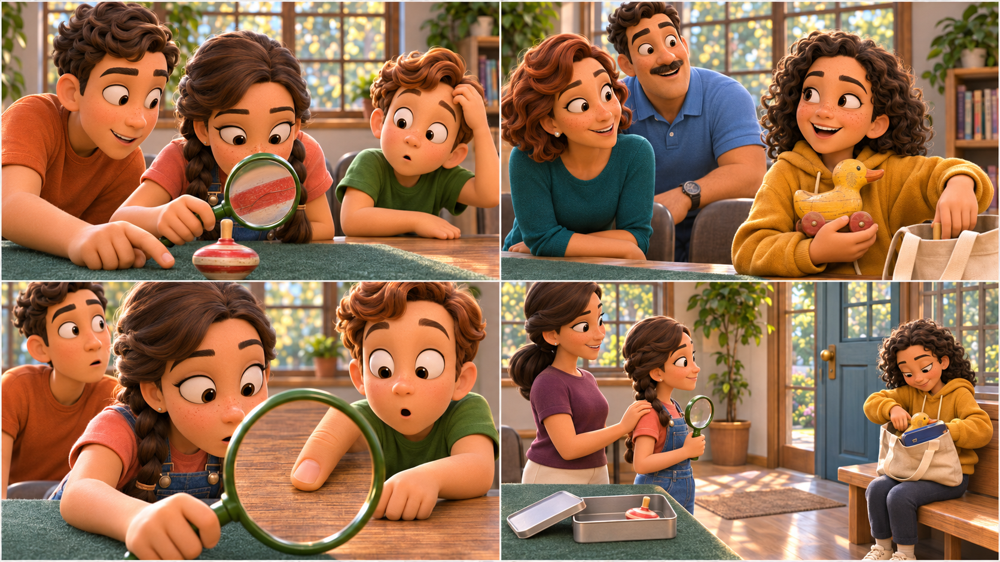](assets/storyboards/BOARD_06.png)

| Panel | Screenplay shot | Episode time |
|---|---|---|
| Top left | [SHOT_021 · A stripe with a secret](STORY.md#shot-021) | 05:00–05:15 |
| Top right | [SHOT_022 · A sound worth taking home](STORY.md#shot-022) | 05:15–05:30 |
| Bottom left | [SHOT_023 · A very clear view of nothing](STORY.md#shot-023) | 05:30–05:45 |
| Bottom right | [SHOT_024 · Mabel's head goes in](STORY.md#shot-024) | 05:45–06:00 |

## Board 07 — The rest of the sentence

[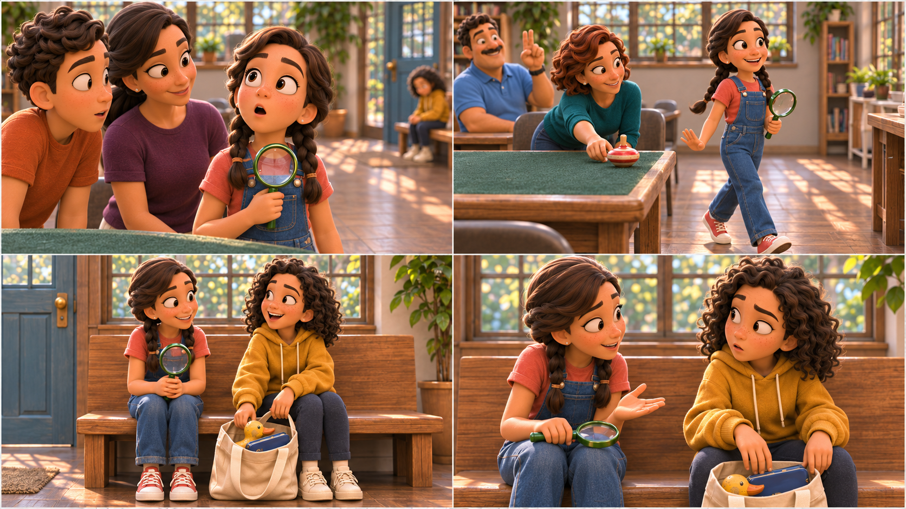](assets/storyboards/BOARD_07.png)

| Panel | Screenplay shot | Episode time |
|---|---|---|
| Top left | [SHOT_025 · The rest of the sentence](STORY.md#shot-025) | 06:00–06:15 |
| Top right | [SHOT_026 · A hand at her side](STORY.md#shot-026) | 06:15–06:30 |
| Bottom left | [SHOT_027 · A place on the bench](STORY.md#shot-027) | 06:30–06:45 |
| Bottom right | [SHOT_028 · How long is a switch?](STORY.md#shot-028) | 06:45–07:00 |

## Board 08 — The word on the door

[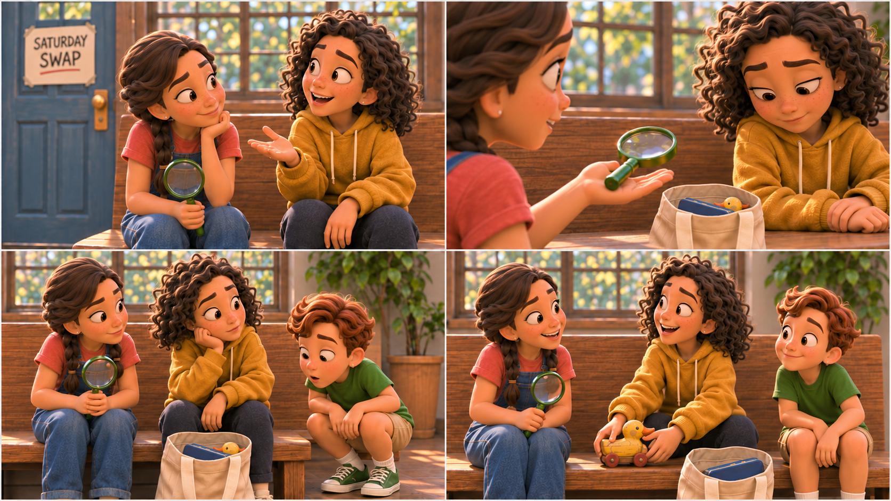](assets/storyboards/BOARD_08.png)

| Panel | Screenplay shot | Episode time |
|---|---|---|
| Top left | [SHOT_029 · The word on the door](STORY.md#shot-029) | 07:00–07:15 |
| Top right | [SHOT_030 · A question with room after it](STORY.md#shot-030) | 07:15–07:30 |
| Bottom left | [SHOT_031 · A quiet second](STORY.md#shot-031) | 07:30–07:45 |
| Bottom right | [SHOT_032 · Two yeses](STORY.md#shot-032) | 07:45–08:00 |

## Board 09 — Back where they belong

[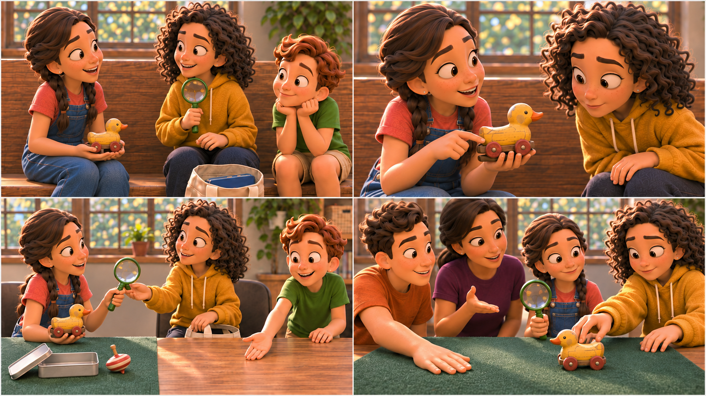](assets/storyboards/BOARD_09.png)

| Panel | Screenplay shot | Episode time |
|---|---|---|
| Top left | [SHOT_033 · Back where they belong](STORY.md#shot-033) | 08:00–08:15 |
| Top right | [SHOT_034 · A smaller question](STORY.md#shot-034) | 08:15–08:30 |
| Bottom left | [SHOT_035 · Back to the window](STORY.md#shot-035) | 08:30–08:45 |
| Bottom right | [SHOT_036 · Take away the tabletop](STORY.md#shot-036) | 08:45–09:00 |

## Board 10 — A hop you can see

[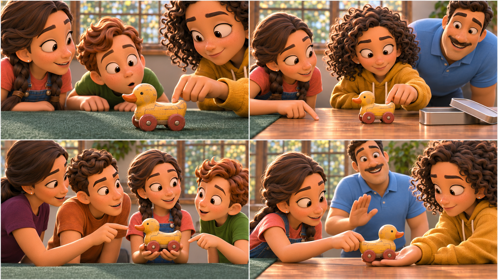](assets/storyboards/BOARD_10.png)

| Panel | Screenplay shot | Episode time |
|---|---|---|
| Top left | [SHOT_037 · A hop you can see](STORY.md#shot-037) | 09:00–09:15 |
| Top right | [SHOT_038 · The sound meets the hop](STORY.md#shot-038) | 09:15–09:30 |
| Bottom left | [SHOT_039 · The front stays level](STORY.md#shot-039) | 09:30–09:45 |
| Bottom right | [SHOT_040 · Backward duck](STORY.md#shot-040) | 09:45–10:00 |

## Board 11 — Which back wheel?

[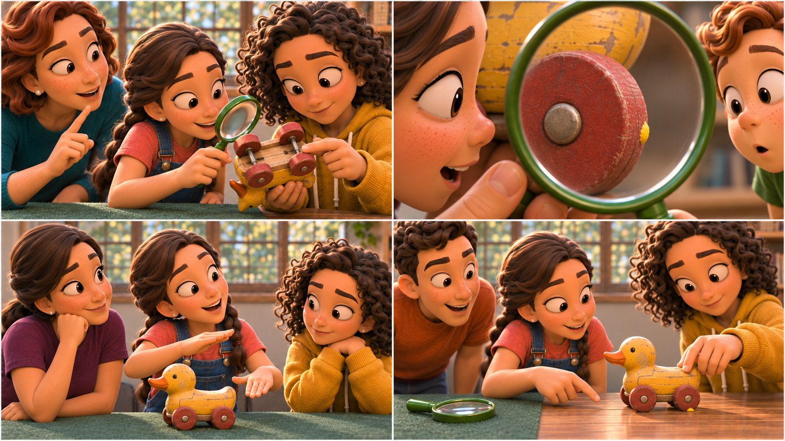](assets/storyboards/BOARD_11.png)

| Panel | Screenplay shot | Episode time |
|---|---|---|
| Top left | [SHOT_041 · Which back wheel?](STORY.md#shot-041) | 10:00–10:15 |
| Top right | [SHOT_042 · A yellow hill](STORY.md#shot-042) | 10:15–10:30 |
| Bottom left | [SHOT_043 · The painter remembers](STORY.md#shot-043) | 10:30–10:45 |
| Bottom right | [SHOT_044 · Once around](STORY.md#shot-044) | 10:45–11:00 |

## Board 12 — A noise she gets to keep

[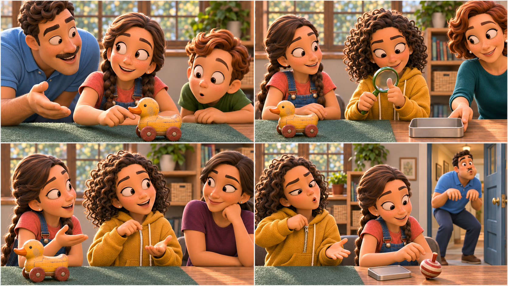](assets/storyboards/BOARD_12.png)

| Panel | Screenplay shot | Episode time |
|---|---|---|
| Top left | [SHOT_045 · A noise she gets to keep](STORY.md#shot-045) | 11:00–11:15 |
| Top right | [SHOT_046 · Glass back, as promised](STORY.md#shot-046) | 11:15–11:30 |
| Bottom left | [SHOT_047 · The unsolved part](STORY.md#shot-047) | 11:30–11:45 |
| Bottom right | [SHOT_048 · The day the zipper won](STORY.md#shot-048) | 11:45–12:00 |

## Board 13 — A noise that looks pink

[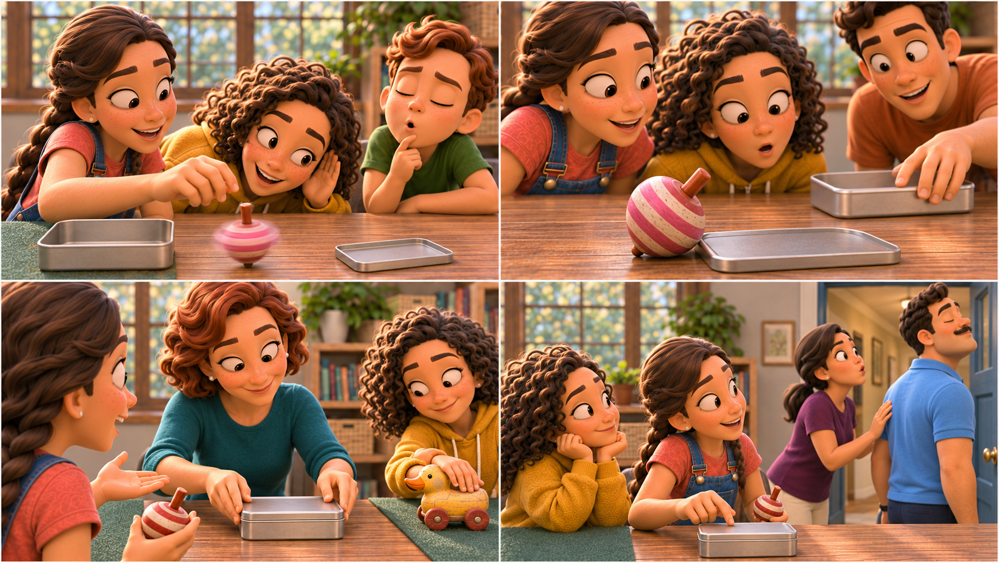](assets/storyboards/BOARD_13.png)

| Panel | Screenplay shot | Episode time |
|---|---|---|
| Top left | [SHOT_049 · A noise that looks pink](STORY.md#shot-049) | 12:00–12:15 |
| Top right | [SHOT_050 · A tiny accidental ting](STORY.md#shot-050) | 12:15–12:30 |
| Bottom left | [SHOT_051 · A roof for the music](STORY.md#shot-051) | 12:30–12:45 |
| Bottom right | [SHOT_052 · Somebody lend me an ear](STORY.md#shot-052) | 12:45–13:00 |

## Board 14 — A bee in a lunchbox

[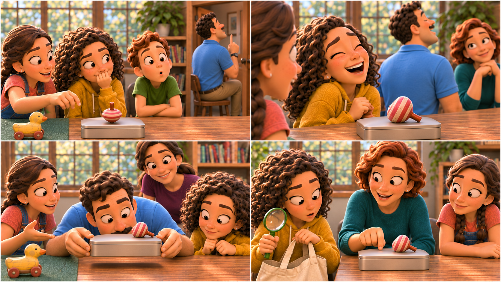](assets/storyboards/BOARD_14.png)

| Panel | Screenplay shot | Episode time |
|---|---|---|
| Top left | [SHOT_053 · A bee in a lunchbox](STORY.md#shot-053) | 13:00–13:15 |
| Top right | [SHOT_054 · The bee gets boots](STORY.md#shot-054) | 13:15–13:30 |
| Bottom left | [SHOT_055 · May I see the bee?](STORY.md#shot-055) | 13:30–13:45 |
| Bottom right | [SHOT_056 · What comes with the top?](STORY.md#shot-056) | 13:45–14:00 |

## Board 15 — June's blue roof

[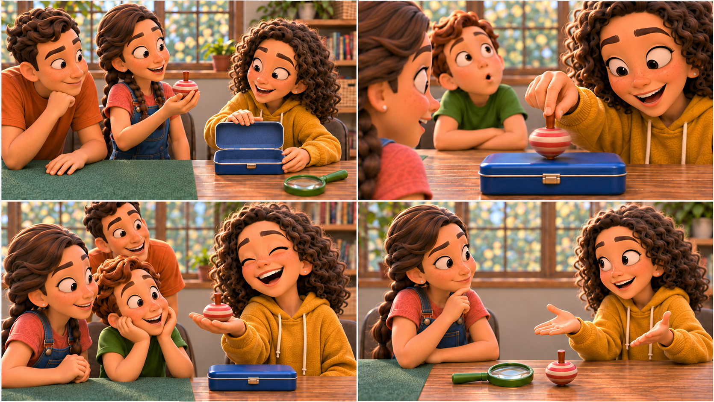](assets/storyboards/BOARD_15.png)

| Panel | Screenplay shot | Episode time |
|---|---|---|
| Top left | [SHOT_057 · June's blue roof](STORY.md#shot-057) | 14:00–14:15 |
| Top right | [SHOT_058 · June takes a turn](STORY.md#shot-058) | 14:15–14:30 |
| Bottom left | [SHOT_059 · A good wrong answer](STORY.md#shot-059) | 14:30–14:45 |
| Bottom right | [SHOT_060 · An offer with names in it](STORY.md#shot-060) | 14:45–15:00 |

## Board 16 — The answer Ella means

[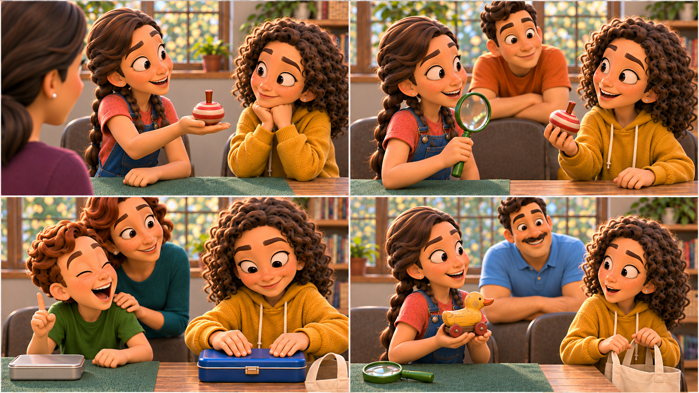](assets/storyboards/BOARD_16.png)

| Panel | Screenplay shot | Episode time |
|---|---|---|
| Top left | [SHOT_061 · The answer Ella means](STORY.md#shot-061) | 15:00–15:15 |
| Top right | [SHOT_062 · A swap that sticks](STORY.md#shot-062) | 15:15–15:30 |
| Bottom left | [SHOT_063 · What fits this afternoon](STORY.md#shot-063) | 15:30–15:45 |
| Bottom right | [SHOT_064 · What about a second sound?](STORY.md#shot-064) | 15:45–16:00 |

## Board 17 — Until three

[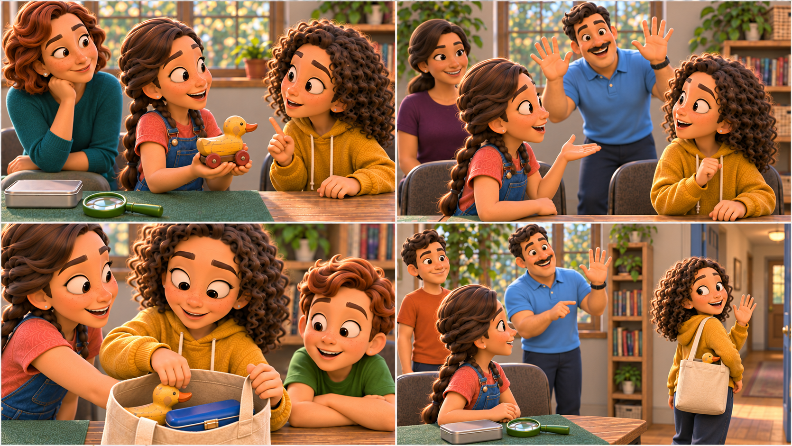](assets/storyboards/BOARD_17.png)

| Panel | Screenplay shot | Episode time |
|---|---|---|
| Top left | [SHOT_065 · Until three](STORY.md#shot-065) | 16:00–16:15 |
| Top right | [SHOT_066 · Which blue door?](STORY.md#shot-066) | 16:15–16:30 |
| Bottom left | [SHOT_067 · Mabel goes visiting](STORY.md#shot-067) | 16:30–16:45 |
| Bottom right | [SHOT_068 · A wave from the hallway](STORY.md#shot-068) | 16:45–17:00 |
