# Episode 14 storyboard — Can You Mail a Hug?

20 of 20 sheets illustrated. Read each sheet across the top row, then across the bottom row. Each panel covers one 10-second shot.

[Screenplay](STORY.md) · [Video prompts](VIDEO_PROMPTS.md)

| Sheet | Episode time | Shot range | Opening beat |
|---|---|---|---|
| [01](#board-01) | 00:00–00:40 | 001–004 | A refrigerator in the mail |
| [02](#board-02) | 00:40–01:20 | 005–008 | A corner goes missing |
| [03](#board-03) | 01:20–02:00 | 009–012 | One cream envelope |
| [04](#board-04) | 02:00–02:40 | 013–016 | One whole Max |
| [05](#board-05) | 02:40–03:20 | 017–020 | Dinner for a piece of paper |
| [06](#board-06) | 03:20–04:00 | 021–024 | Half of half |
| [07](#board-07) | 04:00–04:40 | 025–028 | Roads across the yellow |
| [08](#board-08) | 04:40–05:20 | 029–032 | A pocket accordion |
| [09](#board-09) | 05:20–06:00 | 033–036 | Breakfast words |
| [10](#board-10) | 06:00–06:40 | 037–040 | Open wide |
| [11](#board-11) | 06:40–07:20 | 041–044 | On the outside |
| [12](#board-12) | 07:20–08:00 | 045–048 | Two trips across a table |
| [13](#board-13) | 08:00–08:40 | 049–052 | One more door |
| [14](#board-14) | 08:40–09:20 | 053–056 | Which piece stays home? |
| [15](#board-15) | 09:20–10:00 | 057–060 | The slot and the counter |
| [16](#board-16) | 10:00–10:40 | 061–064 | For someone with a new kitchen |
| [17](#board-17) | 10:40–11:20 | 065–068 | The price of a leaf |
| [18](#board-18) | 11:20–12:00 | 069–072 | Off to Lantern Court |
| [19](#board-19) | 12:00–12:40 | 073–076 | Several breakfasts later |
| [20](#board-20) | 12:40–13:20 | 077–080 | A debt comes due |

## Board 01 — A refrigerator in the mail

[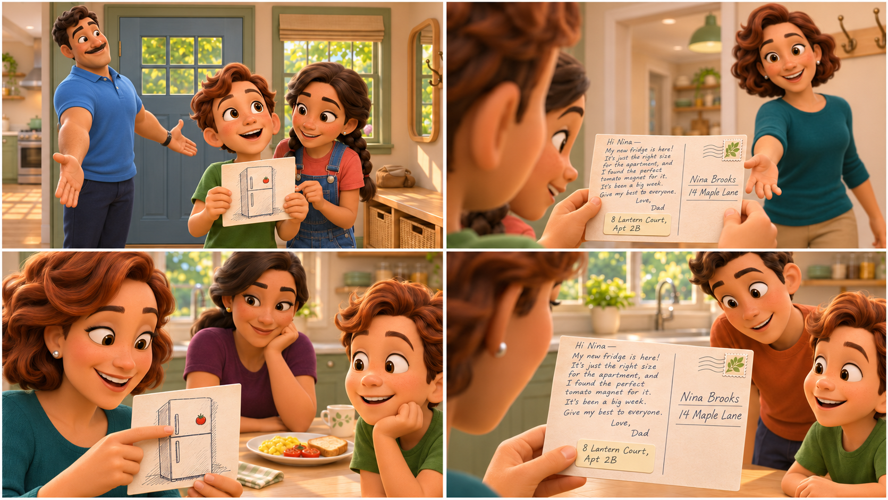](storyboards/BOARD_01.png)

| Panel | Screenplay shot | Episode time |
|---|---|---|
| Top left | [SHOT_001 · A refrigerator in the mail](STORY.md#shot-001) | 00:00–00:10 |
| Top right | [SHOT_002 · Who gets to turn it over?](STORY.md#shot-002) | 00:10–00:20 |
| Bottom left | [SHOT_003 · One very patient tomato](STORY.md#shot-003) | 00:20–00:30 |
| Bottom right | [SHOT_004 · A job for the magnet](STORY.md#shot-004) | 00:30–00:40 |

## Board 02 — A corner goes missing

[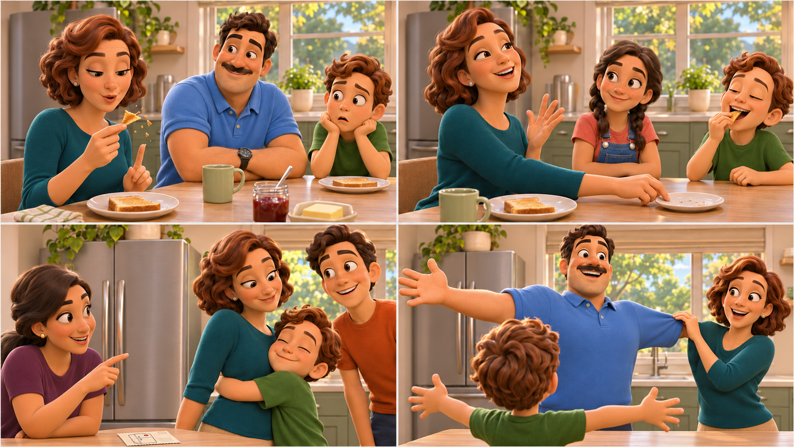](storyboards/BOARD_02.png)

| Panel | Screenplay shot | Episode time |
|---|---|---|
| Top left | [SHOT_005 · A corner goes missing](STORY.md#shot-005) | 00:40–00:50 |
| Top right | [SHOT_006 · What Grandpa used to say](STORY.md#shot-006) | 00:50–01:00 |
| Bottom left | [SHOT_007 · Something a magnet could hold](STORY.md#shot-007) | 01:00–01:10 |
| Bottom right | [SHOT_008 · How wide is a hug?](STORY.md#shot-008) | 01:10–01:20 |

## Board 03 — One cream envelope

[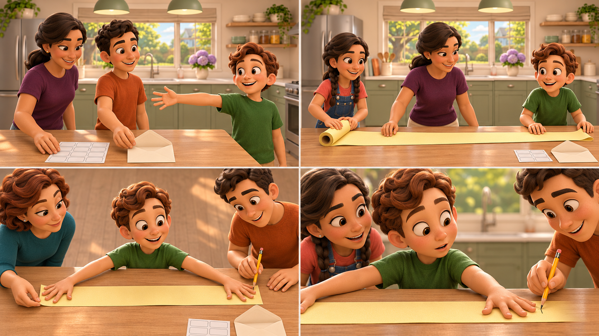](storyboards/BOARD_03.png)

| Panel | Screenplay shot | Episode time |
|---|---|---|
| Top left | [SHOT_009 · One cream envelope](STORY.md#shot-009) | 01:20–01:30 |
| Top right | [SHOT_010 · A road made of yellow paper](STORY.md#shot-010) | 01:30–01:40 |
| Bottom left | [SHOT_011 · Start at this fingertip](STORY.md#shot-011) | 01:40–01:50 |
| Bottom right | [SHOT_012 · The wandering pencil mark](STORY.md#shot-012) | 01:50–02:00 |

## Board 04 — One whole Max

[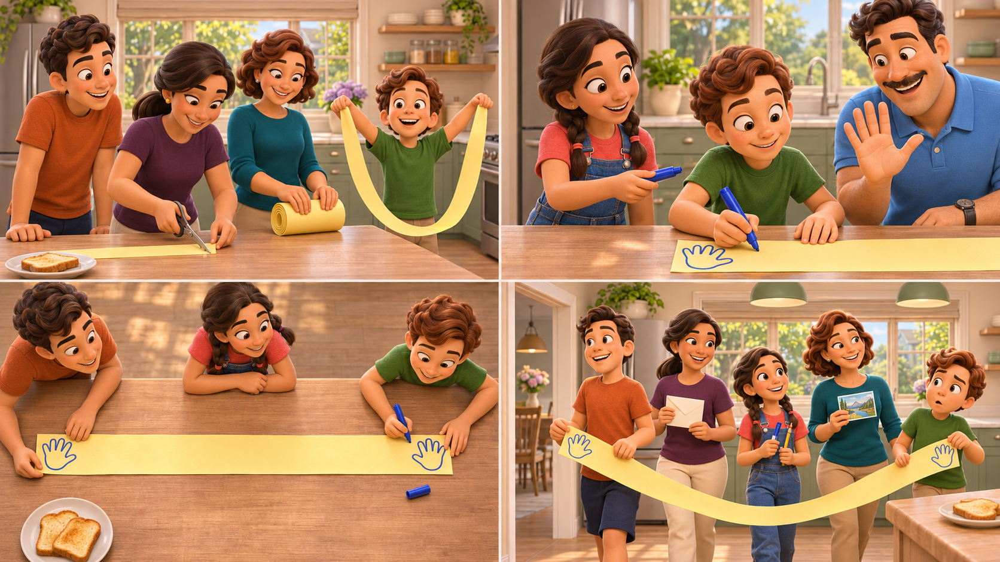](storyboards/BOARD_04.png)

| Panel | Screenplay shot | Episode time |
|---|---|---|
| Top left | [SHOT_013 · One whole Max](STORY.md#shot-013) | 02:00–02:10 |
| Top right | [SHOT_014 · The blue hand on the left](STORY.md#shot-014) | 02:10–02:20 |
| Bottom left | [SHOT_015 · A hand for the other end](STORY.md#shot-015) | 02:20–02:30 |
| Bottom right | [SHOT_016 · A problem for the dining table](STORY.md#shot-016) | 02:30–02:40 |

## Board 05 — Dinner for a piece of paper

[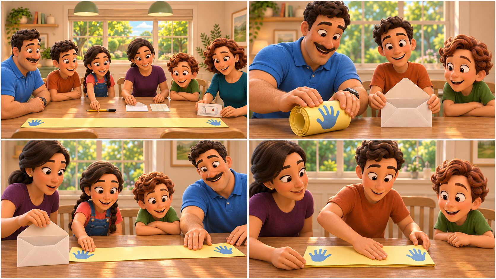](storyboards/BOARD_05.png)

| Panel | Screenplay shot | Episode time |
|---|---|---|
| Top left | [SHOT_017 · Dinner for a piece of paper](STORY.md#shot-017) | 02:40–02:50 |
| Top right | [SHOT_018 · Dad rolls up his sleeves](STORY.md#shot-018) | 02:50–03:00 |
| Bottom left | [SHOT_019 · A flap that won't lie down](STORY.md#shot-019) | 03:00–03:10 |
| Bottom right | [SHOT_020 · Once in half](STORY.md#shot-020) | 03:10–03:20 |

## Board 06 — Half of half

[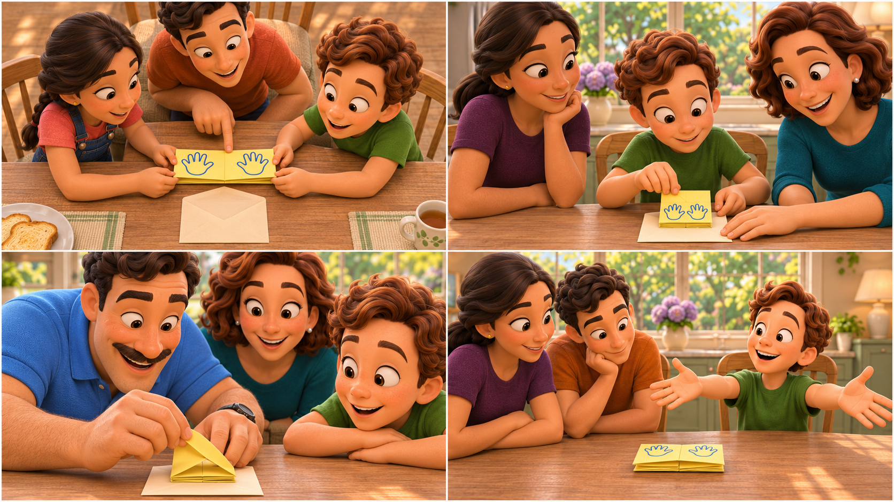](storyboards/BOARD_06.png)

| Panel | Screenplay shot | Episode time |
|---|---|---|
| Top left | [SHOT_021 · Half of half](STORY.md#shot-021) | 03:20–03:30 |
| Top right | [SHOT_022 · Eight layers, one little packet](STORY.md#shot-022) | 03:30–03:40 |
| Bottom left | [SHOT_023 · Too many little doors](STORY.md#shot-023) | 03:40–03:50 |
| Bottom right | [SHOT_024 · One pull](STORY.md#shot-024) | 03:50–04:00 |

## Board 07 — Roads across the yellow

[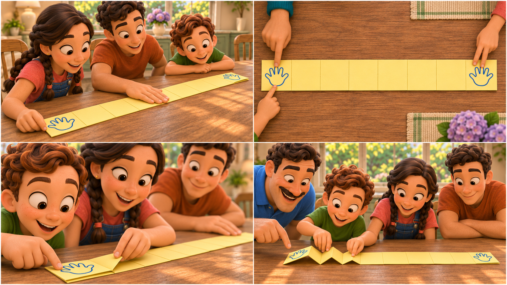](storyboards/BOARD_07.png)

| Panel | Screenplay shot | Episode time |
|---|---|---|
| Top left | [SHOT_025 · Roads across the yellow](STORY.md#shot-025) | 04:00–04:10 |
| Top right | [SHOT_026 · Seven lines, eight places](STORY.md#shot-026) | 04:10–04:20 |
| Bottom left | [SHOT_027 · The first turn](STORY.md#shot-027) | 04:20–04:30 |
| Bottom right | [SHOT_028 · Out and back](STORY.md#shot-028) | 04:30–04:40 |

## Board 08 — A pocket accordion

[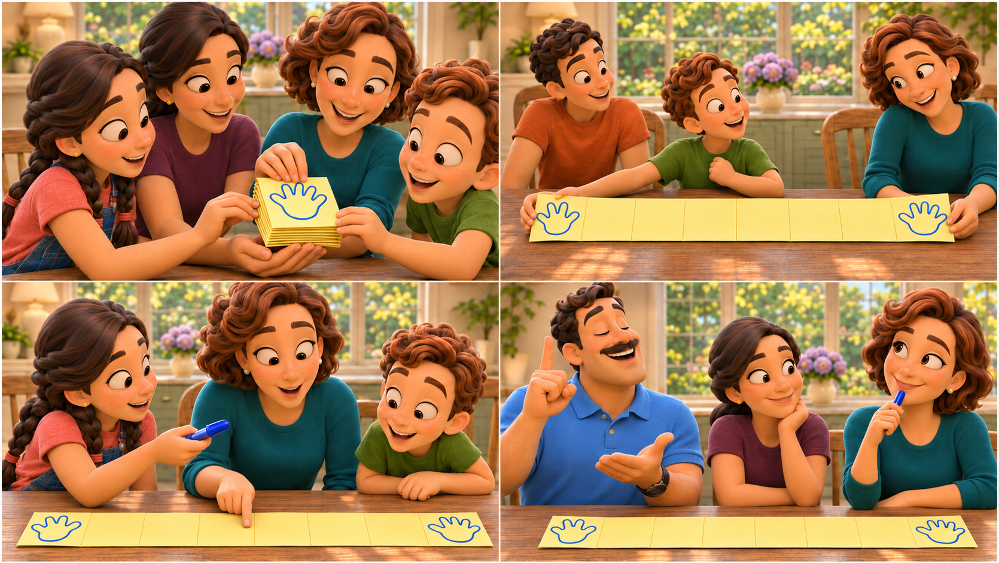](storyboards/BOARD_08.png)

| Panel | Screenplay shot | Episode time |
|---|---|---|
| Top left | [SHOT_029 · A pocket accordion](STORY.md#shot-029) | 04:40–04:50 |
| Top right | [SHOT_030 · The hug opens](STORY.md#shot-030) | 04:50–05:00 |
| Bottom left | [SHOT_031 · Room in the middle](STORY.md#shot-031) | 05:00–05:10 |
| Bottom right | [SHOT_032 · What a refrigerator would say](STORY.md#shot-032) | 05:10–05:20 |

## Board 09 — Breakfast words

[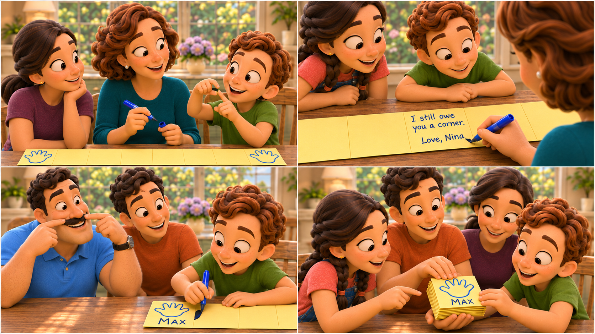](storyboards/BOARD_09.png)

| Panel | Screenplay shot | Episode time |
|---|---|---|
| Top left | [SHOT_033 · Breakfast words](STORY.md#shot-033) | 05:20–05:30 |
| Top right | [SHOT_034 · I still owe you a corner](STORY.md#shot-034) | 05:30–05:40 |
| Bottom left | [SHOT_035 · A small name under a small hand](STORY.md#shot-035) | 05:40–05:50 |
| Bottom right | [SHOT_036 · Can you find the message?](STORY.md#shot-036) | 05:50–06:00 |

## Board 10 — Open wide

[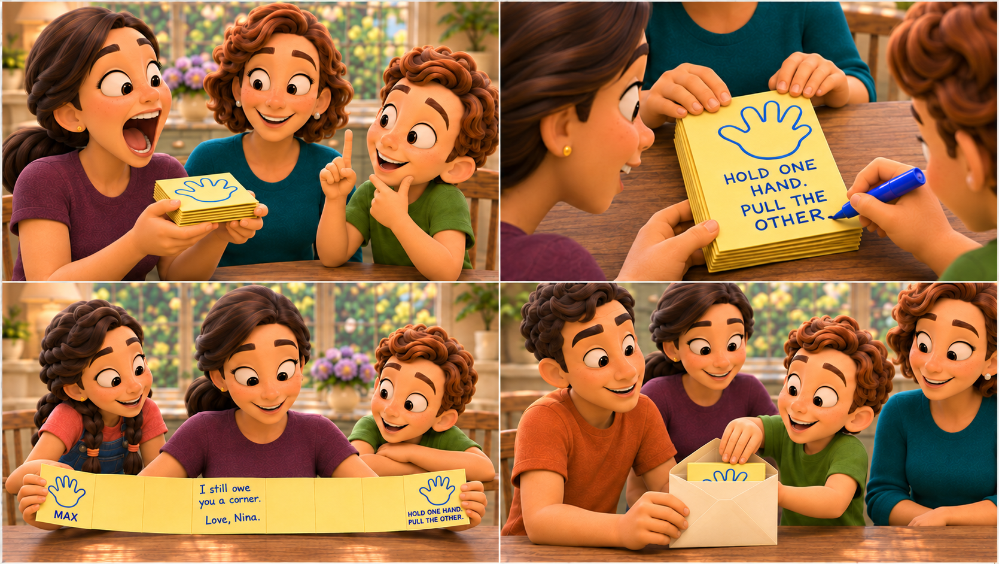](storyboards/BOARD_10.png)

| Panel | Screenplay shot | Episode time |
|---|---|---|
| Top left | [SHOT_037 · Open wide](STORY.md#shot-037) | 06:00–06:10 |
| Top right | [SHOT_038 · One hand and the other](STORY.md#shot-038) | 06:10–06:20 |
| Bottom left | [SHOT_039 · A quiet test](STORY.md#shot-039) | 06:20–06:30 |
| Bottom right | [SHOT_040 · The whole hug goes in](STORY.md#shot-040) | 06:30–06:40 |

## Board 11 — On the outside

[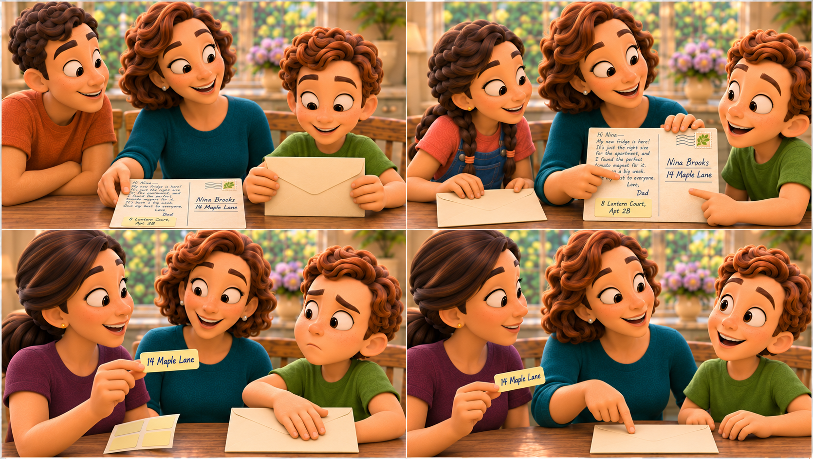](storyboards/BOARD_11.png)

| Panel | Screenplay shot | Episode time |
|---|---|---|
| Top left | [SHOT_041 · On the outside](STORY.md#shot-041) | 06:40–06:50 |
| Top right | [SHOT_042 · The trip the postcard took](STORY.md#shot-042) | 06:50–07:00 |
| Bottom left | [SHOT_043 · Return it?](STORY.md#shot-043) | 07:00–07:10 |
| Bottom right | [SHOT_044 · What comes back?](STORY.md#shot-044) | 07:10–07:20 |

## Board 12 — Two trips across a table

[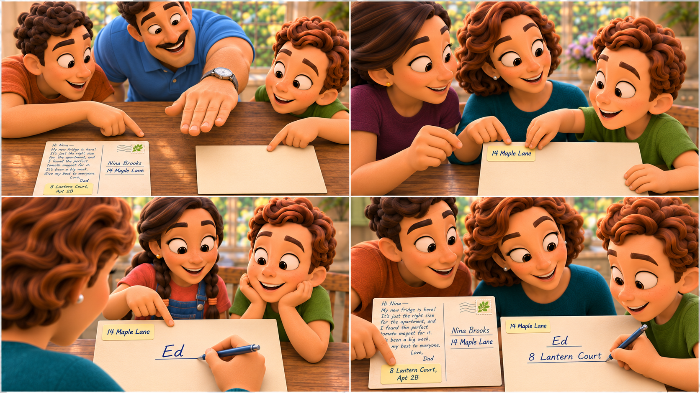](storyboards/BOARD_12.png)

| Panel | Screenplay shot | Episode time |
|---|---|---|
| Top left | [SHOT_045 · Two trips across a table](STORY.md#shot-045) | 07:20–07:30 |
| Top right | [SHOT_046 · Home in the little corner](STORY.md#shot-046) | 07:30–07:40 |
| Bottom left | [SHOT_047 · A name Ed will answer to](STORY.md#shot-047) | 07:40–07:50 |
| Bottom right | [SHOT_048 · Lane here, Court there](STORY.md#shot-048) | 07:50–08:00 |

## Board 13 — One more door

[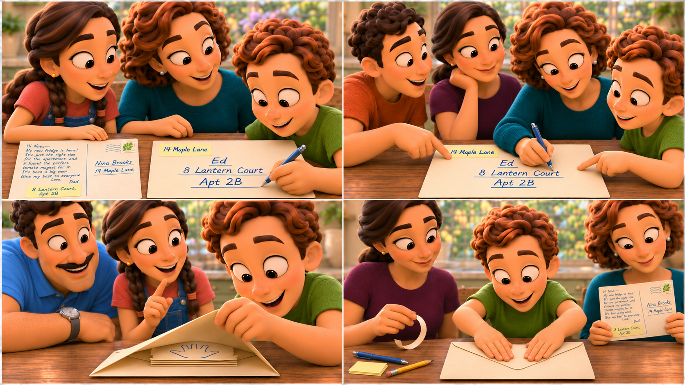](storyboards/BOARD_13.png)

| Panel | Screenplay shot | Episode time |
|---|---|---|
| Top left | [SHOT_049 · One more door](STORY.md#shot-049) | 08:00–08:10 |
| Top right | [SHOT_050 · Two addresses get a finger each](STORY.md#shot-050) | 08:10–08:20 |
| Bottom left | [SHOT_051 · Ready on the inside](STORY.md#shot-051) | 08:20–08:30 |
| Bottom right | [SHOT_052 · The envelope closes](STORY.md#shot-052) | 08:30–08:40 |

## Board 14 — Which piece stays home?

[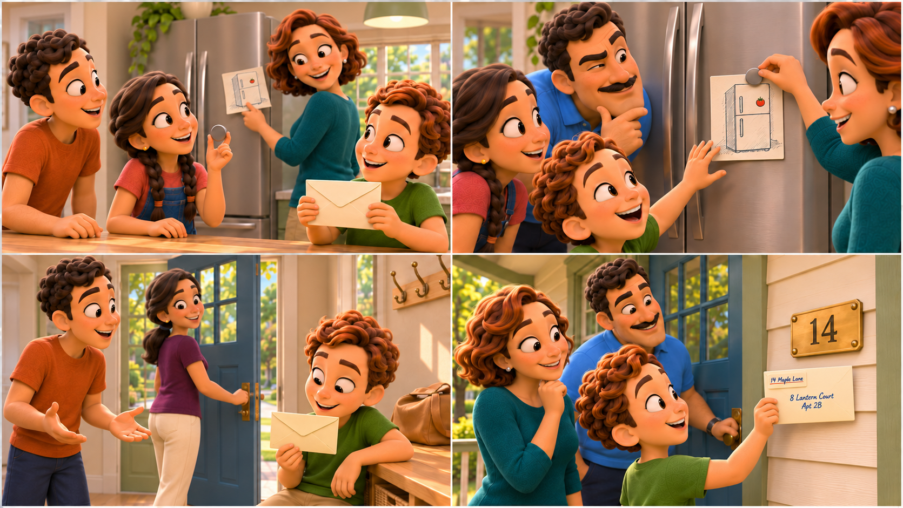](storyboards/BOARD_14.png)

| Panel | Screenplay shot | Episode time |
|---|---|---|
| Top left | [SHOT_053 · Which piece stays home?](STORY.md#shot-053) | 08:40–08:50 |
| Top right | [SHOT_054 · Two refrigerators](STORY.md#shot-054) | 08:50–09:00 |
| Bottom left | [SHOT_055 · What are you carrying?](STORY.md#shot-055) | 09:00–09:10 |
| Bottom right | [SHOT_056 · Fourteen from the outside](STORY.md#shot-056) | 09:10–09:20 |

## Board 15 — The slot and the counter

[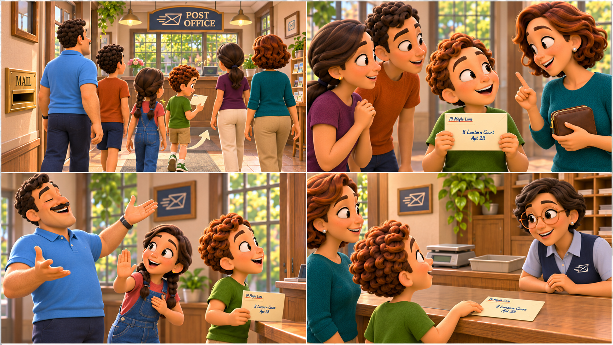](storyboards/BOARD_15.png)

| Panel | Screenplay shot | Episode time |
|---|---|---|
| Top left | [SHOT_057 · The slot and the counter](STORY.md#shot-057) | 09:20–09:30 |
| Top right | [SHOT_058 · What to ask for](STORY.md#shot-058) | 09:30–09:40 |
| Bottom left | [SHOT_059 · Dad's very long introduction](STORY.md#shot-059) | 09:40–09:50 |
| Bottom right | [SHOT_060 · A letter, please](STORY.md#shot-060) | 09:50–10:00 |

## Board 16 — For someone with a new kitchen

[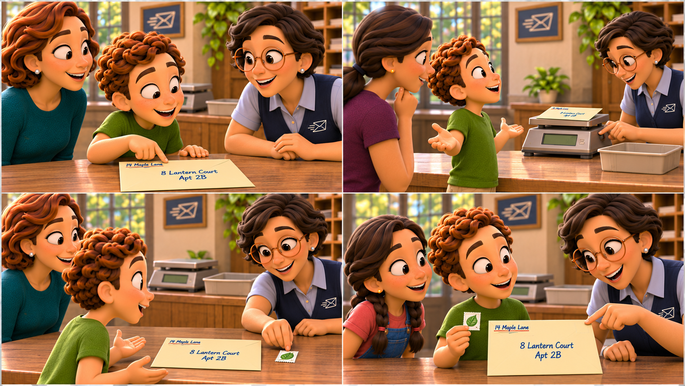](storyboards/BOARD_16.png)

| Panel | Screenplay shot | Episode time |
|---|---|---|
| Top left | [SHOT_061 · For someone with a new kitchen](STORY.md#shot-061) | 10:00–10:10 |
| Top right | [SHOT_062 · Does a hug weigh anything?](STORY.md#shot-062) | 10:10–10:20 |
| Bottom left | [SHOT_063 · One stamp for the whole thing](STORY.md#shot-063) | 10:20–10:30 |
| Bottom right | [SHOT_064 · A leaf with somewhere to go](STORY.md#shot-064) | 10:30–10:40 |

## Board 17 — The price of a leaf

[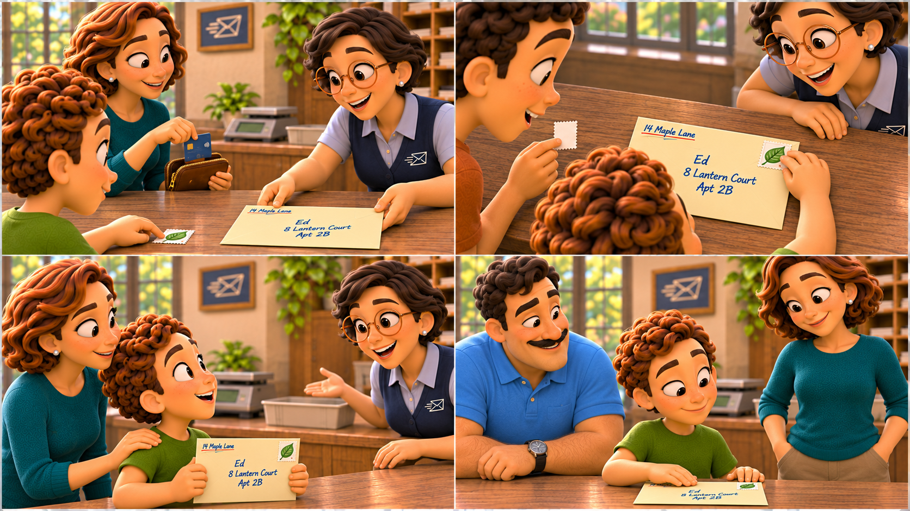](storyboards/BOARD_17.png)

| Panel | Screenplay shot | Episode time |
|---|---|---|
| Top left | [SHOT_065 · The price of a leaf](STORY.md#shot-065) | 10:40–10:50 |
| Top right | [SHOT_066 · A corner that stays put](STORY.md#shot-066) | 10:50–11:00 |
| Bottom left | [SHOT_067 · Does it go today?](STORY.md#shot-067) | 11:00–11:10 |
| Bottom right | [SHOT_068 · The last little hold](STORY.md#shot-068) | 11:10–11:20 |

## Board 18 — Off to Lantern Court

[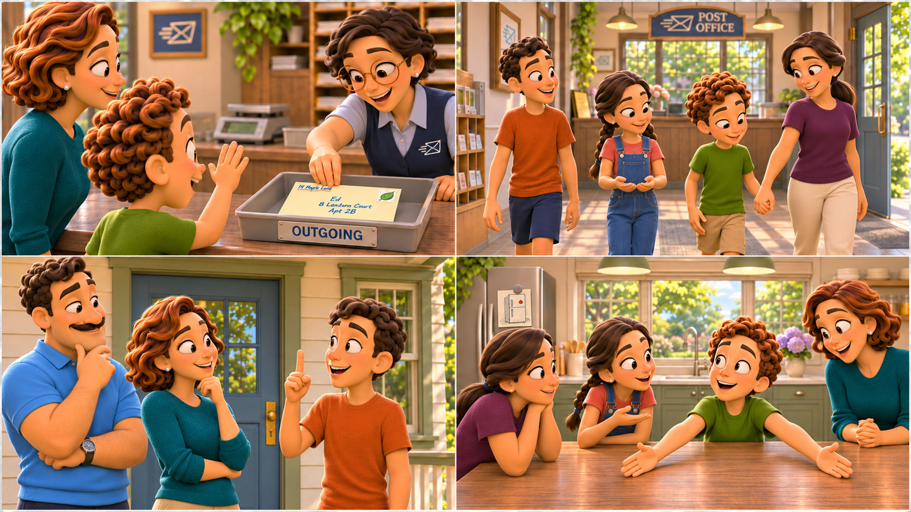](storyboards/BOARD_18.png)

| Panel | Screenplay shot | Episode time |
|---|---|---|
| Top left | [SHOT_069 · Off to Lantern Court](STORY.md#shot-069) | 11:20–11:30 |
| Top right | [SHOT_070 · Two empty hands](STORY.md#shot-070) | 11:30–11:40 |
| Bottom left | [SHOT_071 · One familiar thing](STORY.md#shot-071) | 11:40–11:50 |
| Bottom right | [SHOT_072 · Waiting for the middle](STORY.md#shot-072) | 11:50–12:00 |

## Board 19 — Several breakfasts later

[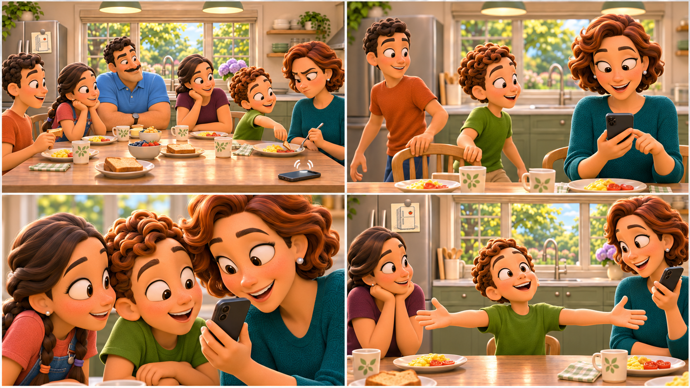](storyboards/BOARD_19.png)

| Panel | Screenplay shot | Episode time |
|---|---|---|
| Top left | [SHOT_073 · Several breakfasts later](STORY.md#shot-073) | 12:00–12:10 |
| Top right | [SHOT_074 · Put him where we can hear](STORY.md#shot-074) | 12:10–12:20 |
| Bottom left | [SHOT_075 · A letter with two hands](STORY.md#shot-075) | 12:20–12:30 |
| Bottom right | [SHOT_076 · One pull from far away](STORY.md#shot-076) | 12:30–12:40 |

## Board 20 — A debt comes due

[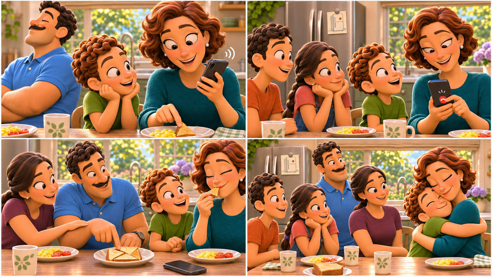](storyboards/BOARD_20.png)

| Panel | Screenplay shot | Episode time |
|---|---|---|
| Top left | [SHOT_077 · A debt comes due](STORY.md#shot-077) | 12:40–12:50 |
| Top right | [SHOT_078 · The fridge grows arms](STORY.md#shot-078) | 12:50–13:00 |
| Bottom left | [SHOT_079 · A corner finally returned](STORY.md#shot-079) | 13:00–13:10 |
| Bottom right | [SHOT_080 · The right address](STORY.md#shot-080) | 13:10–13:20 |
