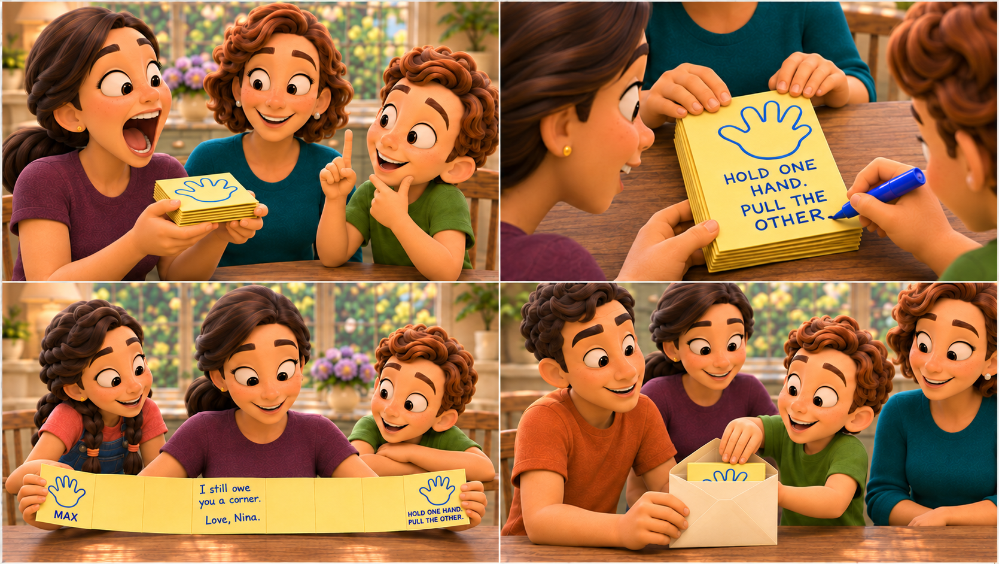
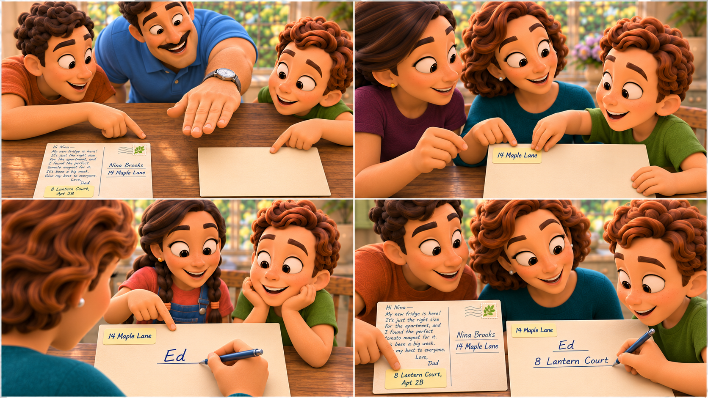
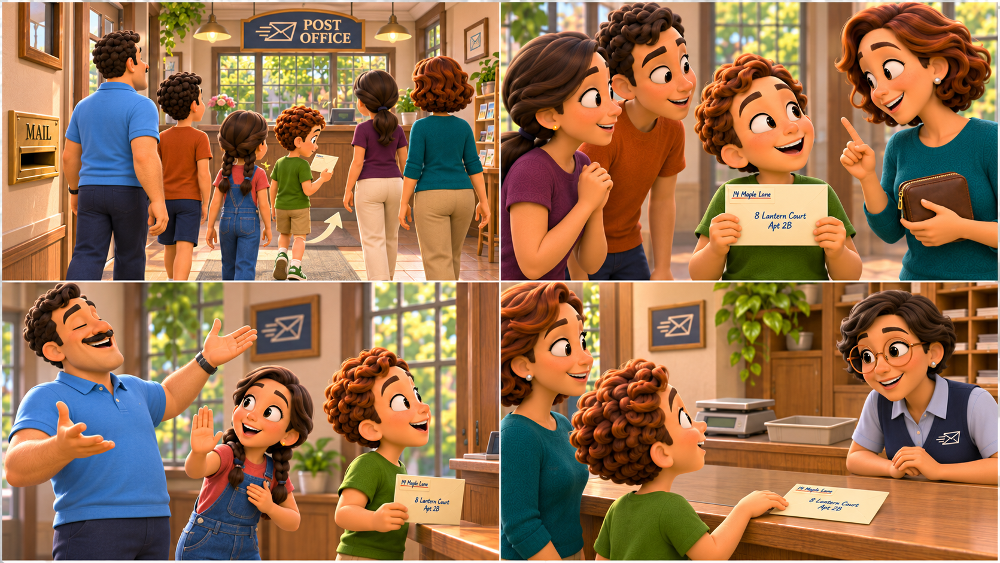

# Episode 14 storyboard — Can You Mail a Hug?

15 of 20 sheets illustrated. Read each sheet across the top row, then across the bottom row. Each panel covers one 15-second shot.

[Screenplay](STORY.md) · [Image references and checksums](assets/storyboards/GENERATION_NOTES.md)

| Sheet | Episode time | Shot range | Opening beat |
|---|---|---|---|
| [01](#board-01) | 00:00–01:00 | 001–004 | A refrigerator in the mail |
| [02](#board-02) | 01:00–02:00 | 005–008 | A corner goes missing |
| [03](#board-03) | 02:00–03:00 | 009–012 | One cream envelope |
| [04](#board-04) | 03:00–04:00 | 013–016 | One whole Max |
| [05](#board-05) | 04:00–05:00 | 017–020 | Dinner for a piece of paper |
| [06](#board-06) | 05:00–06:00 | 021–024 | Half of half |
| [07](#board-07) | 06:00–07:00 | 025–028 | Roads across the yellow |
| [08](#board-08) | 07:00–08:00 | 029–032 | A pocket accordion |
| [09](#board-09) | 08:00–09:00 | 033–036 | Breakfast words |
| [10](#board-10) | 09:00–10:00 | 037–040 | Open wide |
| [11](#board-11) | 10:00–11:00 | 041–044 | On the outside |
| [12](#board-12) | 11:00–12:00 | 045–048 | Two trips across a table |
| [13](#board-13) | 12:00–13:00 | 049–052 | One more door |
| [14](#board-14) | 13:00–14:00 | 053–056 | Which piece stays home? |
| [15](#board-15) | 14:00–15:00 | 057–060 | The slot and the counter |
| 16 · pending | 15:00–16:00 | 061–064 | For someone with a new kitchen |
| 17 · pending | 16:00–17:00 | 065–068 | The price of a leaf |
| 18 · pending | 17:00–18:00 | 069–072 | Off to Lantern Court |
| 19 · pending | 18:00–19:00 | 073–076 | Several breakfasts later |
| 20 · pending | 19:00–20:00 | 077–080 | A debt comes due |

## Board 01 — A refrigerator in the mail

| Panel | Screenplay shot | Episode time |
|---|---|---|
| Top left | [SHOT_001 · A refrigerator in the mail](STORY.md#shot-001) | 00:00–00:15 |
| Top right | [SHOT_002 · Who gets to turn it over?](STORY.md#shot-002) | 00:15–00:30 |
| Bottom left | [SHOT_003 · One very patient tomato](STORY.md#shot-003) | 00:30–00:45 |
| Bottom right | [SHOT_004 · A job for the magnet](STORY.md#shot-004) | 00:45–01:00 |

## Board 02 — A corner goes missing

| Panel | Screenplay shot | Episode time |
|---|---|---|
| Top left | [SHOT_005 · A corner goes missing](STORY.md#shot-005) | 01:00–01:15 |
| Top right | [SHOT_006 · What Grandpa used to say](STORY.md#shot-006) | 01:15–01:30 |
| Bottom left | [SHOT_007 · Something a magnet could hold](STORY.md#shot-007) | 01:30–01:45 |
| Bottom right | [SHOT_008 · How wide is a hug?](STORY.md#shot-008) | 01:45–02:00 |

## Board 03 — One cream envelope

| Panel | Screenplay shot | Episode time |
|---|---|---|
| Top left | [SHOT_009 · One cream envelope](STORY.md#shot-009) | 02:00–02:15 |
| Top right | [SHOT_010 · A road made of yellow paper](STORY.md#shot-010) | 02:15–02:30 |
| Bottom left | [SHOT_011 · Start at this fingertip](STORY.md#shot-011) | 02:30–02:45 |
| Bottom right | [SHOT_012 · The wandering pencil mark](STORY.md#shot-012) | 02:45–03:00 |

## Board 04 — One whole Max

| Panel | Screenplay shot | Episode time |
|---|---|---|
| Top left | [SHOT_013 · One whole Max](STORY.md#shot-013) | 03:00–03:15 |
| Top right | [SHOT_014 · The blue hand on the left](STORY.md#shot-014) | 03:15–03:30 |
| Bottom left | [SHOT_015 · A hand for the other end](STORY.md#shot-015) | 03:30–03:45 |
| Bottom right | [SHOT_016 · A problem for the dining table](STORY.md#shot-016) | 03:45–04:00 |

## Board 05 — Dinner for a piece of paper

| Panel | Screenplay shot | Episode time |
|---|---|---|
| Top left | [SHOT_017 · Dinner for a piece of paper](STORY.md#shot-017) | 04:00–04:15 |
| Top right | [SHOT_018 · Dad rolls up his sleeves](STORY.md#shot-018) | 04:15–04:30 |
| Bottom left | [SHOT_019 · A flap that won't lie down](STORY.md#shot-019) | 04:30–04:45 |
| Bottom right | [SHOT_020 · Once in half](STORY.md#shot-020) | 04:45–05:00 |

## Board 06 — Half of half

| Panel | Screenplay shot | Episode time |
|---|---|---|
| Top left | [SHOT_021 · Half of half](STORY.md#shot-021) | 05:00–05:15 |
| Top right | [SHOT_022 · Eight layers, one little packet](STORY.md#shot-022) | 05:15–05:30 |
| Bottom left | [SHOT_023 · Too many little doors](STORY.md#shot-023) | 05:30–05:45 |
| Bottom right | [SHOT_024 · One pull](STORY.md#shot-024) | 05:45–06:00 |

## Board 07 — Roads across the yellow

| Panel | Screenplay shot | Episode time |
|---|---|---|
| Top left | [SHOT_025 · Roads across the yellow](STORY.md#shot-025) | 06:00–06:15 |
| Top right | [SHOT_026 · Seven lines, eight places](STORY.md#shot-026) | 06:15–06:30 |
| Bottom left | [SHOT_027 · The first turn](STORY.md#shot-027) | 06:30–06:45 |
| Bottom right | [SHOT_028 · Out and back](STORY.md#shot-028) | 06:45–07:00 |

## Board 08 — A pocket accordion

| Panel | Screenplay shot | Episode time |
|---|---|---|
| Top left | [SHOT_029 · A pocket accordion](STORY.md#shot-029) | 07:00–07:15 |
| Top right | [SHOT_030 · The hug opens](STORY.md#shot-030) | 07:15–07:30 |
| Bottom left | [SHOT_031 · Room in the middle](STORY.md#shot-031) | 07:30–07:45 |
| Bottom right | [SHOT_032 · What a refrigerator would say](STORY.md#shot-032) | 07:45–08:00 |

## Board 09 — Breakfast words

| Panel | Screenplay shot | Episode time |
|---|---|---|
| Top left | [SHOT_033 · Breakfast words](STORY.md#shot-033) | 08:00–08:15 |
| Top right | [SHOT_034 · I still owe you a corner](STORY.md#shot-034) | 08:15–08:30 |
| Bottom left | [SHOT_035 · A small name under a small hand](STORY.md#shot-035) | 08:30–08:45 |
| Bottom right | [SHOT_036 · Can you find the message?](STORY.md#shot-036) | 08:45–09:00 |

## Board 10 — Open wide

| Panel | Screenplay shot | Episode time |
|---|---|---|
| Top left | [SHOT_037 · Open wide](STORY.md#shot-037) | 09:00–09:15 |
| Top right | [SHOT_038 · One hand and the other](STORY.md#shot-038) | 09:15–09:30 |
| Bottom left | [SHOT_039 · A quiet test](STORY.md#shot-039) | 09:30–09:45 |
| Bottom right | [SHOT_040 · The whole hug goes in](STORY.md#shot-040) | 09:45–10:00 |

## Board 11 — On the outside

| Panel | Screenplay shot | Episode time |
|---|---|---|
| Top left | [SHOT_041 · On the outside](STORY.md#shot-041) | 10:00–10:15 |
| Top right | [SHOT_042 · The trip the postcard took](STORY.md#shot-042) | 10:15–10:30 |
| Bottom left | [SHOT_043 · Return it?](STORY.md#shot-043) | 10:30–10:45 |
| Bottom right | [SHOT_044 · What comes back?](STORY.md#shot-044) | 10:45–11:00 |

## Board 12 — Two trips across a table

| Panel | Screenplay shot | Episode time |
|---|---|---|
| Top left | [SHOT_045 · Two trips across a table](STORY.md#shot-045) | 11:00–11:15 |
| Top right | [SHOT_046 · Home in the little corner](STORY.md#shot-046) | 11:15–11:30 |
| Bottom left | [SHOT_047 · A name Ed will answer to](STORY.md#shot-047) | 11:30–11:45 |
| Bottom right | [SHOT_048 · Lane here, Court there](STORY.md#shot-048) | 11:45–12:00 |

## Board 13 — One more door

| Panel | Screenplay shot | Episode time |
|---|---|---|
| Top left | [SHOT_049 · One more door](STORY.md#shot-049) | 12:00–12:15 |
| Top right | [SHOT_050 · Two addresses get a finger each](STORY.md#shot-050) | 12:15–12:30 |
| Bottom left | [SHOT_051 · Ready on the inside](STORY.md#shot-051) | 12:30–12:45 |
| Bottom right | [SHOT_052 · The envelope closes](STORY.md#shot-052) | 12:45–13:00 |

## Board 14 — Which piece stays home?

| Panel | Screenplay shot | Episode time |
|---|---|---|
| Top left | [SHOT_053 · Which piece stays home?](STORY.md#shot-053) | 13:00–13:15 |
| Top right | [SHOT_054 · Two refrigerators](STORY.md#shot-054) | 13:15–13:30 |
| Bottom left | [SHOT_055 · What are you carrying?](STORY.md#shot-055) | 13:30–13:45 |
| Bottom right | [SHOT_056 · Fourteen from the outside](STORY.md#shot-056) | 13:45–14:00 |

## Board 15 — The slot and the counter

| Panel | Screenplay shot | Episode time |
|---|---|---|
| Top left | [SHOT_057 · The slot and the counter](STORY.md#shot-057) | 14:00–14:15 |
| Top right | [SHOT_058 · What to ask for](STORY.md#shot-058) | 14:15–14:30 |
| Bottom left | [SHOT_059 · Dad's very long introduction](STORY.md#shot-059) | 14:30–14:45 |
| Bottom right | [SHOT_060 · A letter, please](STORY.md#shot-060) | 14:45–15:00 |
