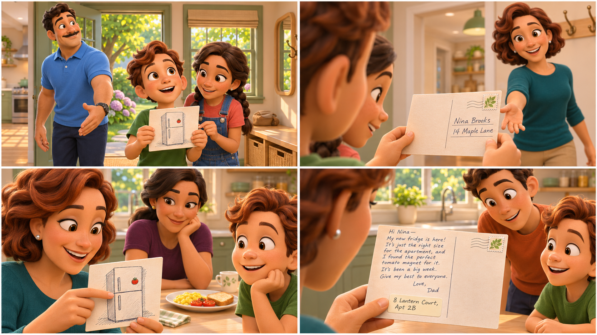
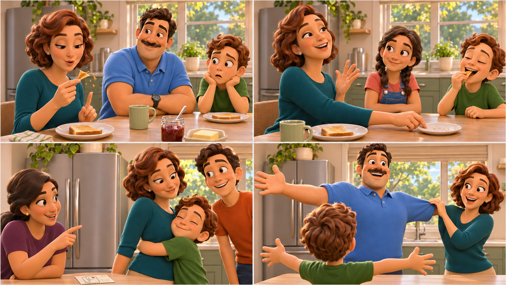
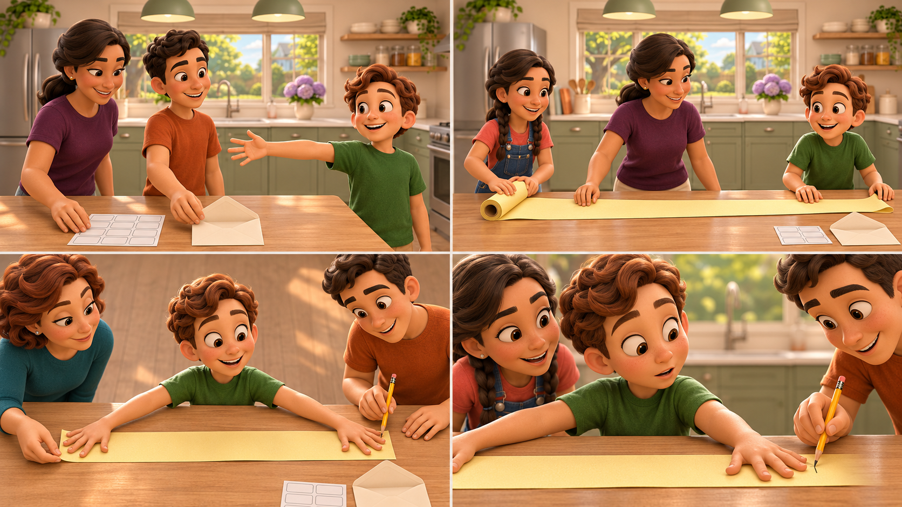
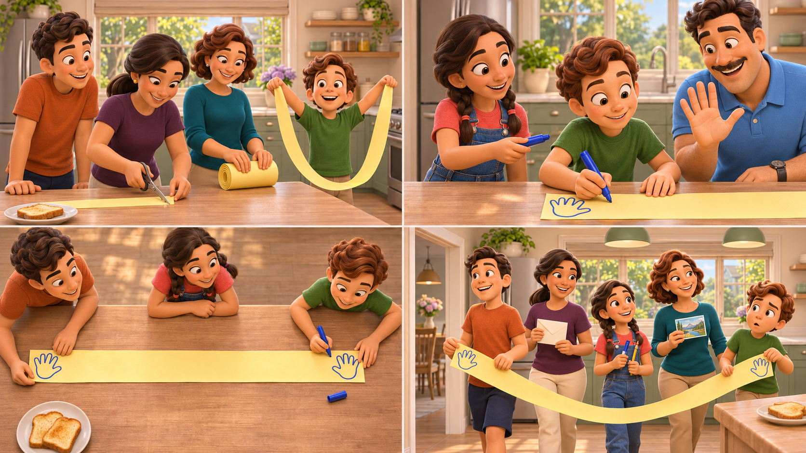

# Episode 14 storyboard — Can You Mail a Hug?

4 of 20 sheets illustrated. Read each sheet across the top row, then across the bottom row. Each panel covers one 15-second shot.

[Screenplay](STORY.md) · [Image references and checksums](assets/storyboards/GENERATION_NOTES.md)

| Sheet | Episode time | Shot range | Opening beat |
|---|---|---|---|
| [01](#board-01) | 00:00–01:00 | 001–004 | A refrigerator in the mail |
| [02](#board-02) | 01:00–02:00 | 005–008 | A corner goes missing |
| [03](#board-03) | 02:00–03:00 | 009–012 | One cream envelope |
| [04](#board-04) | 03:00–04:00 | 013–016 | One whole Max |
| 05 · pending | 04:00–05:00 | 017–020 | Dinner for a piece of paper |
| 06 · pending | 05:00–06:00 | 021–024 | Half of half |
| 07 · pending | 06:00–07:00 | 025–028 | Roads across the yellow |
| 08 · pending | 07:00–08:00 | 029–032 | A pocket accordion |
| 09 · pending | 08:00–09:00 | 033–036 | Breakfast words |
| 10 · pending | 09:00–10:00 | 037–040 | Open wide |
| 11 · pending | 10:00–11:00 | 041–044 | On the outside |
| 12 · pending | 11:00–12:00 | 045–048 | Two trips across a table |
| 13 · pending | 12:00–13:00 | 049–052 | One more door |
| 14 · pending | 13:00–14:00 | 053–056 | Which piece stays home? |
| 15 · pending | 14:00–15:00 | 057–060 | The slot and the counter |
| 16 · pending | 15:00–16:00 | 061–064 | For someone with a new kitchen |
| 17 · pending | 16:00–17:00 | 065–068 | The price of a leaf |
| 18 · pending | 17:00–18:00 | 069–072 | Off to Lantern Court |
| 19 · pending | 18:00–19:00 | 073–076 | Several breakfasts later |
| 20 · pending | 19:00–20:00 | 077–080 | A debt comes due |

## Board 01 — A refrigerator in the mail

| Panel | Screenplay shot | Episode time |
|---|---|---|
| Top left | [SHOT_001 · A refrigerator in the mail](STORY.md#shot-001) | 00:00–00:15 |
| Top right | [SHOT_002 · Who gets to turn it over?](STORY.md#shot-002) | 00:15–00:30 |
| Bottom left | [SHOT_003 · One very patient tomato](STORY.md#shot-003) | 00:30–00:45 |
| Bottom right | [SHOT_004 · A job for the magnet](STORY.md#shot-004) | 00:45–01:00 |

## Board 02 — A corner goes missing

| Panel | Screenplay shot | Episode time |
|---|---|---|
| Top left | [SHOT_005 · A corner goes missing](STORY.md#shot-005) | 01:00–01:15 |
| Top right | [SHOT_006 · What Grandpa used to say](STORY.md#shot-006) | 01:15–01:30 |
| Bottom left | [SHOT_007 · Something a magnet could hold](STORY.md#shot-007) | 01:30–01:45 |
| Bottom right | [SHOT_008 · How wide is a hug?](STORY.md#shot-008) | 01:45–02:00 |

## Board 03 — One cream envelope

| Panel | Screenplay shot | Episode time |
|---|---|---|
| Top left | [SHOT_009 · One cream envelope](STORY.md#shot-009) | 02:00–02:15 |
| Top right | [SHOT_010 · A road made of yellow paper](STORY.md#shot-010) | 02:15–02:30 |
| Bottom left | [SHOT_011 · Start at this fingertip](STORY.md#shot-011) | 02:30–02:45 |
| Bottom right | [SHOT_012 · The wandering pencil mark](STORY.md#shot-012) | 02:45–03:00 |

## Board 04 — One whole Max

| Panel | Screenplay shot | Episode time |
|---|---|---|
| Top left | [SHOT_013 · One whole Max](STORY.md#shot-013) | 03:00–03:15 |
| Top right | [SHOT_014 · The blue hand on the left](STORY.md#shot-014) | 03:15–03:30 |
| Bottom left | [SHOT_015 · A hand for the other end](STORY.md#shot-015) | 03:30–03:45 |
| Bottom right | [SHOT_016 · A problem for the dining table](STORY.md#shot-016) | 03:45–04:00 |
