# Episode 15 storyboard — The Book With Two Beginnings!

20 of 20 sheets illustrated. Read each sheet across the top row, then across the bottom row. Each panel covers one 10-second shot.

[Screenplay](STORY.md) · [Image references and checksums](storyboards/GENERATION_NOTES.md)

| Sheet | Episode time | Shot range | Opening beat |
|---|---|---|---|
| [01](#board-01) | 00:00–00:40 | 001–004 | A boat in the beans |
| [02](#board-02) | 00:40–01:20 | 005–008 | The title that won't come |
| [03](#board-03) | 01:20–02:00 | 009–012 | A question for a librarian |
| [04](#board-04) | 02:00–02:40 | 013–016 | Back through the slot |
| [05](#board-05) | 02:40–03:20 | 017–020 | Quill begins with Q |
| [06](#board-06) | 03:20–04:00 | 021–024 | Six readers at one window |
| [07](#board-07) | 04:00–04:40 | 025–028 | The yellow boat bumps the twig |
| [08](#board-08) | 04:40–05:20 | 029–032 | What does the giant want? |
| [09](#board-09) | 05:20–06:00 | 033–036 | Turn the reader or turn the book? |
| [10](#board-10) | 06:00–06:40 | 037–040 | Grandma's wrist |
| [11](#board-11) | 06:40–07:20 | 041–044 | One face of the patch |
| [12](#board-12) | 07:20–08:00 | 045–048 | The part Maya forgot |
| [13](#board-13) | 08:00–08:40 | 049–052 | Something to tell Rose |
| [14](#board-14) | 08:40–09:20 | 053–056 | A slash between friends |
| [15](#board-15) | 09:20–10:00 | 057–060 | Maya's own card |
| [16](#board-16) | 10:00–10:40 | 061–064 | A place for both bits of paper |
| [17](#board-17) | 10:40–11:20 | 065–068 | What kind of question was it? |
| [18](#board-18) | 11:20–12:00 | 069–072 | Rose sees a familiar boat |
| [19](#board-19) | 12:00–12:40 | 073–076 | What Maya wanted to say |
| [20](#board-20) | 12:40–13:20 | 077–080 | Six little legs |

## Board 01 — A boat in the beans

[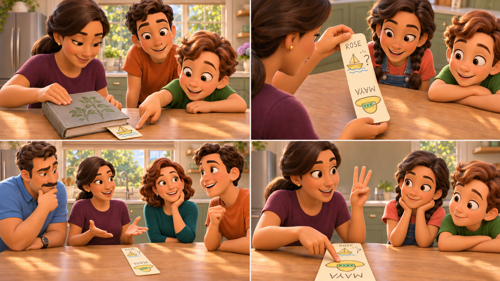](storyboards/BOARD_01.png)

| Panel | Screenplay shot | Episode time |
|---|---|---|
| Top left | [SHOT_001 · A boat in the beans](STORY.md#shot-001) | 00:00–00:10 |
| Top right | [SHOT_002 · Two ends of one bookmark](STORY.md#shot-002) | 00:10–00:20 |
| Bottom left | [SHOT_003 · An argument coming to visit](STORY.md#shot-003) | 00:20–00:30 |
| Bottom right | [SHOT_004 · Three little stitches](STORY.md#shot-004) | 00:30–00:40 |

## Board 02 — The title that won't come

[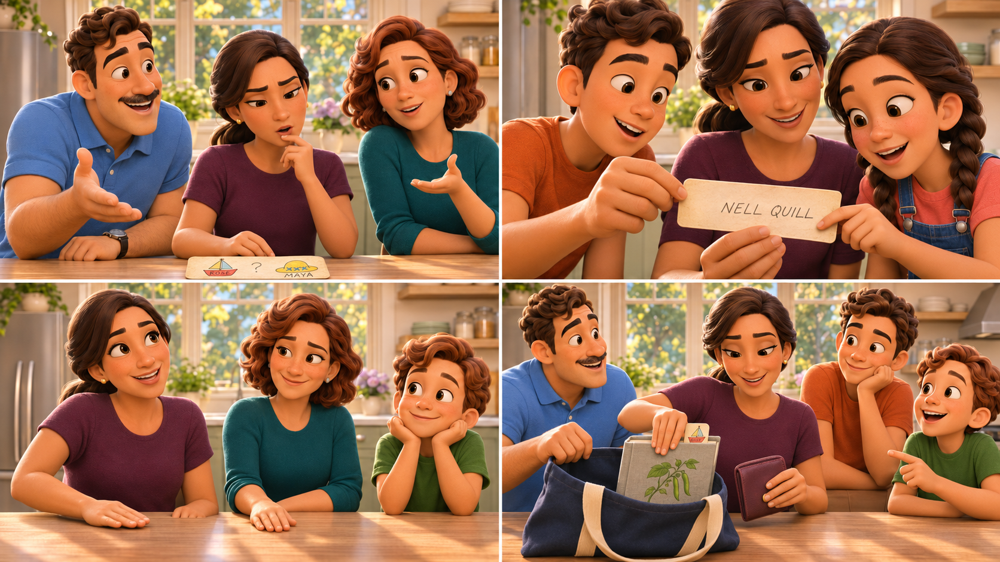](storyboards/BOARD_02.png)

| Panel | Screenplay shot | Episode time |
|---|---|---|
| Top left | [SHOT_005 · The title that won't come](STORY.md#shot-005) | 00:40–00:50 |
| Top right | [SHOT_006 · Grandma wrote on the back](STORY.md#shot-006) | 00:50–01:00 |
| Bottom left | [SHOT_007 · Pick a beginning](STORY.md#shot-007) | 01:00–01:10 |
| Bottom right | [SHOT_008 · Who gets to choose today?](STORY.md#shot-008) | 01:10–01:20 |

## Board 03 — A question for a librarian

[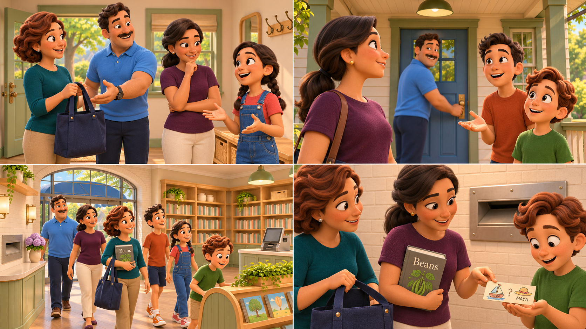](storyboards/BOARD_03.png)

| Panel | Screenplay shot | Episode time |
|---|---|---|
| Top left | [SHOT_009 · A question for a librarian](STORY.md#shot-009) | 01:20–01:30 |
| Top right | [SHOT_010 · A visit this afternoon](STORY.md#shot-010) | 01:30–01:40 |
| Bottom left | [SHOT_011 · Under the blue canopy](STORY.md#shot-011) | 01:40–01:50 |
| Bottom right | [SHOT_012 · A boat that stays ashore](STORY.md#shot-012) | 01:50–02:00 |

## Board 04 — Back through the slot

[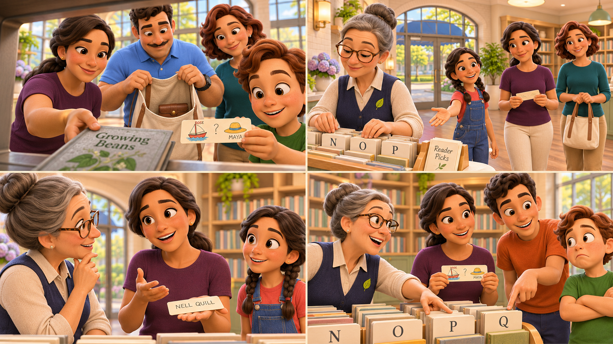](storyboards/BOARD_04.png)

| Panel | Screenplay shot | Episode time |
|---|---|---|
| Top left | [SHOT_013 · Back through the slot](STORY.md#shot-013) | 02:00–02:10 |
| Top right | [SHOT_014 · Somebody who knows the shelves](STORY.md#shot-014) | 02:10–02:20 |
| Bottom left | [SHOT_015 · “I don't know the title”](STORY.md#shot-015) | 02:20–02:30 |
| Bottom right | [SHOT_016 · A cover is a clue](STORY.md#shot-016) | 02:30–02:40 |

## Board 05 — Quill begins with Q

[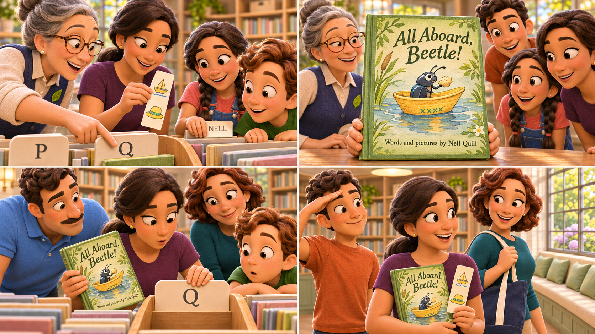](storyboards/BOARD_05.png)

| Panel | Screenplay shot | Episode time |
|---|---|---|
| Top left | [SHOT_017 · Quill begins with Q](STORY.md#shot-017) | 02:40–02:50 |
| Top right | [SHOT_018 · A boat for Rose](STORY.md#shot-018) | 02:50–03:00 |
| Bottom left | [SHOT_019 · The book Maya didn't expect](STORY.md#shot-019) | 03:00–03:10 |
| Bottom right | [SHOT_020 · Maya's turn to choose](STORY.md#shot-020) | 03:10–03:20 |

## Board 06 — Six readers at one window

[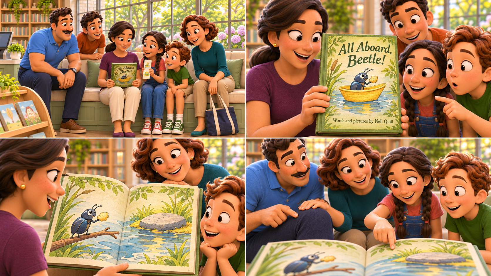](storyboards/BOARD_06.png)

| Panel | Screenplay shot | Episode time |
|---|---|---|
| Top left | [SHOT_021 · Six readers at one window](STORY.md#shot-021) | 03:20–03:30 |
| Top right | [SHOT_022 · What has the beetle packed?](STORY.md#shot-022) | 03:30–03:40 |
| Bottom left | [SHOT_023 · A table across the puddle](STORY.md#shot-023) | 03:40–03:50 |
| Bottom right | [SHOT_024 · A table with no legs](STORY.md#shot-024) | 03:50–04:00 |

## Board 07 — The yellow boat bumps the twig

[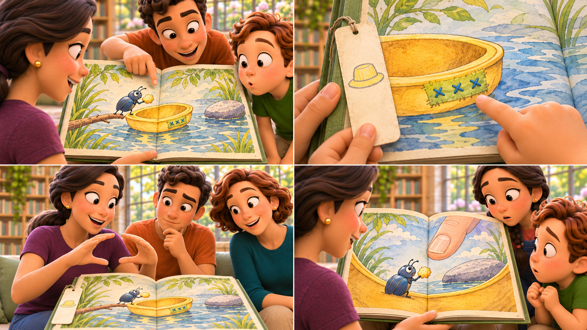](storyboards/BOARD_07.png)

| Panel | Screenplay shot | Episode time |
|---|---|---|
| Top left | [SHOT_025 · The yellow boat bumps the twig](STORY.md#shot-025) | 04:00–04:10 |
| Top right | [SHOT_026 · Something on the rim](STORY.md#shot-026) | 04:10–04:20 |
| Bottom left | [SHOT_027 · One clue and two ideas](STORY.md#shot-027) | 04:20–04:30 |
| Bottom right | [SHOT_028 · A giant at the bank](STORY.md#shot-028) | 04:30–04:40 |

## Board 08 — What does the giant want?

[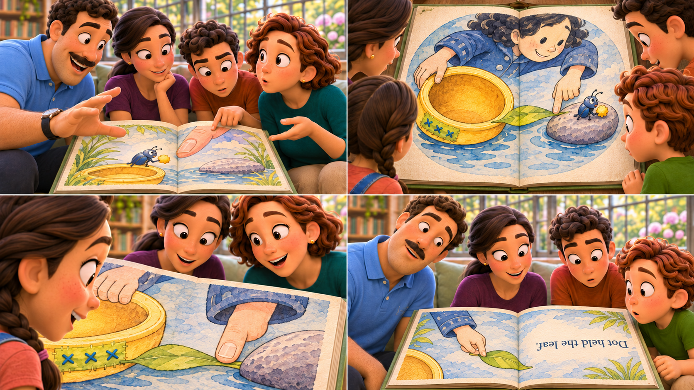](storyboards/BOARD_08.png)

| Panel | Screenplay shot | Episode time |
|---|---|---|
| Top left | [SHOT_029 · What does the giant want?](STORY.md#shot-029) | 04:40–04:50 |
| Top right | [SHOT_030 · The page with no words](STORY.md#shot-030) | 04:50–05:00 |
| Bottom left | [SHOT_031 · A finger on the landing](STORY.md#shot-031) | 05:00–05:10 |
| Bottom right | [SHOT_032 · One page too far](STORY.md#shot-032) | 05:10–05:20 |

## Board 09 — Turn the reader or turn the book?

[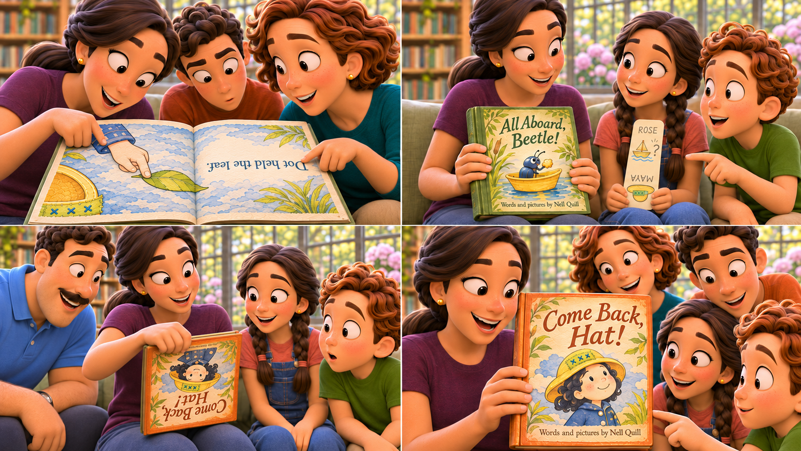](storyboards/BOARD_09.png)

| Panel | Screenplay shot | Episode time |
|---|---|---|
| Top left | [SHOT_033 · Turn the reader or turn the book?](STORY.md#shot-033) | 05:20–05:30 |
| Top right | [SHOT_034 · No place for a back cover](STORY.md#shot-034) | 05:30–05:40 |
| Bottom left | [SHOT_035 · A second face](STORY.md#shot-035) | 05:40–05:50 |
| Bottom right | [SHOT_036 · Come Back, Hat!](STORY.md#shot-036) | 05:50–06:00 |

## Board 10 — Grandma's wrist

[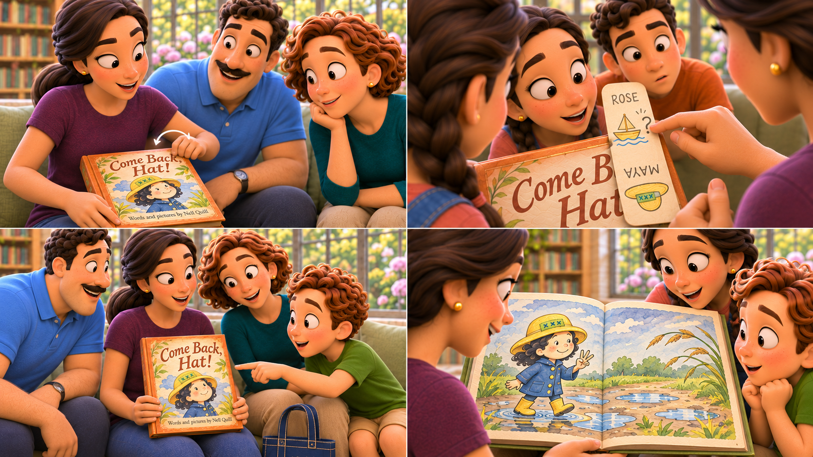](storyboards/BOARD_10.png)

| Panel | Screenplay shot | Episode time |
|---|---|---|
| Top left | [SHOT_037 · Grandma's wrist](STORY.md#shot-037) | 06:00–06:10 |
| Top right | [SHOT_038 · That pencil question mark](STORY.md#shot-038) | 06:10–06:20 |
| Bottom left | [SHOT_039 · The part she might have missed](STORY.md#shot-039) | 06:20–06:30 |
| Bottom right | [SHOT_040 · A girl, a hat and a breeze](STORY.md#shot-040) | 06:30–06:40 |

## Board 11 — One face of the patch

[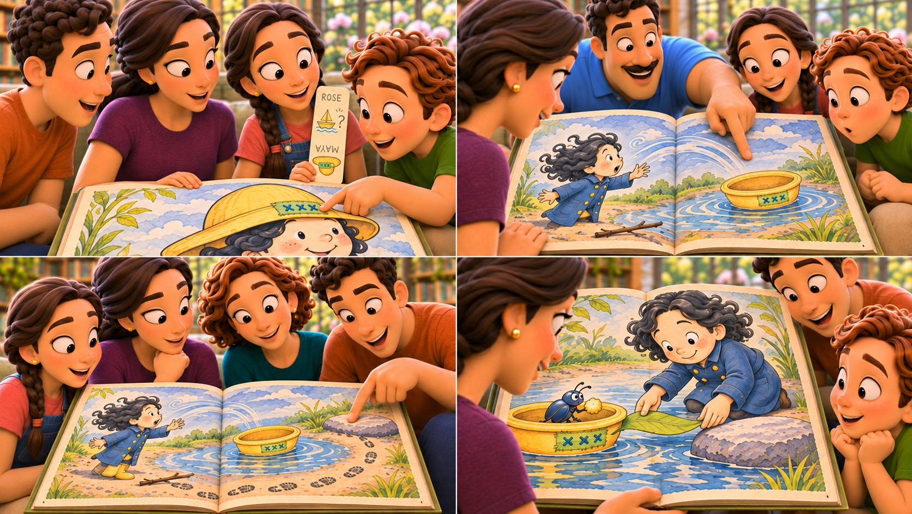](storyboards/BOARD_11.png)

| Panel | Screenplay shot | Episode time |
|---|---|---|
| Top left | [SHOT_041 · One face of the patch](STORY.md#shot-041) | 06:40–06:50 |
| Top right | [SHOT_042 · A hat in the puddle](STORY.md#shot-042) | 06:50–07:00 |
| Bottom left | [SHOT_043 · The road around the puddle](STORY.md#shot-043) | 07:00–07:10 |
| Bottom right | [SHOT_044 · What the giant saw](STORY.md#shot-044) | 07:10–07:20 |

## Board 12 — The part Maya forgot

[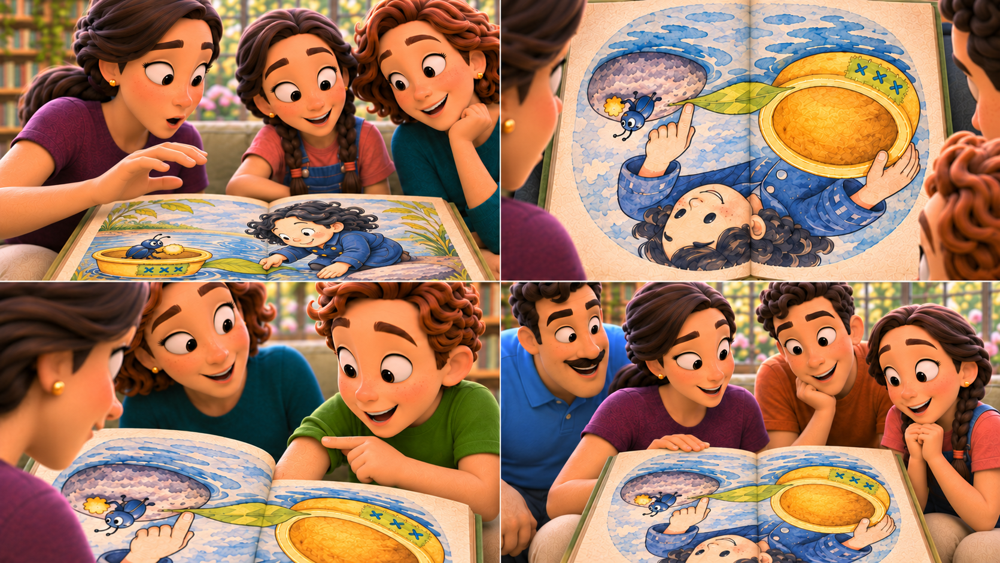](storyboards/BOARD_12.png)

| Panel | Screenplay shot | Episode time |
|---|---|---|
| Top left | [SHOT_045 · The part Maya forgot](STORY.md#shot-045) | 07:20–07:30 |
| Top right | [SHOT_046 · Same landing, other way up](STORY.md#shot-046) | 07:30–07:40 |
| Bottom left | [SHOT_047 · What the finger holds](STORY.md#shot-047) | 07:40–07:50 |
| Bottom right | [SHOT_048 · Everybody gets something back](STORY.md#shot-048) | 07:50–08:00 |

## Board 13 — Something to tell Rose

[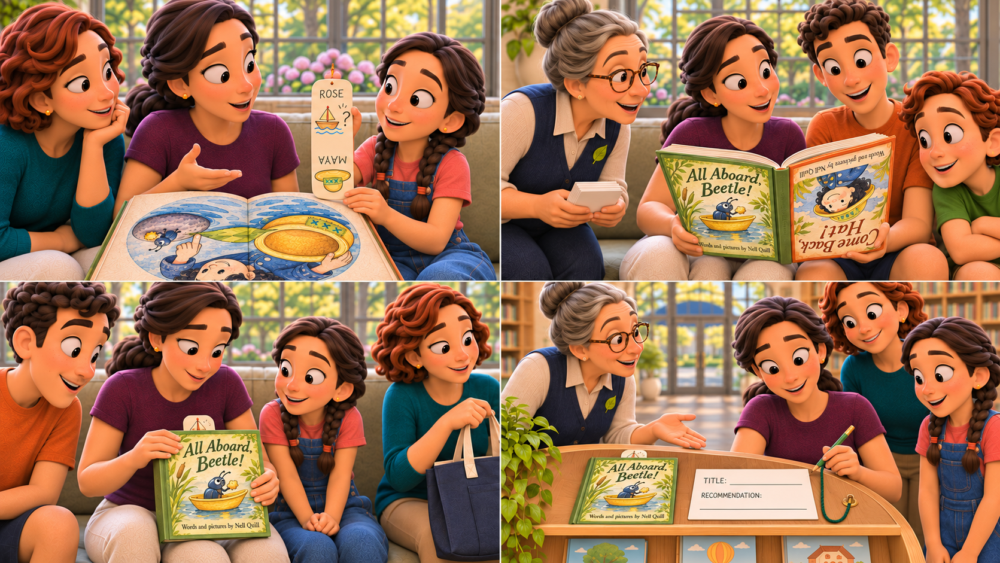](storyboards/BOARD_13.png)

| Panel | Screenplay shot | Episode time |
|---|---|---|
| Top left | [SHOT_049 · Something to tell Rose](STORY.md#shot-049) | 08:00–08:10 |
| Top right | [SHOT_050 · Did you find your book?](STORY.md#shot-050) | 08:10–08:20 |
| Bottom left | [SHOT_051 · Save the landing](STORY.md#shot-051) | 08:20–08:30 |
| Bottom right | [SHOT_052 · A card for the next reader](STORY.md#shot-052) | 08:30–08:40 |

## Board 14 — A slash between friends

[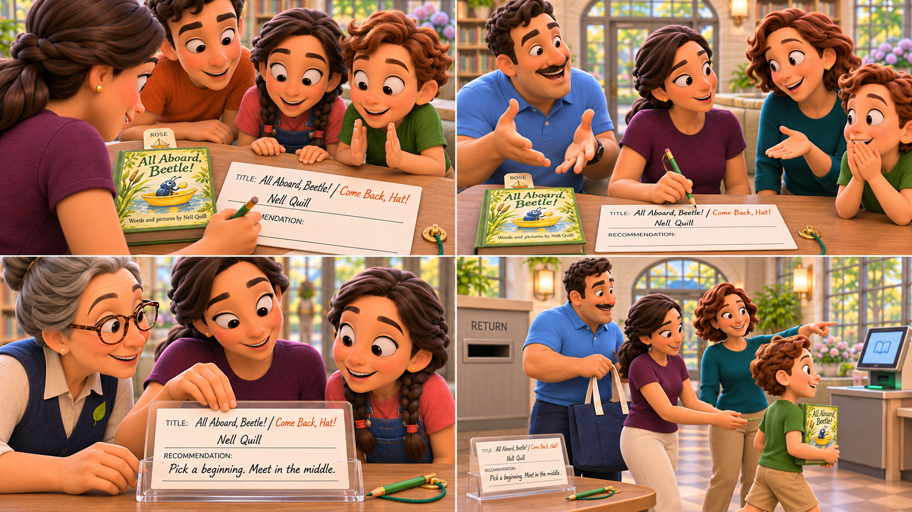](storyboards/BOARD_14.png)

| Panel | Screenplay shot | Episode time |
|---|---|---|
| Top left | [SHOT_053 · A slash between friends](STORY.md#shot-053) | 08:40–08:50 |
| Top right | [SHOT_054 · One line without the ending](STORY.md#shot-054) | 08:50–09:00 |
| Bottom left | [SHOT_055 · Meet in the middle](STORY.md#shot-055) | 09:00–09:10 |
| Bottom right | [SHOT_056 · One book for the bag](STORY.md#shot-056) | 09:10–09:20 |

## Board 15 — Maya's own card

[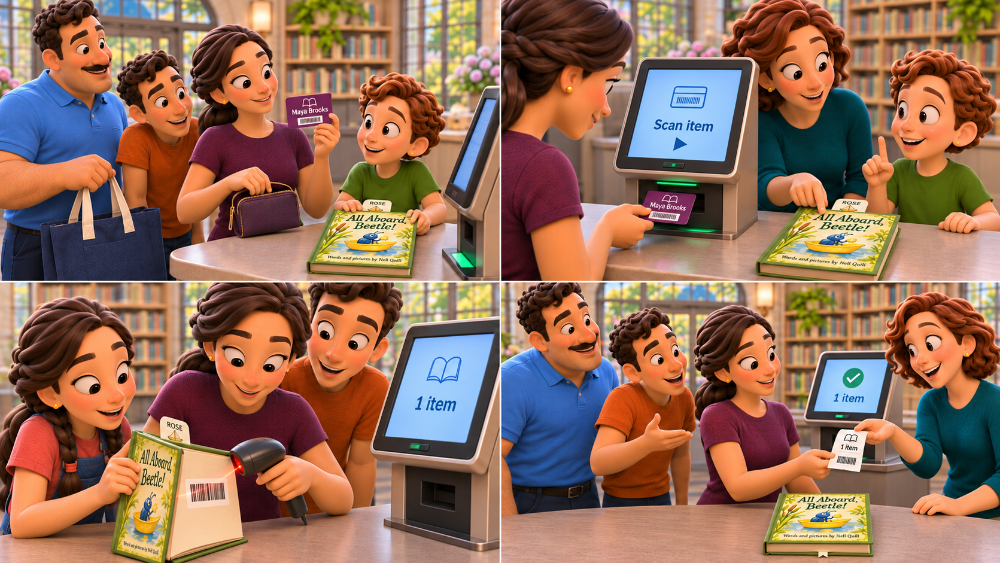](storyboards/BOARD_15.png)

| Panel | Screenplay shot | Episode time |
|---|---|---|
| Top left | [SHOT_057 · Maya's own card](STORY.md#shot-057) | 09:20–09:30 |
| Top right | [SHOT_058 · Card first](STORY.md#shot-058) | 09:30–09:40 |
| Bottom left | [SHOT_059 · Inside the green cover](STORY.md#shot-059) | 09:40–09:50 |
| Bottom right | [SHOT_060 · Proof that a beetle can travel](STORY.md#shot-060) | 09:50–10:00 |

## Board 16 — A place for both bits of paper

[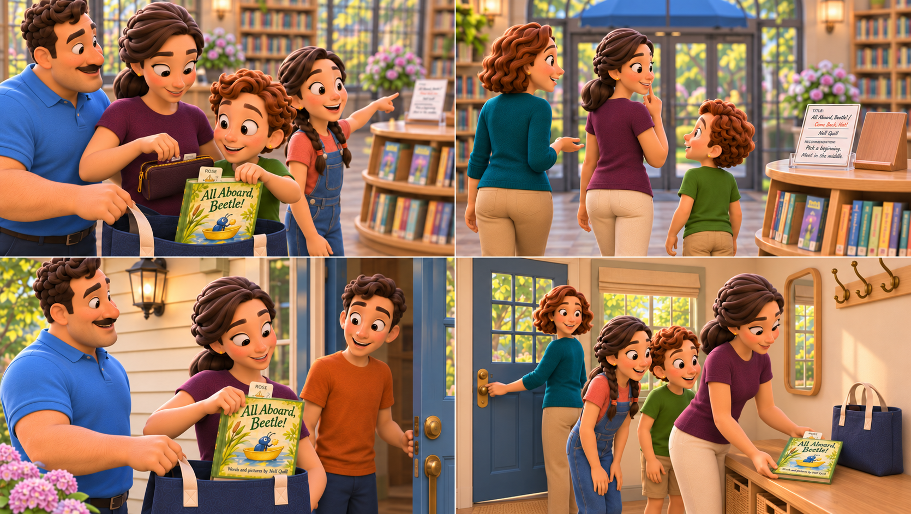](storyboards/BOARD_16.png)

| Panel | Screenplay shot | Episode time |
|---|---|---|
| Top left | [SHOT_061 · A place for both bits of paper](STORY.md#shot-061) | 10:00–10:10 |
| Top right | [SHOT_062 · One look over the shoulder](STORY.md#shot-062) | 10:10–10:20 |
| Bottom left | [SHOT_063 · The turn in Grandma's wrist](STORY.md#shot-063) | 10:20–10:30 |
| Bottom right | [SHOT_064 · A space by the door](STORY.md#shot-064) | 10:30–10:40 |

## Board 17 — What kind of question was it?

[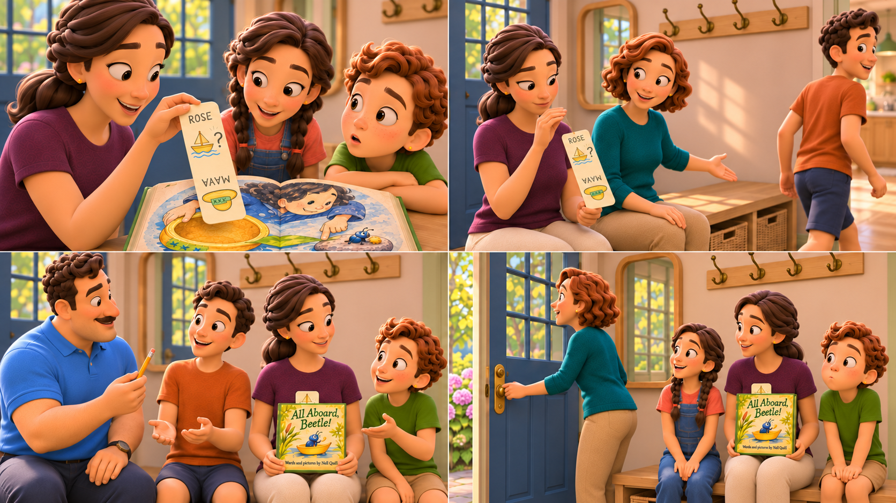](storyboards/BOARD_17.png)

| Panel | Screenplay shot | Episode time |
|---|---|---|
| Top left | [SHOT_065 · What kind of question was it?](STORY.md#shot-065) | 10:40–10:50 |
| Top right | [SHOT_066 · Room for an answer](STORY.md#shot-066) | 10:50–11:00 |
| Bottom left | [SHOT_067 · Boat end showing](STORY.md#shot-067) | 11:00–11:10 |
| Bottom right | [SHOT_068 · Someone on the porch](STORY.md#shot-068) | 11:10–11:20 |

## Board 18 — Rose sees a familiar boat

[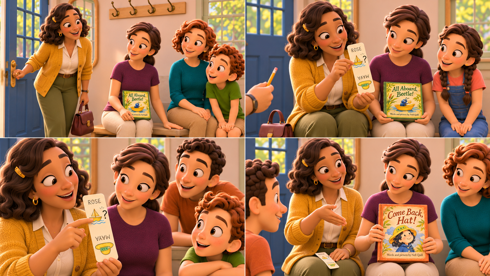](storyboards/BOARD_18.png)

| Panel | Screenplay shot | Episode time |
|---|---|---|
| Top left | [SHOT_069 · Rose sees a familiar boat](STORY.md#shot-069) | 11:20–11:30 |
| Top right | [SHOT_070 · The other artist](STORY.md#shot-070) | 11:30–11:40 |
| Bottom left | [SHOT_071 · “Show me where you started”](STORY.md#shot-071) | 11:40–11:50 |
| Bottom right | [SHOT_072 · The move their mother made](STORY.md#shot-072) | 11:50–12:00 |

## Board 19 — What Maya wanted to say

[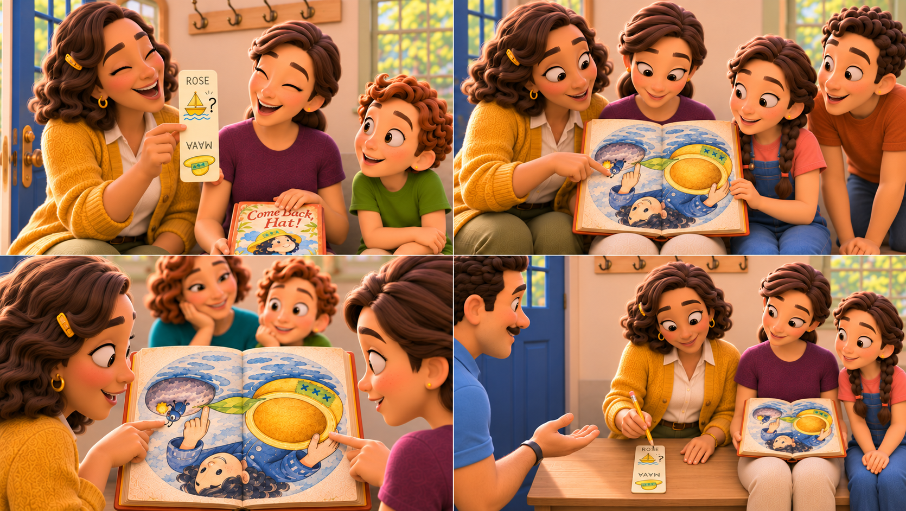](storyboards/BOARD_19.png)

| Panel | Screenplay shot | Episode time |
|---|---|---|
| Top left | [SHOT_073 · What Maya wanted to say](STORY.md#shot-073) | 12:00–12:10 |
| Top right | [SHOT_074 · Find me the crossing](STORY.md#shot-074) | 12:10–12:20 |
| Bottom left | [SHOT_075 · What one sister saw first](STORY.md#shot-075) | 12:20–12:30 |
| Bottom right | [SHOT_076 · Can I change my question?](STORY.md#shot-076) | 12:30–12:40 |

## Board 20 — Six little legs

[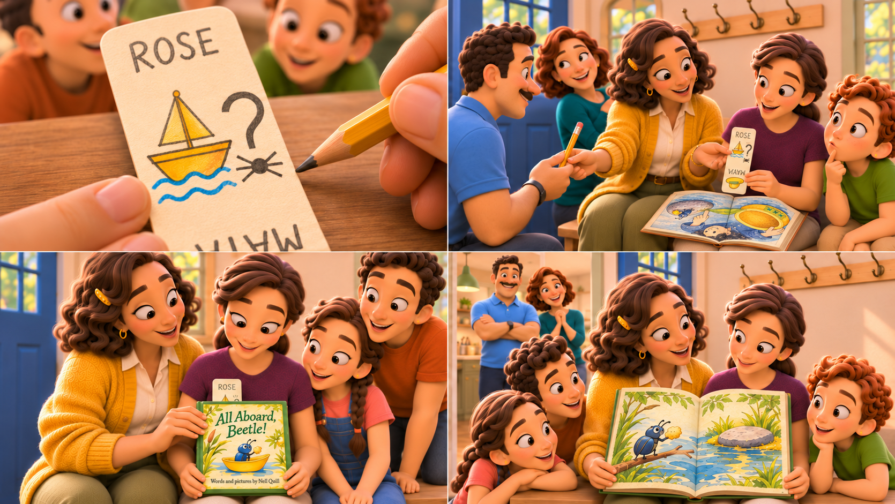](storyboards/BOARD_20.png)

| Panel | Screenplay shot | Episode time |
|---|---|---|
| Top left | [SHOT_077 · Six little legs](STORY.md#shot-077) | 12:40–12:50 |
| Top right | [SHOT_078 · A question for a beetle](STORY.md#shot-078) | 12:50–13:00 |
| Bottom left | [SHOT_079 · Save us the middle](STORY.md#shot-079) | 13:00–13:10 |
| Bottom right | [SHOT_080 · The beginning Maya missed](STORY.md#shot-080) | 13:10–13:20 |
