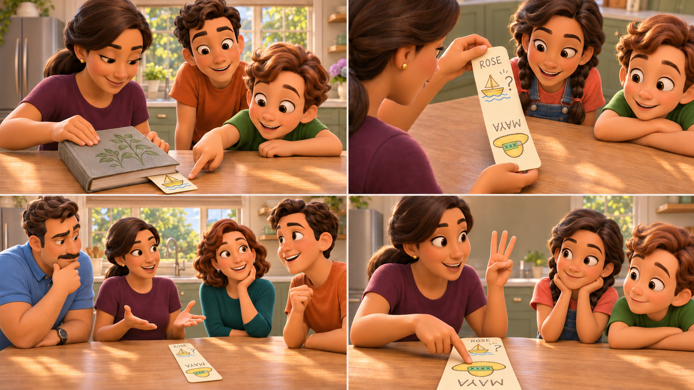
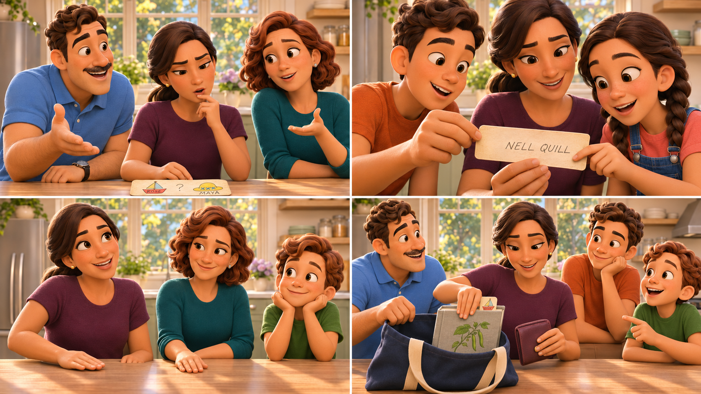
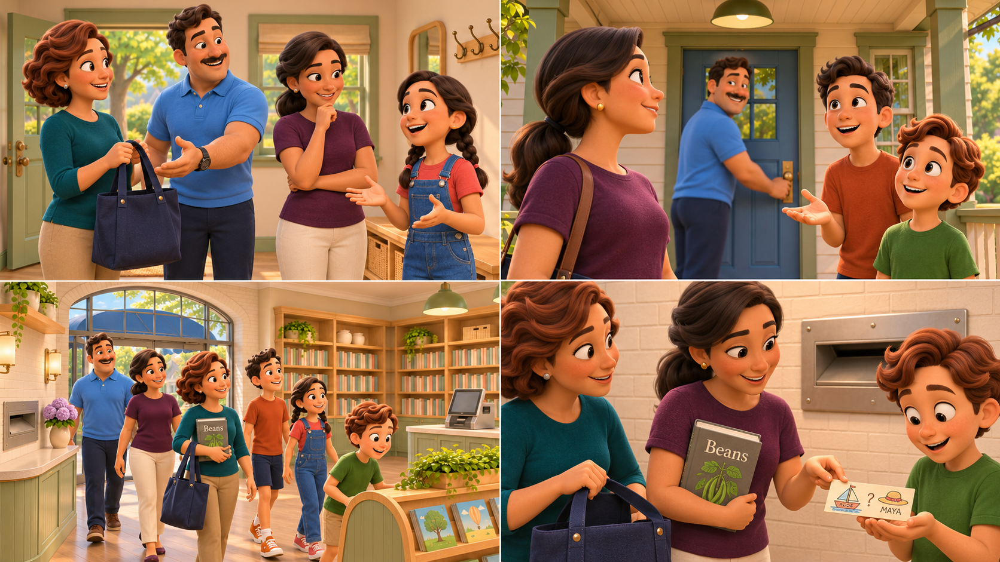
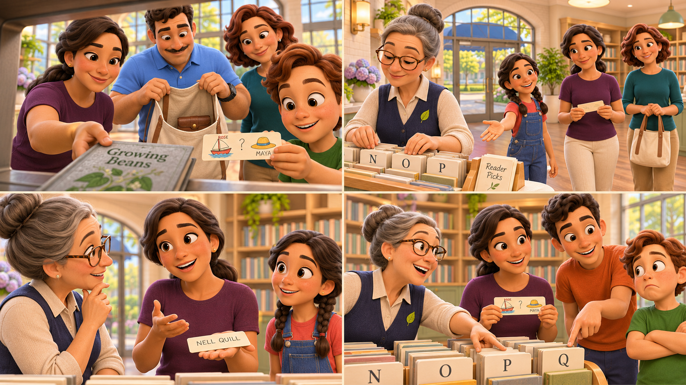
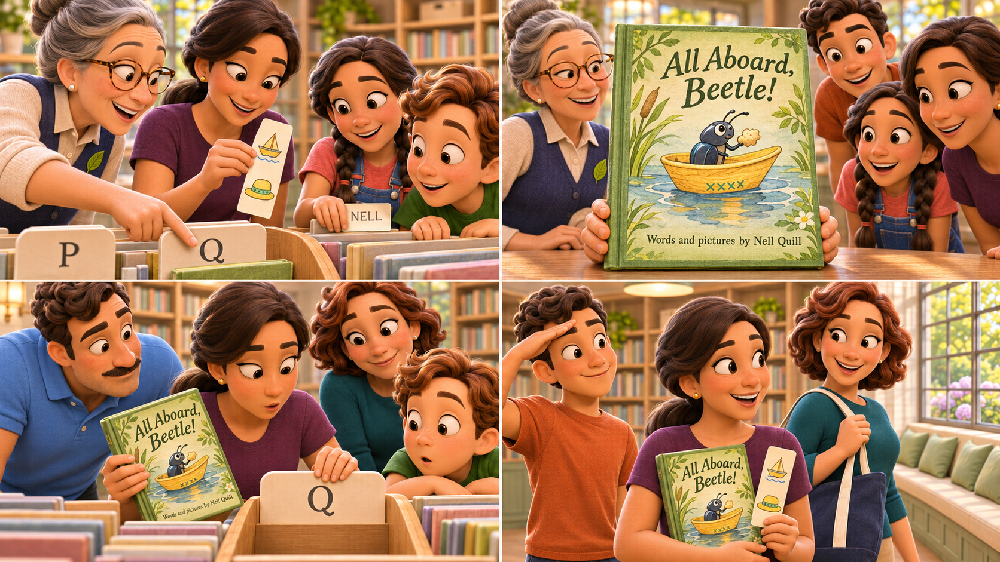
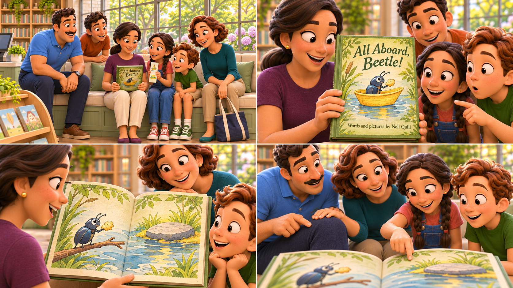
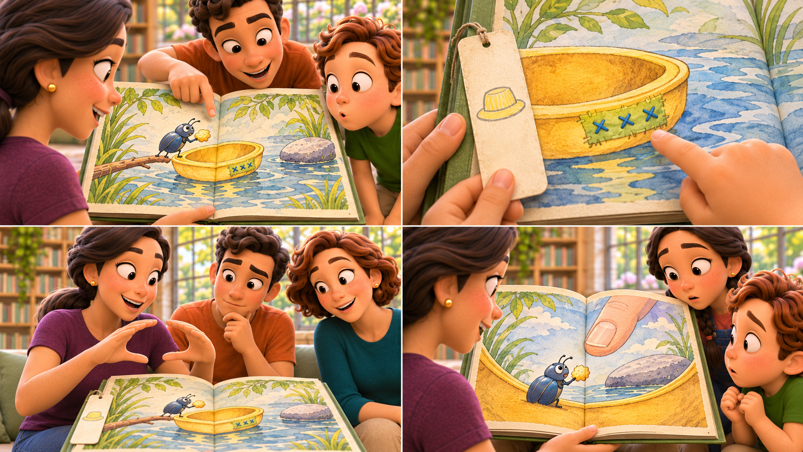
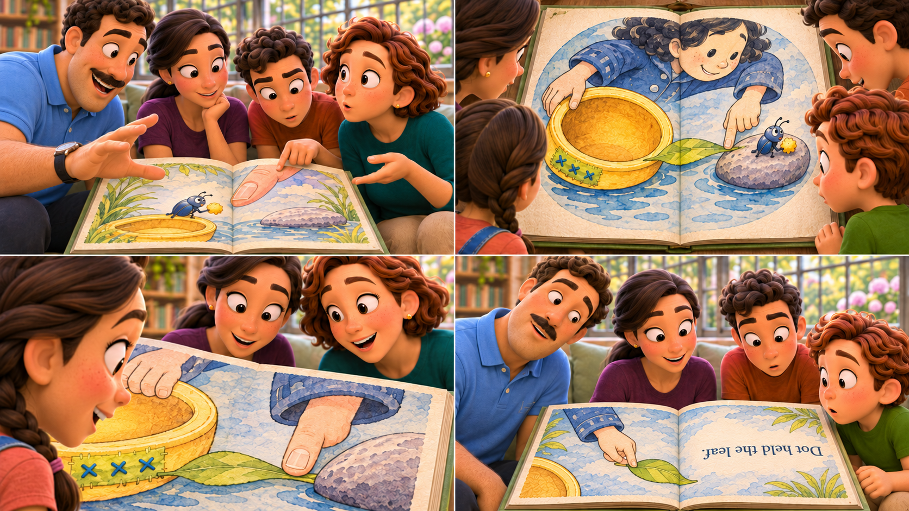
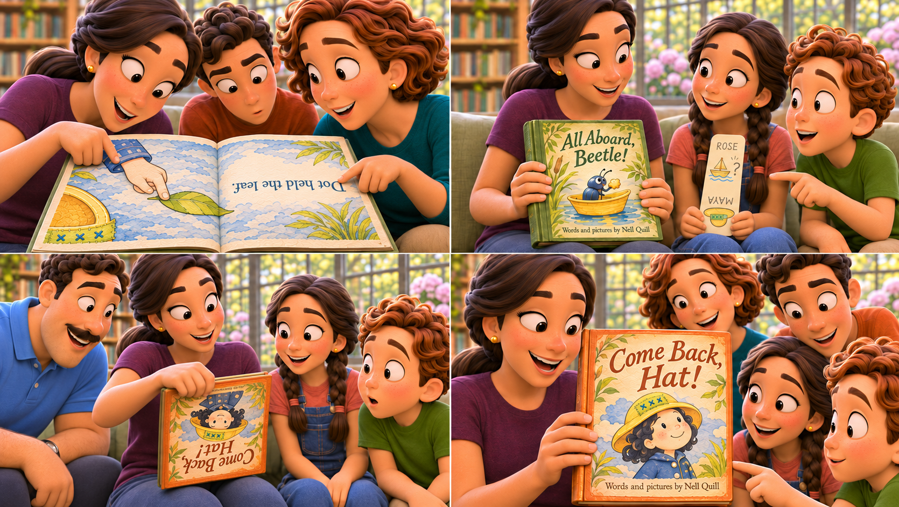
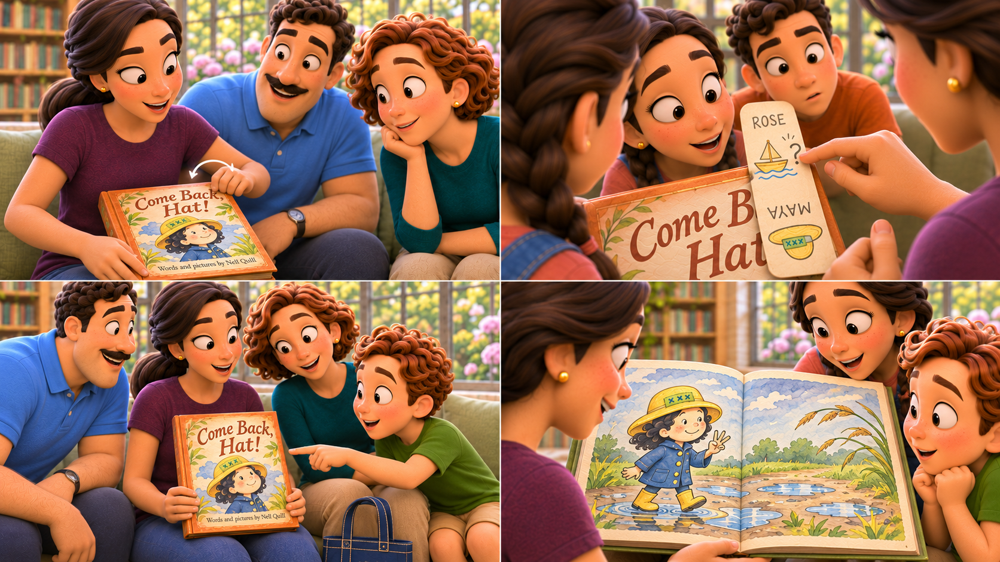

# Episode 15 storyboard — The Book With Two Beginnings!

10 of 20 sheets illustrated. Read each sheet across the top row, then across the bottom row. Each panel covers one 15-second shot.

[Screenplay](STORY.md) · [Image references and checksums](assets/storyboards/GENERATION_NOTES.md)

| Sheet | Episode time | Shot range | Opening beat |
|---|---|---|---|
| [01](#board-01) | 00:00–01:00 | 001–004 | A boat in the beans |
| [02](#board-02) | 01:00–02:00 | 005–008 | The title that won't come |
| [03](#board-03) | 02:00–03:00 | 009–012 | A question for a librarian |
| [04](#board-04) | 03:00–04:00 | 013–016 | Back through the slot |
| [05](#board-05) | 04:00–05:00 | 017–020 | Quill begins with Q |
| [06](#board-06) | 05:00–06:00 | 021–024 | Six readers at one window |
| [07](#board-07) | 06:00–07:00 | 025–028 | The yellow boat bumps the twig |
| [08](#board-08) | 07:00–08:00 | 029–032 | What does the giant want? |
| [09](#board-09) | 08:00–09:00 | 033–036 | Turn the reader or turn the book? |
| [10](#board-10) | 09:00–10:00 | 037–040 | Grandma's wrist |
| 11 · pending | 10:00–11:00 | 041–044 | One face of the patch |
| 12 · pending | 11:00–12:00 | 045–048 | The part Maya forgot |
| 13 · pending | 12:00–13:00 | 049–052 | Something to tell Rose |
| 14 · pending | 13:00–14:00 | 053–056 | A slash between friends |
| 15 · pending | 14:00–15:00 | 057–060 | Maya's own card |
| 16 · pending | 15:00–16:00 | 061–064 | A place for both bits of paper |
| 17 · pending | 16:00–17:00 | 065–068 | What kind of question was it? |
| 18 · pending | 17:00–18:00 | 069–072 | Rose sees a familiar boat |
| 19 · pending | 18:00–19:00 | 073–076 | What Maya wanted to say |
| 20 · pending | 19:00–20:00 | 077–080 | Six little legs |

## Board 01 — A boat in the beans

| Panel | Screenplay shot | Episode time |
|---|---|---|
| Top left | [SHOT_001 · A boat in the beans](STORY.md#shot-001) | 00:00–00:15 |
| Top right | [SHOT_002 · Two ends of one bookmark](STORY.md#shot-002) | 00:15–00:30 |
| Bottom left | [SHOT_003 · An argument coming to visit](STORY.md#shot-003) | 00:30–00:45 |
| Bottom right | [SHOT_004 · Three little stitches](STORY.md#shot-004) | 00:45–01:00 |

## Board 02 — The title that won't come

| Panel | Screenplay shot | Episode time |
|---|---|---|
| Top left | [SHOT_005 · The title that won't come](STORY.md#shot-005) | 01:00–01:15 |
| Top right | [SHOT_006 · Grandma wrote on the back](STORY.md#shot-006) | 01:15–01:30 |
| Bottom left | [SHOT_007 · Pick a beginning](STORY.md#shot-007) | 01:30–01:45 |
| Bottom right | [SHOT_008 · Who gets to choose today?](STORY.md#shot-008) | 01:45–02:00 |

## Board 03 — A question for a librarian

| Panel | Screenplay shot | Episode time |
|---|---|---|
| Top left | [SHOT_009 · A question for a librarian](STORY.md#shot-009) | 02:00–02:15 |
| Top right | [SHOT_010 · A visit this afternoon](STORY.md#shot-010) | 02:15–02:30 |
| Bottom left | [SHOT_011 · Under the blue canopy](STORY.md#shot-011) | 02:30–02:45 |
| Bottom right | [SHOT_012 · A boat that stays ashore](STORY.md#shot-012) | 02:45–03:00 |

## Board 04 — Back through the slot

| Panel | Screenplay shot | Episode time |
|---|---|---|
| Top left | [SHOT_013 · Back through the slot](STORY.md#shot-013) | 03:00–03:15 |
| Top right | [SHOT_014 · Somebody who knows the shelves](STORY.md#shot-014) | 03:15–03:30 |
| Bottom left | [SHOT_015 · “I don't know the title”](STORY.md#shot-015) | 03:30–03:45 |
| Bottom right | [SHOT_016 · A cover is a clue](STORY.md#shot-016) | 03:45–04:00 |

## Board 05 — Quill begins with Q

| Panel | Screenplay shot | Episode time |
|---|---|---|
| Top left | [SHOT_017 · Quill begins with Q](STORY.md#shot-017) | 04:00–04:15 |
| Top right | [SHOT_018 · A boat for Rose](STORY.md#shot-018) | 04:15–04:30 |
| Bottom left | [SHOT_019 · The book Maya didn't expect](STORY.md#shot-019) | 04:30–04:45 |
| Bottom right | [SHOT_020 · Maya's turn to choose](STORY.md#shot-020) | 04:45–05:00 |

## Board 06 — Six readers at one window

| Panel | Screenplay shot | Episode time |
|---|---|---|
| Top left | [SHOT_021 · Six readers at one window](STORY.md#shot-021) | 05:00–05:15 |
| Top right | [SHOT_022 · What has the beetle packed?](STORY.md#shot-022) | 05:15–05:30 |
| Bottom left | [SHOT_023 · A table across the puddle](STORY.md#shot-023) | 05:30–05:45 |
| Bottom right | [SHOT_024 · A table with no legs](STORY.md#shot-024) | 05:45–06:00 |

## Board 07 — The yellow boat bumps the twig

| Panel | Screenplay shot | Episode time |
|---|---|---|
| Top left | [SHOT_025 · The yellow boat bumps the twig](STORY.md#shot-025) | 06:00–06:15 |
| Top right | [SHOT_026 · Something on the rim](STORY.md#shot-026) | 06:15–06:30 |
| Bottom left | [SHOT_027 · One clue and two ideas](STORY.md#shot-027) | 06:30–06:45 |
| Bottom right | [SHOT_028 · A giant at the bank](STORY.md#shot-028) | 06:45–07:00 |

## Board 08 — What does the giant want?

| Panel | Screenplay shot | Episode time |
|---|---|---|
| Top left | [SHOT_029 · What does the giant want?](STORY.md#shot-029) | 07:00–07:15 |
| Top right | [SHOT_030 · The page with no words](STORY.md#shot-030) | 07:15–07:30 |
| Bottom left | [SHOT_031 · A finger on the landing](STORY.md#shot-031) | 07:30–07:45 |
| Bottom right | [SHOT_032 · One page too far](STORY.md#shot-032) | 07:45–08:00 |

## Board 09 — Turn the reader or turn the book?

| Panel | Screenplay shot | Episode time |
|---|---|---|
| Top left | [SHOT_033 · Turn the reader or turn the book?](STORY.md#shot-033) | 08:00–08:15 |
| Top right | [SHOT_034 · No place for a back cover](STORY.md#shot-034) | 08:15–08:30 |
| Bottom left | [SHOT_035 · A second face](STORY.md#shot-035) | 08:30–08:45 |
| Bottom right | [SHOT_036 · Come Back, Hat!](STORY.md#shot-036) | 08:45–09:00 |

## Board 10 — Grandma's wrist

| Panel | Screenplay shot | Episode time |
|---|---|---|
| Top left | [SHOT_037 · Grandma's wrist](STORY.md#shot-037) | 09:00–09:15 |
| Top right | [SHOT_038 · That pencil question mark](STORY.md#shot-038) | 09:15–09:30 |
| Bottom left | [SHOT_039 · The part she might have missed](STORY.md#shot-039) | 09:30–09:45 |
| Bottom right | [SHOT_040 · A girl, a hat and a breeze](STORY.md#shot-040) | 09:45–10:00 |
