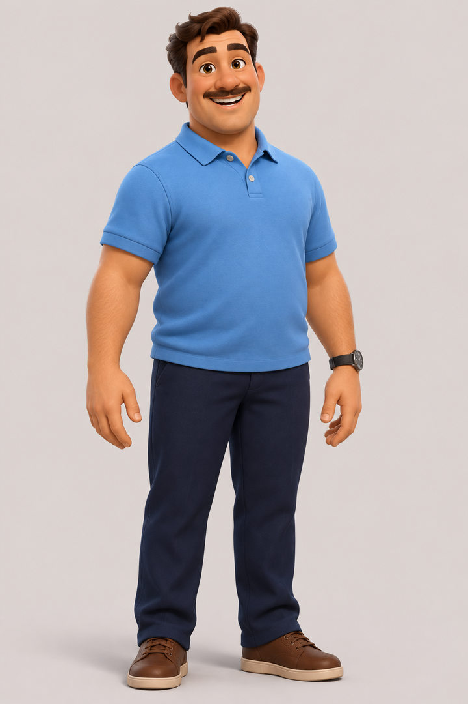
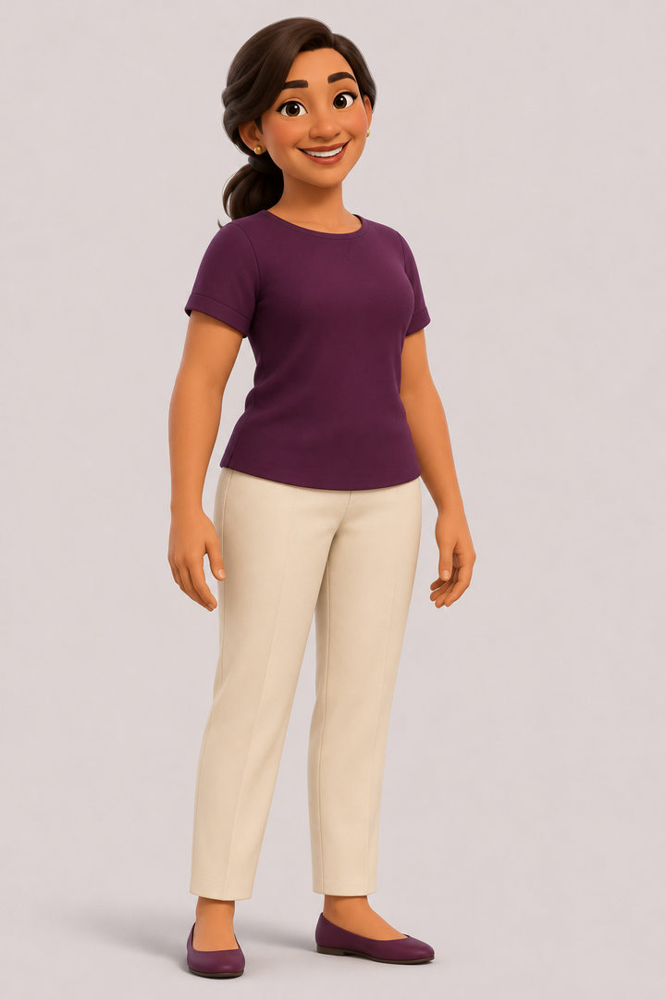
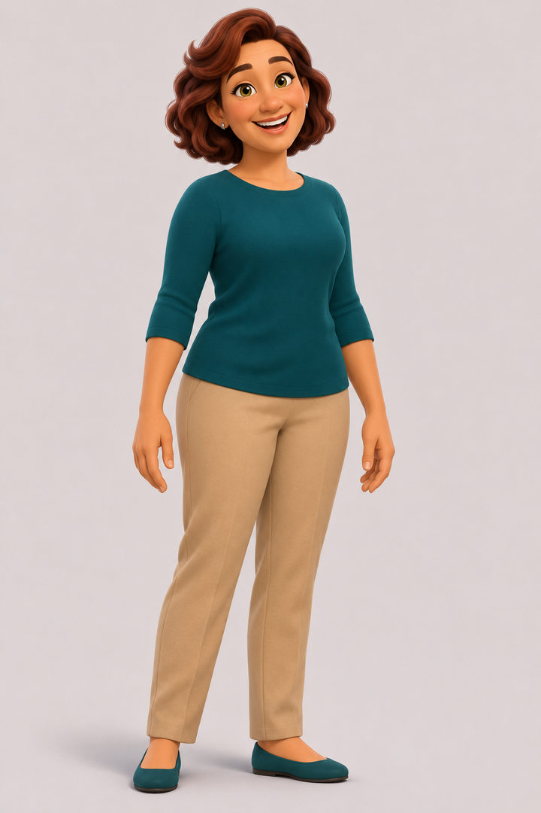
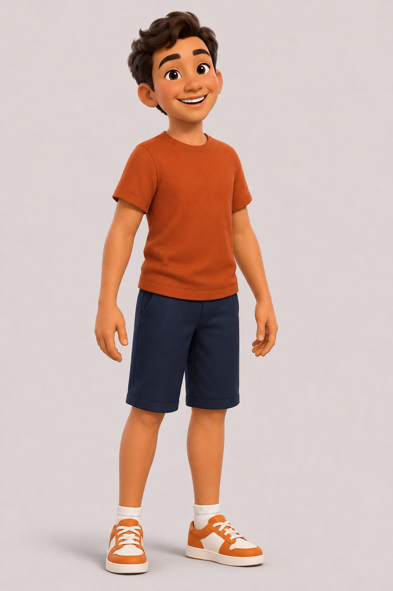
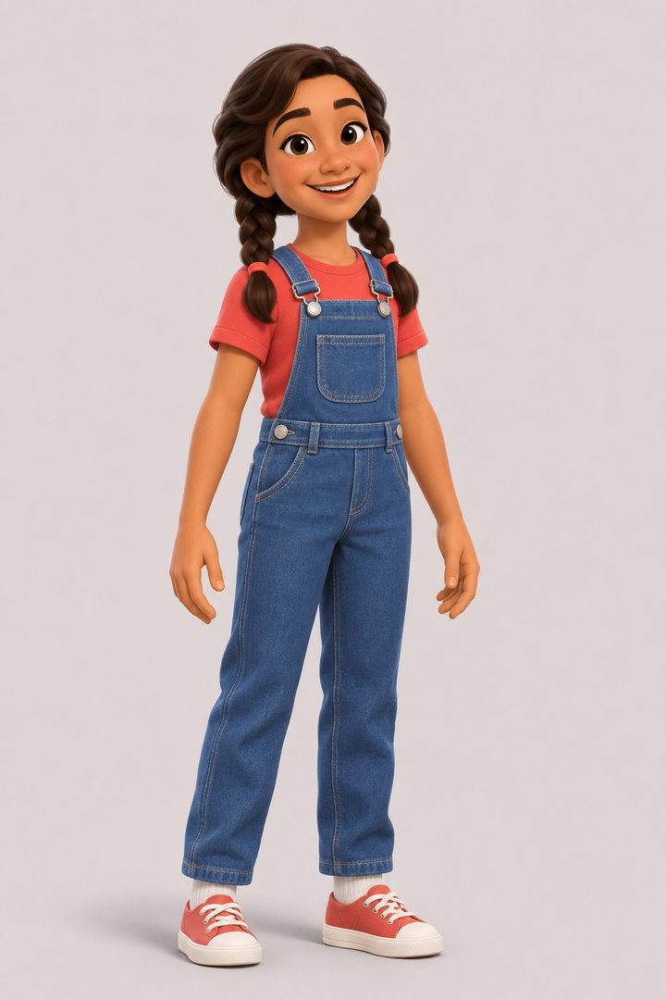
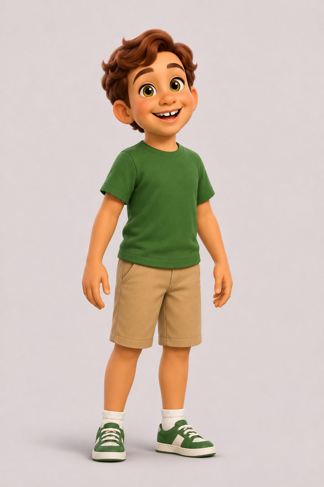

# Character gallery — official Maple House English reference previews

These **14 JPEG viewing copies are directly resized from the original locked v1 PNG character designs** in `Maple_House_Episode_01_Production_Package.zip`. They are **not new AI-generated faces**. The original lossless PNG ID masters and sheets remain in the owner's separately stored ZIP and must be used for model/reference consistency. These smaller images are suitable for convenient public GitHub viewing only. Original master hashes remain recorded by `preproduction/asset_manifest.json`. Task 5 video generation remains deferred.

| Permanent character | Portrait image | Reference sheet |
|---|---|---|
| **Dan** | [Open portrait](DAN_ID_preview.jpg) | [Open sheet](DAN_SHEET_preview.jpg) |
| **Maya** | [Open portrait](MAYA_ID_preview.jpg) | [Open sheet](MAYA_SHEET_preview.jpg) |
| **Nina** | [Open portrait](NINA_ID_preview.jpg) | [Open sheet](NINA_SHEET_preview.jpg) |
| **Leo** | [Open portrait](LEO_ID_preview.jpg) | [Open sheet](LEO_SHEET_preview.jpg) |
| **Ella** | [Open portrait](ELLA_ID_preview.jpg) | [Open sheet](ELLA_SHEET_preview.jpg) |
| **Max** | [Open portrait](MAX_ID_preview.jpg) | [Open sheet](MAX_SHEET_preview.jpg) |

## Cast lineups

- [Adult lineup — Dan, Maya, Nina](ADULTS_LINEUP_preview.jpg)
- [Children lineup — Leo, Ella, Max](CHILDREN_LINEUP_preview.jpg)

## Viewing contact sheet

### Dan

### Maya

### Nina

### Leo

### Ella

### Max

**Do not treat preview JPEGs as character ID masters.** To run image-to-video with the originally selected identities, obtain original `preproduction/characters/*_ID_v01.png` and `*_SHEET_v01.png` from the source ZIP, restore them with `tools/restore_archive.py`, and verify with the original source manifest. The previews are not meant to pass original PNG integrity validation.
